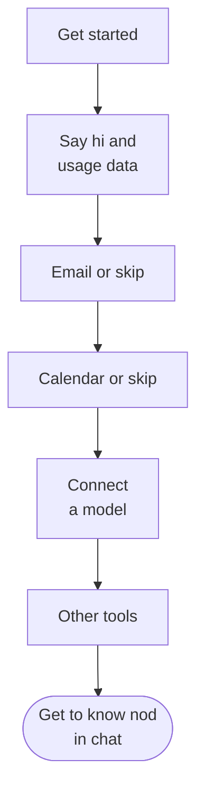

import { Steps } from '@astrojs/starlight/components';

This page walks you through nod's onboarding, your first tasks and what to do when nod needs you.

## Onboarding at a glance

nod opens onboarding the first time you use it. In the desktop app, you can connect accounts while nod prepares its computer. Optionally connect email and calendar, choose an AI provider, then connect other tools if useful. nod gets to know you in the chat after setup.

## Go through onboarding

<Steps>

1. **Get started.** Select **Get started** on the welcome screen. The desktop app starts its services as soon as it opens. If storage is still preparing, a loading screen appears and continues automatically when storage is ready.

2. **Say hi.** nod introduces itself and asks whether to **Share usage data**. It's off unless you turn it on, and you can change it later in **Settings → General**. Select **Let’s go**. The introduction stays visible until email setup is ready to open.

3. **Connect email (optional).** Choose **Gmail** or **Outlook** to get help with replies and follow-ups. Sign in and review the permissions, or select **Skip for now**. Setup continues after the connection is confirmed. Failed sign-in does not erase your earlier progress. If you go **Back**, **Manage** opens the same account manager as Apps to add another account or confirm removal. Select **Continue** when you’re ready.

4. **Connect a calendar (optional).** Choose **Google Calendar** or **Outlook Calendar** to get help planning around your schedule and finding time for meetings. If you already connected Outlook, that account is available here. **Manage** offers the same account controls as email and keeps you on this step. Select **Continue** or **Skip for now**.

5. **Connect a model.** Pick OpenAI, Anthropic or OpenRouter, or select **More providers** for Google Vertex AI, Amazon Bedrock, Azure OpenAI and **Your own server**. For OpenAI, select **Sign in with ChatGPT** to use your ChatGPT Plus or Pro plan. For OpenRouter, select **Sign in to OpenRouter** to have it create a key for nod. To paste a key for either one instead, select **Use an API key instead**. Anthropic takes an API key only, because Claude plans can't be used. Google Vertex AI needs an express mode key or a key bound to a service account with Vertex AI access in a project with billing enabled, Amazon Bedrock a key and Region, and Azure OpenAI an endpoint, deployment and key. See [Connect a model](/connect/models/) for what to prepare. A provider you already connected shows a check; select it to use that connection. In the desktop app or a source install, you can pick **Your own server** to use a [local model](/connect/local-models/): check the server address, add a key only if the server needs one, then select **Connect**. Your key is encrypted and never shown to the model. nod then shows the provider it connected to and the model it will use, its default when available. You can change the model there, or later in **Models**. If nod asks you to choose a model, choose one, then select **Continue**.

6. **Connect other apps (optional).** Browse the categories or search by name, then select **Connect** and review the access requested by each app. Connected apps keep their place in the list. **Manage** opens the same account manager as Apps, where you can add another account or disconnect one. A count beside **Continue** shows connected tools, excluding email. Each app counts once, even with multiple accounts. Select **Continue** whenever you’re ready, including with no apps connected. You can add apps anytime from **Apps**.

7. **Open at login.** In the desktop app, enable **Open at login**, then select **Start chatting**. The first chat requests desktop notifications once. You can change both preferences in **Settings → General**.

</Steps>

Setup finishes after the apps step in the web app, or after desktop preferences in the app. If the computer is still preparing, nod shows its progress and opens chat automatically when ready. If it is already ready, chat opens directly. A startup failure offers **Try again** without clearing your connections. If setup needs a model connection, nod sends you back to that step.

You can add more later from **Apps** and **Channels** in the sidebar. See [Connect apps](/connect/apps/) and [Channels](/use/channels/).

To revisit setup in your browser, open `/onboarding?replay=1` on your nod address. This returns to Welcome while keeping saved connections and settings.

In the desktop app, **Replay onboarding** opens setup again without deleting saved connections or preferences. While first setup is still running, it returns to your current step. For a separate empty test install on a Mac, use the [Mac test installer](/contribute/desktop-releases/#test-a-local-mac-build); it creates a new isolated profile.

## Start your first task

nod opens the conversation by asking what you're working on and what it can take off your plate. Reply in chat, or ask for a task directly. There is no required interview. What you share follows the normal chat memory settings. The opening message also links to **Channels**, where you can connect Telegram or WhatsApp to chat from your phone. Keep nod running on your computer so it can reply.

On a new desktop installation, nod requests notification permission when its first chat message appears, so it can tell you when work is ready or needs your attention. Your operating system may show a permission prompt. If you decline, nod does not ask again automatically; you can allow notifications in your system settings later. Existing notification choices are kept. Desktop alerts do not authorize app monitoring or scheduled work.

nod also prepares three starting task cards: one **Right now** and two **Ongoing** ideas. It reads a small sample from your connected tools to find work it could take off your plate. That might be a meeting to prepare for, a conversation waiting on you, or a recurring report. It uses only available read operations and respects your rules. Preparing suggestions never sends messages, changes your accounts, or starts ongoing work.

If a tool can't be read or has nothing useful to surface, nod suggests work without claiming it found something. You can ignore the cards and type any request.

Each card shows its connected tool, or **For you** for general suggestions. Select **Do it**, or **Set it up** on an ongoing card, to send the card's title to nod as your message. The card shows **On it…** while nod works, then **Done** or **Set up**.

:::note[A card isn't your permission]
The card's words are nod's, not yours. They can't on their own approve sending something to other people or deleting data, now or in a schedule the card set up.
:::

## Write a good first request

- **Say what done looks like:** "Compare these three suppliers and put the price and delivery time in a table."
- **Name the account or site:** "Download last month's invoice from billing.example.com with my saved login."
- **Say whether to send or draft:** "Draft a reply to the Northstar quote. Don't send it."
- **Ask for a schedule in plain words:** "Every Monday at 9 am, send me a summary of new client email."

You can keep writing while nod works. nod reads new messages before its next step.

## When nod needs you

| nod needs                    | What you see                                                       | What you do                              |
| ---------------------------- | ------------------------------------------------------------------ | ---------------------------------------- |
| A choice or a missing detail | A question in the chat                                             | Reply in the chat                        |
| Your OK for an action        | "Reply yes to go ahead, no to skip it, or tell me what to change." | Reply **yes** or **no**                  |
| A password, code or card     | A private form, such as **Sign in** or **Approve payment**         | Enter it in the form, not the chat       |
| You to use a website         | A live browser view in chat                                        | Take over, then select **Return to nod** |

What you type in a private form goes to the website, not to the model. nod never asks for a password, code, card number or API key in the chat. See [Approvals and the trust check](/trust/approvals/) and [Vault](/trust/vault/).

## Stop nod

To stop nod, select **Stop**, the square button next to the send button. It shows while nod is working. nod stops the current work and cancels anything still queued. Stopping can't undo an action that already started, such as an email that's already on its way.

## Related resources

- [What is nod](/get-started/what-is-nod/)
- [Key concepts](/get-started/glossary/)
- [Chat with nod](/use/chat/)
- [Connect a model](/connect/models/)
- [Trust and Vault](/trust/)
