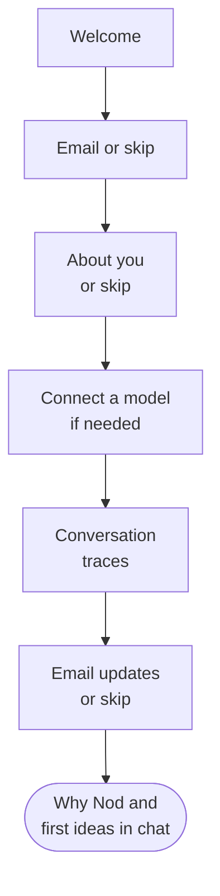

import { Steps } from '@astrojs/starlight/components';

This page walks you through Nod's onboarding, your first tasks and what to do when Nod needs you.

## Onboarding at a glance

Nod opens onboarding the first time you set up an assistant. After the welcome screen, Nod starts preparing its private computer in the background while you optionally connect email, tell it a bit about yourself, choose an AI provider if none is set up yet, decide whether to share conversation traces, and optionally leave an email address for updates. If you connected email, Nod reads a small sample of it in the meantime to suggest first ideas in chat.

For a local desktop assistant, you connect accounts while Nod prepares its computer. When you connect to a server, setup and saved connections belong to that server. A server that already completed onboarding opens your existing chat.

## Go through onboarding

<Steps>

1. **Choose your assistant.** The welcome screen shows what sets Nod apart, including that Nod checks your connected apps in the background with your model, so those checks count as model usage. When **Share usage data** is on, it also asks you to keep usage data on; select **How Nod uses your data** to see what it includes. Select **Get started**. In the desktop app, select **Connect to a server** instead to use an existing assistant. The desktop app starts preparing its private computer as soon as the welcome screen opens, and the web app as soon as you continue. If the desktop app isn't ready to save your choices yet, it shows a loading screen with the current setup stage. Onboarding opens as soon as it can save them, while the workspace and browser continue preparing in the background.

2. **Connect email (optional).** Select **Connect via Composio** next to **Gmail** or **Outlook**, then sign in and review the permissions, or select **Skip for now**. Google or Microsoft asks you to allow [Composio](/connect/apps/), the service Nod uses to connect apps, as the note under the buttons says. Setup continues after the connection is confirmed. Once you've also answered or skipped the About you questions, Nod starts reading a small sample of recent email in the background to learn what you work on and suggest first ideas. From that sample it keeps only the names of apps that send you notifications, never the email itself. Failed sign-in does not erase your earlier progress. If you go **Back**, **Manage** opens the same account manager as Apps.

3. **Tell Nod about yourself (optional).** Nod asks where you'd like its help, what you do, how big your company is, and what you'd like to take off your plate. You can choose more than one role and more than one task, or choose **Something else** to type your own. If you run a business, freelance, or work at an agency, Nod also asks whether the help is for you, your clients, or both. **Mostly personal life** skips the company question. **Not now** skips a question, and the pen next to an answer lets you change it. If memory is on, Nod saves your answers as one note in [Memory](/use/memory/) and uses them for your first ideas in chat. Anything you type that looks like a password, key, or card number is left out. When **Share usage data** is on, Nod says before the first question that your answers reach the Nod team as usage data. It saves the fixed choices on this installation's analytics profile and never includes what you type in **Something else**; see [Analytics](/deploy/analytics/). If analytics is unavailable, you can retry saving those choices or continue without sharing them.

4. **Connect a model (only if none is set up).** Choose a provider, or select **More providers** to search all supported services. The **OpenAI** row notes that you can sign in with a ChatGPT Plus or Pro plan at no extra cost. See [Connect a model](/connect/models/) for required credentials and cloud settings. Nod skips this step when a model connection already works, including one configured through server environment variables.

   To use an [OpenAI-compatible model server](/connect/local-models/), choose **Your own server** and enter an address reachable from Nod's server. Choose a model if prompted, then select **Continue**.

   While setting up a provider, **Back** returns to the provider list. From that list, **Back** returns to About you.

5. **Help improve Nod.** Nod asks whether you'll share conversation traces, and says that it shares basic usage data, which is on by default. Select **Share traces** or **Not now**; either one saves your choice and continues, and traces stay off unless you share them. To see what each one includes and what's never shared, select **How Nod uses your data**. You can change both later in **Settings → Privacy & data**; see [What Nod shares with n8n](/trust/privacy/#what-nod-shares-with-n8n). Traces appear only where they're available.

6. **Email updates (optional).** Where the email option is available, enter an address and tick the consent box if you want n8n GmbH to email you about Nod and other n8n products. The box also says that n8n links your email to your Nod usage data. **Start chatting**, or **Continue** in the desktop app, submits the address and finishes setup. Leave the address blank to finish without submitting it. If submission fails, choose **Try again** or **Continue to chat** without retrying. Nod stores a submitted address and consent record on a PostHog person profile linked to this installation's usage, only while **Share usage data** is on. Submitting the form sends no email immediately. You can withdraw at any time through the unsubscribe link in every email or at privacy@n8n.io. Discord and the n8n Labs forum are secondary links here and are also in **Settings → General**.

</Steps>

Setup finishes after the last step in the web app or a desktop client connected to a server. For a local assistant, Nod also turns on **Open at login** so it's ready when you sign in to your computer. You can turn it off in **Settings → General**. If its computer is still preparing, Nod shows a loading screen and opens chat when ready. Finishing setup always opens chat, even while first ideas are still being prepared. A startup failure offers **Try again** without clearing your connections. If setup needs a model connection, Nod sends you back to that step.

You can add more later from **Apps** and **Channels** in the sidebar. See [Connect apps](/connect/apps/) and [Channels](/use/channels/).

To revisit setup in your browser, open `/onboarding?replay=1` on your Nod address. This returns to Welcome while keeping saved connections and settings.

In the desktop app, **Replay onboarding** opens setup again without deleting saved connections or preferences. While first setup is still running, it returns to your current step. Finishing setup opens chat rather than following links received during setup, including the Apps return link from sign-in. For a separate empty test install on a Mac, use the [Mac test installer](/contribute/desktop-releases/#test-a-local-mac-build); it creates a new isolated profile.

## Start your first task

Nod opens the conversation with a short hello: tell it what you'd like off your plate or start with an idea, and it checks with you before it sends, buys or deletes anything you didn't ask for. Reply in chat, or ask for a task directly. There is no required interview. What you share follows the normal chat memory settings.

After the first chat introduction, choose **Enable notifications** to hear from Nod while you’re away, or **Not now** to dismiss the offer. Nod does not enable notifications just because you open chat. In the web app, your browser asks for permission after you select Enable. Your browser and system settings control delivery. You can change the choice in **Settings → General**. Enabling alerts does not authorize app monitoring or scheduled work.

Nod then shows idea cards. The first three are one to do once and two that repeat. When your connected tools, such as email, have useful recent activity, they're based on a small sample of it; otherwise they're general suggestions. Nod's message above them says where it looked. The cards after them add common ideas, such as a morning brief on your day or a Friday recap. A picked idea might be an upcoming meeting to prepare for, a conversation waiting on you, or a recurring report. Meeting suggestions use the current time and, when known, your time zone to avoid preparation for events that have already started, ended, or been cancelled. It uses only available read operations and respects your rules. Preparing suggestions never sends messages, changes your accounts, or starts ongoing work.

If a tool can't be read or has nothing useful to surface, Nod suggests work without claiming it found something. You can ignore the cards and type any request.

Under the cards, Nod says you can ask it for more ideas. If you get notification email from apps you haven't connected, such as Slack, GitHub or Linear, it names up to three of them, since connecting them helps it find more. To get more ideas, just ask in the chat. If apps that would show Nod more of your work aren't connected yet, Nod first lists up to three of them, each with a **Connect** button below its message. Connect any of them, then ask again: Nod looks through the newly connected apps and suggests ideas from what it finds. With nothing useful left to connect, Nod suggests ideas right away.

The whole card is the button. A card that works in one of your tools shows that tool's logo under its title, and a card that repeats shows **Repeats**. Select a card to send its title to Nod as your message. The card shows **On it…** while its turn or saved task works. It shows **Waiting for you** when that work needs your attention. **Waiting** means a saved task waits for someone or something else. **Done** or **Set up** means its saved tasks are complete. **Request sent** means the chat turn ended without a saved task. Read the delivered result to check what Nod completed.

Nod keeps the saved tasks started from these cards available with recent tasks, so a card can still show completion when you return to the first conversation later.

You can get useful work without connected apps. For example, paste three supplier quotes and ask Nod to compare their prices and delivery times. Include your deadline and ask for a recommendation. Check the delivered comparison in chat. A starting card or an acknowledgement is not the result.

Use **Send feedback** in chat when you want to report a problem or suggest a change. New setup does not open a feedback hint over your first result.

:::note[A card isn't your permission]
The card's words are Nod's, not yours. They can't on their own approve sending something to other people or deleting data, now or in a schedule the card set up.
:::

## Write a good first request

- **Say what done looks like:** "Compare these three suppliers and put the price and delivery time in a table."
- **Name the account or site:** "Download last month's invoice from billing.example.com with my saved login."
- **Say whether to send or draft:** "Draft a reply to the Northstar quote. Don't send it."
- **Ask for a schedule in plain words:** "Every Monday at 9 am, send me a summary of new client email."

You can keep writing while Nod works. Nod reads new messages before its next step.

## When Nod needs you

| Nod needs                    | What you see                                                       | What you do                              |
| ---------------------------- | ------------------------------------------------------------------ | ---------------------------------------- |
| A choice or a missing detail | A question in the chat                                             | Reply in the chat                        |
| Your OK for an action        | "Reply yes to go ahead, no to skip it, or tell me what to change." | Reply **yes** or **no**                  |
| A password, code or card     | A private form, such as **Sign in** or **Approve payment**         | Enter it in the form, not the chat       |
| You to use a website         | A live browser view in chat                                        | Take over, then select **Return to Nod** |

What you type in a private form goes to the website, not to the model. Nod never asks for a password, code, card number or API key in the chat. See [Approvals and the trust check](/trust/approvals/) and [Vault](/trust/vault/).

## Stop Nod

To stop Nod, select **Stop**, the square button next to the send button. It shows while Nod is working. Nod stops the current work and cancels anything still queued. Stopping can't undo an action that already started, such as an email that's already on its way.

## Related resources

- [What is Nod](/get-started/what-is-nod/)
- [Key concepts](/get-started/glossary/)
- [Chat with Nod](/use/chat/)
- [Connect a model](/connect/models/)
- [Trust and Vault](/trust/)
