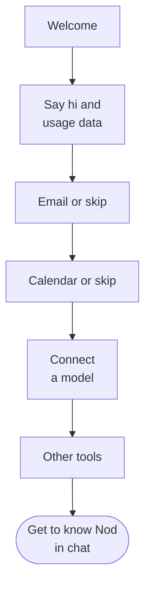

import { Steps } from '@astrojs/starlight/components';

This page walks you through Nod's onboarding, your first tasks and what to do when Nod needs you.

## Onboarding at a glance

Nod opens onboarding the first time you set up an assistant. Optionally connect email and calendar, choose an AI provider, then connect other tools if useful. Nod gets to know you in chat after setup.

For a local desktop assistant, you can connect accounts while Nod prepares its computer. When you connect to a server, setup and saved connections belong to that server. A server that already completed onboarding opens your existing chat.

## Go through onboarding

<Steps>

1. **Choose your assistant.** In the desktop app, select **Use this computer** for a local assistant or **Connect to a server**. In the web app, select **Get started**. Local setup prepares its services in the background after your choice. If storage is still preparing, Nod waits and continues automatically when it's ready.

2. **Say hi.** Nod introduces itself and asks whether to **Share usage data**. It's off unless you turn it on, and you can change it later in **Settings → General**. Select **Let’s go**. For a local desktop assistant, the introduction stays visible until email setup is ready to open.

3. **Connect email (optional).** Choose **Gmail** or **Outlook** to get help with replies and follow-ups. Sign in and review the permissions, or select **Skip for now**. Setup continues after the connection is confirmed. Failed sign-in does not erase your earlier progress. If you go **Back**, **Manage** opens the same account manager as Apps to add another account or confirm removal. Select **Continue** when you’re ready.

4. **Connect a calendar (optional).** Choose **Google Calendar** or **Outlook Calendar** to get help planning around your schedule and finding time for meetings. If you already connected Outlook, that account is available here. **Manage** offers the same account controls as email and keeps you on this step. Select **Continue** or **Skip for now**.

5. **Connect a model.** Choose a provider, or select **More providers** to search all supported services. Follow its sign-in or API-key form. See [Connect a model](/connect/models/) for required credentials and cloud settings. Existing connections, including those configured through server environment variables, are available here.

   To use an [OpenAI-compatible model server](/connect/local-models/), choose **Your own server** and enter an address reachable from Nod's server. If Nod shows **Key saved for**, access will be checked on first use. Choose a model if prompted, then select **Continue**. You can change the model here or later in **Models**.

   While setting up a provider, **Back** returns to the provider list. From that list, **Back** returns to calendar setup.

6. **Connect other apps (optional).** Browse the categories or search by name, then select **Connect** and review the access requested by each app. Connected apps keep their place in the list. **Manage** opens the same account manager as Apps, where you can add another account or disconnect one. A count shows connected tools, excluding email. Each app counts once, even with multiple accounts. Finish this step whenever you’re ready, including with no apps connected. You can add apps anytime from **Apps**.

7. **Open at login for a local assistant.** Enable **Open at login**, then select **Start chatting**. The first chat introduction enables desktop notifications on a new profile. You can change both preferences in **Settings → General**.

</Steps>

Setup finishes after the apps step in the web app or a desktop client connected to a server. A local assistant also requires desktop preferences. If its computer is still preparing, Nod shows progress and opens chat when ready. A startup failure offers **Try again** without clearing your connections. If setup needs a model connection, Nod sends you back to that step.

You can add more later from **Apps** and **Channels** in the sidebar. See [Connect apps](/connect/apps/) and [Channels](/use/channels/).

To revisit setup in your browser, open `/onboarding?replay=1` on your Nod address. This returns to Welcome while keeping saved connections and settings.

In the desktop app, **Replay onboarding** opens setup again without deleting saved connections or preferences. While first setup is still running, it returns to your current step. For a separate empty test install on a Mac, use the [Mac test installer](/contribute/desktop-releases/#test-a-local-mac-build); it creates a new isolated profile.

## Start your first task

Nod opens the conversation by asking what you're working on and what it can take off your plate. Reply in chat, or ask for a task directly. There is no required interview. What you share follows the normal chat memory settings. The opening message also links to **Channels**, where you can connect Telegram or WhatsApp to chat from your phone. Keep your local assistant or server running so it can reply.

On a new desktop profile, Nod enables notifications when its first chat introduction appears, so it can tell you when work is ready or needs your attention. macOS may ask for permission; your system settings control delivery. If you decline, Nod does not ask again automatically. You can allow notifications in your system settings later. Existing notification choices are kept. Desktop alerts do not authorize app monitoring or scheduled work.

Nod also prepares three starting task cards: one **Right now** and two **Ongoing** ideas. It reads a small sample from your connected tools to find work it could take off your plate. That might be an upcoming meeting to prepare for, a conversation waiting on you, or a recurring report. Meeting suggestions use the current time and, when known, your time zone to avoid preparation for events that have already started, ended, or been cancelled. It uses only available read operations and respects your rules. Preparing suggestions never sends messages, changes your accounts, or starts ongoing work.

If a tool can't be read or has nothing useful to surface, Nod suggests work without claiming it found something. You can ignore the cards and type any request.

Each card shows its connected tool, or **For you** for general suggestions. Select **Do it**, or **Set it up** on an ongoing card, to send the card's title to Nod as your message. The card shows **On it…** while its turn or saved task works. It shows **Waiting for you** when that work needs your attention. **Waiting** means a saved task waits for someone or something else. **Done** or **Set up** means its saved tasks are complete. **Request sent** means the chat turn ended without a saved task. Read the delivered result to check what Nod completed.

Nod keeps the saved tasks started from these cards available with recent tasks, so a card can still show completion when you return to the first conversation later.

You can get useful work without connected apps. For example, paste three supplier quotes and ask Nod to compare their prices and delivery times. Include your deadline and ask for a recommendation. Check the delivered comparison in chat. A starting card or an acknowledgement is not the result.

Use **Send feedback** in chat when you want to report a problem or suggest a change. New setup does not open a feedback hint over your first result.

:::note[A card isn't your permission]
The card's words are Nod's, not yours. They can't on their own approve sending something to other people or deleting data, now or in a schedule the card set up.
:::

## Write a good first request

- **Say what done looks like:** "Compare these three suppliers and put the price and delivery time in a table."
- **Name the account or site:** "Download last month's invoice from billing.example.com with my saved login."
- **Say whether to send or draft:** "Draft a reply to the Northstar quote. Don't send it."
- **Ask for a schedule in plain words:** "Every Monday at 9 am, send me a summary of new client email."

You can keep writing while Nod works. Nod reads new messages before its next step.

## When Nod needs you

| Nod needs                    | What you see                                                       | What you do                              |
| ---------------------------- | ------------------------------------------------------------------ | ---------------------------------------- |
| A choice or a missing detail | A question in the chat                                             | Reply in the chat                        |
| Your OK for an action        | "Reply yes to go ahead, no to skip it, or tell me what to change." | Reply **yes** or **no**                  |
| A password, code or card     | A private form, such as **Sign in** or **Approve payment**         | Enter it in the form, not the chat       |
| You to use a website         | A live browser view in chat                                        | Take over, then select **Return to Nod** |

What you type in a private form goes to the website, not to the model. Nod never asks for a password, code, card number or API key in the chat. See [Approvals and the trust check](/trust/approvals/) and [Vault](/trust/vault/).

## Stop Nod

To stop Nod, select **Stop**, the square button next to the send button. It shows while Nod is working. Nod stops the current work and cancels anything still queued. Stopping can't undo an action that already started, such as an email that's already on its way.

## Related resources

- [What is Nod](/get-started/what-is-nod/)
- [Key concepts](/get-started/glossary/)
- [Chat with Nod](/use/chat/)
- [Connect a model](/connect/models/)
- [Trust and Vault](/trust/)
