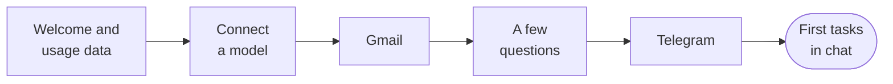

import { Steps } from '@astrojs/starlight/components';

This page walks you through Otto's onboarding, your first tasks and what to do when Otto needs you.

## Onboarding at a glance

Otto opens onboarding the first time you use it. In the desktop app, you can answer and connect accounts while Otto prepares its computer. Connect an AI provider and Gmail, then answer the setup questions. Telegram is optional.

## Go through onboarding

<Steps>

1. **Say hi.** Otto introduces itself and asks whether to **Share usage data**. It's off unless you turn it on, and you can change it later in **Settings → General**. Select **Let's go**.

2. **Connect a model.** Pick OpenAI, Anthropic or OpenRouter. Select **Sign in with ChatGPT** or **Connect OpenRouter** to use your account, or paste an API key. In the desktop app or a source install, you can instead pick **OpenAI-compatible** to use a [local model](/connect/local-models/): check the server address, then select **Connect**. Your key is encrypted and never shown to the model. Otto uses your provider’s default model when available. You can change it later in **Models**. Setup moves on once the new connection and model are ready; if a model choice is still needed, select one and then **Continue**.

3. **Connect Gmail.** On desktop or a personal web install, choose **Easy Connect** and sign in with an allowed Google account, or save your own Composio key. Then select **Connect** for Gmail and approve its separate permissions. Setup continues after Gmail connects. If sign-in fails, retry or change your connection setup; your earlier answers stay saved.

4. **Answer a few questions.** Otto says hello, then asks what you're working on and what it can take off your plate, and sometimes what you're aiming for. If you connected Gmail and its inbox summary is ready, it also mentions what it noticed in your inbox. It asks at most three questions and keeps an encrypted draft so you can resume after closing Otto. Select **Continue** to save your answers to memory and remove the encrypted draft text. A browser session copy lets you revisit your answers until setup finishes or the tab closes. Select **Change my answers** to discard it and start again. A completion record lasts 30 days so returning to setup doesn't ask you to save the interview again.

   If a draft can’t be opened, **Try again** keeps it. **Start interview again** discards only that draft; saved connections and settings stay in place.

5. **Connect Telegram (optional).** Follow the numbered steps. Scan the code or select **Open Telegram** to open BotFather, send `/newbot`, and choose a name and a username ending in `bot`. Select **I have my token**, paste BotFather's reply, and select **Connect bot**. In **Open your bot**, scan the new code or open Telegram, then press **Start**. Check your account details and select **Confirm**.

6. **Choose desktop preferences.** In the desktop app, choose whether Otto can notify you when work finishes or needs your attention, and whether it should open when you sign in to your computer. Both switches are optional and save as soon as you change them. Select **Continue** after each choice. You can change both later in **Settings → General**.

7. Select **Start chatting** to finish setup. If the computer is still preparing, Otto shows its progress and opens chat when ready. If you enabled notifications and switched away, it notifies you when setup finishes.

</Steps>

You can add more later from **Apps** and **Channels** in the sidebar. See [Connect apps](/connect/apps/) and [Channels](/use/channels/).

To revisit setup in your browser, open `/onboarding?replay=1` on your Otto address. This returns to Welcome while keeping saved connections, settings and your unfinished interview. Use **Change my answers** to restart the interview.

In the desktop app, **Replay onboarding** opens the questions again without deleting saved connections or preferences. While first setup is still running, it returns to your current step. For a separate empty test install on a Mac, use the [Mac test installer](/contribute/desktop-releases/#test-a-local-mac-build); it creates a new isolated profile.

## Start your first task

Otto greets you in the chat and lines up three first tasks as cards: one it can finish **Right now**, and two **Ongoing** jobs it keeps doing for you, such as a morning briefing or a weekly check-in. It bases them on your answers and, if you connected Gmail, on a short inbox summary prepared during setup. If no summary is ready, it uses recent inbox subjects and snippets instead. If a card doesn't come out right, you get a standard one in its place, such as **Plan my next two weeks**.

Each card shows where the task comes from (**Gmail**, **For you** or **Telegram**). Select **Do it**, or **Set it up** on an ongoing card, to send the card's title to Otto as your message. The card shows **On it…** while Otto works, then **Done** or **Set up**. You can also ignore the cards and type any request.

:::note[A card isn't your permission]
The card's words are Otto's, not yours. They can't on their own approve sending something to other people or deleting data, now or in a schedule the card set up.
:::

## Write a good first request

- **Say what done looks like:** "Compare these three suppliers and put the price and delivery time in a table."
- **Name the account or site:** "Download last month's invoice from billing.example.com with my saved login."
- **Say whether to send or draft:** "Draft a reply to the Northstar quote. Don't send it."
- **Ask for a schedule in plain words:** "Every Monday at 9 am, send me a summary of new client email."

You can keep writing while Otto works. Otto reads new messages before its next step.

## When Otto needs you

| Otto needs                   | What you see                                                       | What you do                        |
| ---------------------------- | ------------------------------------------------------------------ | ---------------------------------- |
| A choice or a missing detail | A question in the chat                                             | Reply in the chat                  |
| Your OK for an action        | "Reply yes to go ahead, no to skip it, or tell me what to change." | Reply **yes** or **no**            |
| A password, code or card     | A private form, such as **Sign in** or **Approve payment**         | Enter it in the form, not the chat |
| You to use a website         | An **Open browser** link                                           | Take over, then select **Done**    |

What you type in a private form goes to the website, not to the model. Otto never asks for a password, code, card number or API key in the chat. See [Approvals and the trust check](/trust/approvals/) and [Vault](/trust/vault/).

## Stop Otto

To stop Otto, select **Stop**, the square button next to the send button. It shows while Otto is working. Otto stops the current work and cancels anything still queued. Stopping can't undo an action that already started, such as an email that's already on its way.

## Related resources

- [What is Otto](/get-started/what-is-otto/)
- [Key concepts](/get-started/glossary/)
- [Chat with Otto](/use/chat/)
- [Connect a model](/connect/models/)
- [Trust and Vault](/trust/)
