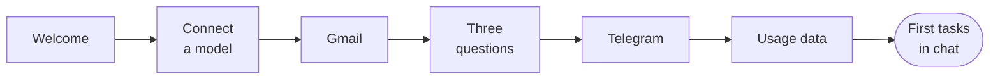

import { Steps } from '@astrojs/starlight/components';

This page walks you through Otto's onboarding, your first tasks and what to do when Otto needs you.

## Onboarding at a glance

Otto opens onboarding the first time you use it. In the desktop app, it starts once Otto has prepared its computer. It's a short chat, and you can skip Gmail and Telegram until later.

## Go through onboarding

<Steps>

1. **Say hi.** Otto introduces itself. Select **Let's go**.

2. **Connect a model.** Pick OpenAI, Anthropic or OpenRouter. Select **Sign in with ChatGPT** or **Connect OpenRouter** to use your account, or paste an API key. Your key is encrypted and never shown to the model. Otto picks a recommended model, which you can change. Select **Continue**.

3. **Connect Gmail (optional).** On desktop or a personal web install, choose **Easy Connect** and sign in with an allowed Google account, or save your own Composio key. Then select **Connect** for Gmail and approve its separate permissions. You can also select **Skip for now**.

4. **Answer three questions.** Otto asks what you're working on, what you're aiming for and what it can take off your plate. Type a short answer to each. Otto shows a summary and saves it to its memory. Select **Continue**, or **Change my answers** to start again.

5. **Connect Telegram (optional).** Scan the code to open BotFather, send `/newbot` and pick a name. Select **I have my token**, paste the token and select **Save**. Then scan the new code and send `/start` to your bot. When Otto asks **Is this you?**, select **Confirm**.

6. Select **Start chatting** to finish setup.

</Steps>

You can add more later from **Apps** and **Channels** in the sidebar. See [Connect apps](/connect/apps/) and [Channels](/use/channels/).

To restart unfinished setup in your browser, open `/onboarding?replay=1` on your Otto address. This clears the saved onboarding step and unfinished answers from that browser. Your saved model connections, app accounts and other settings stay in place.

## Start your first task

Otto greets you in the chat and lines up three first tasks as cards: one it can finish **Right now**, and two **Ongoing** jobs it keeps doing for you, such as a morning briefing or a weekly check-in. It bases them on your answers and, if you connected Gmail, on a short inbox summary prepared during setup on desktop and personal web installs. If no summary is ready, or you use hosted Otto, it uses recent inbox subjects and snippets instead. If a card doesn't come out right, you get a standard one in its place, such as **Plan my next two weeks**.

Each card shows where the task comes from (**Gmail**, **For you** or **Telegram**). Select **Do it**, or **Set it up** on an ongoing card, to send the card's title to Otto as your message. The card shows **On it…** while Otto works, then **Done** or **Set up**. You can also ignore the cards and type any request.

When your first task is done, Otto suggests a few other things it can do for you. Ask for any of them in your own words.

:::note[A card isn't your permission]
The card's words are Otto's, not yours. They can't on their own approve sending something to other people or deleting data, now or in a schedule the card set up.
:::

## Write a good first request

- **Say what done looks like:** "Compare these three suppliers and put the price and delivery time in a table."
- **Name the account or site:** "Download last month's invoice from billing.example.com with my saved login."
- **Say whether to send or draft:** "Draft a reply to the Northstar quote. Don't send it."
- **Ask for a schedule in plain words:** "Every Monday at 9 am, send me a summary of new client email."

You can keep writing while Otto works. Otto reads new messages before its next step.

## When Otto needs you

| Otto needs                   | What you see                                                       | What you do                        |
| ---------------------------- | ------------------------------------------------------------------ | ---------------------------------- |
| A choice or a missing detail | A question in the chat                                             | Reply in the chat                  |
| Your OK for an action        | "Reply yes to go ahead, no to skip it, or tell me what to change." | Reply **yes** or **no**            |
| A password, code or card     | A private form, such as **Sign in** or **Approve payment**         | Enter it in the form, not the chat |
| You to use a website         | An **Open browser** link                                           | Take over, then select **Done**    |

What you type in a private form goes to the website, not to the model. Otto never asks for a password, code, card number or API key in the chat. See [Approvals and the trust check](/trust/approvals/) and [Vault](/trust/vault/).

## Stop Otto

To stop Otto, select **Stop**, the square button next to the send button. It shows while Otto is working. Otto stops the current work and cancels anything still queued. Stopping can't undo an action that already started, such as an email that's already on its way.

## Related resources

- [What is Otto](/get-started/what-is-otto/)
- [Key concepts](/get-started/glossary/)
- [Chat with Otto](/use/chat/)
- [Connect a model](/connect/models/)
- [Trust and Vault](/trust/)
