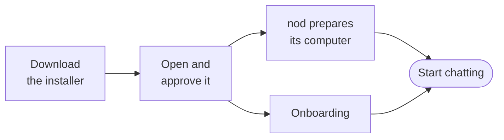

import { Badge, Steps, TabItem, Tabs } from '@astrojs/starlight/components';

The desktop app is the quickest way to run nod. You don't need Node.js, Docker or developer tools.

Before you start, have a model connection ready: an OpenAI, Anthropic or OpenRouter API key, an Amazon Bedrock key and Region, a Google Vertex AI key, an Azure OpenAI endpoint, deployment and key, a ChatGPT Plus or Pro plan, or a [local model](/connect/local-models/) server such as Ollama. Paid providers bill you for use. A local model costs nothing per request.



## Install nod

<Tabs syncKey="os">
<TabItem label="Mac" icon="apple">

You need macOS 14 or later, on Apple silicon or Intel. The app and its runtime are about 1.8 GB to download.

<Steps>

1. Open the [releases page](https://github.com/n8n-io/nod/releases) and find the newest **nod** release. Download `nod-arm64.dmg` for Apple silicon or `nod-x64.dmg` for Intel.

2. Open the DMG, drag **nod** to **Applications** and open it from there.

3. The first time, macOS asks whether to open an app downloaded from the internet. Select **Open**.

4. Welcome opens while nod prepares its computer. Select **Get started**; if storage is still preparing, nod waits and continues automatically. Choose whether to share usage data, optionally connect email and calendar, then choose a model. You can connect other tools and Telegram or WhatsApp while the workspace and browser finish starting. Enable **Open at login** to finish setup. nod gets to know you in chat, where it requests notification permission once on a new installation. You can change the desktop preferences later in Settings. If macOS asks for your keychain password, approve it so nod can protect your saved keys.

5. Keep your internet connection on. When setup and the computer are ready, nod opens your chat with the connections and answers you just saved. See [Your first conversation](/get-started/first-conversation/).

</Steps>

<details>
<summary>Install from Terminal instead</summary>

You can install the latest release on Apple silicon or Intel with one command. Quit nod first, then paste this into Terminal:

```sh title="Terminal"
(
  installer="$(mktemp)" || exit
  trap 'rm -f "$installer"' EXIT
  curl -q --proto '=https' --tlsv1.2 -fsSL https://internal.users.n8n.cloud/webhook/nod/install -o "$installer" && /bin/sh "$installer"
)
```

Run it as your normal user, without `sudo`. It verifies the download, installs to `/Applications/nod.app`, and opens nod. Your existing data stays in place. You don't need a GitHub account.

</details>

</TabItem>
<TabItem label="Windows" icon="seti:windows">

<Badge text="Preview" variant="caution" /> You need Windows 11 x64, WSL 2 with hardware
virtualization, and at least 20 GB of free disk space. The app and its runtime are about 2.1 GB to
download.

<Steps>

1. Open the [releases page](https://github.com/n8n-io/nod/releases) and find the newest **nod** release. Download `nod-Setup-x64.exe`.

2. Run `nod-Setup-x64.exe`. The preview isn't signed, so Windows can show a publisher warning. The installer adds nod to the Start menu.

3. Welcome opens while nod prepares its computer. Select **Get started**; if storage is still preparing, nod waits and continues automatically. Choose whether to share usage data, optionally connect email and calendar, then choose a model. You can connect other tools and Telegram or WhatsApp while the workspace and browser finish starting. Enable **Open at login** to finish setup. nod gets to know you in chat, where it requests notification permission once on a new installation. You can change the desktop preferences later in Settings.

4. If nod needs WSL, follow its setup instructions and approve the administrator request. If Windows needs a restart, open nod again afterwards; your saved connections and settings are kept.

5. Keep your internet connection on. When setup and the computer are ready, nod opens your chat with your saved connections and answers. See [Your first conversation](/get-started/first-conversation/).

</Steps>

<details>
<summary>Install from PowerShell instead</summary>

Quit nod first, then paste this into PowerShell:

```powershell title="PowerShell"
irm https://internal.users.n8n.cloud/webhook/nod/install-windows | iex
```

Use a normal PowerShell window, not **Run as administrator**. It verifies the installer and runtime file, installs nod, and opens it. Your existing data stays in place. You don't need a GitHub account.

</details>

</TabItem>
</Tabs>

## Keep nod running

Closing the window keeps nod running in the menu bar on a Mac, or the tray on Windows. **Quit nod** stops nod and its private computer.

| nod is                                  | What runs                                       |
| --------------------------------------- | ----------------------------------------------- |
| Open, or closed to the menu bar or tray | Chat, channels, schedules and background checks |
| Quit, or your computer is asleep        | Nothing, until nod is open and awake again      |

If you rely on scheduled tasks, turn on **Open at login** in **Settings → General**.

## Update nod

nod updates itself. It checks after it starts, every six hours while it's open and after your computer wakes. To check now, select **Check for Updates…** in the **nod** menu on a Mac, or from the menu bar or tray icon.

When an update is ready, choose **Restart** to install it or **Later** to keep working. If nod is in the middle of a task, it asks before restarting, and you can ask it to continue afterwards. nod keeps your profile, keys and data. A completed installation does not repeat onboarding after an update.

On Windows, the restart runs the new installer in the background and opens nod again when it's done.

## Where your data lives

nod's database, workspace and browser stay on your computer. Requests go to the model provider and apps you choose. Managed app requests and results pass through n8n's hosted connection service and Composio. Usage analytics leave only if you turn on **Share usage data** during setup or in **Settings → General**. Conversation traces leave only if you turn on **Share conversation traces** in **Settings → General**. See [Your data and privacy](/trust/privacy/).

nod starts with a fresh profile and doesn't import data from a source install.

|                       | Mac                                                | Windows                                     |
| --------------------- | -------------------------------------------------- | ------------------------------------------- |
| App data and settings | `~/Library/Application Support/nod/profiles/local` | `%APPDATA%\nod\profiles\local`              |
| Private computer      | `~/.nod-desktop/<profile id>`                      | A WSL distribution named `nod-<profile id>` |
| Saved keys            | Encrypted with the macOS key store                 | Encrypted with Windows DPAPI                |

## Remove nod

Moving nod to the Trash or uninstalling it keeps your data, so a later install opens where you left off. To delete everything first:

1. Select **Remove all data** in **Settings → General**. If nod can't finish setup, select **Remove all data…** in the **nod** menu instead.
2. Confirm. nod deletes your profile and private computer, then quits.
3. Move nod to the Trash on a Mac, or uninstall it in **Settings → Apps** on Windows.

On a Mac, nod keeps the runtime it downloaded, so a new install doesn't download it again, and its entry in the key store. Neither holds your data. Apps you connected may still list nod until you remove it there.

If you deleted nod's folders by hand, nod removes the private computer they leave behind the next time it opens.

## Troubleshooting

| Problem                            | Try this                                                                                                          |
| ---------------------------------- | ----------------------------------------------------------------------------------------------------------------- |
| macOS blocks the first launch      | Install the newest release. On a managed Mac, ask your IT team to allow nod.                                      |
| Setup stops with an error          | Select **Try again**. If it fails again, send the error with **Send feedback…** from the menu bar or tray icon.   |
| nod asks for a runtime file        | Select **Choose runtime file** and pick the `nod-Runtime-…` file from the same release.                           |
| Windows can't download the runtime | Put `nod-Runtime-win32-x64.tar.gz` from the same release next to `nod-Setup-x64.exe` and run the installer again. |
| A scheduled task didn't run        | Check that nod was open and your computer was awake at that time.                                                 |

:::caution
Don't delete the profile or the private computer to fix a problem. You'd lose your conversations, workspace and saved keys.
:::

## Related resources

- [What is nod](/get-started/what-is-nod/)
- [Your first conversation](/get-started/first-conversation/)
- [Install from source](/get-started/install-from-source/)
- [The desktop app in depth](/deploy/desktop-app/)
- [Troubleshooting](/deploy/troubleshooting/)
