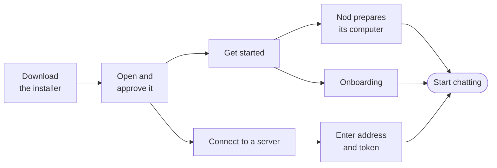

import { Steps, TabItem, Tabs } from '@astrojs/starlight/components';

The desktop app is the quickest way to run Nod. You don't need Node.js, Docker or developer tools.

Already have a [Nod server](/deploy/self-host/)? Choose **Connect to a server** on first launch. After setup, choose **Replay onboarding…** in the Nod menu, then **Connect to a server**. Enter its address and access token to use that assistant.

For a local assistant, have a [supported model service](/connect/models/) ready with its required credentials, a ChatGPT plan that supports sign-in, or a [local model](/connect/local-models/) server such as Ollama. Paid providers bill you for use. A local model costs nothing per request. A remote assistant uses the models configured on its server.



## Install Nod

<Tabs syncKey="os">
<TabItem label="Mac" icon="apple">

You need macOS 14 or later, on Apple silicon or Intel. For a local assistant, the app and its runtime are about 1.8 GB to download.

<Steps>

1. In **Apple menu → About This Mac**, check whether your Mac has a **Chip** (Apple silicon) or **Processor** (Intel). Download the latest [Apple silicon DMG](https://github.com/n8n-io/nod/releases/latest/download/nod-arm64.dmg) or [Intel DMG](https://github.com/n8n-io/nod/releases/latest/download/nod-x64.dmg) from GitHub.

2. Open the DMG, drag **Nod** to **Applications** and open it from there.

3. The first time, macOS asks whether to open an app downloaded from the internet. Select **Open**.

4. At Welcome, choose **Connect to a server** to use an existing assistant, or **Get started** to start a local one. Local setup offers an optional email connection, a few optional questions about you, a model if none works yet, a choice about conversation traces, which also says basic usage data is shared by default for new owners and can be turned off in **Settings → Privacy & data**, and an optional email address for updates about Nod and other n8n products, with its own consent checkbox. Discord and forum links are also in **Settings → General**. Other apps can be connected later from the first chat or **Apps**. Nod tries to turn on **Open at login** when local setup finishes. If the operating system blocks this setting, setup still finishes. After the first chat introduction, choose **Enable notifications** if you want Nod to alert you while you’re away. macOS may ask for permission. If macOS asks for your keychain password, approve it so Nod can protect your saved keys.

5. Keep your internet connection on. When setup is ready, Nod opens your chat with your saved connections. See [Your first conversation](/get-started/first-conversation/).

</Steps>

<details>
<summary>Install from Terminal instead</summary>

You can install the latest release on Apple silicon or Intel with one command. Quit Nod first, then paste this into Terminal:

```sh title="Terminal"
(
  installer="$(mktemp)" || exit
  trap 'rm -f "$installer"' EXIT
  curl -q --proto '=https' --tlsv1.2 -fsSL https://raw.githubusercontent.com/n8n-io/nod/main/deployment/n8n/install.sh -o "$installer" && /bin/sh "$installer"
)
```

Run it as your normal user, without `sudo`. It finds the latest published GitHub release, verifies the downloaded app, installs it to `/Applications/Nod.app`, and opens Nod. An existing installation keeps its current path. Your existing data stays in place. You don't need a GitHub account.

Before it replaces Nod, the installer stops any old ShipIt update job and removes its cache. If it cannot stop the job, it keeps your app. If the new app cannot open, it keeps the previous copy and shows its location.

</details>

</TabItem>
<TabItem label="Windows" icon="seti:windows">

You need Windows 11 x64. A local assistant also needs WSL
2 with hardware virtualization and at least 20 GB of free disk space. Its app and runtime are about
2.1 GB to download. Connecting to a server doesn't need WSL or a local runtime.

<Steps>

1. Download the latest [Windows x64 installer](https://github.com/n8n-io/nod/releases/latest/download/nod-Setup-x64.exe) from GitHub.

2. Run `nod-Setup-x64.exe`. Windows shows n8n GmbH as the publisher, though SmartScreen can still warn about a new release. The installer adds Nod to the Start menu.

3. At Welcome, choose **Connect to a server** to use an existing assistant, or **Get started** to start a local one. Local setup offers an optional email connection, a few optional questions about you, a model if none works yet, a choice about conversation traces, which also says basic usage data is shared by default for new owners and can be turned off in **Settings → Privacy & data**, and an optional email address for updates about Nod and other n8n products, with its own consent checkbox. Discord and forum links are also in **Settings → General**. Other apps can be connected later from the first chat or **Apps**. Nod tries to turn on **Open at login** when local setup finishes. If the operating system blocks this setting, setup still finishes. After the first chat introduction, choose **Enable notifications** if you want Nod to alert you while you’re away. Windows notification settings control delivery. You can change these preferences later in Settings.

4. If Nod needs WSL, follow its setup instructions and approve the administrator request. If Windows needs a restart, open Nod again afterwards; your saved connections and settings are kept.

5. Keep your internet connection on. When setup is ready, Nod opens your chat with your saved connections. See [Your first conversation](/get-started/first-conversation/).

</Steps>

<details>
<summary>Install from PowerShell instead</summary>

Quit Nod, then run this command in Windows PowerShell 5.1 or PowerShell 7:

```powershell title="PowerShell"
irm https://raw.githubusercontent.com/n8n-io/nod/main/deployment/n8n/install.ps1 | iex
```

Use a normal PowerShell window, not **Run as administrator**. It finds the latest published GitHub release, verifies the installer and runtime file, installs Nod, and opens it. An existing installation keeps its current path. Your existing data stays in place. You don't need a GitHub account.

</details>

</TabItem>
</Tabs>

## Keep Nod running

For a local assistant, closing the window keeps Nod running in the menu bar on a Mac, or the tray on Windows. **Quit Nod** stops Nod and its private computer. On Windows, running the installer or uninstaller while Nod is open offers to quit it first.

| Nod is                                  | What runs                                       |
| --------------------------------------- | ----------------------------------------------- |
| Open, or closed to the menu bar or tray | Chat, channels, schedules and background checks |
| Quit, or your computer is asleep        | Nothing, until Nod is open and awake again      |

Nod tries to turn on **Open at login** when setup finishes. If the operating system blocks this setting, setup still finishes. If you rely on scheduled tasks, keep it on in **Settings → General**.

When connected to a server, the server keeps your assistant, channels and schedules running after you quit the app or put your computer to sleep. The server must stay running and connected.

## Update Nod

Nod checks for updates after it starts, every six hours while it's open, and after your computer wakes if a check is due. Checks continue when an update is already downloaded, so a newer release can replace it before you restart.

To check now, select **Check for Updates…** in the **Nod** menu on a Mac, or from the menu bar or tray icon. This stays available alongside **Restart to update** when an update is ready. While a check or download runs, its menu item shows progress and restart waits until it finishes.

Newer Nod builds show an in-app notice when an update finishes downloading. It names the new version and offers **Restart to update** or **Later**. **Later** hides the notice for that version during the current app session; **Restart to update** stays in the menu. Older builds may show only the menu action, so use **Check for Updates…** there to check immediately. If Nod is in the middle of a task, it asks before restarting, and you can ask it to continue afterwards. While it shuts down to install, Nod shows **Updating Nod…**, then opens again where you left it, with any unsent message still in the box. Nod keeps your profile, keys and data. A completed installation does not repeat onboarding after an update.

On Windows, the restart runs the new installer in the background and opens Nod again when it's done.

Updating a connected desktop client does not update its server. Follow [Server operations](/deploy/server-operations/) to update the server separately.

## Where your data lives

For a local assistant, Nod's database, workspace and browser stay on your computer. When connected to a server, the server stores them along with model credentials and the Composio identity. Every client using the same server reaches the same assistant and connected accounts. Your device keeps its server address, encrypted access token, preferences and client data, such as unsent drafts and downloaded files.

Requests go to the model provider and apps you choose. Managed app requests and results pass through the configured connection service and Composio; n8n hosts the default service. Usage analytics are on by default for a new owner. Turning off **Share usage data** in **Settings → Privacy & data** stops new sends, though a submission already in flight may still complete. If you enter an email address and agree to updates about Nod and other n8n products, Nod links it to this installation's usage in PostHog and sends an unverified signup request to n8n's Customer.io Labs workspace only if **Share usage data** is on when you submit. Fixed About you choices accompany it only if you shared them successfully. Nod records the request on a new or existing profile and sends no email. Conversation traces leave only if you turn on **Share conversation traces** in **Settings → Privacy & data**. See [Your data and privacy](/trust/privacy/).

Nod starts with a fresh profile and doesn't import data from a source install.

|                       | Mac                                                | Windows                                     |
| --------------------- | -------------------------------------------------- | ------------------------------------------- |
| App data and settings | `~/Library/Application Support/nod/profiles/local` | `%APPDATA%\nod\profiles\local`              |
| Private computer      | `~/.nod-desktop/<profile id>`                      | A WSL distribution named `nod-<profile id>` |
| Saved keys            | Encrypted with the macOS key store                 | Encrypted with Windows DPAPI                |

## Remove Nod

Moving Nod to the Trash or uninstalling it keeps your data, so a later install opens where you left off. Uninstalling a connected client does not delete server data. To return to a local assistant first, choose **Replay onboarding… → Change server → Use this computer**, then:

1. Select **Remove all data** in **Settings → Privacy & data**. If Nod can't finish setup, select **Remove all data…** in the **Nod** menu instead.
2. Review the warning, then confirm. It lists what Nod will delete and explains that you must complete setup again. Nod deletes your profile and private computer, then restarts and opens setup. The app stays installed.
3. To remove the app too, quit Nod. Move it to the Trash on a Mac, or uninstall it in **Settings → Apps** on Windows.

On a Mac, Nod keeps the runtime it downloaded, so a new install doesn't download it again, and its entry in the key store. Neither holds your data. Apps you connected may still list Nod until you remove it there.

If you deleted Nod's folders by hand, Nod removes the private computer they leave behind the next time it opens.

## Troubleshooting

| Problem                                                 | Try this                                                                                                                                                                                                                                            |
| ------------------------------------------------------- | --------------------------------------------------------------------------------------------------------------------------------------------------------------------------------------------------------------------------------------------------- |
| macOS blocks the first launch                           | Install the newest release. On a managed Mac, ask your IT team to allow Nod.                                                                                                                                                                        |
| Setup stops with an error                               | Select **Try again**. If it fails again, send the error with **Send feedback…** from the menu bar or tray icon.                                                                                                                                     |
| Nod asks for a runtime file                             | Select **Choose runtime file** and pick the `nod-Runtime-…` file from the same release.                                                                                                                                                             |
| Windows can't download the runtime                      | Put `nod-Runtime-win32-x64.tar.gz` from the same release next to `nod-Setup-x64.exe` and run the installer again.                                                                                                                                   |
| Windows downloads the same update again after a restart | Nod 0.6.2 and earlier can't install updates on Windows. Quit Nod from the tray icon, then download and run the [newest Windows installer](https://github.com/n8n-io/nod/releases/latest/download/nod-Setup-x64.exe) once. Your data stays in place. |
| A scheduled task didn't run                             | Check that the machine running your assistant was awake and Nod was running. For a remote assistant, check the server.                                                                                                                              |

### A failed Mac update blocks a new install

After a failed update, the ShipIt update job can stay loaded. A new copy of Nod can then fail to open. If macOS shows **“Nod” is damaged and can't be opened** after an update failed, remove the old update job before you install Nod again.

1. Quit Nod. If it stays open, use **Activity Monitor** to stop it.
2. Open **Terminal** and run these commands as your normal user:

   ```sh title="Terminal"
   launchctl bootout "gui/$(id -u)/dev.nod.desktop.ShipIt"
   rm -rf "$HOME/Library/Caches/dev.nod.desktop.ShipIt"
   ```

   If no ShipIt job is loaded, the first command can report an error. Continue with the second command.

3. Download the newest DMG from the [releases page](https://github.com/n8n-io/nod/releases). Replace the copy in **Applications**, then open it.

These commands remove only the update job and its cache. They keep your profile, conversations, saved keys and private computer. If Nod still does not open, [send feedback](/deploy/troubleshooting/#send-feedback-with-a-diagnostic-report).

:::caution
Don't delete the profile or the private computer to fix a problem. You'd lose your conversations, workspace and saved keys.
:::

## Related resources

- [What is Nod](/get-started/what-is-nod/)
- [Your first conversation](/get-started/first-conversation/)
- [Install from source](/get-started/install-from-source/)
- [The desktop app in depth](/deploy/desktop-app/)
- [Troubleshooting](/deploy/troubleshooting/)
