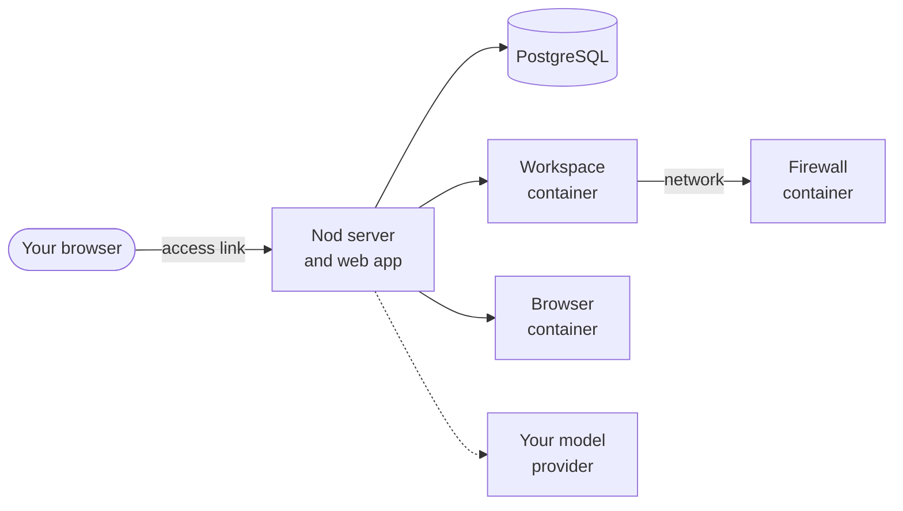

import { Steps, TabItem, Tabs } from '@astrojs/starlight/components';

Run Nod from its source code on macOS, Linux or Windows. Choose this to change Nod's code or use a source installation. The [desktop app](/get-started/install-desktop/) is quicker to install on Mac and Windows. Linux x64 also has a [Flatpak preview](/get-started/install-desktop/#linux).

To run Nod on a VPS, cloud VM, or Mac mini and reach it from other devices, use [Host your own server](/deploy/self-host/).

## Requirements

| You need         | Version or detail                                                                                                                                                    |
| ---------------- | -------------------------------------------------------------------------------------------------------------------------------------------------------------------- |
| Node.js          | 24.21.0 or newer                                                                                                                                                     |
| pnpm             | 10.34.5, enabled through Corepack                                                                                                                                    |
| Docker           | With Compose v2 and the Buildx plugin, running. For a Docker VM such as Colima, start with two CPUs and 8 GB of memory.                                              |
| Git              | Any recent version                                                                                                                                                   |
| Model connection | A [supported model service](/connect/models/) with its required credentials, a ChatGPT plan that supports sign-in, or a [local model](/connect/local-models/) server |

## What `pnpm start` runs

`pnpm start` installs dependencies when they changed, builds the web app and starts four Docker containers: PostgreSQL, the workspace, the workspace's firewall and the browser. Then it starts the Nod server, which serves the web app on `127.0.0.1`.



The workspace is where Nod runs commands and keeps files. The browser is where it visits websites. Neither of them receives your provider keys. The workspace reaches the network only through its [firewall](/deploy/self-host/#what-runs-on-the-server), which blocks private addresses.

`pnpm start` sets the browser and workspace CPU limits to fit the CPUs available to Docker. To check a Docker VM's allocation, run `docker info --format '{{.NCPU}}'`. If Nod runs slowly, stop Nod, raise the VM's CPU or memory allocation, then run `pnpm start` again to recalculate the limits. For example, to give an existing Colima VM four CPUs and 8 GB of memory:

```sh title="Terminal"
colima stop
colima start --cpu 4 --memory 8
pnpm start
```

## Get the code

```sh title="Terminal"
git clone https://github.com/n8n-io/nod.git
cd nod
```

## Set up the Vault key

Nod encrypts your saved keys, logins and cards with a Vault key.

<Tabs syncKey="platform">
<TabItem label="macOS" icon="apple">

Nothing to do. Nod creates a key and keeps it in the macOS Keychain item `dev.nod.vault`.

</TabItem>
<TabItem label="Linux" icon="linux">

Nothing to do for a fresh install. Nod creates a private key at `NOD_DATA_ROOT/vault/master-key` (`.local/vault/master-key` by default). Keep it with your backup; saved credentials can't be read without it.

You can instead set `NOD_VAULT_KEY` yourself. If encrypted data already exists, restore its original key rather than generating a new one. See [Vault configuration](/deploy/configuration/#vault).

</TabItem>
<TabItem label="Windows" icon="seti:windows">

Create a key and add it as `NOD_VAULT_KEY=<key>` to `.env` in the `nod` folder. Create the file if it doesn't exist.

```powershell title="PowerShell"
node -e "console.log(require('crypto').randomBytes(32).toString('base64'))"
```

Keep the key with your backup; saved credentials can't be read without it. If encrypted data already exists, restore its original key rather than generating a new one. See [Vault configuration](/deploy/configuration/#vault).

</TabItem>
</Tabs>

## Start Nod

<Steps>

1. Enable pnpm and start Nod. The first run takes a while.

   ```sh title="Terminal"
   corepack enable
   pnpm start
   ```

2. When the server is ready, it prints a link such as `http://localhost:4310/#access=…`. Open it once. Your browser keeps the access cookie, so `http://localhost:4310` works from then on.

3. Follow the onboarding to connect a model and try a first task. See [Your first conversation](/get-started/first-conversation/).

</Steps>

:::caution[Access from other devices]
This source setup listens on your computer's loopback interface. For network access, follow [Host your own server](/deploy/self-host/) to configure a server token and HTTPS.
:::

## Run Nod day to day

| To             | Do this                                                                                                                                                                                                 |
| -------------- | ------------------------------------------------------------------------------------------------------------------------------------------------------------------------------------------------------- |
| Stop Nod       | Press Ctrl-C, then run `docker compose stop` to stop the containers.                                                                                                                                    |
| Update Nod     | Stop it, run `git pull`, then `pnpm start`.                                                                                                                                                             |
| Get a new link | Delete `access-key` in your data folder (`.local/` by default) and restart. Otherwise the key stays the same across restarts.                                                                           |
| Find your data | `.local/` (or `NOD_DATA_ROOT`) and the Docker volumes. The Vault key is in `vault/master-key` on Linux, the macOS Keychain item `dev.nod.vault`, or your explicit `NOD_VAULT_KEY`, which Windows needs. |
| Back up        | Stop Nod, then copy your data folder (`.local/` or `NOD_DATA_ROOT`), the Docker volumes and the Vault key.                                                                                              |

:::caution
There's no tested restore procedure yet. Keep your Vault key with your backup, or your saved credentials can't be read.
:::

Settings live in `.env`, and you need to restart after you change them. See [Configuration](/deploy/configuration/).

## Troubleshooting

| You see                                | Do this                                                                                                                                                                                                                                   |
| -------------------------------------- | ----------------------------------------------------------------------------------------------------------------------------------------------------------------------------------------------------------------------------------------- |
| `Use Node.js 24.21.0 or newer.`        | Install a newer Node.js and run `pnpm start` again.                                                                                                                                                                                       |
| Docker errors on start                 | Make sure Docker is running and `docker compose version` reports v2.                                                                                                                                                                      |
| `the --chmod option requires BuildKit` | Install the [Docker Buildx plugin](https://github.com/docker/buildx#installing) and check that `docker buildx version` works. If `DOCKER_BUILDKIT=0` is set in your environment, remove it or set it to `1`. Then run `pnpm start` again. |
| A missing or unreadable Vault key      | Restore the original key and check its permissions. Don't generate a replacement for encrypted data. See [Vault configuration](/deploy/configuration/#vault).                                                                             |
| The port is in use                     | Set another `PORT` in `.env`. The default is `4310`.                                                                                                                                                                                      |

## Related resources

- [What is Nod](/get-started/what-is-nod/)
- [Install the desktop app](/get-started/install-desktop/)
- [Your first conversation](/get-started/first-conversation/)
- [Configuration](/deploy/configuration/)
- [Host your own server](/deploy/self-host/)
- [Troubleshooting](/deploy/troubleshooting/)
