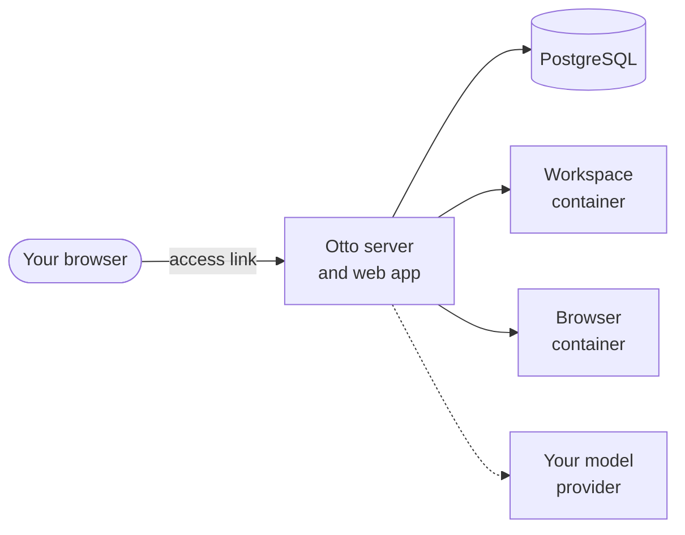

import { Steps, TabItem, Tabs } from '@astrojs/starlight/components';

Run Otto from its source code on macOS or Linux. Choose this if you use Linux or want to change Otto's code. On a Mac or Windows PC, the [desktop app](/get-started/install-desktop/) is quicker.

## Requirements

| You need         | Version or detail                                                                                             |
| ---------------- | ------------------------------------------------------------------------------------------------------------- |
| Node.js          | 24.21.0 or newer                                                                                              |
| pnpm             | 10.34.5, enabled through Corepack                                                                             |
| Docker           | With Compose v2, running, for example Docker Desktop on a Mac                                                 |
| Git              | Any recent version                                                                                            |
| Model connection | An OpenAI, Anthropic or OpenRouter API key, a ChatGPT plan, or a [local model](/connect/local-models/) server |

## What `pnpm start` runs

`pnpm start` installs dependencies when they changed, builds the web app and starts three Docker containers. Then it starts the Otto server, which serves the web app on `127.0.0.1`.



The workspace is where Otto runs commands and keeps files. The browser is where it visits websites. Neither of them receives your provider keys.

## Get the code

```sh title="Terminal"
git clone https://github.com/n8n-io/otto.git
cd otto
```

## Set up the Vault key

Otto encrypts your saved keys, logins and cards with a Vault key.

<Tabs syncKey="platform">
<TabItem label="macOS" icon="apple">

Nothing to do. Otto creates a key and keeps it in the macOS Keychain item `dev.otto.vault`.

</TabItem>
<TabItem label="Linux" icon="linux">

Nothing to do for a fresh install. Otto creates a private key at `OTTO_DATA_ROOT/vault/master-key` (`.local/vault/master-key` by default). Keep it with your backup; saved credentials can't be read without it.

You can instead set `OTTO_VAULT_KEY` yourself. If encrypted data already exists, restore its original key rather than generating a new one. See [Vault configuration](/deploy/configuration/#vault).

</TabItem>
</Tabs>

## Start Otto

<Steps>

1. Enable pnpm and start Otto. The first run takes a while.

   ```sh title="Terminal"
   corepack enable
   pnpm start
   ```

2. When the server is ready, it prints a link such as `http://localhost:4310/#access=…`. Open it once. Your browser keeps the access cookie, so `http://localhost:4310` works from then on.

3. Follow the onboarding to connect a model and try a first task. See [Your first conversation](/get-started/first-conversation/).

</Steps>

:::danger[Keep Otto on your computer]
Otto serves one person on `127.0.0.1` with no account login. Don't expose it to a network or the internet, for example through port forwarding, a tunnel or a reverse proxy.
:::

## Run Otto day to day

| To             | Do this                                                                                                                                                                               |
| -------------- | ------------------------------------------------------------------------------------------------------------------------------------------------------------------------------------- |
| Stop Otto      | Press Ctrl-C, then run `docker compose stop` to stop the containers.                                                                                                                  |
| Update Otto    | Stop it, run `git pull`, then `pnpm start`.                                                                                                                                           |
| Get a new link | Delete `access-key` in your data folder (`.local/` by default) and restart. Otherwise the key stays the same across restarts.                                                         |
| Find your data | `.local/` (or `OTTO_DATA_ROOT`) and the Docker volumes. The Vault key is in `vault/master-key` on Linux, the macOS Keychain item `dev.otto.vault`, or your explicit `OTTO_VAULT_KEY`. |
| Back up        | Stop Otto, then copy your data folder (`.local/` or `OTTO_DATA_ROOT`), the Docker volumes and the Vault key.                                                                          |

:::caution
There's no tested restore procedure yet. Keep your Vault key with your backup, or your saved credentials can't be read.
:::

Settings live in `.env`, and you need to restart after you change them. See [Configuration](/deploy/configuration/).

## Troubleshooting

| You see                                       | Do this                                                                                                                        |
| --------------------------------------------- | ------------------------------------------------------------------------------------------------------------------------------ |
| `Use Node.js 24.21.0 or newer.`               | Install a newer Node.js and run `pnpm start` again.                                                                            |
| Docker errors on start                        | Make sure Docker is running and `docker compose version` reports v2.                                                           |
| `Configure OTTO_VAULT_KEY…` when saving a key | Set `OTTO_VAULT_KEY` as shown in [Set up the Vault key](/get-started/install-from-source/#set-up-the-vault-key), then restart. |
| The port is in use                            | Set another `PORT` in `.env`. The default is `4310`.                                                                           |

## Related resources

- [What is Otto](/get-started/what-is-otto/)
- [Install the desktop app](/get-started/install-desktop/)
- [Your first conversation](/get-started/first-conversation/)
- [Configuration](/deploy/configuration/)
- [Troubleshooting](/deploy/troubleshooting/)
