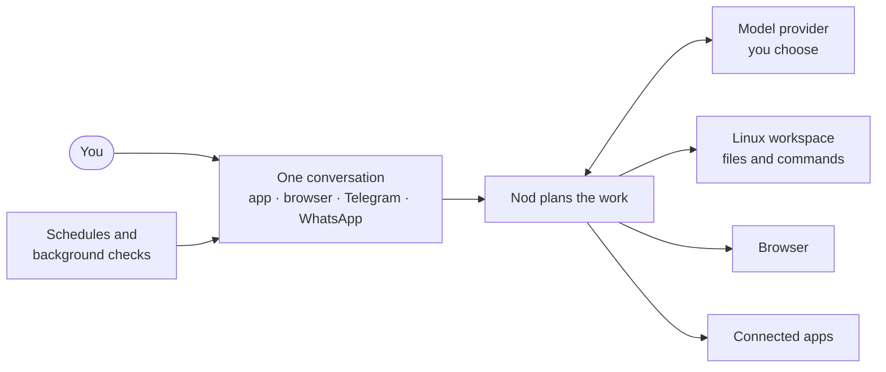

import { Badge, LinkCard, CardGrid } from '@astrojs/starlight/components';

Nod is a personal assistant you talk to in one chat. It has its own Linux workspace and browser, so it can do real work for you, not only answer questions.

<Badge text="Early preview" variant="caution" /> Expect rough edges and breaking changes.

## How Nod fits together

You have one ongoing conversation with Nod. The app, your web browser, Telegram and WhatsApp all show the same conversation, so you can start a task on your laptop and check on it from your phone.

- **Its own computer.** Nod runs commands and keeps files in a private Linux workspace. It browses the web in its own browser, which you can take over when a site needs you.
- **Your apps.** Connect Gmail, Calendar, Slack, Notion, Linear and others, and Nod can read and act in them.
- **Work that runs on its own.** Nod can run tasks on a schedule. When you ask, it also notices new email and app activity that needs you.
- **Your hosting, your model.** Nod runs on your computer or a [server you host](/deploy/self-host/). Its model requests go to the [provider you choose](/connect/models/) or an [OpenAI-compatible model server](/connect/local-models/) such as Ollama that you run yourself.

## What Nod can do

| Area           | Try asking                                                                     |
| -------------- | ------------------------------------------------------------------------------ |
| Research       | "Compare three project tools for a team of five. Put the prices in a table."   |
| Files          | "Turn the attached CSV into a chart and a one-page PDF summary."               |
| Email and apps | "Find client emails from this week that still need a reply and draft answers." |
| Websites       | "Download last month's invoice from billing.example.com with my saved login."  |
| Schedules      | "Every Friday at 5 pm, send me a recap of what we finished this week."         |
| On the go      | Message Nod on Telegram: "Did the supplier reply yet?"                         |

Nod is designed to check with you before it sends, posts or deletes anything you didn't ask for. The Nod server runs that check before every such action, but an AI model makes the call, so it can be wrong. Background work that Nod starts on its own only reads and drafts, unless you've told it what to do on its own. See [Trust and Vault](/trust/) for how that works.

## Where Nod runs

|          | Local desktop assistant                  | Local source install                       | Self-hosted server                                              |
| -------- | ---------------------------------------- | ------------------------------------------ | --------------------------------------------------------------- |
| Best for | Using Nod on your own computer           | Running Nod on Linux, or changing its code | Reaching one assistant from several devices                     |
| Runs on  | Mac (Apple silicon or Intel), Windows 11 | macOS or Linux with Docker                 | A machine with Docker Compose                                   |
| You need | Nothing else installed                   | Node.js, pnpm, Docker and Git              | [Server setup](/deploy/self-host/) and HTTPS for network access |
| Updates  | Automatic                                | `git pull` and restart                     | [Update the server](/deploy/server-operations/)                 |

The desktop app can also connect to a server. Its chat, files, model connections and connected apps then come from that server. Closing the client doesn't stop the assistant.

Each assistant needs a [model connection](/connect/models/): a supported service's credentials, a ChatGPT plan that supports sign-in, or a model server. [Connect apps](/connect/apps/) by signing in to each app and reviewing its permissions.

## What Nod isn't

- **It doesn't run models itself.** It connects to a model provider, which bills you for use, or to a [local model](/connect/local-models/) server you run.
- **It needs a running host.** A local assistant runs only while Nod is open and your computer is awake. A server keeps working while its clients are closed.
- **It belongs to one person.** Several devices can reach the same server and assistant. Separate installations don't sync their data.
- **Network access needs setup.** Local source installs listen on loopback by default. A [self-hosted server](/deploy/self-host/) uses an access token and HTTPS.
- **It isn't finished.** Nod is an early preview, so features and data formats can change.

## Next steps

<CardGrid>
  <LinkCard
    title="Install the desktop app"
    href="/get-started/install-desktop/"
    description="The quickest way to start, on a Mac or Windows PC."
  />
  <LinkCard
    title="Install from source"
    href="/get-started/install-from-source/"
    description="Run Nod on macOS or Linux from its code."
  />
  <LinkCard
    title="Host your own server"
    href="/deploy/self-host/"
    description="Keep one assistant running for your web and desktop clients."
  />
  <LinkCard
    title="Trust and Vault"
    href="/trust/"
    description="How Nod keeps your accounts and actions under your control."
  />
  <LinkCard
    title="Key concepts"
    href="/get-started/glossary/"
    description="The words these docs use, in plain language."
  />
</CardGrid>

## Related resources

- [Your first conversation](/get-started/first-conversation/)
- [Connect a model](/connect/models/)
- [How Nod works](/how-it-works/architecture/)
