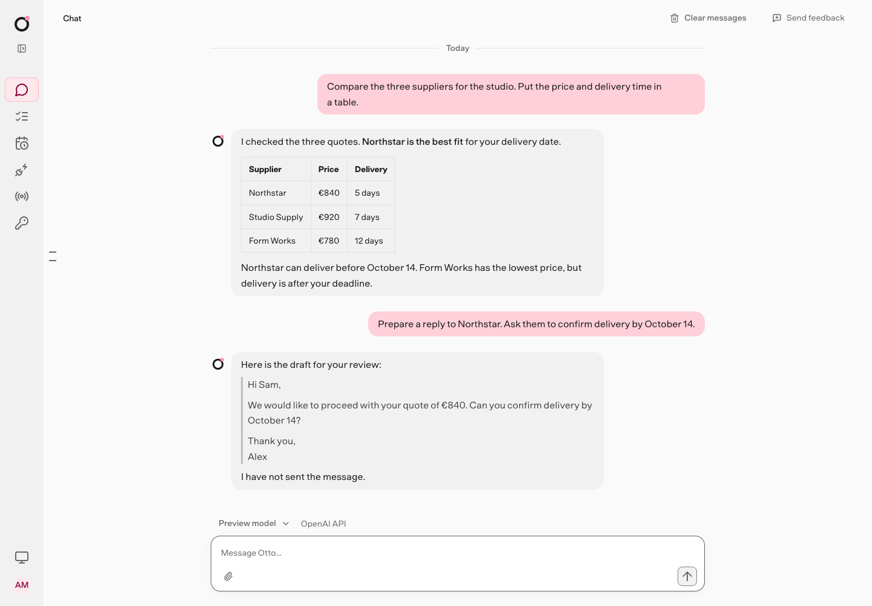
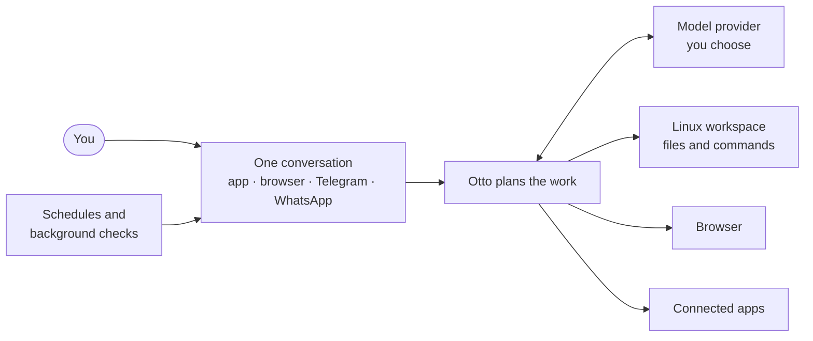

import { Badge, LinkCard, CardGrid } from '@astrojs/starlight/components';

Otto is a personal assistant you talk to in one chat. It has its own Linux workspace and browser, so it can do real work for you, not only answer questions.

<Badge text="Early preview" variant="caution" /> Expect rough edges and breaking changes.

## How Otto fits together

You have one ongoing conversation with Otto. The app, your web browser, Telegram and WhatsApp all show the same conversation, so you can start a task on your laptop and check on it from your phone.

- **Its own computer.** Otto runs commands and keeps files in a private Linux workspace. It browses the web in its own browser, which you can take over when a site needs you.
- **Your apps.** Connect Gmail, Calendar, Slack, Notion, Linear and others, and Otto can read and act in them.
- **Work that runs on its own.** Otto can run tasks on a schedule. When you ask, it also notices new email and app activity that needs you.
- **Your computer, your model.** Otto runs on your computer. Its model requests go to the provider you choose: OpenAI, Anthropic, OpenRouter, or a [local model](/connect/local-models/) server such as Ollama that you run yourself.

## What Otto can do

| Area           | Try asking                                                                     |
| -------------- | ------------------------------------------------------------------------------ |
| Research       | "Compare three project tools for a team of five. Put the prices in a table."   |
| Files          | "Turn the attached CSV into a chart and a one-page PDF summary."               |
| Email and apps | "Find client emails from this week that still need a reply and draft answers." |
| Websites       | "Download last month's invoice from billing.example.com with my saved login."  |
| Schedules      | "Every Friday at 5 pm, send me a recap of what we finished this week."         |
| On the go      | Message Otto on Telegram: "Did the supplier reply yet?"                        |

Otto checks with you before it sends, posts or deletes anything you didn't ask for. Background work that Otto starts on its own only reads and drafts, unless you've told it what to do on its own. See [Trust and Vault](/trust/) for how that works.

## Where Otto runs

|          | Desktop app                                      | From source                                 |
| -------- | ------------------------------------------------ | ------------------------------------------- |
| Best for | Using Otto on your own computer                  | Running Otto on Linux, or changing its code |
| Runs on  | Mac (Apple silicon or Intel), Windows 11 preview | macOS or Linux with Docker                  |
| You need | Nothing else installed                           | Node.js, pnpm, Docker and Git               |
| Updates  | Automatic on Apple silicon Macs                  | `git pull` and restart                      |

Both need a model connection: an API key from OpenAI, Anthropic or OpenRouter, a ChatGPT plan or a local model. [App connections](/connect/apps/) offer Google sign-in for the managed service or your own Composio key.

## What Otto isn't

- **It doesn't run models itself.** It connects to a model provider, which bills you for use, or to a [local model](/connect/local-models/) server you run.
- **It isn't always on.** The desktop app runs tasks only while it's open and your computer is awake.
- **It isn't shared.** Each Otto belongs to one person. The desktop app and source installs don't sync between computers.
- **It isn't a public server.** A source install has no account login, so never expose it to a network.
- **It isn't finished.** Otto is an early preview, so features and data formats can change.

## Next steps

<CardGrid>
  <LinkCard
    title="Install the desktop app"
    href="/get-started/install-desktop/"
    description="The quickest way to start, on a Mac or Windows PC."
  />
  <LinkCard
    title="Install from source"
    href="/get-started/install-from-source/"
    description="Run Otto on macOS or Linux from its code."
  />
  <LinkCard
    title="Trust and Vault"
    href="/trust/"
    description="How Otto keeps your accounts and actions under your control."
  />
  <LinkCard
    title="Key concepts"
    href="/get-started/glossary/"
    description="The words these docs use, in plain language."
  />
</CardGrid>

## Related resources

- [Your first conversation](/get-started/first-conversation/)
- [Connect a model](/connect/models/)
- [How Otto works](/how-it-works/architecture/)
