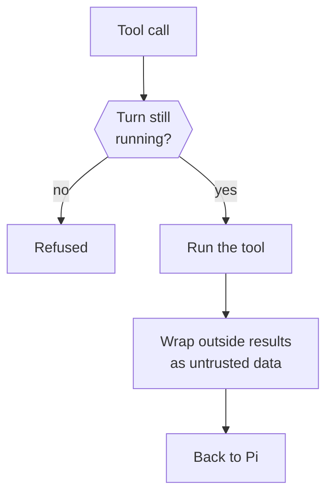

This page explains what happens inside a turn: the Pi session, the tools the model can call, the guard every call passes, and how the prompt is assembled.

The short version: `src/runtime` runs each turn in a Pi session. Every tool call goes through one turn guard. Results from the outside world reach the model wrapped as untrusted data.

nod has its own warm, direct voice. It uses normal sentence capitalization and preserves names and acronyms. It follows the conversation language and explicit style requests. It does not copy the user's casing, slang or tone. These rules also apply to channel notices and confirmation questions.

## Pi sessions

Pi is the agent harness nod runs on. It keeps the transcript, calls the model and runs tools. nod's adapter is in [`src/providers/pi/`](https://github.com/n8n-io/nod/tree/main/src/providers/pi). The runtime in [`src/runtime/index.ts`](https://github.com/n8n-io/nod/blob/main/src/runtime/index.ts) runs sessions in parallel. Each session runs one turn at a time:

- Conversation turns share the thread's saved session. The server hands it to one turn at a time.
- Background sessions save their transcript too. A reply or secure form continues that session.
- Subagents use temporary in-memory Pi sessions and run in parallel.

Recent chat history goes into the prompt only when Pi has no saved session. A resumed session gets new background messages since its previous turn started.

## Execution records and cost

Each Pi execution has one scope: thread ID, session ID, turn ID, run ID, parent run ID, and browser ID.
The main run uses the turn ID. Each subagent gets a new run ID and uses it as its browser ID.
Tools and model usage keep this scope. `turn_events` records execution and tool activity without saving raw tool arguments or results.

`model_usage` is the only cost ledger. Each model request reports one usage ID, including subagent, compaction, review, and memory requests.
Repeated reports with the same ID create no extra charge record. Parent runs never add child costs again.
All totals come from these ledger rows. Missing prices stay unknown.

## Keeping the context small

| Mechanism          | Rule                                                                                                                                                                                                                                                                                         |
| ------------------ | -------------------------------------------------------------------------------------------------------------------------------------------------------------------------------------------------------------------------------------------------------------------------------------------- |
| Compaction         | Pi compacts at 256k tokens or 16,384 tokens below the model's context window, whichever is smaller, and keeps the newest third of that in full, which leaves the summary request room even when a chat fills the window.                                                                     |
| Screenshot pruning | Above twelve screenshots, the oldest are replaced in steps of eight with a note to take a new one. The prompt cache breaks only at those steps.                                                                                                                                              |
| Attached images    | PNG, JPEG and WebP images of up to 3.75 MiB each, and 16 MiB together per message, reach the model with the message. If the chat model cannot read images, an image model from a connected service supplies an untrusted description. Other images stay workspace files marked as not shown. |
| Provider errors    | Reach Pi with only the connection key redacted, so Pi's overflow recovery and retries see the real error.                                                                                                                                                                                    |

Image analysis keeps the selected chat model. It prefers an image model on that model's connection, then checks the owner's other connected services. It reads current credentials for each request. The image model receives the current request and supported images, without the chat history, tool results or Vault data. Its description is untrusted data and cannot approve an action. Analysis has no automatic retry. Its usage belongs to the current session and counts toward the monthly limit and task check-in. A failed analysis leaves the image marked as not shown.

When a loaded session ends with tool calls that have no result, each call gets the result "This action was interrupted. Its outcome is unknown; check before doing it again."

## Tools

Tool definitions live in [`src/runtime/tools.ts`](https://github.com/n8n-io/nod/blob/main/src/runtime/tools.ts).

| Tool                                                                | What it does                                                                                                                                 |
| ------------------------------------------------------------------- | -------------------------------------------------------------------------------------------------------------------------------------------- |
| `read`, `bash`, `edit`, `write`, `find`, `ls`                       | Pi's native tools. They run inside the workspace container.                                                                                  |
| `skills`                                                            | Reads a [guide](/how-it-works/skills/) or [learned skill](/how-it-works/memory/#learned-skills); only owner-started work writes one.         |
| `send_message`                                                      | Sends a message now. The only delivery in background turns.                                                                                  |
| `follow_up`                                                         | In a chat or saved task, queues one short line that goes out as its own message right after the reply, such as an offer to keep doing a job. |
| `ask_user`                                                          | Asks one question and ends the turn as waiting.                                                                                              |
| `react_to_message`                                                  | Now and then, reacts to the user's message with one emoji, on web, Telegram and WhatsApp. At most one every five minutes.                    |
| `browser`                                                           | Drives the private browser: open, snapshot, click, fill, evaluate, download and handoff.                                                     |
| `sign_in`                                                           | Enters a Vault login or code into the page without showing it to the model.                                                                  |
| `pay`                                                               | Pays at a checkout with a Vault card after your approval.                                                                                    |
| `browser_session`                                                   | Creates a browser profile to sign in to, or opens a saved one after the same check as a sign-in.                                             |
| `apps`                                                              | Runs an action on a connected account, after the trust check.                                                                                |
| `manage_apps`                                                       | Lists, discovers, connects or proposes app connections.                                                                                      |
| `manage_personal_context`                                           | Schedules, notification preferences, memory, history and usage.                                                                              |
| `task`                                                              | Starts saved task sessions, sends owner updates, reports progress and stops a task. It grants no permission.                                 |
| `share_file`                                                        | Attaches a workspace file to nod's next reply or question, or sends it alone when a turn finishes or fails without one.                      |
| `create_audio`                                                      | Turns text into speech and sends it to you.                                                                                                  |
| `web_search`, `fetch_content`, `get_search_content`, `source_check` | Web research from the pinned `pi-web-access` extension. It never reads local files.                                                          |
| `mcp__<server>__<tool>`                                             | One tool for each tool of a connected MCP server, such as `mcp__n8n__validate_workflow`. Each call runs like `apps`, after the trust check.  |
| `tool_search`                                                       | Finds connected MCP server tools by meaning and loads the matches for the next model call.                                                   |
| `codemode`                                                          | Runs a model-written script that calls workspace, web and connected MCP server tools.                                                        |

The `pi-web-access` extension runs in the server process with the server's permissions, but has no direct access to workspace files and never uses the server's own logins, such as a GitHub CLI session. Its connections go only to public addresses, checked when each connection opens, IP addresses included. nod drops any proxy, whether the model names it or the settings file sets it. Its settings live in `NOD_DATA_ROOT/pi/web-search.json`.

## The turn guard

Every tool call, including every call a codemode script makes, passes the same guard.

- **Cancellation:** a stopped or finished turn can't start a call. Server callbacks also check `withTurnLock` before they run.
- **Observations:** the guard reports each call to an optional observer. Only the capability evals and the voice eval script set one; the capability evals redact typed text and memory arguments.
- **App actions:** `apps` and every connected MCP server tool also pass the server's [trust check](/trust/approvals/).

`apps` and `manage_personal_context` calls run in parallel with each other and with subagents. The trust check covers app actions, changes to schedules, notification settings, the owner's rules and spending limits, and forgetting a note or turning memory on, off or clearing it, and those checks run in parallel too. Other `manage_personal_context` operations, such as saving a note and reads, have no trust check and count as decided as soon as they reach the server.

A call acts only once every `apps` or `manage_personal_context` call issued before it in the turn is decided, and each earlier one that asks has opened its question or failed. If one of them opened a question, the later call is refused. A turn has at most one open confirmation: while one waits for the owner, approvals refuse to open another.

## Codemode

Pi's `codemode` tool runs model-written JavaScript in a QuickJS sandbox with no network, files or timers.

- Scripts can call the workspace and `pi-web-access` tools and the tools of connected MCP servers, in parallel, plus Pi's image and classifier models. That model spend goes to the usage ledger.
- Every other nod tool is `model-only`, so scripts can't reach Composio apps, the browser, credentials, messages or shared files.
- A connected MCP server tool called from a script passes the same guard, order and trust check as a direct call. If the check asks you first, the script stops and the question goes to chat.
- Calls inside a script stay raw so the script can parse them. Codemode's output is wrapped when it returns.

## Connected MCP server tools

Each tool of a connected MCP server becomes its own Pi tool, named `mcp__<server>__<tool>`, with the server's own description and input schema. These tools are deferred: the model loads the ones it needs with `tool_search` or calls them from codemode, so a server with dozens of tools doesn't fill every request. Each server's own guide to its tools reaches Pi inside an `untrusted_tool_result` block, as data that never grants permission.

nod keeps one MCP connection per account and address for a minute after its last call, caches each server's tool list for ten minutes and waits up to ten minutes for one call.

## Untrusted results

Results from apps, the browser, the web and codemode reach Pi inside one `untrusted_tool_result` block with a data-not-instructions notice. Workspace tool results aren't wrapped, and errors reach Pi unwrapped. See [Untrusted content](/trust/untrusted-content/).

## How the prompt is built

The prompt has three layers, built in [`src/runtime/prompt.ts`](https://github.com/n8n-io/nod/blob/main/src/runtime/prompt.ts).

| Layer         | Contains                                                                                                                        | Sent                       |
| ------------- | ------------------------------------------------------------------------------------------------------------------------------- | -------------------------- |
| Static prompt | nod's personality and rules, the conversation and background rules, the core guides, the skill catalog and Pi's tool guidelines | Once per session           |
| Owner context | Account details, date format, the memory index and the learned skill index                                                      | Again only when it changes |
| Turn message  | Mode, time, channel, message ID, reply target, recent conversation and the instruction                                          | Every turn                 |

The core guides are `connected-apps`, `schedules-and-watches`, `artifacts` and `video-links`. Pi's own tool guidelines are appended to the static prompt, because nod's custom prompt would otherwise drop them.

The owner context is a message of its own, never part of the system prompt, so a memory change leaves the system prompt and the conversation before it untouched:

- A session gets the full current owner context with its first turn, and again with the first turn after it changes. The newest copy replaces earlier ones.
- Earlier copies stay where they are, so the cached conversation after them stays valid.
- Compaction summaries leave the owner context out. A session that compacts it away gets it again with its next request.

Providers that take a prompt cache key, such as OpenAI, get the same one from every session of a thread: a keyed hash of the thread ID that changes when nod restarts. When a session's system prompt and tools match a recent request from the same thread, as they do for back-to-back background runs even after memory changes, the provider reads them from its cache and bills them at its cheaper cache-read rate. The code is in [`src/providers/pi/index.ts`](https://github.com/n8n-io/nod/blob/main/src/providers/pi/index.ts).

## Message cadence

nod keeps two things apart:

- **Live status** shows that nod is working and what it's doing right now. It updates in place, is never stored as a message and never notifies you.
- **Messages** are what nod says to you: its opening line, a question, a blocker it sends on purpose, the result or a failure.

Live status covers work you started: a chat request, a task, a reply to a task, and work that continues after you answer or approve something. Schedules and email events that nod starts on its own show none. Whether nod is working comes from the turn's state and its tool events, never from what the model says about its progress; the model only words the step. The status is computed in [`src/server/activity.ts`](https://github.com/n8n-io/nod/blob/main/src/server/activity.ts), and the runtime records steps in [`src/runtime/index.ts`](https://github.com/n8n-io/nod/blob/main/src/runtime/index.ts).

| Where               | While nod works for you                                                                                                                                                                                                                                                                          |
| ------------------- | ------------------------------------------------------------------------------------------------------------------------------------------------------------------------------------------------------------------------------------------------------------------------------------------------ |
| nod web and desktop | A bubble from nod at the bottom of the chat with its current step, such as "Found two flights under budget, checking seats now", or the website it's on until it writes one, and the task's title for a task. The answer replaces it. The task card shows the same step and the website it's on. |
| Telegram            | **typing…** plus the current step as a live draft in your chat. A draft never notifies you and disappears when the answer arrives or after 30 seconds.                                                                                                                                           |
| WhatsApp            | **typing…** only, because WhatsApp can't show a draft or edit a message. Showing it marks your latest message as read.                                                                                                                                                                           |

| Moment              | What nod does                                                                                                                      | Why                                                                                                                                                                                                                                                                                                                                                                                        |
| ------------------- | ---------------------------------------------------------------------------------------------------------------------------------- | ------------------------------------------------------------------------------------------------------------------------------------------------------------------------------------------------------------------------------------------------------------------------------------------------------------------------------------------------------------------------------------------ |
| Start               | One line on what it will do, only when the work takes more than a few seconds                                                      | Unexplained waits feel longer ([Maister 1985](https://davidmaister.com/articles/5/52/index.html)); feedback matters past about 10 seconds ([Nielsen](https://www.nngroup.com/articles/response-times-3-important-limits/))                                                                                                                                                                 |
| During              | A live step before each new step: what it found and what's next, without tool names, percentages or time estimates                 | Intermediate results beat silence on perceived speed and trust ([Kirmayr et al. 2026](https://arxiv.org/abs/2602.15569)); agents misreport their own progress mid-task, so nod shows facts and the model's words, never a percentage ([Wang et al. 2026](https://arxiv.org/abs/2609.08589)); Telegram added [drafts](https://core.telegram.org/bots/api#sendmessagedraft) for exactly this |
| Something needs you | A question, a blocker or a decision, sent on purpose as a message                                                                  | Every phone notification costs attention ([Stothart et al. 2015](https://doi.org/10.1037/xhp0000100)), and updates land best at breakpoints ([Iqbal and Bailey 2008](https://www.interruptions.net/literature/Iqbal-CHI08.pdf))                                                                                                                                                            |
| End                 | One reply that leads with the result. If work you started fails, hits the spending limit or is interrupted, one message saying why | Summaries help; full traces hurt ([Fernandes et al. 2026](https://arxiv.org/abs/2605.25856)); fewer notifications help, but none at all raises anxiety ([Fitz et al. 2019](https://doi.org/10.1016/j.chb.2019.07.016))                                                                                                                                                                     |
| After               | At most one concrete offer, not repeated after a no                                                                                | Frequent proactive suggestions annoy ([Chen et al. 2025](https://arxiv.org/abs/2410.04596)); keep requests minimal and easy to dismiss ([PAIR](https://pair.withgoogle.com/chapter/feedback-controls/))                                                                                                                                                                                    |

## Compact command output

Workspace images include a pinned [RTK](https://github.com/rtk-ai/rtk). Supported simple Bash commands are rewritten to RTK inside the workspace for compact Git, file, search, test and build output. Pipes, redirection, machine-output flags, bare `git log` and `find` stay raw. RTK's `find` skips hidden and ignored folders such as `.nod`, where nod keeps its working files. Unsupported commands fall back before they run, and executed commands are never retried. `rtk proxy <command>` gives exact output. The rules are in [`src/providers/pi/sandbox.ts`](https://github.com/n8n-io/nod/blob/main/src/providers/pi/sandbox.ts).

## Related resources

- [Architecture](/how-it-works/architecture/)
- [Threads and turns](/how-it-works/threads-and-turns/)
- [Sandbox and browser isolation](/how-it-works/sandbox-and-browser/)
- [Skills](/how-it-works/skills/)
- [Untrusted content](/trust/untrusted-content/)
