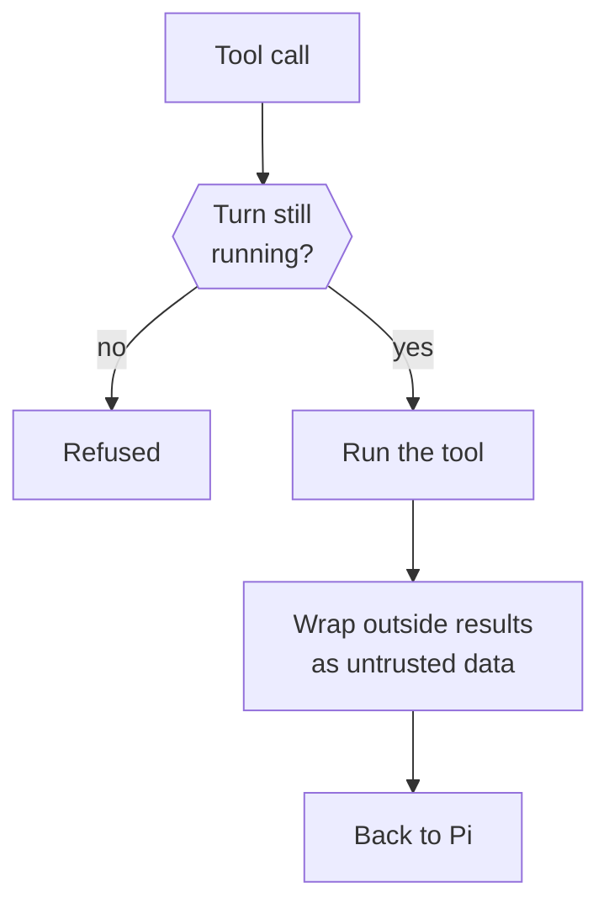

This page explains what happens inside a turn: the Pi session, the tools the model can call, the guard every call passes, and how the prompt is assembled.

The short version: `src/runtime` runs each turn in a Pi session. Every tool call goes through one turn guard. Results from the outside world reach the model wrapped as untrusted data.

## Pi sessions

Pi is the agent harness Otto runs on. It keeps the transcript, calls the model and runs tools. Otto's adapter is in [`src/providers/pi/`](https://github.com/n8n-io/otto/tree/main/src/providers/pi). The runtime in [`src/runtime/index.ts`](https://github.com/n8n-io/otto/blob/main/src/runtime/index.ts) can run any number of turns per thread at once, each in its own Pi session:

- Conversation turns share the thread's saved session. The server hands it to one turn at a time.
- Background turns each get a new in-memory session.

Recent chat history goes into the prompt only when Pi has no saved session. A resumed session gets only the messages that background turns sent since the previous conversation turn started.

## Keeping the context small

| Mechanism          | Rule                                                                                                                                                                                      |
| ------------------ | ----------------------------------------------------------------------------------------------------------------------------------------------------------------------------------------- |
| Compaction         | Pi compacts at 256k tokens or 16,384 tokens below the model's context window, whichever is smaller.                                                                                       |
| Screenshot pruning | Above twelve screenshots, the oldest are replaced in steps of eight with a note to take a new one. The prompt cache breaks only at those steps. The saved session keeps every screenshot. |
| Provider errors    | Reach Pi with only the connection key redacted, so Pi's overflow recovery and retries see the real error.                                                                                 |

## Hosted transcript checkpoints

In hosted mode, the conversation transcript lives in private object storage. The details are in [`src/providers/pi/checkpoint.ts`](https://github.com/n8n-io/otto/blob/main/src/providers/pi/checkpoint.ts).

- **When:** before each tool, at turn boundaries and before completion.
- **How:** each checkpoint uploads only new entries as an immutable part. A small manifest lists the parts and is written with compare-and-swap, so a stale writer can't overwrite a newer session.
- **Size:** every 64 parts, the session is rewritten as chunks of at most 8 MiB, up to 64 MiB in total.
- **Rebase:** a restored session over 8 MiB is rebased to what the model sees: the latest compaction, later messages and only the newest screenshots.

In both modes, when a loaded session ends with tool calls that have no result, each call gets the result "This action was interrupted. Its outcome is unknown; check before doing it again."

## Tools

Tool definitions live in [`src/runtime/tools.ts`](https://github.com/n8n-io/otto/blob/main/src/runtime/tools.ts).

| Tool                                                                | What it does                                                                                     |
| ------------------------------------------------------------------- | ------------------------------------------------------------------------------------------------ |
| `read`, `bash`, `edit`, `write`, `find`, `ls`                       | Pi's native tools. They run inside the workspace container.                                      |
| `skills`                                                            | Reads a task guide from the trusted [skill library](/how-it-works/skills/).                      |
| `send_message`                                                      | Sends a message now. The only delivery in background turns.                                      |
| `ask_user`                                                          | Asks one question and ends the turn as waiting.                                                  |
| `react_to_message`                                                  | Reacts to a message with one emoji, on web only.                                                 |
| `browser`                                                           | Drives the private browser: open, snapshot, click, fill, evaluate, download and more.            |
| `sign_in`                                                           | Enters a Vault login or code into the page without showing it to the model.                      |
| `pay`                                                               | Pays at a checkout with a Vault card after your approval.                                        |
| `payment_setting`                                                   | Turns **Do it for me** on or off for a card, after a confirmation.                               |
| `browser_session`                                                   | Creates a browser profile to sign in to, or opens a saved one after the same check as a sign-in. |
| `apps`                                                              | Runs an action on a connected account, after the trust check.                                    |
| `manage_apps`                                                       | Lists, discovers, connects or proposes app connections.                                          |
| `manage_personal_context`                                           | Schedules, notification preferences, memory, history and usage.                                  |
| `task`                                                              | Keeps a progress card on the Tasks page. It schedules and grants nothing.                        |
| `share_file`                                                        | Sends a workspace file to you.                                                                   |
| `create_audio`                                                      | Turns text into speech and sends it to you.                                                      |
| `web_search`, `fetch_content`, `get_search_content`, `source_check` | Web research from the pinned `pi-web-access` extension. It never reads local files.              |
| `codemode`                                                          | Runs a model-written script that calls workspace and web tools.                                  |

The `pi-web-access` extension runs in the server process with the server's permissions, but has no direct access to workspace files. Its settings live in `OTTO_DATA_ROOT/pi/web-search.json`.

## The turn guard

Every tool call, including every call a codemode script makes, passes the same guard.

- **Cancellation:** a stopped or finished turn can't start a call. Server callbacks also check `withTurnLock` before they run.
- **Observations:** the guard reports each call to an optional observer. Only the capability evals and the voice eval script set one; the capability evals redact typed text and memory arguments.
- **App actions:** `apps` also passes the server's [trust check](/trust/approvals/).

`apps` and `manage_personal_context` calls run in parallel with each other and with subagents. The trust check covers app actions and changes to schedules and notification settings, and those checks run in parallel too. Other `manage_personal_context` operations, such as memory and reads, have no trust check and count as decided as soon as they reach the server.

A call acts only once every `apps` or `manage_personal_context` call issued before it in the turn is decided, and each earlier one that asks has opened its question or failed. If one of them opened a question, the later call is refused. A turn has at most one open confirmation: while one waits for the owner, approvals refuse to open another.

## Codemode

Pi's `codemode` tool runs model-written JavaScript in a QuickJS sandbox with no network, files or timers.

- Scripts can call only the workspace and `pi-web-access` tools, in parallel, plus Pi's image and classifier models. That model spend goes to the usage ledger.
- Every Otto tool is `model-only`, so scripts can't reach apps, the browser, credentials, messages or shared files.
- Calls inside a script stay raw so the script can parse them. Codemode's output is wrapped when it returns.

## Untrusted results

Results from apps, the browser, the web and codemode reach Pi inside one `untrusted_tool_result` block with a data-not-instructions notice. Workspace tool results aren't wrapped, and errors reach Pi unwrapped. See [Untrusted content](/trust/untrusted-content/).

## How the prompt is built

The prompt has three layers, built in [`src/runtime/prompt.ts`](https://github.com/n8n-io/otto/blob/main/src/runtime/prompt.ts).

| Layer         | Contains                                                                                                                         | Sent                       |
| ------------- | -------------------------------------------------------------------------------------------------------------------------------- | -------------------------- |
| Static prompt | Otto's personality and rules, the conversation and background rules, the core guides, the skill catalog and Pi's tool guidelines | Once per session           |
| Owner context | Account details, date format and the memory index                                                                                | Again only when it changes |
| Turn message  | Mode, time, channel, message ID, reply target, recent conversation and the instruction                                           | Every turn                 |

The core guides are `connected-apps`, `schedules-and-watches`, `artifacts` and `video-links`. Pi's own tool guidelines are appended to the static prompt, because Otto's custom prompt would otherwise drop them.

## Compact command output

Workspace images include a pinned [RTK](https://github.com/rtk-ai/rtk). Supported simple Bash commands are rewritten to RTK inside the workspace for compact Git, file, search, test and build output. Pipes, redirection, machine-output flags and bare `git log` stay raw. Unsupported commands fall back before they run, and executed commands are never retried. `rtk proxy <command>` gives exact output. The rules are in [`src/providers/pi/sandbox.ts`](https://github.com/n8n-io/otto/blob/main/src/providers/pi/sandbox.ts).

## Related resources

- [Architecture](/how-it-works/architecture/)
- [Threads and turns](/how-it-works/threads-and-turns/)
- [Sandbox and browser isolation](/how-it-works/sandbox-and-browser/)
- [Skills](/how-it-works/skills/)
- [Untrusted content](/trust/untrusted-content/)
