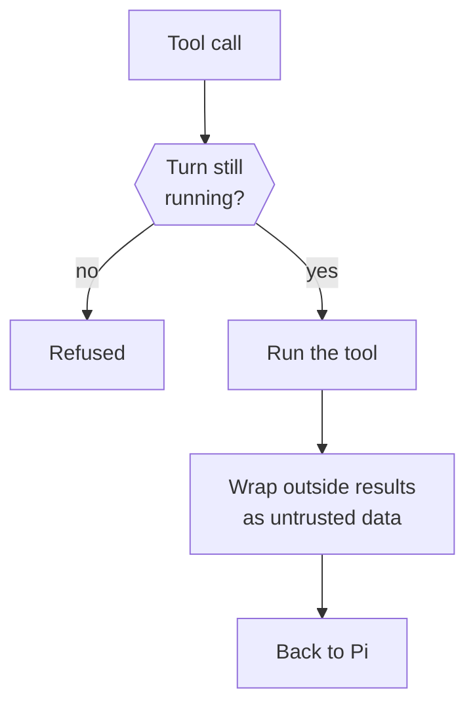

This page explains what happens inside a turn: the Pi session, the tools the model can call, the guard every call passes, and how the prompt is assembled.

The short version: `src/runtime` runs each turn in a Pi session. Every tool call goes through one turn guard. Results from the outside world reach the model wrapped as untrusted data.

Nod has its own warm, direct voice. It uses normal sentence capitalization and preserves names and acronyms. It follows the conversation language and explicit style requests, and translates what it reads in websites, email and documents, keeping their original wording only in quotes, such as a button name. It does not copy the user's casing, slang or tone. These rules also apply to channel notices and confirmation questions.

The prompt allows Nod to address you by name only when your own words establish it, including saved memory based on those words. It tells Nod to omit the name otherwise. Connected-account labels, email addresses and names in outside content do not establish your name.

Replies, task updates, questions and confirmations share one writing rule. They use short paragraphs with blank lines between them. Long answers are allowed when useful. They use lists and headings when those help you read. On Telegram and WhatsApp they use lists instead of tables and headings. A long result you may keep or reuse, such as research, a guide, a plan or a report, comes as a Markdown file with a short message giving the main finding, unless you ask for it in chat. A confirmation asks once and separates the necessary details into short paragraphs.

The prompt asks Nod to preserve source titles and identifying context in the visible reply, including a meeting's known date or a document's project. A link or the period searched does not replace that context. Context already clear for the item need not be repeated. The reply says when details are unknown, including people's roles or an item's purpose, without dropping known facts or inventing context.

The reply policy stays within the requested scope. Status checks, forecasts and causal explanations belong in answers that request them. Optional details need support from the source or the owner's words; partial or filtered results cannot establish that nothing changed. These instructions also apply when Nod resumes an existing conversation.

The prompt requires a search by known references for later resolution or payment evidence, including other threads, before treating work or a balance as open.

Email drafts are saved in the matching connected mailbox and thread, including when the owner asks to see them in chat. An explicit request for text only keeps the draft in chat.

The acting loop uses code for arithmetic and time conversions, and compares before and after values before a write.

Meeting replies use current calendar availability before proposing a time. A failed read leaves availability unknown.

The activity view stays available during work. For a longer request, Nod sends a normal chat message when a useful, verified part is ready. It states what it found or completed and what remains. It can deliver that result before the whole job is done. Routine tool steps do not each need a message or a new status line.

`send_message` accepts an optional `intent`: `update` keeps work open, and `final` ends the turn after a successful delivery. Omitting it keeps the existing update behavior. A final reply includes any staged files and ends without another model request to narrate completion. Failed delivery and an unchanged duplicate keep work open. Messages still queued run in their own turn. A newer message taken into the current turn during delivery keeps that request active.

Related details stay together. Nod can split a reply at a natural break when each message has a clear purpose. It does not split each sentence or paragraph into another notification. Progress messages need useful progress, an important change, a blocker or a question. [Notification research](https://interruptions.net/literature/Iqbal-CHI08.pdf) supports choosing useful breaks for interruptions. A [randomized field study of notification batching](https://doi.org/10.1016/j.chb.2019.07.016) also found benefits from grouping alerts. These findings guide the choice of message breaks. They do not prove that one or two messages are best for a given reply, or set a fixed message rate for Nod.

The rule uses everyday words, natural contractions and practical help. It follows [Microsoft's writing guidance](https://learn.microsoft.com/en-us/windows/apps/design/style/writing-style) on warmth, clear language and useful error recovery.

[COLING 2025 research](https://aclanthology.org/2025.coling-main.410/) supports adapting the interaction to the user rather than assuming one style suits everyone. A [2026 study of conversational style and trust](https://arxiv.org/abs/2502.10844) found that praise combined with changing stance can reduce trust. Nod therefore keeps its own judgement and explains disagreement with respect.

These sources guide the design. They do not prove the quality of each generated reply. Paragraph length and blank lines are product choices for readability.

[Research on conversational feedback](https://arxiv.org/abs/2507.22352) found that natural cues improved perceived response time in a voice and VR setting. [Sidekick](https://arxiv.org/abs/2607.17527) found benefits from combining quiet background cues with summaries of completed actions. These studies support adapting feedback to the task. They do not establish that chat messages always beat status indicators, or measure a dopamine effect from Nod messages.

## Pi sessions

Pi is the agent harness Nod runs on. It keeps the transcript, calls the model and runs tools. Nod's adapter is in [`src/providers/pi/`](https://github.com/n8n-io/nod/tree/main/src/providers/pi). The runtime in [`src/runtime/index.ts`](https://github.com/n8n-io/nod/blob/main/src/runtime/index.ts) runs sessions in parallel. Each session runs one turn at a time:

- Conversation turns share the thread's saved session. The server hands it to one turn at a time.
- Background sessions save their transcript too. A reply or secure form continues that session.
- Subagents use temporary in-memory Pi sessions and run in parallel.

Owner replies and corrections steer unfinished work until the owner cancels or replaces it. Completed earlier requests are context, not a queue.

Recent chat history goes into the prompt only when Pi has no saved session. A resumed session gets new background messages since its previous turn started. Neither includes owner messages of a [withdrawn turn](/how-it-works/threads-and-turns/#stop-and-failures); the session's next turn gets `withdrawnRequest` instead, so the model doesn't continue that request unless the owner asks again.

Pi validates tool arguments as JSON Schema with `@earendil-works/pi-schema`. It can convert a numeric string to a number or a single value to an array. This also applies to MCP tools. TypeBox refinements and custom TypeBox formats do not run. Nod's tool checks, turn guard, and trust check still apply before an action runs.

When a clarification has a few known answers, Nod uses `ask_user` with clickable choices instead of listing them in prose. This includes choosing an account in chat. Open-ended questions need no choices. The runtime assigns each option an ID; labels and descriptions contain its full meaning, with no hidden action payload. The owner can select one or several options when offered, or write their own answer. Sign-in method selection and credentials use the private sign-in flow. Choices never replace action approvals or browser handoffs. Channels, speech and rebuilt history retain the option text.

The server derives whether a question still accepts choices from its waiting turn and session. An answer, stop, reset or separate newer turn in that session closes the choices. A queued follow-up absorbed into the asking turn does not close its resulting question. Questions in other sessions stay independent. Structured answers bind to the owned question, are checked under the thread lock and preserve the selected labels and descriptions in the owner's message. Typed answers keep private-code screening; only an exact visible choice skips numeric-code interpretation. Retrying the same message ID returns its saved result; a different submission cannot reopen a question that was already answered.

## Execution records and cost

Each Pi execution has one scope: thread ID, session ID, turn ID, run ID, parent run ID, and browser ID.
The main run uses the turn ID. Each subagent gets a new run ID and uses it as its browser ID.
Tools and model usage keep this scope. `turn_events` records execution and tool activity without saving raw tool arguments or results.

`model_usage` is the only cost ledger. Each model request reports one usage ID, including subagent, compaction, review, and memory requests.
Repeated reports with the same ID create no extra charge record. Parent runs never add child costs again.
All totals come from these ledger rows. Missing prices stay unknown. Shutdown waits for pending usage writes after the model sessions close. A failed write makes shutdown fail.
Usage that arrives after a conversation reset stays on the owner's ledger without a turn link. A reference to another owner's turn is refused.
Checks linked to a turn count toward that session's task check-in, even when the agent is not running.
A stopped turn does not wait for a source check that ignores cancellation. A late result cannot mark the turn complete.

## Keeping the context small

Optional next steps belong in the result message. There is no separate offer tool, queue or delivery delay.

App tool search returns account IDs with the schemas. It needs no separate account list. When a search returns more than six tools, the first three keep full schemas and the rest form an index. Search an exact tool name to read its full schema, or separate several names with commas to read them together. A missing exact app tool name returns an explicit schema error with the available tool index. The agent must choose a returned name. Each action still uses the same account binding, validation and trust check. The observer also receives the names of tools whose schemas are deferred, so it can ask for an exact schema. A name alone cannot run a tool.

Tool descriptions state the call contract. Codemode uses tool discovery instead of a second inline copy of workspace and web schemas. It runs tool scripts without a separate model API. Nested script calls return text; use direct tool calls to show images to the model. Shared behaviour stays in the system prompt. The artifacts guide is for document formats and layout checks; Markdown, simple text files and copies do not need an extra guide read. The observer uses the supplied issue, source and memory indexes, and reads more context only for a specific need.

| Mechanism          | Rule                                                                                                                                                                                                                                                                                                                                                                                                                                                                                                                                                                                                            |
| ------------------ | --------------------------------------------------------------------------------------------------------------------------------------------------------------------------------------------------------------------------------------------------------------------------------------------------------------------------------------------------------------------------------------------------------------------------------------------------------------------------------------------------------------------------------------------------------------------------------------------------------------- |
| Compaction         | At 65,536 tokens or more, Pi compacts at 256k tokens or 16,384 tokens below the context window, whichever is smaller. It keeps the newest third of that in full. Below 65,536 tokens, it compacts at half the window and keeps the newest eighth. Summaries use the model's lightest reasoning effort: the first of `off`, `minimal`, `low` or `medium` it offers, otherwise its first effort. At 65,536 tokens or more, a turn that crosses the line sends its reply first and compacts after it, as long as the request still fits with room for the reply and stays within the line plus the third it keeps. |
| Screenshot pruning | Above twelve screenshots, the oldest are replaced in steps of eight with a note to take a new one. The prompt cache breaks only at those steps.                                                                                                                                                                                                                                                                                                                                                                                                                                                                 |
| Attached images    | PNG, JPEG and WebP images of up to 3.75 MiB each, and 16 MiB together per message, reach the model with the message. If the chat model cannot read images, an image model from a connected service supplies an untrusted description. Other images stay workspace files marked as not shown.                                                                                                                                                                                                                                                                                                                    |
| Provider errors    | Reach Pi with only the connection key redacted, so Pi's overflow recovery and retries see the real error.                                                                                                                                                                                                                                                                                                                                                                                                                                                                                                       |

Image analysis keeps the selected chat model. It prefers an image model on that model's connection, then checks the owner's other connected services. It reads current credentials for each request. The image model receives the current request and supported images, without the chat history, tool results or Vault data. Its description is untrusted data and cannot approve an action. Analysis has no automatic retry. Its usage belongs to the current session and counts toward the monthly limit and task check-in. A failed analysis leaves the image marked as not shown.

Pi exposes the browser as `nod_browser` and tool discovery as `nod_tool_search`. Server events keep `browser` and `tool_search`, with the same guard, private entry and receipt.

Normal sessions start with native workspace tools, common Nod tools, `codemode` and `tool_search`. Apps, app connections, browser, skills, personal context, questions, messages and file delivery need no discovery call. The first browser call also loads sign-in, browser profiles and payment. Less common tools load when needed. Tool search loads the schemas needed for the current work. Large models keep loaded tools for later calls. The restricted observer keeps its small read and preparation tool set available from the start.

Below 65,536 tokens, each search loads one detailed tool and removes the previous selection. Core guides are read through `skills` instead of being included in every request. Saved memory, task lists and older chat context are available through their tools. The first request keeps up to two recent complete exchanges within 4,000 characters. An exchange starts with an owner message and includes its assistant updates. The current instruction, rules and reply target stay complete. Every model gets a small connected MCP account index with guide names and revision hashes. Full server guides load through skills read when needed. A guide change updates the index, so a persistent session can read the new version.

For `openrouter/free` and `openrouter/auto`, Nod uses an 8,192-token working window because the router can select a model with a smaller window than its catalog entry. It keeps the selected router ID. It does not select a replacement model or connection.

If a restored session already uses more than half a small model's window, Nod adds a checkpoint without a model request. It keeps recent complete turns that fit in one eighth of the window. The checkpoint tells the model to retrieve older messages and files when needed. The full transcript stays on disk. This prevents an oversized old transcript from blocking its own summary request.

For these small windows, direct text tool results above half the window in characters are saved in full under `.nod/outputs/` inside the workspace. The model gets a file reference and a short preview. Nested codemode calls keep their full results so scripts can process them. Scripts can call Nod and connected MCP tools. Each call keeps its normal validation, account binding, trust check, approval order and stop guard. An approval or private-entry wait stops later calls. The final script output is untrusted data. Full argument validation and the turn guard still apply.

Each model request uses at most the output limit of its target model. Text requests from an audio model use the limit of its text companion. A smaller requested output limit stays unchanged.

Before sending a small-window model request, Nod estimates the complete serialized payload at one token per three UTF-8 bytes. It leaves a safety margin and limits output to at most a quarter of the window. A request that leaves fewer than 128 output tokens fails before it reaches the provider. This estimate includes tool schemas. Images use Pi's estimate of 1,200 tokens each, instead of counting their encoded bytes as text. The provider's actual text and image token counts can differ. Nod does not cut the current owner instruction or rules to make a request fit.

When a cut-off response's reported token use reaches the context safety margin, Nod reports a full context. It asks you to start a new conversation or choose a model with more context. Other output-limit cutoffs still offer “continue”. Nod does not replay the turn or its tools.

When a loaded session ends with tool calls that have no result, each call gets the result "This action was interrupted. Its outcome is unknown; check before doing it again."

## Tools

Tool definitions live in [`src/runtime/tools.ts`](https://github.com/n8n-io/nod/blob/main/src/runtime/tools.ts).

| Tool                                                                | What it does                                                                                                                                |
| ------------------------------------------------------------------- | ------------------------------------------------------------------------------------------------------------------------------------------- |
| `read`, `bash`, `edit`, `write`, `find`, `ls`                       | Pi's native tools. They run inside the workspace container.                                                                                 |
| `skills`                                                            | Reads a [guide](/how-it-works/skills/) or [learned skill](/how-it-works/memory/#learned-skills); only owner-started work writes one.        |
| `set_status`                                                        | Replaces the live activity description for a chat or saved task. It sends no chat message.                                                  |
| `send_message`                                                      | Sends a message now. Schedule and event runs use explicit delivery; saved tasks also deliver their final reply.                             |
| `ask_user`                                                          | Asks one question and ends the turn as waiting.                                                                                             |
| `react_to_message`                                                  | Now and then, reacts to the user's message with one emoji, on web, Telegram and WhatsApp. At most one every five minutes.                   |
| `browser`                                                           | Drives the private browser: open, snapshot, click, fill, evaluate, download and handoff.                                                    |
| `sign_in`                                                           | Enters a Vault login or code into the page without showing it to the model, then returns the page that follows.                             |
| `pay`                                                               | Submits a Vault card at checkout after your approval. Submission does not establish that payment succeeded.                                 |
| `browser_session`                                                   | Creates a browser profile to sign in to, or opens a saved one after the same check as a sign-in.                                            |
| `apps`                                                              | Runs an action on a connected account, after the trust check.                                                                               |
| `manage_apps`                                                       | Lists, discovers, connects or proposes app connections.                                                                                     |
| `manage_personal_context`                                           | Schedules, notification preferences, memory, history and usage.                                                                             |
| `task`                                                              | Starts saved task sessions, sends owner updates, reports progress and stops one task or all background work. It grants no permission.       |
| `share_file`                                                        | Attaches a workspace file to Nod's next reply or question, or sends it alone when a turn finishes or fails without one.                     |
| `create_audio`                                                      | Turns text into speech and sends it to you.                                                                                                 |
| `web_search`, `fetch_content`, `get_search_content`, `source_check` | Web research from the pinned `pi-web-access` extension. It never reads local files.                                                         |
| `mcp__<server>__<tool>`                                             | One tool for each tool of a connected MCP server, such as `mcp__n8n__validate_workflow`. Each call runs like `apps`, after the trust check. |
| `tool_search`                                                       | Finds connected MCP server tools by meaning and loads the matches for the next model call.                                                  |
| `codemode`                                                          | Runs a model-written script that calls workspace, web and connected MCP server tools.                                                       |

The `pi-web-access` extension runs in the server process with the server's permissions, but has no direct access to workspace files and never uses the server's own logins, such as a GitHub CLI session. Its connections go only to public addresses, checked when each connection opens, IP addresses included. Nod drops any proxy, whether the model names it or the settings file sets it. Its settings live in `NOD_DATA_ROOT/pi/web-search.json`.

## The turn guard

Every tool call, including every call a codemode script makes, passes the same guard.

- **Cancellation:** a stopped or finished turn can't start a call. Server callbacks also check `withTurnLock` before they run.
- **Observations:** the guard reports each call to an optional observer. Only the capability evals and the voice eval script set one; the capability evals redact typed text and memory arguments.
- **App actions:** `apps` and every connected MCP server tool also pass the server's [trust check](/trust/approvals/).

`apps` and `manage_personal_context` calls run in parallel with each other and with subagents. The trust check covers app actions, changes to schedules, notification settings, the owner's rules and spending limits, and forgetting a note or turning memory on, off or clearing it, and those checks run in parallel too. Other `manage_personal_context` operations, such as saving a note and reads, have no trust check and count as decided as soon as they reach the server.

Public web reads also run in parallel when the model requests independent searches or pages in one step. Each call passes the same turn guard. Browser steps run in sequence.

Managed app requests use the request's time limit, or the client's default, for the whole response. Nod keeps that deadline and the caller's Stop signal active after headers arrive. The SDK keeps its normal lazy parsing: a raw response is available at headers, and Nod does not read an extra copy first. Completed parsing removes the timer and Stop listener without aborting the retained raw response. Without parsing, a raw response with a body keeps those guards until its deadline or Stop. Client and request options cannot enable retries.

A call acts only once every `apps` or `manage_personal_context` call issued before it in the turn is decided, and each earlier one that asks has opened its question or failed. If one of them opened a question, the later call is refused. A turn has at most one open confirmation: while one waits for the owner, approvals refuse to open another.

## Codemode

Pi's `codemode` tool runs model-written JavaScript in a QuickJS sandbox with no network, files or timers.

- Scripts can call the workspace, `pi-web-access`, connected MCP and normal Nod tools. Independent calls can run in parallel. Scripts have no separate model API.
- Each nested call passes the same turn guard, account checks, order and trust check as a direct call. If a check asks you first, later calls cannot act and the question goes to chat.
- Nested calls return text. Use a direct tool call when the model needs an image, such as a browser screenshot.
- Calls inside a script stay raw so the script can parse them. Codemode's output is wrapped when it returns.

## Connected MCP server tools

Each tool of a connected MCP server becomes its own Pi tool, named `mcp__<server>__<tool>`, with the server's own description and input schema. These tools are deferred: the model loads the ones it needs with `tool_search` or calls them from codemode, so a server with dozens of tools doesn't fill every request. Each server's own guide to its tools reaches Pi inside an `untrusted_tool_result` block, as data that never grants permission.

Nod keeps one MCP connection per account and address for a minute after its last call, caches each server's tool list for ten minutes and waits up to ten minutes for one call.

When a known tool list expires, a new turn uses the last successful list while Nod refreshes it. It does not wait for that refresh. The first load still waits for the server. Explicit tool searches wait for a current list. Each turn checks the connected accounts again, and each tool call checks its account binding and permission before it runs.

## Untrusted results

Results from apps, the browser, the web and codemode reach Pi inside one `untrusted_tool_result` block with a data-not-instructions notice. Workspace tool results aren't wrapped, and errors reach Pi unwrapped. See [Untrusted content](/trust/untrusted-content/).

## How the prompt is built

The prompt has three layers, built in [`src/runtime/prompt.ts`](https://github.com/n8n-io/nod/blob/main/src/runtime/prompt.ts).

| Layer         | Contains                                                                               | Sent                       |
| ------------- | -------------------------------------------------------------------------------------- | -------------------------- |
| Static prompt | Shared behavior and security rules, guide names, and Pi's tool guidelines              | Once per session           |
| Owner context | Account details, date format, the memory index and the learned skill index             | Again only when it changes |
| Turn message  | Mode, time, channel, message ID, reply target, recent conversation and the instruction | Every turn                 |

One shared prompt serves large and small context windows. Guides load only when their procedures are needed. Pi's tool guidelines are appended to the shared prompt.

The model receives a small presentation object schema for `send_message`. The server still validates the complete visual before delivery.

Each model request includes the active system prompt, tools and session history. The provider can reuse a matching prefix from its prompt cache. Building a prompt once does not remove it from later requests.

Task IDs stay in the turn message. Pi supplies the workspace path after the shared instructions. These values do not change the shared instruction prefix when a new task starts.

For OpenAI API models that support explicit cache boundaries, Nod marks the end of the shared instructions before the workspace path. This boundary also covers tool definitions that precede the instructions. The request keeps implicit caching for the growing conversation and uses the provider's default cache lifetime.

For Anthropic API models, Nod moves the system text's cache marker to that same boundary. The workspace path follows in a second text block. The request keeps the SDK's tool and conversation markers, cache lifetime and total number of markers. Disabled caching stays disabled.

ChatGPT subscriptions and other model APIs keep their existing cache settings.

When a model's cache lifetime is known, as for Anthropic, the chat's Pi session stays open after a turn so Pi can keep a large conversation's cache warm for up to 30 minutes. Each refresh gets one Usage record, even if it fails or is cancelled. A cancelled refresh stays unknown if its usage has not arrived. Stop does not wait for a later reply.

The owner context is a message of its own, never part of the system prompt, so a memory change leaves the system prompt and the conversation before it untouched:

- A session gets the full current owner context with its first turn, and again with the first turn after it changes. The newest copy gives the current values.
- Earlier copies stay where they are, so the cached conversation after them stays valid.
- Compaction summaries leave the owner context out. A session that compacts it away gets it again with its next request.

Providers that take a prompt cache key, such as OpenAI, get the same one from every session of a thread: a keyed hash of the thread ID that changes when Nod restarts. When a session's system prompt and tools match a recent request from the same thread, as they do for back-to-back background runs even after memory changes, the provider reads them from its cache and bills them at its cheaper cache-read rate. The code is in [`src/providers/pi/index.ts`](https://github.com/n8n-io/nod/blob/main/src/providers/pi/index.ts).

## Message cadence

Nod keeps two things apart:

- **Live status** briefly names the current activity when an update helps you follow the work. It updates in place without notifying you. Its activity records are separate from chat messages.
- **Messages** are what Nod says to you: an opening line, a useful milestone or partial result, a question, a blocker, the final result or a failure.

Live status covers work you started: a chat request, a task, a reply to a task, and work that continues after you answer or approve something. Schedules and email events that Nod starts on its own show none, and a task Nod starts on its own shows its line on its card only. Whether Nod is working comes from the turn's state and its tool events, never from what the model says about its progress; the model only writes the activity description.

Nod chooses whether an activity update would help you follow longer work and skips it for quick replies and simple actions. The `set_status` tool replaces the live description without a chat message or notification. It briefly names the current work, such as "Comparing flight prices", without generic busy text, tool names, private details or completion claims. This guidance also applies to smaller model contexts. A status call can run alongside useful work. When the model streams a reasoning summary whose block starts with a bold heading, the runtime records that heading as a `thought` event, and the line shows the newest step or thought; thoughts never appear in a task's activity list. Without either, a task's card falls back to the task's saved progress. Otherwise the line uses the website or app of a call that's still running, and then a rotating word, such as **Joining the dots…**, which screen readers hear as **Working…**. A task's card shows **Working…** while its turn waits to start; the chat's line shows the rotating word from the moment you send. The chat's line follows only the chat session's turn; each task's card shows its own. After a quiet minute it adds how long nothing has happened. A description written before the owner's newest message stops counting once Nod reads that message. You can still stop active work from the composer. The status is computed in [`src/server/activity.ts`](https://github.com/n8n-io/nod/blob/main/src/server/activity.ts), and the runtime records steps in [`src/runtime/index.ts`](https://github.com/n8n-io/nod/blob/main/src/runtime/index.ts).

| Where               | While Nod works for you                                                                                                                                                                                                                                                                                                                                                                                      |
| ------------------- | ------------------------------------------------------------------------------------------------------------------------------------------------------------------------------------------------------------------------------------------------------------------------------------------------------------------------------------------------------------------------------------------------------------ |
| Nod web and desktop | A line beside the animated Nod mark from the moment you send: the current step or a runtime fallback, the website it waits on and quiet minutes. A second line confirms a message sent mid-work until Nod reads it. A task also shows its title, and its card shows the same line. When the chat's work ends, the line stays until Nod's answer appears in its place; it disappears when work waits for you. |
| Telegram            | **typing…** plus a quoted progress section in your language, or the website or app Nod is using, on an eligible first message. It updates without another notification and is removed when work stops. Milestones arrive separately. See [While Nod works](/use/channels/#while-nod-works) for which messages show live status.                                                                              |
| WhatsApp            | **typing…** only; it marks your latest message as read. In Business Cloud API mode, Nod stops typing when the 24-hour reply window closes. A QR-paired connection does not set that limit. In both apps, a message sent mid-work gets 👀 until Nod reads it.                                                                                                                                                 |

| Moment              | What Nod does                                                                                                      | Purpose                                                                 |
| ------------------- | ------------------------------------------------------------------------------------------------------------------ | ----------------------------------------------------------------------- |
| Start               | Keep active work stoppable. Add an activity description when useful. A saved task uses its existing start message. | Let you control work without an extra chat message.                     |
| Routine work        | Update an existing description when the main activity changes.                                                     | Show the current work without narrating each tool call.                 |
| Milestone           | Send a verified result the user can use now. Include the result, an attachment or a checked link.                  | Give the user something they can inspect before the whole job is done.  |
| Something needs you | Send a question, blocker or decision as a message.                                                                 | Make a required response clear.                                         |
| End                 | Deliver the final result. State a failure, interruption or spending limit when it stops requested work.            | Mark the actual outcome and avoid repeating messages already delivered. |
| After               | Make at most one relevant offer. Do not repeat an offer the user ignored or declined.                              | Keep follow-up useful and easy to dismiss.                              |

A turn that stops on an error tells you what stopped it, in your language. A failed schedule run, or a failed task Nod started on its own, names that work in its failure message. A task's planned check resumes the task's own session when it's due.

Nod reports progress when you can use a result now, a change affects your next step, or it needs your help. A claim that work was created, updated or completed needs a successful tool result. The message includes the result, an attachment or a checked link you can open. Internal record changes and private preparation stay quiet unless you ask about them. These instructions guide the model. For a proactive nudge, the server also adds the saved result's verified link.

A partial result does not mean the whole task is finished. Background schedules and events keep routine checks quiet and deliver only what their standing instruction asks for.

The runtime's conversation guidance defines these message breaks. The confirmation and notice writer uses the same voice and paragraph rules, but returns one message for its supplied purpose. It does not receive instructions to send progress messages or start another part of a conversation.

## Compact command output

Workspace images include a pinned [RTK](https://github.com/rtk-ai/rtk). Supported simple Bash commands are rewritten to RTK inside the workspace for compact Git, file, search, test and build output. Pipes, redirection, machine-output flags, bare `git log` and `find` stay raw. RTK's `find` skips hidden and ignored folders such as `.nod`, where Nod keeps its working files. Unsupported commands fall back before they run, and executed commands are never retried. `rtk proxy <command>` gives exact output. The rules are in [`src/providers/pi/sandbox.ts`](https://github.com/n8n-io/nod/blob/main/src/providers/pi/sandbox.ts).

## Related resources

- [Architecture](/how-it-works/architecture/)
- [Threads and turns](/how-it-works/threads-and-turns/)
- [Sandbox and browser isolation](/how-it-works/sandbox-and-browser/)
- [Skills](/how-it-works/skills/)
- [Untrusted content](/trust/untrusted-content/)
