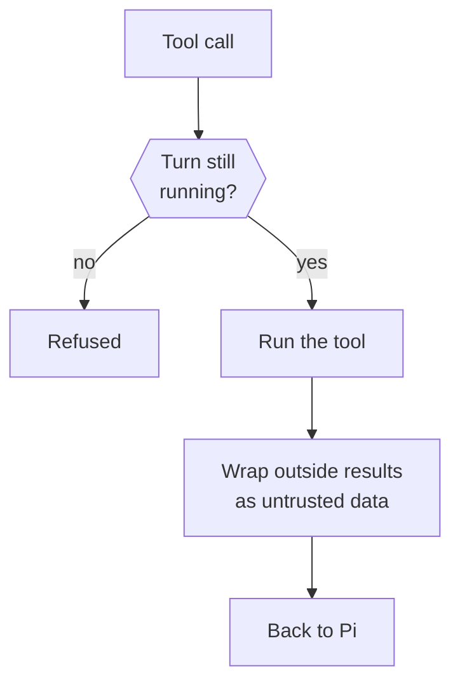

This page explains what happens inside a turn: the Pi session, the tools the model can call, the guard every call passes, and how the prompt is assembled.

The short version: `src/runtime` runs each turn in a Pi session. Every tool call goes through one turn guard. Results from the outside world reach the model wrapped as untrusted data.

Nod has its own warm, direct voice. It uses normal sentence capitalization and preserves names and acronyms. It follows the conversation language and explicit style requests. The conversation language is the language of your latest message to Nod, in chat or to a task, not counting answers to approval cards. When that message is too short to tell, Nod keeps the language it last used, and a request to use a language wins. Chat, tasks, background work and model-written approvals all switch together when you switch; websites, email and the language of an older request never choose it. Nod translates what it reads in websites, email and documents, keeping their original wording only in quotes, such as a button name. It does not copy the user's casing, slang or tone. These rules also apply to channel notices. Model-written approval questions and both of their button labels use the conversation language.

The prompt allows Nod to address you by name only when your own words establish it, including saved memory based on those words. It tells Nod to omit the name otherwise. Connected-account labels, email addresses and names in outside content do not establish your name.

Replies, task updates and questions share one writing rule. They use short paragraphs with blank lines between them. Long answers are allowed when useful. They use lists and headings when those help you read. On Telegram and WhatsApp they use lists instead of tables and headings. A long result you may keep or reuse, such as research, a guide, a plan or a report, comes as a Markdown file with a short message giving the main finding, unless you ask for it in chat. A confirmation asks once and shows the action data separately.

The prompt asks Nod to preserve source titles and identifying context in the visible reply, including a meeting's known date or a document's project. A link or the period searched does not replace that context. Context already clear for the item need not be repeated. The reply says when details are unknown, including people's roles or an item's purpose, without dropping known facts or inventing context.

The reply policy stays within the requested scope. Status checks, forecasts and causal explanations belong in answers that request them. Optional details need support from the source or the owner's words; partial or filtered results cannot establish that nothing changed. These instructions also apply when Nod resumes an existing conversation.

The prompt requires a search by known references for later resolution or payment evidence, including other threads, before treating work or a balance as open.

Email drafts are saved in the matching connected mailbox and thread, including when the owner asks to see them in chat. An explicit request for text only keeps the draft in chat.

The acting loop uses code for arithmetic and time conversions, and compares before and after values before a write.

Meeting replies use current calendar availability before proposing a time. A failed read leaves availability unknown.

The activity view stays available during work. For a longer request, Nod sends a normal chat message when a useful, verified part is ready. It states what it found or completed and what remains. It can deliver that result before the whole job is done. Routine tool steps do not each need a message or a new status line.

`send_message` accepts an optional `intent`: `update` keeps work open, and `final` ends the turn after a successful delivery. Omitting it keeps the existing update behavior. A final reply includes any staged files and ends without another model request to narrate completion. Failed delivery and an unchanged duplicate keep work open. Messages still queued run in their own turn. A newer message taken into the current turn during delivery keeps that request active.

Related details stay together. Nod can split a reply at a natural break when each message has a clear purpose. It does not split each sentence or paragraph into another notification. Progress messages need useful progress, an important change, a blocker or a question. [Notification research](https://interruptions.net/literature/Iqbal-CHI08.pdf) supports choosing useful breaks for interruptions. A [randomized field study of notification batching](https://doi.org/10.1016/j.chb.2019.07.016) also found benefits from grouping alerts. These findings guide the choice of message breaks. They do not prove that one or two messages are best for a given reply, or set a fixed message rate for Nod.

The rule uses everyday words, natural contractions and practical help. It follows [Microsoft's writing guidance](https://learn.microsoft.com/en-us/windows/apps/design/style/writing-style) on warmth, clear language and useful error recovery.

[COLING 2025 research](https://aclanthology.org/2025.coling-main.410/) supports adapting the interaction to the user rather than assuming one style suits everyone. A [2026 study of conversational style and trust](https://arxiv.org/abs/2502.10844) found that praise combined with changing stance can reduce trust. Nod therefore keeps its own judgement and explains disagreement with respect.

These sources guide the design. They do not prove the quality of each generated reply. Paragraph length and blank lines are product choices for readability.

[Research on conversational feedback](https://arxiv.org/abs/2507.22352) found that natural cues improved perceived response time in a voice and VR setting. [Sidekick](https://arxiv.org/abs/2607.17527) found benefits from combining quiet background cues with summaries of completed actions. These studies support adapting feedback to the task. They do not establish that chat messages always beat status indicators, or measure a dopamine effect from Nod messages.

## Pi sessions

Pi is the agent harness Nod runs on. It keeps the transcript, calls the model and runs tools. Nod's adapter is in [`src/providers/pi/`](https://github.com/n8n-io/nod/tree/main/src/providers/pi). The runtime in [`src/runtime/index.ts`](https://github.com/n8n-io/nod/blob/main/src/runtime/index.ts) runs sessions in parallel. Each session runs one turn at a time:

- Conversation turns share the thread's saved session. The server hands it to one turn at a time.
- Background sessions save their transcript too. A reply or secure form continues that session.
- Subagents use temporary in-memory Pi sessions and run in parallel.

Owner replies and corrections steer unfinished work until the owner cancels or replaces it. Completed earlier requests are context, not a queue.

Recent chat history goes into the prompt only when Pi has no saved session. A resumed session gets new background messages since its previous turn started. Neither includes owner messages of a [withdrawn turn](/how-it-works/threads-and-turns/#stop-and-failures); the session's next turn gets `withdrawnRequest` instead, so the model doesn't continue that request unless the owner asks again.

History search returns message IDs and turn IDs. Its `around` option accepts either kind. A turn ID opens the context around that turn's first visible message. The anchor message is complete; nearby messages can be shortened. Reads remain limited to the owner's active conversation. Hidden messages and turns with no visible message cannot serve as anchors.

Nod repairs incomplete assistant text and thinking blocks when it restores or saves a session and before each model request. This also covers tool continuations and summary requests. The repair keeps valid text and tool calls and does not repeat an action.

Pi validates tool arguments as JSON Schema with `@earendil-works/pi-schema`. It can convert a numeric string to a number or a single value to an array. This also applies to MCP tools. TypeBox refinements and custom TypeBox formats do not run. Nod's tool checks, turn guard, and trust check still apply before an action runs.

When an action has one matching input form, a rejected call names its missing or invalid fields. The `skills`, `browser_session`, and `task` tools list all valid actions when an action is invalid. Each action requires its own fields and refuses extra fields. Five repeated input, tool availability, sign-in binding, or action review failures for the same tool end the run before another model request. A successful call to that tool clears its count. Parent and helper sessions have separate counts. The failure keeps its last specific cause after secret removal. Nod reports it without creating an unexpected-error report. This limit does not repeat any tool or bypass an approval.

Nod applies provider settings when it opens a model connection. Groq Qwen uses the system message role. OpenRouter MiMo V2.6 Flash uses tools without optional strict sampling, so tools with different sampling settings can share a request. A tool that requires strict sampling still refuses a model that cannot supply it. OpenRouter's free route keeps reasoning enabled because a routed model can require it. Its picker does not offer Off; a saved Off choice uses the lowest supported effort. Ollama models with only on or off thinking send an effort value: `none` turns thinking off and `high` turns it on. Models with named thinking levels send a supported effort instead. OpenCode helper calls get a separate session ID for each helper request, shared by that request's model retries.

Some OpenAI-compatible models, such as Mistral reasoning models, stream the answer as a list of content parts. Nod reads the text parts as the answer and leaves out reasoning parts.

After a model list refresh or a connection is saved again, an unsupported saved effort changes to a supported effort for the same model. Nod chooses the first listed effort that is Off, Minimal, Low or Medium. If none is listed, it uses the first listed effort. A supported choice stays unchanged.

If Ollama does not report its thinking controls, Nod uses the server's default instead of sending an effort value.

Nod corrects saved Ollama boolean effort values when it opens a model connection. A model that advertises only On keeps thinking enabled. Its selected-model check can still fail if reasoning uses the check's 512-token limit.

Helper requests use Pi's bounded retry policy. Invalid requests, account limits, and authentication failures do not get unconditional retries. Provider-client retries remain off. A model retry does not repeat a turn or a completed tool action.

The model adapter uses supported HTTP and stream hooks to record the observed request phase. Available transport cause codes are retained. An absent cause stays unknown. Google's adapters reject custom fetch hooks. Their transport failures can therefore retain only the last observed payload phase. No provider transport or dependency is replaced to obtain missing details.

When a clarification has a few known answers, Nod uses `ask_user` with clickable choices instead of listing them in prose. This includes choosing an account in chat. Open-ended questions need no choices. The runtime assigns each option an ID; each label contains its full meaning, with no hidden action payload. The owner can select one or several options when offered, or write their own answer. Sign-in method selection and credentials use the private sign-in flow. Choices never replace action approvals or browser handoffs. Channels, speech and rebuilt history retain the option text.

The server derives whether a question still accepts choices from its waiting turn and session. An answer, stop, reset or separate newer turn in that session closes the choices. A queued follow-up absorbed into the asking turn does not close its resulting question. Questions in other sessions stay independent. Structured answers bind to the owned question, are checked under the thread lock and preserve the selected labels and descriptions in the owner's message. Typed answers keep private-code screening; only an exact visible choice skips numeric-code interpretation. Retrying the same message ID returns its saved result; a different submission cannot reopen a question that was already answered.

## Execution records and cost

Each Pi execution has one scope: thread ID, session ID, turn ID, run ID, parent run ID, and browser ID.
The main run uses the turn ID. Each subagent gets a new run ID and uses it as its browser ID.
Tools and model usage keep this scope. `turn_events` records execution and tool activity without saving raw tool arguments or results.

`model_usage` is the only cost ledger. Each model request reports one usage ID, including subagent, compaction, review, and memory requests.
Repeated reports with the same ID create no extra charge record. Parent runs never add child costs again.
All totals come from these ledger rows. Missing prices stay unknown. Shutdown waits for pending usage writes after the model sessions close. A failed write makes shutdown fail.
Usage that arrives after a conversation reset stays on the owner's ledger without a turn link. A reference to another owner's turn is refused.
Checks linked to a turn count toward that session's task check-in, even when the agent is not running.
A stopped turn does not wait for a source check that ignores cancellation. A late result cannot mark the turn complete.

## Keeping the context small

Optional next steps belong in the result message. There is no separate offer tool, queue or delivery delay.

The agent's context lists the tool names of each connected MCP server, taken from the tool list Nod already keeps, so the agent can load a tool by name instead of searching for it. All servers share one limit of 150 names, filled in connection order; a server whose tools don't fit in what is left shows only its count. The compact context for small models keeps only the counts. Names use the same lowercase letters, digits and `_` as the loaded tools, and they are data from the server, never permission. Apps connected through the connection service are still found with tool search. Loading a server's first tool with `nod_tool_search` also returns that server's guide, as untrusted data, so the agent doesn't need a separate `skills` read before using it.

App tool search returns account IDs with the schemas. It needs no separate account list. When a search returns more than six tools, the first three keep full schemas and the rest form an index. Search an exact tool name to read its full schema, or separate several names with commas to read them together. A missing exact app tool name returns an explicit schema error with the available tool index. The agent must choose a returned name. Each action still uses the same account binding, validation and trust check. The observer also receives the names of tools whose schemas are deferred, so it can ask for an exact schema. A name alone cannot run a tool.

Tool descriptions state the call contract. Codemode uses tool discovery instead of a second inline copy of workspace and web schemas. It runs tool scripts without a separate model API. Nested script calls return text; use direct tool calls to show images to the model. Shared behaviour stays in the system prompt. The artifacts guide is for document formats and layout checks; Markdown, simple text files and copies do not need an extra guide read. The observer uses the supplied issue, source and memory indexes, and reads more context only for a specific need.

When a script fails, Nod waits for tool calls that the script already started before it reports their results. A completed action keeps its result. The failed script starts no further calls and does not repeat a call. **Stop** or the script's deadline ends this wait, even when a tool does not respond to cancellation. A call that has not finished has an unknown result. An outside action already sent can still finish. Check its result before you repeat it.

| Mechanism            | Rule                                                                                                                                                                                                                                                                                                                                                                                                                                                                                                                                                                                                                                                                                                                                  |
| -------------------- | ------------------------------------------------------------------------------------------------------------------------------------------------------------------------------------------------------------------------------------------------------------------------------------------------------------------------------------------------------------------------------------------------------------------------------------------------------------------------------------------------------------------------------------------------------------------------------------------------------------------------------------------------------------------------------------------------------------------------------------- |
| Compaction           | At 65,536 tokens or more, Pi compacts at 256k tokens or 16,384 tokens below the context window, whichever is smaller. It keeps the newest third of that in full. Below 65,536 tokens, it compacts at half the window and keeps the newest eighth. Pi uses the session's model at its lowest supported effort for summaries. It decides when to compact and retries a failed model request after overflow recovery, without repeating completed tool calls.                                                                                                                                                                                                                                                                            |
| Earlier tool results | A new request that starts after the prompt cache went cold leaves out tool results over 2,000 characters from earlier requests. The cache counts as cold five minutes after the last request or cache refresh, or after a change of model or provider. Each removed result becomes a short note with the tool name and size that tells the model to read the source again for details and never to repeat an action to see its result. Every message and tool call stays. Results of the current request, including earlier turns it resumes, stay complete. A warm request or a resume never moves this boundary, so it causes no cache miss. The saved transcript keeps every result, and compaction summarizes what the model saw. |
| Screenshot pruning   | Above twelve screenshots, the oldest are replaced in steps of eight with a note to take a new one. The prompt cache breaks only at those steps.                                                                                                                                                                                                                                                                                                                                                                                                                                                                                                                                                                                       |
| Attached images      | PNG, JPEG and WebP images of up to 3.75 MiB each, and 16 MiB together per message, reach the model with the message. If the chat model cannot read images, an image model from a connected service supplies an untrusted description. Other images stay workspace files marked as not shown.                                                                                                                                                                                                                                                                                                                                                                                                                                          |
| Provider errors      | Reach Pi with only the connection key redacted, so Pi's overflow recovery and retries see the real error.                                                                                                                                                                                                                                                                                                                                                                                                                                                                                                                                                                                                                             |

Image analysis keeps the selected chat model. It prefers an image model on that model's connection, then checks the owner's other connected services. It reads current credentials for each request. The image model receives the current request and supported images, without the chat history, tool results or Vault data. Its description is untrusted data and cannot approve an action. Analysis has no automatic retry. Its usage belongs to the current session and counts toward the monthly limit and task check-in. A failed analysis leaves the image marked as not shown.

Pi exposes the browser as `nod_browser` and tool discovery as `nod_tool_search`. Server events keep `browser` and `tool_search`, with the same guard, private entry and receipt.

Normal sessions start with native workspace tools, common Nod tools, `codemode` and `tool_search`. Apps, app connections, browser, skills, personal context, questions, messages and file delivery need no discovery call. The first browser or browser profile call also loads sign-in and payment, and a browser call also loads browser profiles. Less common tools load when needed. Tool search loads the schemas needed for the current work. Large models keep loaded tools for later calls and later turns of the same session, so a follow-up doesn't search for them again. The restricted observer keeps its small read and preparation tool set available from the start.

Below 65,536 tokens, the `apps` and `send_message` tools stay loaded with the workspace tools and `nod_tool_search`, so connected apps are reachable and a scheduled run can deliver its result without a search. Connected MCP server tools still load through search. Each search loads one other detailed tool and removes the previous selection. The search result names the loaded tool; its full schema appears in the next model call. Core guides are read through `skills` instead of being included in every request. Saved memory, task lists and older chat context are available through their tools. The first request keeps up to two recent complete exchanges within 4,000 characters. An exchange starts with an owner message and includes its assistant updates. The current instruction, rules and reply target stay complete. Every model gets a small connected MCP account index with guide names and revision hashes. Full server guides load through skills read when needed. A guide change updates the index, so a persistent session can read the new version.

Sign-in form status guidance enters a request only when the session has an earlier form status to interpret.

For `openrouter/free` and `openrouter/auto`, Nod uses an 8,192-token working window because the router can select a model with a smaller window than its catalog entry. It keeps the selected router ID. It does not select a replacement model or connection.

Working limits come from [`src/providers/pi/context.ts`](https://github.com/n8n-io/nod/blob/main/src/providers/pi/context.ts). Model registration, Pi sessions and provider requests use the same effective context and output limits. The same policy sets compaction, safety margins and tool output bounds. The turn runtime and capability reports also use this policy. An audio model and its text companion share the smaller context and output limits. An explicit request can use less output.

Audio sessions use Pi's native model routing. Requests with retained recordings use the audio model. Other requests and compaction summaries use its text companion. Pi can identify the model that answered and apply that model's overflow recovery.

Pi manages request limits, saved context, compaction and provider-reported overflow. This includes resumed sessions and sessions opened with another model. Pi selects the history boundary, runs its summary routine and makes at most one compact-and-retry attempt for a failed model request. Nod does not add a second request-size check or output reservation.

Nod checks individual messages against half the model's context estimate. For an oversized message, a Pi context edit replaces text or images with a workspace file reference when that reduces its size. Messages with only tool calls or thinking stay unchanged. The file reference includes a bounded preview. The original message stays in the saved transcript. Assistant tool calls and thinking blocks stay intact. File references keep the owner-context and learned-skill labels, so trace redaction still applies. Pi uses the edited context for later requests and summaries. Oversized saved summaries receive a bounded file checkpoint with the same retained history.

Pi's native tool loadout leaves oversized tool declarations out of model requests while keeping the tools callable. Large discovery results use the same workspace file path as other large messages. Core tools stay available.

After a provider overflow or premature output cutoff, Nod sets Pi's retained-token budget to zero for recovery. This lets Pi select a cut when its estimate would otherwise leave no history to summarize. Pi still selects the boundary and retries only the model request. Completed tools do not run again. If a failed request entered a summary, Nod restores the preceding valid checkpoint before another turn. The failed input and summary stay in the saved transcript, outside model context.

For every context size, Nod saves large direct tool results under `.nod/outputs/` inside the workspace. It uses Pi's tool-result estimate and a byte limit. Calls in the same model response share those limits equally, including their previews. Saved images keep their original bytes; a manifest lists the files and accompanying text. The model gets a workspace-relative file reference and a short preview. Nested codemode calls keep their full results so scripts can process them. Scripts can call Nod and connected MCP tools. Each call keeps its normal validation, account binding, trust check, approval order and stop guard. An approval or private-entry wait stops later calls. The final script output is untrusted data.

Each model request uses at most the output limit of its target model and half its context window. Below 65,536 tokens, output is limited to a quarter of the window. Text requests from an audio model use the limit of its text companion. A smaller requested output limit stays unchanged. Pi receives that same output limit, so a normal output cutoff does not trigger context recovery.

OpenRouter requests also have a 32,768-token working output limit, including reasoning. Smaller model and request limits still apply. This avoids reserving a large model's entire output capacity against the account's credits. It leaves the input context window intact. Accounts with insufficient credits can still receive OpenRouter's specific credit error.

The provider makes the final context check. Provider account limits, such as tokens per minute, are separate from context limits. A small patch to Pi's overflow detector excludes quota codes, token-rate limits, and HTTP 401, 402, 403, 404, 408, 409, 410, 429 and 5xx responses before it checks token wording. Pi then uses its normal retry policy. An explicit token-rate failure stops compaction for that request and keeps the provider reason.

Nod runs Pi's native summary routine with the selected model at its lowest supported effort. Pi sets the summary request's output allowance. If the provider reports a context overflow or summary output reaches its limit, Nod saves the full source in the workspace. A bounded checkpoint keeps the file reference, the current owner instruction and Pi's selected tail. An incomplete model summary is never used as a checkpoint. Each summary request keeps its own usage record, including a request that ends at its output limit. An abort never saves a checkpoint.

A summary failure during overflow recovery stops the unfinished request with its specific reason. A failed threshold summary does not fail an already completed answer. Its failed usage record and the previous valid context remain available.

When a cut-off response's reported token use reaches the context safety margin, Nod reports a full context and suggests a shorter instruction or a model with more context. Other output-limit cutoffs still offer “continue”. Nod does not replay the turn or its tools.

When a loaded session ends with tool calls that have no result, each call gets the result "This action was interrupted. Its outcome is unknown; check before doing it again."

## Tools

Tool definitions live in [`src/runtime/tools.ts`](https://github.com/n8n-io/nod/blob/main/src/runtime/tools.ts).

| Tool                                                                | What it does                                                                                                                                                  |
| ------------------------------------------------------------------- | ------------------------------------------------------------------------------------------------------------------------------------------------------------- |
| `read`, `bash`, `edit`, `write`                                     | Pi's native tools. They run inside the workspace container. `bash` covers listing and finding files.                                                          |
| `skills`                                                            | Reads a [guide](/how-it-works/skills/) or [learned skill](/how-it-works/memory/#learned-skills); only owner-started work writes one.                          |
| `send_message`                                                      | Sends a message now. Schedule and event runs use explicit delivery; saved tasks also deliver their final reply.                                               |
| `ask_user`                                                          | Asks one question and ends the turn as waiting.                                                                                                               |
| `react_to_message`                                                  | Reacts to the user's message with one emoji, on web, Telegram and WhatsApp, such as when a message only gives context.                                        |
| `browser`                                                           | Drives the private browser: open, snapshot, click, fill, evaluate, download and handoff.                                                                      |
| `sign_in`                                                           | Enters a Vault login or code into the page without showing it to the model, then returns the page that follows.                                               |
| `pay`                                                               | Submits a Vault card at checkout after your approval. Submission does not establish that payment succeeded.                                                   |
| `browser_session`                                                   | Creates a browser profile to sign in to, or opens a saved one after the same check as a sign-in.                                                              |
| `apps`                                                              | Runs an action on a connected account, after the trust check.                                                                                                 |
| `computer`                                                          | Uses native apps on macOS, Windows and Linux (experimental) through their accessibility tree, when the owner turns on [computer use](/connect/computer-use/). |
| `manage_apps`                                                       | Lists, discovers, connects or proposes app connections.                                                                                                       |
| `memory`                                                            | Finds, reads, learns and forgets memory notes, searches chat history, and reads or changes notification preferences and standing rules.                       |
| `nod`                                                               | Nod's own docs, schedules, models, usage, limits, prepared work and bug reports. Reading the `nod` guide loads it.                                            |
| `task`                                                              | Starts saved task sessions, sends owner updates, reports progress and stops one task or all background work. It grants no permission.                         |
| `share_file`                                                        | Attaches a workspace file to Nod's next reply or question, or sends it alone when a turn finishes or fails without one.                                       |
| `create_audio`                                                      | Turns text into speech and sends it to you.                                                                                                                   |
| `web_search`, `fetch_content`, `get_search_content`, `source_check` | Web research from the pinned `pi-web-access` extension. It never reads local files.                                                                           |
| `flights`                                                           | Searches Google Flights from the server and returns options that `send_message` can show by ID. Reading the `travel` guide loads it.                          |
| `mcp__<server>__<tool>`                                             | One tool for each tool of a connected MCP server, such as `mcp__n8n__validate_workflow`. Each call runs like `apps`, after the trust check.                   |
| `tool_search`                                                       | Finds connected MCP server tools by meaning and loads the matches for the next model call.                                                                    |
| `codemode`                                                          | Runs a model-written script that calls workspace, web and connected MCP server tools.                                                                         |

The `pi-web-access` extension runs in the server process with the server's permissions, but has no direct access to workspace files and never uses the server's own logins, such as a GitHub CLI session. Its connections go only to public addresses, checked when each connection opens, IP addresses included. Nod drops any proxy, whether the model names it or the settings file sets it. Its settings live in `NOD_DATA_ROOT/pi/web-search.json`.

### Questions about Nod

Nod searches its own documentation before answering any question about Nod. This covers setup, models, channels, schedules, memory, privacy, safety, troubleshooting, and development. It reads the relevant sections and links to them. The `nod` guide holds this rule, the greeting and ideas guidance, how Nod's settings work and when to draft a bug report; reading it loads the `nod` tool.

The `nod` tool's `docs_search` and `docs_read` actions build an index on its first use and keeps it in memory. Search ignores case and accents, while keeping different words distinct. It gives more weight to section titles and terms that occur in fewer sections. Search adjusts for section length and limits the effect of repeated words. Search returns up to five results with short excerpts. A read returns up to 8,000 characters. Longer sections include an offset to read the next part. Neither action calls a model or sends a network request.

Desktop packages and self-hosted images include the Markdown and MDX pages from the same source as the application. The tool reads only indexed sections. It accepts no file path or website address. Documentation is data, not permission to act. Nod still uses live tools to check current account state and owner settings.

## The turn guard

Every tool call, including every call a codemode script makes, passes the same guard.

- **Cancellation:** a stopped or finished turn can't start a call. Server callbacks also check `withTurnLock` before they run.
- **Observations:** the guard reports each call to an optional observer. Only the capability evals and the voice eval script set one; the capability evals redact typed text and memory arguments.
- **App actions:** `apps` and every connected MCP server tool also pass the server's [trust check](/trust/approvals/).

`apps`, `memory` and `nod` calls run in parallel with each other and with subagents. The trust check covers app actions, changes to schedules, notification settings, the owner's rules and spending limits, and forgetting a note or turning memory on, off or clearing it, and those checks run in parallel too. Other `memory` and `nod` operations, such as saving a note and reads, have no trust check and count as decided as soon as they reach the server.

Public web reads and flight searches also run in parallel when the model requests independent searches or pages in one step. Each call passes the same turn guard. Browser steps run in sequence.

Managed app requests use the request's time limit, or the client's default, for the whole response. Nod keeps that deadline and the caller's Stop signal active after headers arrive. The SDK keeps its normal lazy parsing: a raw response is available at headers, and Nod does not read an extra copy first. Completed parsing removes the timer and Stop listener without aborting the retained raw response. Without parsing, a raw response with a body keeps those guards until its deadline or Stop. Client and request options cannot enable retries.

A call acts only once every `apps`, `memory` or `nod` call issued before it in the turn is decided, and each earlier one that asks has opened its question or failed. If one of them opened a question, the later call is refused. A turn has at most one open confirmation: while one waits for the owner, approvals refuse to open another.

## Codemode

Pi's `codemode` tool runs model-written JavaScript in a QuickJS sandbox with no network, files or timers.

- Scripts can call the workspace, `pi-web-access`, connected MCP and normal Nod tools. Independent calls can run in parallel. Scripts have no separate model API.
- Each nested call passes the same turn guard, account checks, order and trust check as a direct call. If a check asks you first, later calls cannot act and the question goes to chat.
- Nested calls return text. Use a direct tool call when the model needs an image, such as a browser screenshot.
- Calls inside a script stay raw so the script can parse them. Codemode's output is wrapped when it returns.

## Connected MCP server tools

Each tool of a connected MCP server becomes its own Pi tool, named `mcp__<server>__<tool>`, with the server's own description and input schema. These tools are deferred: the model loads the ones it needs with `tool_search` or calls them from codemode, so a server with dozens of tools doesn't fill every request. Each server's own guide to its tools reaches Pi inside an `untrusted_tool_result` block, as data that never grants permission.

Anthropic rejects a whole request when one tool schema doesn't match JSON Schema draft 2020-12. Some servers still use older forms, such as a list of schemas in `items` or `exclusiveMinimum: true`. Before each model request, Nod removes each keyword that doesn't match draft 2020-12 from the schemas of every tool Pi declares, including tools loaded earlier in the conversation. The rest of each schema stays as the server wrote it. The MCP server still checks its own input.

Nod keeps one MCP connection per account and address for a minute after its last call, caches each server's tool list for ten minutes and waits up to ten minutes for one call. Each call asks the server to report progress, and each progress report restarts that wait, so a long call stays open while the server keeps reporting, for about an hour. A connection that receives nothing for ten minutes is closed. Other remote app requests end after an hour, and their errors name which limit they reached.

Calls from different sessions share that connection. When one call is stopped or times out, only that call ends. Nod opens a new connection for later calls and closes the old one when its other calls finish. An error reply from the server also ends only its own call. A network failure or a lost connection ends every call on it.

When a known tool list expires, a new turn uses the last successful list while Nod refreshes it. It does not wait for that refresh. Nod loads each server's list when it starts, so the first turn doesn't wait for it unless the server is still answering. Explicit tool searches wait for a current list. Each turn checks the connected accounts again, and each tool call checks its account binding and permission before it runs.

## Untrusted results

Results from apps, the browser, the web and codemode reach Pi inside one `untrusted_tool_result` block with a data-not-instructions notice. Workspace tool results aren't wrapped, and errors reach Pi unwrapped. See [Untrusted content](/trust/untrusted-content/).

## How the prompt is built

The prompt has three layers, built in [`src/runtime/prompt.ts`](https://github.com/n8n-io/nod/blob/main/src/runtime/prompt.ts).

| Layer         | Contains                                                                                                                                        | Sent                       |
| ------------- | ----------------------------------------------------------------------------------------------------------------------------------------------- | -------------------------- |
| Static prompt | Shared behavior and security rules, how to read request data, guide names, and Pi's tool guidelines                                             | Once per session           |
| Owner context | Account details, date format, the memory index and the learned skill index                                                                      | Again only when it changes |
| Turn message  | Mode, time, channel, message ID, reply target, open and recent tasks, memory selected for this request, recent conversation and the instruction | Every turn                 |

One prompt serves every model, with a chat, task or background section for the work at hand; small context windows get a shorter variant without the browser procedure. Guides load only when their procedures are needed. The turn message carries data only; how to read it is in the static prompt, so it isn't repeated every turn. Pi's tool guidelines are appended to the shared prompt.

The model receives a small presentation object schema for `send_message`. The server still validates the complete visual before delivery.

Each model request includes the active system prompt, tools and session history. The provider can reuse a matching prefix from its prompt cache. Building a prompt once does not remove it from later requests.

Task IDs stay in the turn message. Pi supplies the workspace path after the shared instructions. These values do not change the shared instruction prefix when a new task starts.

For OpenAI API models that support explicit cache boundaries, Nod marks the end of the shared instructions before the workspace path. This boundary also covers tool definitions that precede the instructions. The request keeps implicit caching for the growing conversation and uses the provider's default cache lifetime.

For ordinary Anthropic API turns, Nod moves the system text's cache marker to that same boundary. The workspace path follows in a second text block. The request keeps the SDK's tool and conversation markers, cache lifetime and total number of markers. Disabled caching stays disabled.

ChatGPT subscriptions and other model APIs keep their existing cache settings.

When a model's cache lifetime is known, as for Anthropic, the chat's Pi session stays open after a turn so Pi can keep a large conversation's cache warm for up to 30 minutes. Each refresh gets one Usage record, even if it fails or is cancelled. A cancelled refresh stays unknown if its usage has not arrived. Stop does not wait for a later reply.

The owner context is a message of its own, never part of the system prompt, so a memory change leaves the system prompt and the conversation before it untouched:

- A session gets the full current owner context with its first turn, and again with the first turn after it changes. The newest copy gives the current values.
- Earlier copies stay where they are, so the cached conversation after them stays valid.
- Compaction summaries leave the owner context out. A session that compacts it away gets it again with its next request.

Providers that take a prompt cache key, such as OpenAI, get the same one from every session of a thread: a keyed hash of the thread ID that changes when Nod restarts. When a session's system prompt and tools match a recent request from the same thread, as they do for back-to-back background runs even after memory changes, the provider reads them from its cache and bills them at its cheaper cache-read rate. The code is in [`src/providers/pi/index.ts`](https://github.com/n8n-io/nod/blob/main/src/providers/pi/index.ts).

### Scheduled turn caching

Each scheduled run starts a separate Pi session. For Anthropic API models, Nod places owner context and unchanged request fields ahead of the task ledger, recent chat, current instruction and time. It marks the owner context and stable request prefix for caching, so a later run with the same prefix can reuse them even though the sessions are separate. The changing tail keeps the five-minute cache lifetime.

For an enabled recurring schedule on its current revision, Nod chooses the stable prefix's lifetime from the planned gap between runs: five minutes for gaps up to five minutes, and one hour for gaps longer than five minutes and at most 55 minutes. Longer gaps and one-time schedules use the provider's default caching. A failed cadence lookup also uses default caching and does not stop the scheduled turn. Anthropic [bills cached input at its cache-read rate](https://platform.claude.com/docs/en/build-with-claude/prompt-caching), while the one-hour option has a higher cache-write cost, so it is reserved for intervals likely to reuse it.

## Message cadence

In web and desktop, the live line shows up to four completed tool calls from its current turn, with the newest first. Select the line to hide or show them. Each entry uses the description saved before that call started in the same run, or the tool's display label. A web search's label is **Searched** and its first query in quotes, with search operators removed, cut at 40 characters and known secrets redacted. A page read's label is **Read** and its site. A newer owner message prevents an older description from being reused. Status updates and Nod's own tool loading, through tool search or `skills`, do not appear as completed work. When the chat's running turn takes in a message sent while it works, the list starts over from that message. The server reads these entries from `turn_events`, with no extra model request. Each chat and task keeps its own list.

Nod keeps two things apart:

- **Live status** briefly names the current activity when an update helps you follow the work. It updates in place without notifying you. Its activity records are separate from chat messages.
- **Messages** are what Nod says to you: an opening line, a useful milestone or partial result, a question, a blocker, the final result or a failure.

Live status covers work you started, including chat requests, tasks, replies, and work that continues after you answer or approve something. Scheduled runs show their live activity on their cards in **Scheduled**. Email event checks stay quiet, and a task Nod starts on its own shows its line on its card only. The turn state and tool events determine whether Nod is working. The model can supply an activity description.

Nod derives live activity from the current work. For longer work and activity changes, a brief description arrives with a tool call, without a separate status action or model request. Quick replies and simple actions need no description. The description excludes internal tool names, reasoning, generic busy text, private details and completion claims. Nod does not start helpers to write activity descriptions. Its only separate model request for live status is the request line described below. Text the model writes before a tool call becomes the step when that call starts streaming, not after the call's arguments finish. When the model streams a reasoning summary whose block starts with a bold heading, the runtime records that heading as a `thought` event, and the line shows the newest step or thought; thoughts never appear in a task's activity list. When Pi retries a failed model request, the runtime records a `retry` event that names the model and the attempt, such as "Gemini 3.8 Flash failed, trying again (1 of 3)". The line shows it until any later event of that turn. Without either, a task's card falls back to the task's saved progress. When a running tool has a label but no description, the line says **Using** followed by that label. The label can name a website, connected app, MCP server, or local files; examples include **Using Gmail**, **Using Slack**, and **Using local files**. A known tool without such a label shows a fixed description of its kind of work, such as **Running code**, **Running a command**, **Reading files**, **Searching the web** or **Working with helpers**. A web search with a query shows **Searching** and its first query in quotes instead, and a page read shows **Reading** and its site. With a description, the label follows it after a dot. Other tools keep the rotating word. While the model works and nothing has happened for a minute, the line says **Waiting for** and the selected model's name. Otherwise it shows a rotating word, such as **Joining the dots…**, or the request line in its place. Screen readers hear **Working…**. A task's card shows **Working…** while its turn waits to start; the chat's line shows the rotating word from the moment you send. The chat's line follows only the chat session's turn, apart from owner messages that go to a task, described below. Each task's card shows its own. After a quiet minute it adds how long nothing has happened. A description written before the owner's newest message stops counting once Nod reads that message. You can still stop active work from the composer. The status is computed in [`src/server/activity.ts`](https://github.com/n8n-io/nod/blob/main/src/server/activity.ts), and the runtime records steps in [`src/runtime/index.ts`](https://github.com/n8n-io/nod/blob/main/src/runtime/index.ts).

The request line fills the time before Nod names its own step. About a second after an owner message to the main chat in Nod web or desktop, a small model writes one short line about the request, such as "Checking the weather in Brno". It is the selected connection's small model, the same one task classification uses. A message that the chat's running turn takes in while it works gets its own line the same way, about a second after Nod picks it up. For an answer to Nod's question, it also gets that question as context. The line takes the rotating word's place until Nod's own step, a reasoning heading or a retry replaces it, and an active tool's label shows beside it meanwhile. It is never posted as a message, never reaches the main model and never claims a result. Messages to a task, confirmation replies, and schedule, event and proactive work get none, and neither do Telegram and WhatsApp. Nod skips it past the monthly limit, when the small model has no known price, or when no small model is set up. Each line is one small model request, recorded in Usage and model analytics like other auxiliary requests. It is not included in conversation traces.

When an owner message goes to a task, the bottom of the chat shows that task's working dot, title and live line under the message, where the chat's own line normally shows. A message goes to a task as a reply to one of the task's messages or an answer to its question, or through `task reply`. It stays until the task posts a message, finishes or needs the owner, and selecting it opens the task. While it shows, the label above an earlier question from that task keeps only the task's name, so progress shows in one place. A task's first turn still shows its progress on its card.

| Where               | While Nod works for you                                                                                                                                                                                                                                                                                                                                                                                                                                                                                                                                                        |
| ------------------- | ------------------------------------------------------------------------------------------------------------------------------------------------------------------------------------------------------------------------------------------------------------------------------------------------------------------------------------------------------------------------------------------------------------------------------------------------------------------------------------------------------------------------------------------------------------------------------ |
| Nod web and desktop | A line beside the animated Nod mark from the moment you send: the current step, the request line or a runtime fallback (the active tool's label or kind of work, or the model Nod is waiting for), a retry note while the model request is retried, and quiet minutes. A second line confirms a message sent mid-work until Nod reads it. For a message that goes to a task, the line also shows the task's title, and its card shows the same line. When the chat's work ends, the line stays until Nod's answer appears in its place; it disappears when work waits for you. |
| Telegram            | **typing…** plus a quoted progress section in your language, or a fallback: **Using** plus an active app, website, MCP server or local files, or a known tool's kind of work alone, such as **Running code**, on an eligible first message. It updates without another notification and is removed when work stops. Milestones arrive separately. See [While Nod works](/use/channels/#while-nod-works) for which messages show live status.                                                                                                                                   |
| WhatsApp            | **typing…** only; it marks your latest message as read. In Business Cloud API mode, Nod stops typing when the 24-hour reply window closes. A QR-paired connection does not set that limit. In both apps, a message sent mid-work gets 👀 until Nod reads it.                                                                                                                                                                                                                                                                                                                   |

| Moment              | What Nod does                                                                                                      | Purpose                                                                 |
| ------------------- | ------------------------------------------------------------------------------------------------------------------ | ----------------------------------------------------------------------- |
| Start               | Keep active work stoppable. Add an activity description when useful. A saved task uses its existing start message. | Let you control work without an extra chat message.                     |
| Routine work        | Update an existing description when the main activity changes.                                                     | Show the current work without narrating each tool call.                 |
| Milestone           | Send a verified result the user can use now. Include the result, an attachment or a checked link.                  | Give the user something they can inspect before the whole job is done.  |
| Something needs you | Send a question, blocker or decision as a message.                                                                 | Make a required response clear.                                         |
| End                 | Deliver the final result. State a failure, interruption or spending limit when it stops requested work.            | Mark the actual outcome and avoid repeating messages already delivered. |
| After               | Make at most one relevant offer. Do not repeat an offer the user ignored or declined.                              | Keep follow-up useful and easy to dismiss.                              |

A turn that stops on an error tells you what stopped it, in your language. A failed schedule run, or a failed task Nod started on its own, names that work in its failure message. A task's planned check resumes the task's own session when it's due.

Nod reports progress when you can use a result now, a change affects your next step, or it needs your help. A claim that work was created, updated or completed needs a successful tool result. The message includes the result, an attachment or a checked link you can open. Internal record changes and private preparation stay quiet unless you ask about them. These instructions guide the model. For a proactive nudge, the server also adds the saved result's verified link.

A partial result does not mean the whole task is finished. Background schedules and events keep routine checks quiet and deliver only what their standing instruction asks for.

The runtime's conversation guidance defines these message breaks. The confirmation and notice writer uses the same voice and paragraph rules, but returns one message for its supplied purpose. It does not receive instructions to send progress messages or start another part of a conversation.

## Compact command output

Workspace images include a pinned [RTK](https://github.com/rtk-ai/rtk). Supported simple Bash commands are rewritten to RTK inside the workspace for compact Git, file, search, test and build output. Pipes, redirection, machine-output flags, bare `git log` and `find` stay raw. RTK's `find` skips hidden and ignored folders such as `.nod`, where Nod keeps its working files. Unsupported commands fall back before they run, and executed commands are never retried. `rtk proxy <command>` gives exact output. The rules are in [`src/providers/pi/sandbox.ts`](https://github.com/n8n-io/nod/blob/main/src/providers/pi/sandbox.ts).

## Related resources

- [Architecture](/how-it-works/architecture/)
- [Threads and turns](/how-it-works/threads-and-turns/)
- [Sandbox and browser isolation](/how-it-works/sandbox-and-browser/)
- [Skills](/how-it-works/skills/)
- [Untrusted content](/trust/untrusted-content/)
