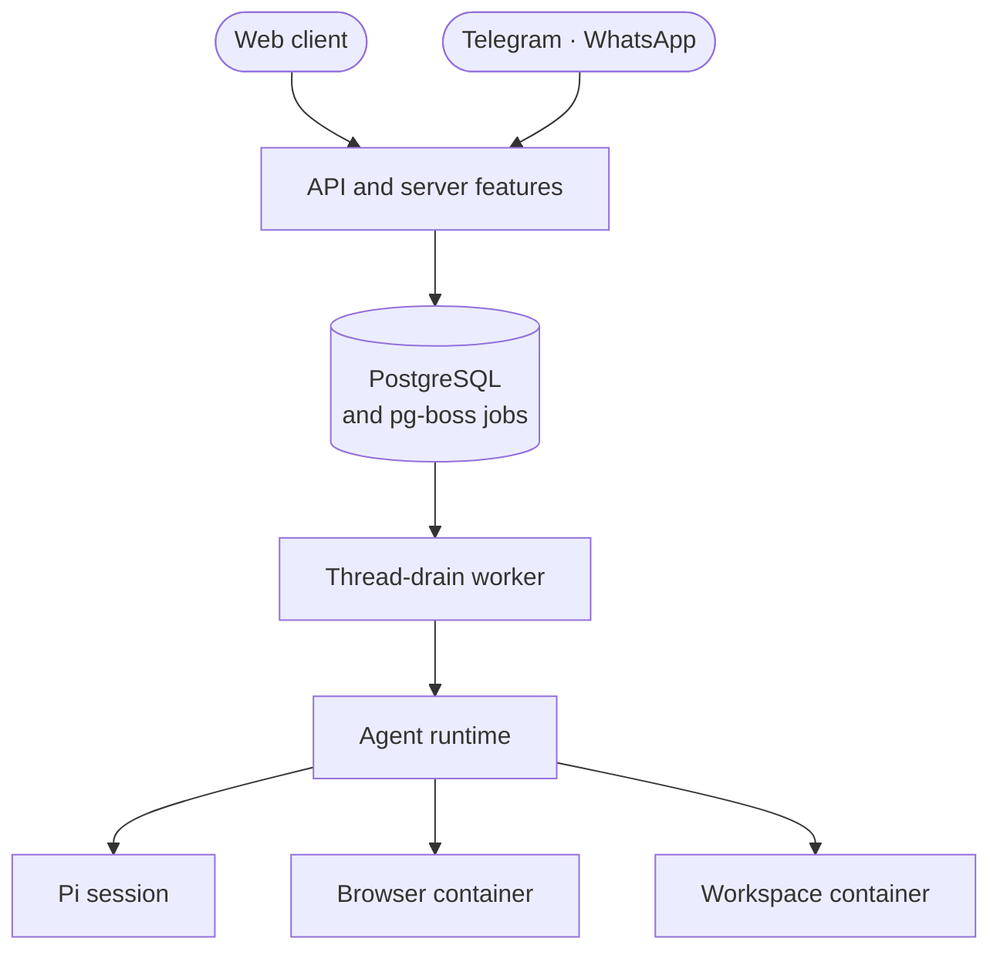

import { Card, CardGrid, FileTree } from '@astrojs/starlight/components';

This page shows how Nod's parts fit together and where each one lives in the code. Start here before you change Nod or evaluate how it works.

The short version: Nod is one Node process plus Docker containers on the computer running your assistant. That can be your desktop's private runtime or a self-hosted server reached by web and desktop clients.

## One conversation, independent tasks

The main chat session coordinates work. It answers short requests and starts a saved session for each independent task. Task questions, progress and results return to the same conversation. Task results do not need a second model call in the coordinator.

The `tasks` table is the task ledger. All sessions share the owner's workspace and memory, with separate saved histories and task folders. The server routes replies and delivers addressed owner updates to the correct session.

See [Task sessions](/how-it-works/task-sessions/) for the architecture diagram, records, context sharing and lifecycle.

## One process and a few containers

One Node process serves the React client and runs the Fastify API, the agent runtime, the thread-drain worker and the schedulers. Docker containers run PostgreSQL, the workspace and the browser. While you pick a login from 1Password, a separate helper process talks to the 1Password app, so the server never loads 1Password's code.

Messages and schedule fires become turns in PostgreSQL with a `thread-drain` job. App events and source checks feed one observer through a saved source queue. The worker picks up the job and asks the runtime to run a turn. The runtime opens a Pi agent session, and Pi calls tools that act in the workspace, the browser and your connected apps.

The web client reads saved chat state after a server update. A new update during a read queues one more read. It does not cancel the active read, so frequent updates cannot keep saved replies or approval cards from appearing. A read stops after 15 seconds and shows a timeout error. A queued read can then run. A conversation reset or account change still blocks old replies.

## Main ideas

<CardGrid>
  <Card title="One thread per owner" icon="comment">
    One conversation shared by web, Telegram and WhatsApp. Its ID keys the workspace and chat
    session. Background sessions have their own browser tabs and saved Pi transcripts.
  </Card>
  <Card title="Everything is a turn" icon="list-format">
    Messages, schedule fires, event wakes and resumes each run as a turn. Turns are never retried.
  </Card>
  <Card title="Policy lives on the server" icon="server">
    The server checks app actions, Vault use and payments. The model's instructions sit on top of
    those checks, not in place of them.
  </Card>
  <Card title="A sandboxed computer" icon="laptop">
    Commands run in a locked-down container. Provider keys never enter it or the browser.
  </Card>
</CardGrid>

One observer reads connected apps and saves private work. It starts separate tasks for outside actions, questions, and approvals. Those tasks use normal tools and Trust. See [Proactivity engine](/how-it-works/proactivity/). Ordinary tasks and schedules keep their normal tools.

Guides tell Pi to list the full requested scope and time range before keyword filters in a broad review. A narrow search cannot establish full coverage.

Structured results from apps, connected MCP tools, `read_source` and `proactive_issue` can include timestamps with UTC or numeric offsets. Before Pi reads a result, the runtime adds up to 32 local time equivalents in the owner's time zone. The source values stay unchanged. Posted local hours keep their original zone unless the owner asks for a conversion. Converted times name their zone. Nested script calls keep raw data; their JSON output can receive the same display annotation. Date-only values, times without an offset and direct browser observations are not converted. Personal tools such as `prepared_list` do not get this annotation. The annotation stays inside the same untrusted data block.

For calendar plans, Pi uses availability tools when available and code for durations, gaps and proposed moves. Time ranges that only share an endpoint do not overlap. Required travel or preparation buffers are checked separately. Each proposed alternative is checked against the relevant calendar window.

## Where the code lives

<FileTree>

- src/
  - apps/ app definitions, required contract fixtures, icons, and optional guides
  - ports/ capabilities as interfaces, without vendor types
  - providers/ vendor SDKs and protocols, such as Pi, Docker, agent-browser and Composio
  - runtime/ the agent's tools, prompts and turn loop
  - server/ policy, storage and HTTP
    - composition.ts selects providers and implementations
    - feedback-delivery.ts selects only feedback delivery for normal startup and startup reports
  - shared/ browser-safe types for the server and the client
  - web/ the React client
- scripts/
  - check-architecture.mjs enforces the import directions below

</FileTree>

[`scripts/check-architecture.mjs`](https://github.com/n8n-io/nod/blob/main/scripts/check-architecture.mjs) runs as part of `pnpm run check`. It fails when an import crosses a boundary:

| Folder      | Can import from                                                                                                                                               |
| ----------- | ------------------------------------------------------------------------------------------------------------------------------------------------------------- |
| `web`       | `web`, `shared`                                                                                                                                               |
| `shared`    | `shared`                                                                                                                                                      |
| `ports`     | `ports`, `shared`                                                                                                                                             |
| `runtime`   | `runtime`, `ports`, `shared`                                                                                                                                  |
| `providers` | `providers`, `ports`, `shared`                                                                                                                                |
| `server`    | `server`, `ports`, `shared`. `composition.ts` also imports `runtime` and `providers`. The startup feedback exception below is limited to one provider import. |

The same check keeps vendor packages (Pi, Composio, chat adapters and agent-browser) inside `providers`. It also stops `runtime`, `ports`, `shared` and `web` from reading `process.env`. Configuration belongs in [`src/server/composition.ts`](https://github.com/n8n-io/nod/blob/main/src/server/composition.ts), with the feedback-only exception below.

The desktop startup report helper (`desktop/main/feedback.mjs`) uses the same feedback factory as normal composition: `src/server/feedback-delivery.ts`. This factory imports only the n8n feedback provider and its port type. It reads only the `NOD_FEEDBACK_*` values from the environment it receives. It does not load `.env`, the server configuration module, the database, or the runtime. The import check permits this one provider import so a failed engine can still report its startup failure. No other provider selection moves out of `composition.ts`.

Desktop main uses `src/shared/environment-secrets.mjs` and `src/shared/literal-masks.mjs` for local error text. These pure modules take values as input. They do not read configuration files or choose a provider. Exported startup reports use `src/shared/startup-feedback-facts.mjs` instead: a strict projection of fixed states, event choices, error classes and codes, counts and ages. `feedbackTechnicalContext` in `src/server/feedback-context.ts` normalizes app versions and release values. The startup report omits all startup prose. It reads only data properties and does not call getters or serializers. The helper projects the facts again before review. Normal feedback keeps its own redaction flow.

## In this section

- [Threads and turns](/how-it-works/threads-and-turns/): how messages, schedules and events become turns, and how they share one thread.
- [The agent runtime](/how-it-works/agent-runtime/): Pi sessions, tools, codemode, the turn guard and the system prompt.
- [Sandbox and browser isolation](/how-it-works/sandbox-and-browser/): what the workspace and browser containers can and can't reach.
- [Memory](/how-it-works/memory/): how Nod learns and keeps what it knows about you.
- [Skills](/how-it-works/skills/): the trusted task guides Nod reads before it works.
