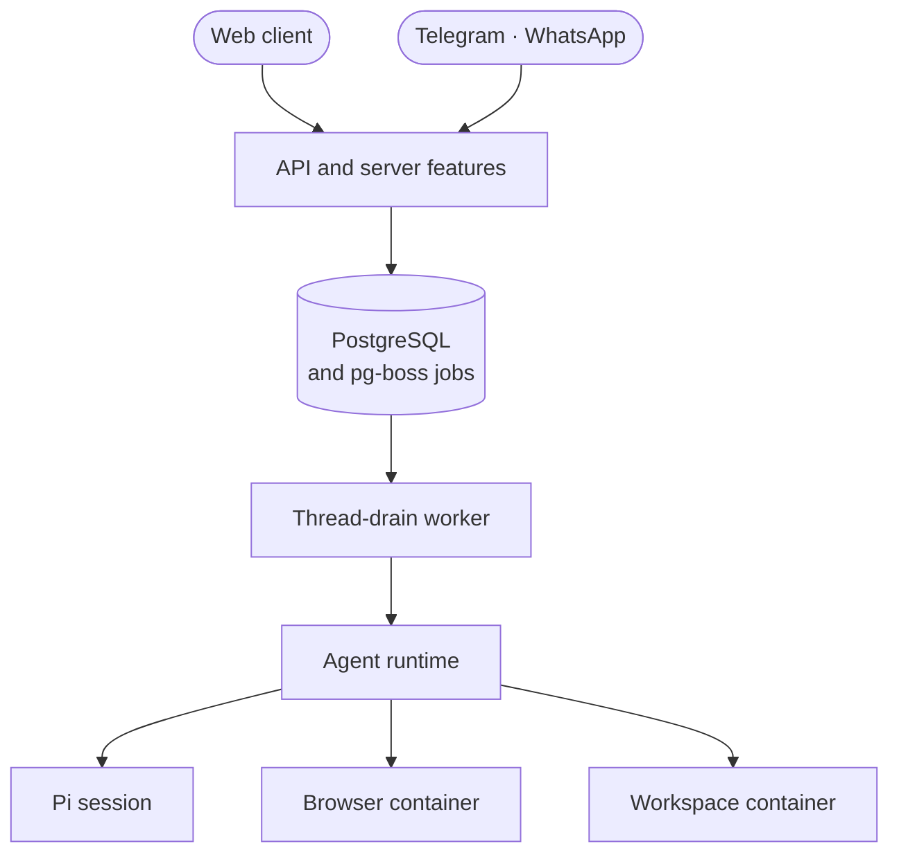

import { Card, CardGrid, FileTree } from '@astrojs/starlight/components';

This page shows how nod's parts fit together and where each one lives in the code. Start here before you change nod or evaluate how it works.

The short version: nod is one Node process plus a few Docker containers on your computer.

## One conversation, independent tasks

The main chat session coordinates work. It answers short requests and starts a saved session for each independent task. Task questions, progress and results return to the same conversation. Task results do not need a second model call in the coordinator.

The `tasks` table is the task ledger. All sessions share the owner's workspace and memory, with separate saved histories and task folders. The server routes replies and delivers addressed owner updates to the correct session.

See [Task sessions](/how-it-works/task-sessions/) for the architecture diagram, records, context sharing and lifecycle.

## One process and a few containers

One Node process serves the React client and runs the Fastify API, the agent runtime, the thread-drain worker and the schedulers. Docker containers run PostgreSQL, the workspace and the browser. While you pick a login from 1Password, a separate helper process talks to the 1Password app, so the server never loads 1Password's code.

Every message, schedule fire and event becomes a row in PostgreSQL plus a `thread-drain` job. The worker picks up the job and asks the runtime to run a turn. The runtime opens a Pi agent session, and Pi calls tools that act in the workspace, the browser and your connected apps.

## Main ideas

<CardGrid>
  <Card title="One thread per owner" icon="comment">
    One conversation shared by web, Telegram and WhatsApp. Its ID keys the workspace and chat
    session. Background sessions have their own browsers and saved Pi transcripts.
  </Card>
  <Card title="Everything is a turn" icon="list-format">
    Messages, schedule fires, event wakes and resumes each run as a turn. Turns are never retried.
  </Card>
  <Card title="Policy lives on the server" icon="server">
    The server checks app actions, Vault use and payments. The model's instructions sit on top of
    those checks, not in place of them.
  </Card>
  <Card title="A sandboxed computer" icon="laptop">
    Commands run in a locked-down container. Provider keys never enter it or the browser.
  </Card>
</CardGrid>

## Where the code lives

<FileTree>

- src/
  - ports/ capabilities as interfaces, without vendor types
  - providers/ vendor SDKs and protocols, such as Pi, Docker, agent-browser and Composio
  - runtime/ the agent's tools, prompts and turn loop
  - server/ policy, storage and HTTP
    - composition.ts the only place that selects providers and implementations
  - shared/ browser-safe types for the server and the client
  - web/ the React client
- scripts/
  - check-architecture.mjs enforces the import directions below

</FileTree>

[`scripts/check-architecture.mjs`](https://github.com/n8n-io/nod/blob/main/scripts/check-architecture.mjs) runs as part of `pnpm run check`. It fails when an import crosses a boundary:

| Folder      | Can import from                                                                            |
| ----------- | ------------------------------------------------------------------------------------------ |
| `web`       | `web`, `shared`                                                                            |
| `shared`    | `shared`                                                                                   |
| `ports`     | `ports`, `shared`                                                                          |
| `runtime`   | `runtime`, `ports`, `shared`                                                               |
| `providers` | `providers`, `ports`, `shared`                                                             |
| `server`    | `server`, `ports`, `shared`. Only `composition.ts` also imports `runtime` and `providers`. |

The same check keeps vendor packages (Pi, Composio, chat adapters and agent-browser) inside `providers`. It also stops `runtime`, `ports`, `shared` and `web` from reading `process.env`. Configuration belongs in [`src/server/composition.ts`](https://github.com/n8n-io/nod/blob/main/src/server/composition.ts).

## In this section

- [Threads and turns](/how-it-works/threads-and-turns/): how messages, schedules and events become turns, and how they share one thread.
- [The agent runtime](/how-it-works/agent-runtime/): Pi sessions, tools, codemode, the turn guard and the system prompt.
- [Sandbox and browser isolation](/how-it-works/sandbox-and-browser/): what the workspace and browser containers can and can't reach.
- [Memory](/how-it-works/memory/): how nod learns and keeps what it knows about you.
- [Skills](/how-it-works/skills/): the trusted task guides nod reads before it works.
