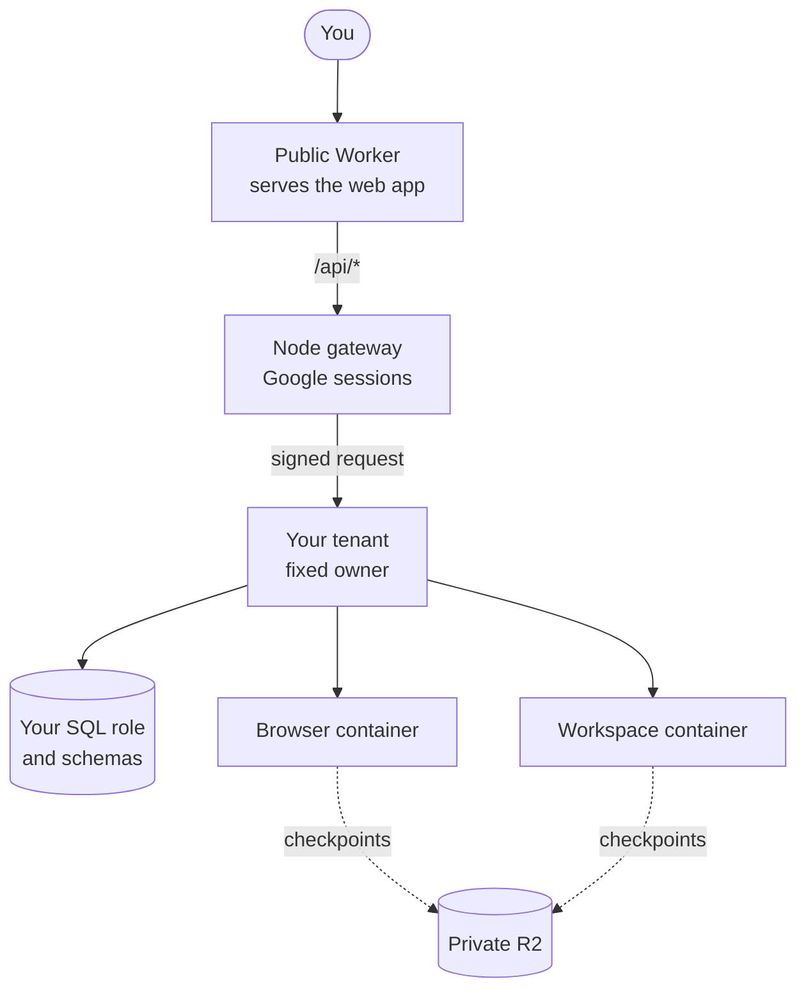
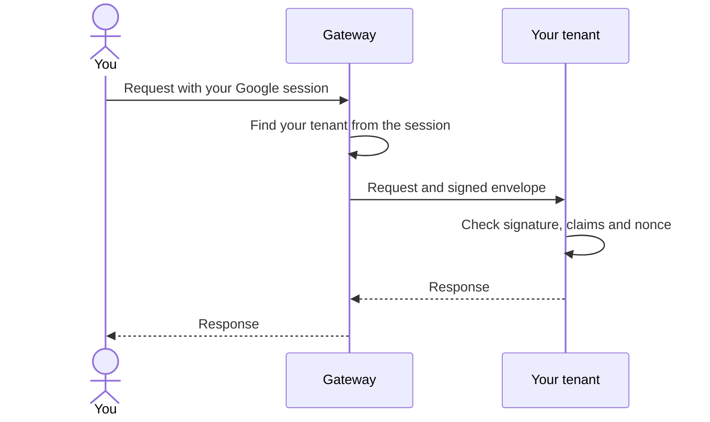

import { Card, CardGrid, LinkCard } from '@astrojs/starlight/components';

This page explains how hosted Otto serves many users from one deployment while it keeps each user's data, keys and computers apart.

The short version: a gateway signs you in with Google and forwards each request, signed, to a tenant that belongs only to you. Your browser and workspace run in their own containers and save checkpoints to private storage.

## How a request reaches your Otto

The gateway and the tenants run the same server image. `OTTO_MODE=gateway` runs the gateway, and `OTTO_MODE=tenant` runs one user's Otto.

| Container                    | One per    | Job                                                                             |
| ---------------------------- | ---------- | ------------------------------------------------------------------------------- |
| `GatewayContainer`           | Deployment | Authenticates Google sessions, provisions tenants, signs and forwards requests. |
| `TenantContainer`            | User       | Runs that user's Otto: API, worker, runtime and Pi sessions.                    |
| `BrowserComputerContainer`   | User       | The user's browser.                                                             |
| `WorkspaceComputerContainer` | User       | The user's workspace and connected CLIs.                                        |

Provider keys stay in the Node gateway and tenant processes. They never enter the browser or workspace containers.

## Each user gets an isolated tenant

<CardGrid>
  <Card title="Fixed owner" icon="approve-check-circle">
    A tenant's owner is set when it starts and never changes per request. Public owner or account
    headers never select a tenant.
  </Card>
  <Card title="Own database login" icon="database">
    The gateway provisions a SQL role with private app and jobs schemas. A tenant can't read another
    tenant's schema or assume its role.
  </Card>
  <Card title="Leased generation" icon="random">
    Each tenant start takes a numbered lease. A replacement starts only after the previous
    generation's stop is confirmed.
  </Card>
  <Card title="Derived keys" icon="padlock">
    `OTTO_MASTER_KEY` stays in the gateway. Each tenant gets only the keys derived for its own user,
    including the secret that checks the gateway's signed requests. It never gets the gateway's
    control or sign-in credentials, or the Composio webhook secret.
  </Card>
</CardGrid>

`OTTO_MASTER_KEY` derives each user's database password, runtime signing secret and Vault key. Admission defaults to eight users and is set with `OTTO_MAX_USERS`. The tenant code is in [`src/server/tenants.ts`](https://github.com/n8n-io/otto/blob/main/src/server/tenants.ts).

## Signed requests

The gateway picks your tenant from your signed-in Google session, then signs each forwarded request with an HMAC envelope. The tenant rejects anything that doesn't match. See [`src/server/gateway.ts`](https://github.com/n8n-io/otto/blob/main/src/server/gateway.ts) and [`src/server/runtime-auth.ts`](https://github.com/n8n-io/otto/blob/main/src/server/runtime-auth.ts).

| Envelope field       | Binds the request to                                                                                |
| -------------------- | --------------------------------------------------------------------------------------------------- |
| Owner                | Your user ID                                                                                        |
| Environment          | The deployment, such as `development` or `production`                                               |
| Generation           | The tenant generation that holds the lease                                                          |
| Method and target    | The exact HTTP method and path                                                                      |
| Body hash            | A SHA-256 hash of the exact body, so an altered body is rejected                                    |
| Nonce                | A one-time ID, so a replayed request is rejected                                                    |
| Expiry               | 30 seconds after signing                                                                            |
| Developer capability | Whether you're in `OTTO_DEVELOPER_IDS`. Only developers reach the standalone `/api/browser` routes. |

The gateway forwards only the content type, accept and range headers. For streams such as chat events, it rechecks your session while the stream stays open. A Google session ends after seven days without use.

The gateway checks each Composio, Telegram and WhatsApp webhook, then forwards it to its owner's tenant in a webhook envelope. The tenant accepts Composio events only through that envelope and only for its own owner.

## Your browser and workspace

Both containers start on first use and save checkpoints to private R2, under `<environment>/<owner>/`.

|             | Browser                                                                 | Workspace                                                                          |
| ----------- | ----------------------------------------------------------------------- | ---------------------------------------------------------------------------------- |
| Checkpoints | When it goes idle, which closes its pages                               | About 20 seconds after its last command, and before it sleeps, stops or is drained |
| Saves       | Cookies, Local Storage, IndexedDB and Service Worker data; skips caches | `/home/node/state`, without `__pycache__` and `.cache` folders                     |
| Size limit  | 1 GiB uncompressed and 100,000 entries                                  | The same                                                                           |

While a conversation turn waits on you for a question, approval or credential request, a running browser is held for up to 30 minutes, so its pages survive and its container stays awake. After that, the container may sleep and close the pages. The next turn or a reset releases the hold sooner. A hold never starts a stopped browser.

A workspace too large to save keeps running on its previous checkpoint, and every command still runs. The model's next `bash` output starts with the sizes, the largest files and what to delete. The unsaved changes are discarded when the workspace sleeps, stops or is drained, and the next `bash` command says so.

:::caution[Durability window]
If the workspace container is lost between checkpoints, changes since the last checkpoint are lost. The model is told on its next command. The computer isn't fenced.
:::

## Workspace users and connected CLIs

Workspace commands run as `node`, and each connected CLI runs as its own user in group `otto-connected`. A deployed container gives every process root's capabilities, whatever its user. So both start through `setpriv --no-new-privs` with their capabilities cleared. Otherwise, a workspace command could read a CLI token from `/proc`.

Connected CLIs run from sealed installs under `/var/tmp/otto-cli-<path id>`. Those installs aren't checkpointed, so each CLI is installed again from its declared source on first use after a restart. Connected CLIs can read shared workspace files but can't write them.

## What hosted mode refuses

- Saving new cards, updating cards and paying with a card. Cards saved earlier stay readable and removable.
- Any request where the signed owner, environment, generation, method, target or body doesn't match.
- Starting a replacement tenant before the previous generation has stopped.

:::caution[Operator access]
The infrastructure operator can decrypt stored data. There's no KMS or externally controlled key release.
:::

<LinkCard
  title="Deploy on Cloudflare"
  href="/deploy/cloudflare/"
  description="Environments, secrets, rollout, recovery and database reset."
/>

## Related resources

- [Architecture](/how-it-works/architecture/)
- [Sandbox and browser isolation](/how-it-works/sandbox-and-browser/)
- [The agent runtime](/how-it-works/agent-runtime/)
- [Payments](/trust/payments/)
- [Security model and limits](/trust/security-model/)
