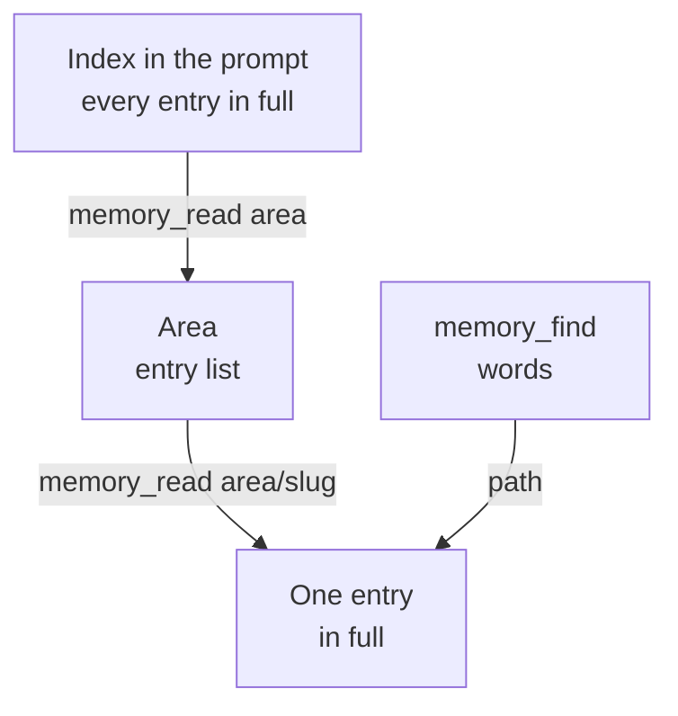
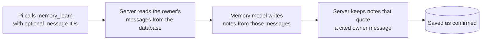

Otto keeps one private memory document per owner. This page explains how it's stored, how the model reads and writes it, and what the hourly maintenance job does. To see and edit memory in the app, read [Memory](/use/memory/).

The short version: memory notes hold only what the owner said in their messages or wrote in Settings → Memory, what they choose to import from another assistant, and one style note learned from their own sent email. When the owner asks Otto to remember something, a separate memory model writes the notes from the owner's own messages only, and an hourly job archives entries instead of deleting them. Next to the notes, memory keeps [learned skills](#learned-skills): procedures Otto writes itself after a task, without personal data.

## Where memory lives

Memory is one JSON document, `memory/MEMORY.md`, in Otto's private object store in the database. It sits outside the thread workspace, so it survives a thread reset. It holds up to 256 KiB.

Each entry has an address, `area/slug`, a text of up to 4,000 characters and an optional one-line abstract. There are five areas:

| Area          | Holds                               |
| ------------- | ----------------------------------- |
| `about`       | Who the owner is                    |
| `preferences` | How they want things done           |
| `people`      | Who they deal with                  |
| `routines`    | Recurring procedures they described |
| `lessons`     | Corrections and what to avoid       |

Earlier versions kept the owner's name, location, phone and preferences in a separate profile. On upgrade, its text becomes confirmed notes, such as `Name: …` in `about` and the preferences in `preferences`. Long text is split at sentence and line breaks into notes of up to 120 characters, so each shows in full in the index. Text that looks like a secret is skipped. If memory is full, the profile stays and Otto tries again at the next start.

The code is in [`src/server/memory.ts`](https://github.com/n8n-io/otto/blob/main/src/server/memory.ts) and [`src/server/memory-tree.ts`](https://github.com/n8n-io/otto/blob/main/src/server/memory-tree.ts).

## How Pi reads memory

Pi, the agent that runs each turn, sees memory in three steps.

- The **index** lists every entry's full text in the owner context, one line each as `area/slug: text`, with confirmed entries first. Nothing is cut. Tentative entries are marked `(tentative)`, so Pi treats them as likely rather than certain.
- An **area** lists its entries.
- An **entry** shows its full text, status and evidence count.

`memory_find` matches words in the slug, abstract and text. There's no model and there are no embeddings.

### Earlier conversation

Notes hold what lasts. For everything else, Pi searches the conversation itself with `history_search`, which reads every message of the active thread, the owner's and Otto's.

- A query matches any of its words, in any word form ("properties" finds "property"), and the best matches come first, each with its date and the message before and after it.
- `from` and `to` keep matches between two dates in the owner's time zone; alone, they list that period's messages.
- `around` returns one message with the five before and after it, such as the reply to a question.

Before a turn started by an owner message, the server runs the same search on that message and gives Pi the six best-matching older owner messages, shortened, as `relatedConversation`, so an answer or recommendation can use what the owner said without waiting for a search.

Pi is told to search when the conversation in front of it doesn't show what the owner said, did or planned, to gather every mention and keep only what fits the question before it counts or totals, to let the newest statement win, to answer what it said earlier from the conversation before correcting it, and to say it doesn't have something rather than answer from a near match. Search uses PostgreSQL full-text search with an index, with no model and no embeddings. A reset conversation is no longer searched.

## How the model saves memory

The memory tools are actions of Pi's `manage_personal_context` tool. Pi never writes a note. `memory_learn` names the owner's messages, and the memory model writes the notes from them:

1. The server reads the current owner message, the owner's last 10 messages in that conversation and any older owner messages Pi names by ID, such as one it found with `history_search`. It skips task-card titles the owner tapped, which are Otto's wording, messages over 4,000 characters and messages with a secret. A message Pi names that isn't one of the owner's own refuses the save.
2. The memory model sees only those messages, with the current one apart from the earlier ones, and the memory index, never Otto's replies, tool results, web pages or emails. It saves every lasting fact the current message asks to remember or states, using the earlier messages to work out what it refers to, so "remember that address" saves the address from a few messages back. Each note is one declarative fact, such as `Delivery address: …`, with names and numbers as the owner wrote them, an optional expiry date, the messages it cites and a short quote from one of them.
3. The server keeps a note only if a cited owner message contains its quote and it holds no card number, key or link with a login. It saves the note as confirmed, with the cited messages as evidence. When the messages make a saved note untrue, the model can archive it; the old version stays in the archive.

This is one call to the memory model per save, about $0.0002 with GPT-6 Luna, made again once if its answer can't be read. If the model is unreachable or its answer still can't be read, nothing is saved and Pi gets the reason.

| Action           | What the server requires                                                                                                                                                                         |
| ---------------- | ------------------------------------------------------------------------------------------------------------------------------------------------------------------------------------------------ |
| `memory_learn`   | Work the owner started, in chat or a task, with an owner message. Every message it reads is the owner's own, and every note quotes one.                                                          |
| `memory_forget`  | A turn started by an owner message, and the [trust check](/trust/approvals/): unless the owner's words ask to forget that note, Otto asks first. It deletes the entry and its archived versions. |
| `memory_control` | The complete current owner message, quoted, and the trust check: unless it asks to stop, resume or clear memory, Otto asks first. Clearing also needs a turn started by an owner message.        |

So a fact from a web page, an email, a tool result or Otto's own reply can't be saved, even when it fools Pi, and neither can an event or scheduled run, or a session that started from one.

Saves are silent: no notice appears in chat or on Telegram or WhatsApp. A note that repeats an existing one adds the new message as evidence to it, and confirms it if it was only learned in the background.

:::caution[Memory is context, not permission]
A saved note never authorizes an action. For `memory_learn`, the sensitive-topic rule is a model instruction: the memory model saves sensitive topics only when they're turned on or the owner explicitly asks it to remember them, and the server checks the quote, not the topic.
:::

## Statuses

Every entry has an origin: `stated`, `inferred` or `email`. Its status comes from the origin and the number of source messages.

| Status      | Label in **Settings → Memory** | Meaning                                                                         | In the L0 index |
| ----------- | ------------------------------ | ------------------------------------------------------------------------------- | --------------- |
| `tentative` | **Mentioned once**             | Inferred from one owner message                                                 | Yes, marked     |
| `observed`  | **Learned**                    | Inferred from two or more messages, or the Gmail writing style                  | Yes             |
| `stated`    | **Confirmed**                  | Saved by `memory_learn`, or added, imported, rewritten or confirmed in Settings | Yes             |
| Archived    | **Let go**                     | Replaced, merged, expired or stale                                              | No              |

## Hourly maintenance

A `memory-maintenance` job runs every hour, at minute 7 UTC. It posts nothing to chat, and it doesn't run while saving is off.

Every write uses a compare-and-swap on the document version, so a stale writer can't overwrite a newer one.

### Repair

Repair runs first on every tick, even without a model key. It archives:

- entries past their expiry date,
- inferred entries with one source that nobody repeated for 60 days, and
- duplicates whose text matches after normalizing case, accents and punctuation. The stronger entry stays.

The archive keeps as many records as fit. When the file reaches 256 KiB, the oldest archived records go first. A save that still doesn't fit is refused with **Memory is full**.

### Reflect

Reflection reads owner messages written since the last batch, 40 at a time, until it has caught up. It skips assistant text, tool results, attachments, messages over 4,000 characters, messages under 10 minutes old, messages with secrets, and task-card titles the owner tapped, which are Otto's wording.

- A small model from the selected connection proposes operations: add an entry, or archive an inferred one that a newer message replaces or says is wrong. An add that would overflow the file is skipped.
- It records what the owner says about their life, including what a request reveals: people, places, possessions, events, plans, numbers, interests and preferences, one fact per entry. Each message comes with the time it was sent, so an entry about an event starts with its date, with words like "yesterday" resolved.
- Each operation cites messages and a verbatim quote. Only cited messages that contain the quote count as evidence.
- An add with the same text as an inferred entry adds evidence to it. Reflection never changes a stated entry.
- Each add must say whether it's sensitive. Unless the owner turned on **Remember sensitive topics**, the server drops sensitive adds. An add without the flag is invalid.
- A model error or unreadable answer is retried on the next two ticks, then the batch is skipped. The progress watermark is saved in the same write as the operations, so a batch applies once.

Sensitive topics are health, religion, politics, sexuality, gender identity, ethnicity, immigration status and criminal history.

## The Memory tab and API

**Settings → Memory** reads `GET /api/memory`, and **Export** downloads `GET /api/memory/export` as one Markdown file. Quotes in the view come only from the owner's own messages. The add, edit, confirm, forget and restore routes are in [`src/server/personal.ts`](https://github.com/n8n-io/otto/blob/main/src/server/personal.ts).

**Import** splits a pasted answer from another assistant into notes in the page, without a model: each `- ` line, or each line when the answer has no bullets, becomes a note in the area named by the heading above it (`## About you`, `## Preferences`, `## People`, `## Routines` or `## Lessons`), or `about` otherwise. The owner removes what they don't want, and `POST /api/memory/import` saves the rest as stated notes, word for word. Like the profile move, it skips notes already saved, lines over 4,000 characters and text that looks like a secret.

Page changes post nothing to chat and work while saving is off. Rewriting a note archives the previous version and makes the note stated. On Telegram or WhatsApp, `/memory` or `/context` sends a short digest without a turn or a model call.

## Writing style from Gmail

When Gmail connects, a background job reads the owner's recent sent emails, without quoted, forwarded or automated mail. The model describes only the style in at most 500 characters, with no facts, names or quotes.

Otto saves it as `preferences/writing-style`, labelled **Learned from your sent email**. A new version archives the old one. It never replaces an entry at that path that came from chat.

## Learned skills

Learned skills are procedures Otto writes for itself after a task, as [Hermes Agent](https://hermes-agent.nousresearch.com/docs/user-guide/features/skills) does. Each one covers one site, app or flow: the steps, the gotchas Otto hit and how it got past them, what to verify and what didn't work. They sit in the same memory document as the notes. Built-in [task guides](/how-it-works/skills/) cover kinds of work; a learned skill covers one concrete flow and can point to the guide it extends.

- **Index and body.** The owner context lists each learned skill's name and one-line description. Pi reads the body with `skills read` before a matching flow. The body reaches Pi inside an `untrusted_tool_result` block.
- **Writing.** Pi calls `skills save` when no learned skill covers a flow that took several steps, needed a workaround or was corrected, and `skills patch` when a skill it followed was wrong or out of date. It saves quietly.
- **Preparing.** The server first removes known secret values from the draft. The memory model then rewrites it as a reusable procedure. It is told to remove names, contact details, addresses, account, order and booking numbers, amounts and message content and to write placeholders such as `<order number>` instead; as a model, it can miss one. It drops any step that sends something to an outside party unless that is the flow's purpose. The server refuses a result with card numbers, keys or links with logins. Unless **Remember sensitive topics** is on, a skill about a sensitive topic isn't saved.
- **Who can write.** Only work the owner started, in chat, a task or a schedule, can save or patch a skill. Background event runs and subagents can read skills but not write them. Nothing is saved while saving is off.
- **Limits.** A body holds up to 6,000 characters and a description 200. Memory keeps up to 40 skills. When it's full, the skill used least recently that the owner hasn't edited is dropped. A built-in guide's name can't be reused.

The owner sees, edits and forgets learned skills under **Skills** in **Settings → Memory**, and **Export** includes them. Clearing memory clears them too. The code is in [`src/server/learned-skills.ts`](https://github.com/n8n-io/otto/blob/main/src/server/learned-skills.ts).

:::caution[Skills come from what Otto read]
Otto writes a skill from what it did and read, so a web page or an email can shape one. A skill is guidance, never permission. It never counts as the owner's words: the trust check, the confirmation writer and the fact check never see it. Saving a note still needs the owner's own messages, quoted, and forgetting a note, turning memory off or clearing it, and changes to schedules, notification rules and limits still go through the check.
:::

## Related resources

- [Memory](/use/memory/)
- [Architecture](/how-it-works/architecture/)
- [Agent runtime](/how-it-works/agent-runtime/)
- [Skill library](/how-it-works/skills/)
- [Your data and privacy](/trust/privacy/)
