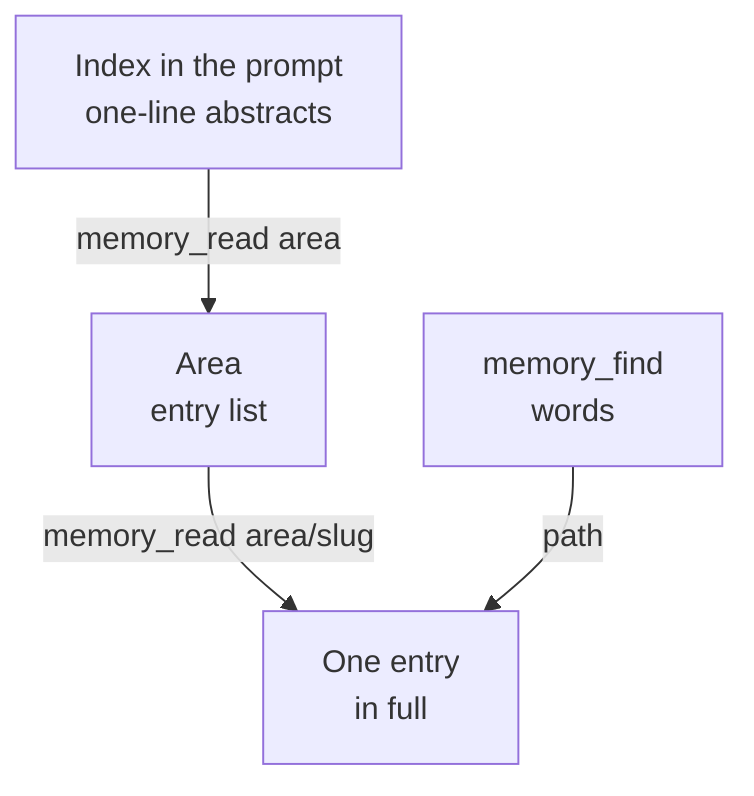
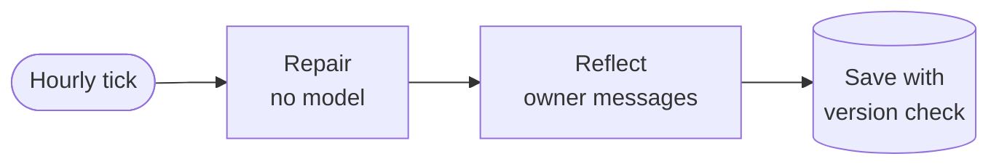

Otto keeps one private memory document per owner. This page explains how it's stored, how the model reads and writes it, and what the hourly maintenance job does. To see and edit memory in the app, read [Memory](/use/memory/).

The short version: memory can hold only what the owner said in their own messages. Otto saves the owner's message word for word, and an hourly job archives entries instead of deleting them.

## Where memory lives

Memory is one JSON document, `memory/MEMORY.md`, in Otto's private object store: the database in local mode, private object storage in hosted mode. It sits outside the thread workspace, so it survives a thread reset. It holds at most 300 entries and 256 KiB.

Each entry has an address, `area/slug`, a text of up to 600 characters and an optional one-line abstract. There are five areas:

| Area          | Holds                               |
| ------------- | ----------------------------------- |
| `about`       | Who the owner is                    |
| `preferences` | How they want things done           |
| `people`      | Who they deal with                  |
| `routines`    | Recurring procedures they described |
| `lessons`     | Corrections and what to avoid       |

Earlier versions kept the owner's name, location, phone and preferences in a separate profile. On upgrade, its text becomes confirmed notes, such as `Name: …` in `about` and the preferences in `preferences`. Long text is split at sentence and line breaks into notes of up to 120 characters, so each shows in full in the index. Text that looks like a secret is skipped. If memory is full, the profile stays and Otto tries again at the next start.

The code is in [`src/server/memory.ts`](https://github.com/n8n-io/otto/blob/main/src/server/memory.ts) and [`src/server/memory-tree.ts`](https://github.com/n8n-io/otto/blob/main/src/server/memory-tree.ts).

## How Pi reads memory

Pi, the agent that runs each turn, sees memory in three steps so the prompt stays small.

- The **index** is a JSON list of abstracts in the owner context, within a 6,000-character budget. Confirmed entries come first, then the newest. Tentative entries stay out.
- An **area** lists its entries.
- An **entry** shows its full text, status and evidence count.

`memory_find` matches words in the slug, abstract and text. There's no model and there are no embeddings.

## How the model saves memory

The memory tools are actions of Pi's `manage_personal_context` tool. Pi can save only the owner's own words: `memory_learn` stores the current owner message as it was written, with line breaks turned into spaces, up to 600 characters. It keeps the message ID as evidence.

| Action           | What the server requires                                                                                    |
| ---------------- | ----------------------------------------------------------------------------------------------------------- |
| `memory_learn`   | The quote is the complete current owner message, word for word.                                             |
| `memory_forget`  | A turn started by an owner message. It deletes the entry and its archived versions, without a confirmation. |
| `memory_control` | The complete current owner message, quoted, asking to stop, resume or clear memory.                         |

So a fact from a web page, an email, a tool result or Otto's own reply can't be saved, and neither can a background or scheduled run, which has no owner message.

Saves are silent: no notice appears in chat or on Telegram or WhatsApp. Text containing a card number, an API key or a link with a login in it is refused. A correction uses `replace: true` and archives the old version. Another owner message with the same text adds that message as evidence to the entry that has it. Learning the same message twice adds nothing.

:::caution[Memory is context, not permission]
A saved note never authorizes an action. For `memory_learn`, the sensitive-topic rule is a model instruction: the server checks the quote, not the topic.
:::

## Statuses

Every entry has an origin: `stated`, `inferred` or `email`. Its status comes from the origin and the number of source messages.

| Status      | Label in **Settings → Memory** | Meaning                                                               | In the L0 index |
| ----------- | ------------------------------ | --------------------------------------------------------------------- | --------------- |
| `tentative` | **Mentioned once**             | Inferred from one owner message                                       | No              |
| `observed`  | **Learned**                    | Inferred from two or more messages, or the Gmail writing style        | Yes             |
| `stated`    | **Confirmed**                  | Saved by `memory_learn`, or added, rewritten or confirmed in Settings | Yes             |
| Archived    | **Let go**                     | Replaced, merged, expired or stale                                    | No              |

## Hourly maintenance

A `memory-maintenance` job runs every hour, at minute 7 UTC. It posts nothing to chat, and it doesn't run while saving is off.

Every write uses a compare-and-swap on the document version, so a stale writer can't overwrite a newer one.

### Repair

Repair runs first on every tick, even without a model key. It archives:

- entries past their expiry date,
- inferred entries with one source that nobody repeated for 60 days, and
- duplicates whose text matches after normalizing case, accents and punctuation. The stronger entry stays.

The archive keeps only its latest 40 records.

### Reflect

Reflection reads up to 40 owner messages written since the last batch. It skips assistant text, tool results, attachments, messages over 1,000 characters, messages under 10 minutes old, and messages with secrets or a memory-save approval.

- A small model from the selected connection proposes at most six operations: add an entry, or archive an inferred one the owner said is wrong.
- Each operation cites messages and a verbatim quote. Only cited messages that contain the quote count as evidence.
- An add with the same text as an inferred entry adds evidence to it. Reflection never changes a stated entry.
- Each add must say whether it's sensitive. Unless the owner turned on **Remember sensitive topics**, the server drops sensitive adds. An add without the flag is invalid.
- A model error or unreadable answer is retried on the next two ticks, then the batch is skipped. The progress watermark is saved in the same write as the operations, so a batch applies once.

Sensitive topics are health, religion, politics, sexuality, gender identity, ethnicity, immigration status and criminal history.

## The Memory tab and API

**Settings → Memory** reads `GET /api/memory`, and **Export** downloads `GET /api/memory/export` as one Markdown file. Quotes in the view come only from the owner's own messages. The add, edit, confirm, forget and restore routes are in [`src/server/personal.ts`](https://github.com/n8n-io/otto/blob/main/src/server/personal.ts).

Page changes post nothing to chat and work while saving is off. Rewriting a note archives the previous version and makes the note stated. On Telegram or WhatsApp, `/memory` or `/context` sends a short digest without a turn or a model call.

## Writing style from Gmail

When Gmail connects, a background job reads the owner's recent sent emails, without quoted, forwarded or automated mail. The model describes only the style in at most 500 characters, with no facts, names or quotes.

Otto saves it as `preferences/writing-style`, labelled **Learned from your sent email**. A new version archives the old one. It never replaces an entry at that path that came from chat.

## Related resources

- [Memory](/use/memory/)
- [Architecture](/how-it-works/architecture/)
- [Agent runtime](/how-it-works/agent-runtime/)
- [Skill library](/how-it-works/skills/)
- [Your data and privacy](/trust/privacy/)
