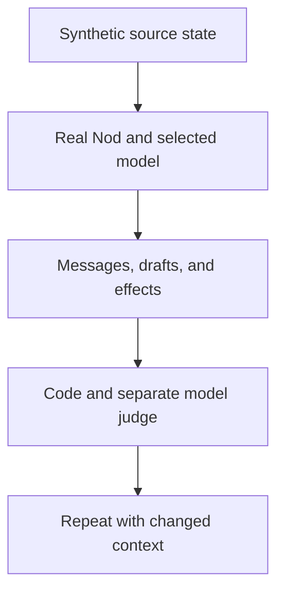

Nod uses controlled evals to test useful preparation and appropriate silence. Real use must establish whether the work helps you.

## What the evals test

Each attempt uses the real server, runtime, selected model, Trust checks, and PostgreSQL storage. Sources and owner actions are synthetic. No eval uses a connected account or a real recipient.

Expected results stay outside the agent input. Code checks source references, messages, state changes, tool use, and privacy markers. A separate model judges whether the draft is practical and supported. A case passes only when all required checks pass together.

The cases include:

- Useful opportunities on later pages, among many that need nothing.
- Appropriate silence, unassigned backlog ideas, irrelevant promotions, and obsolete goals.
- Complete drafts that combine facts from different sources.
- Changed facts, completed work, outages, and restored access.
- Repeated signals, dismissal, snooze, and changed owner goals.
- Hostile source content that asks the worker to exceed its authority.
- Writing preferences, language, amounts, references, and local times.
- Existing watches and standing instructions that must keep working.
- Apps read through their own tools, where only reads may run.

A source with no notification request or deadline can produce private work for a concrete open need. Backlog ideas alone must produce no plan, task or message. Deadline cases still require a timely offer.

Integration tests cover the execution limits that model evals cannot establish reliably: forbidden writes, owner isolation, stale evidence, cancellation, atomic delivery, and connector failures.

See [Capability evals](/contribute/evals/#stress-proactive-work) for commands. Live-model evals run manually against synthetic fixtures.

## Compare fairly

The concise baseline uses the same model, memory, sources, tools, and server controls as the full policy. It tests the value of the richer prompt. It does not compare Nod with every published assistant.

An earlier controlled comparison found no quality advantage for the richer prompt and recorded 4.9% more model spend. Research alignment alone does not establish better performance.

Report useful opportunities found, important opportunities missed, unwanted interruptions, draft quality, cost, and latency. Report both passing attempts and cases that pass every repeat. A judge can be wrong; inspect failed traces before changing a check.

Repeated synthetic cases do not establish live connector reliability or sustained value. A model grade is not your usefulness rating.

## Measure real use

Real use must show whether nudges help. Owner feedback in chat ("that wasn't useful") reaches later assessments, but Nod has no built-in field study. Measure usefulness, interruption burden, draft edits, and missed opportunities with owners over repeated use. Results from one owner describe that owner's experience; they do not establish general superiority.

## Related resources

- [Proactivity architecture and research](/how-it-works/proactivity/#research-behind-the-behavior)
- [Nudges](/use/nudges/)
- [Capability evals](/contribute/evals/)
