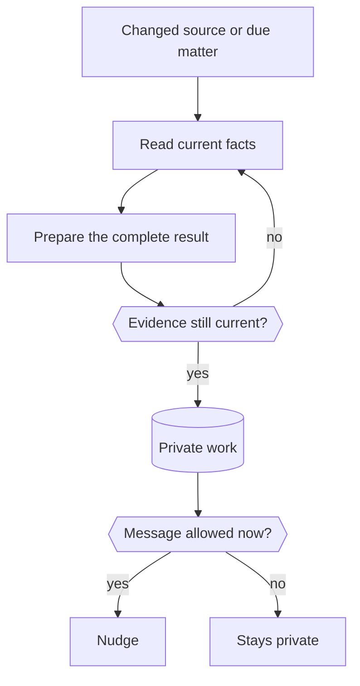

The proactivity engine reads your connected apps on its own and helps with concrete open needs. It prepares work for an unhandled request, an unresolved commitment, a problem, financial risk or recoverable payment that affects you, or work your notification rule asks for. For you it's just [nudges](/use/nudges/): messages when a concrete consequence needs your attention.

Ideas, backlog entries, general opportunities and routine updates alone start no plan, draft, task or nudge, including private work. Nod can still use a model to check for an open need. A possible improvement or missing information in a backlog is not evidence of a present problem or obligation. Saving an idea is not a commitment. Nod does not turn it into an impact review because that review might be useful.

Saved work starts observation when at least one saved task exists. An empty local task list needs no model read. Task changes still use the existing change token and normal observation checks.

## From a change to a nudge

App events, periodic source checks, and due matters feed one observer for your active conversation. It keeps its context only while the model's cache is warm and the context is no larger than compaction would keep. Otherwise it starts fresh, since saved matters carry its state. Each check's request puts what rarely changes first: its instructions, then your rules and the source list, then recent chat, with saved matters, the new batch and the time last. When it starts fresh less than an hour after the previous check, the stable part stays in the model's one-hour cache on Anthropic models, so a check pays mainly for what is new. The server reads changed sources first and ends the batch without your selected model when nothing changed or the connection's smaller model finds no concrete open need. This also applies to app results read through known tools. A record of a saved matter, an unread page or a failed read always goes to the full check. The full check starts with what the server already read, as untrusted data, so it does not read those sources again. They update a saved source queue. A single observer turn reads the due batch. Events received during a turn stay saved for its next turn. App events that arrive together start one check, and a check also takes any source due within the next 15 minutes. The source read also returns the app reports it checks, up to the last ten for that source. The small model sees those reports as untrusted data. This lets it compare the current record with a reported change, such as a meeting's old and new time. A new report with no changed record goes to the full check. The full check also gets the reports. Reports received during a read stay pending for the next check, without a longer wait. A restricted worker reads current facts and relevant memory, checks the need, then prepares and saves the result. Server code then decides whether a message can go out now.

If nothing useful remains, Nod stays quiet. It never reports routine checks or repeats a nudge because you didn't reply.

## What it reads

Every connected account is a source. No setup or opt-in is needed.

| Source                                                               | How Nod reads it                                                     | When it looks                                                       |
| -------------------------------------------------------------------- | -------------------------------------------------------------------- | ------------------------------------------------------------------- |
| Gmail                                                                | Conversations from the last 30 days, with exact versions per thread  | On new mail, checked every 15 minutes                               |
| Google Calendar                                                      | Events in the primary calendar from yesterday through the next month | When the calendar changes, checked every 30 minutes without a model |
| Work Nod saved for you                                               | Task state, results and waiting conditions                           | When a task changes                                                 |
| Every other app, including MCP and HTTP connections you added to Nod | The account's own read tools, the same ones Nod uses in chat         | Every 30 minutes, up to ten due accounts per run                    |

The saved-work change check covers a task's title, completion condition, state, result, waiting condition and next check, so step-by-step progress doesn't start a new assessment.

For an app without its own reader, the worker searches that account's tools, picks one and fills its arguments. The server checks the arguments against the tool's schema, then Trust's read-only check must classify the call as a read. Anything that would create, change, send or delete, a draft included, never runs.

All sources use the same observer. An instruction such as "forward Ana's invoices to accounting" starts a separate task for that action. The task uses the normal tools and Trust check. Its question or approval wait leaves the observer free to process later activity.

An upgrade cancels queued account checks from the old event path. The observer reads current sources through its own queue.

## Keep judgment and permission apart

The model judges usefulness. The server enforces permission, freshness and delivery.

| Question                           | What answers it                                                                 |
| ---------------------------------- | ------------------------------------------------------------------------------- |
| Does this help your current goals? | The model, from current facts, relevant memory and your preferences             |
| What does waiting cost?            | The model names a supported deadline or another concrete consequence            |
| Can Nod read this?                 | Trust, from your rules; private preparation skips a read instead of asking you  |
| Are the facts still current?       | The server re-reads cited records, or requires a read from the last two minutes |
| Can a nudge go out now?            | The server: repeats, snooze, quiet hours and the pause switch                   |

The observer reads sources with `read_source`, saves work and nudges with `proactive_issue`, and reads personal context. It uses `task` to start separate work with a stable key for the source record and actual change. That key returns the existing task, including completed work. Only a spending check-in can pause the observer with `ask_user`. A check that ends past the check-in without asking waits on the check-in notice instead, so no new check starts until you reply to it. It has no sandbox, browser, web, code or connected-app write tools, and its final text stays private. App content, memory and saved drafts reach it as data, never instructions or permission. Secret fields are removed and email that gives account access is hidden before anything reaches the model.

A separate task sends a draft only when your words permit it, through the [trust check](/trust/approvals/). An observer task keeps only your current notification rule and rules as its authority. Its generated brief grants no permission.

## Prepare the full result

A nudge doesn't replace the work. The worker saves a complete draft, plan, comparison or decision aid, with the references, amounts, dates and time zones the reader needs, and states what it couldn't confirm. It never invents eligibility, a cause, a deadline or an action that didn't happen.

The nudge states the concrete finding and why it needs your attention now. It asks a next-step question only when that helps you decide, and follows your requested format. An internal draft update alone does not justify a notification. When useful, Nod explains once what it will keep flagging and how to stop it.

Every nudge includes a link to the saved result. Open it to read the full draft, facts that still need checking, and source references with links where available. The page shows the latest saved work. It needs your Nod access and cannot show another owner's work. If its source account is removed or replaced, the old result becomes unavailable. Nod adds this link from the saved record; the model does not invent it.

## Deliver at the right time

There's no message count. The worker offers only work worth an interruption, weighed against the other open matters, and the server enforces what must always hold:

- **One saved identity.** Related reports reuse the same primary source record and matter key. The model must recognize that they describe the same matter. Different keys can still cause repeated nudges.
- **Once per matter.** A matter nudges you again only when its evidence changes and the change matters, such as an earlier deadline or a new option.
- **Quiet hours.** A nudge that comes up at night goes out when they end, unless it's high impact with strong evidence and its deadline comes first. The full check itself waits too: when the smaller model finds that a changed record needs work, it also decides whether it must reach you before quiet hours end. A changed record of a saved matter gets only that timing question. Only then does the full check run at night; otherwise the batch stays unread until quiet hours end. A saved matter that comes due at night waits for the end unless its deadline comes first. A task the observer starts at night begins when they end, so its questions and approvals wait.
- **Snooze and pause.** A snoozed matter waits until its time. "Pause preparation" stops source checks, nudges, new tasks Nod would start, planned checks of tasks it started, and the email checks on new Gmail mail. Schedules and tasks you started keep running.

"Fewer of these" or "that wasn't useful" becomes feedback the worker uses next time.

The saved matter and its chat message commit together. A repeated save does not repeat a nudge. A material evidence change or an ended snooze can permit another nudge. The desktop listener uses message IDs to suppress repeated alerts during refresh and reconnect.

Channel delivery claims a saved message before it sends. If the channel reply is lost after acceptance, delivery stays uncertain and Nod does not send again. This prevents an automatic duplicate, but cannot prove receipt by the channel.

## Keep one record of each matter

Prepared work is saved per matter, identified by a stable key and its main record, so a repeated signal never opens a second matter. A resolved matter stays closed until its condition really changes. A dismissed one comes back only for a changed condition or a new option, never just because a deadline moved. Closed drafts are deleted after 30 days; their closed state stays so dismissed work doesn't come back. Removing an account deletes everything prepared from it.

You answer in chat. `prepared_list` shows a draft, and reading it in a turn you started counts as review. `prepared_update` snoozes, closes, dismisses or rates a matter, and runs only in a turn started by your own message.

## Cost

Preparation has no budget of its own. Its model use counts toward your monthly spending limit in **Usage**, like everything else. Unchanged Gmail, Calendar and saved work start no model call. Apps without their own reader are checked every 30 minutes, backing off to every 4 hours while nothing changes, and cost a private run only when their results changed. A due matter is checked once at its time; that check decides when to look again. The stable part of each check stays cached between checks less than an hour apart, and during quiet hours only work that can't wait runs a full check. "Pause preparation" stops all of it, including the email checks on new Gmail mail and the planned checks of tasks Nod started.

Source checks also count toward the observer's task check-in, before the full observer starts. At the limit, Nod stops new source reads and checks and asks whether to continue. A quiet result cannot skip this check-in.

Nod reuses an assessment only after its turn succeeds. The owner context, rules, check instructions, source revision, record version and availability must match. A failed, cancelled or waiting turn gives no result to reuse. A due matter still gets its full check.

## Research behind the behavior

The model judges usefulness. Code checks source versions, tool access, owner controls and delivery limits. These checks can't prove that a draft is useful.

| Research                                                                                                                                                          | Design choice                                                                                                      |
| ----------------------------------------------------------------------------------------------------------------------------------------------------------------- | ------------------------------------------------------------------------------------------------------------------ |
| [Mixed-initiative principles, 1999](https://erichorvitz.com/chi99horvitz.pdf)                                                                                     | Compare expected benefit, uncertainty, and interruption cost before offering help.                                 |
| [COM-B, 2011](https://implementationscience.biomedcentral.com/articles/10.1186/1748-5908-6-42)                                                                    | Remove work with a complete draft, plan, or choice aid. A reminder alone is insufficient.                          |
| [JITAI design principles, 2018](https://pmc.ncbi.nlm.nih.gov/articles/PMC5364076/)                                                                                | Separate need from readiness to engage. Keep useful work private when an interruption would add burden.            |
| [HeartSteps trial, 2019](https://pmc.ncbi.nlm.nih.gov/articles/PMC6401341/)                                                                                       | Measure repeated use and fatigue. Offer only what's worth it; silence does not mean approval or call for a repeat. |
| [Human-AI interaction guidelines, 2019](https://www.microsoft.com/en-us/research/wp-content/uploads/2019/01/Guidelines-for-Human-AI-Interaction-camera-ready.pdf) | Explain the prepared value and preserve feedback, dismissal, snooze, and stop controls.                            |
| [CaMeL, 2025](https://arxiv.org/abs/2503.18813)                                                                                                                   | Keep outside content separate from authority. The private worker has no connected-write tools.                     |
| [PRISM, 2026](https://arxiv.org/abs/2602.01532)                                                                                                                   | Test the decision to interrupt separately from the quality of the prepared response.                               |
| [PARE, 2026](https://arxiv.org/abs/2604.00842)                                                                                                                    | Test changing user state, failed tools, and repeated events. Re-read evidence before saving.                       |

These are design applications of research. Health intervention results don't establish the value of an assistant nudge, and Nod uses no fixed psychological score or sender-ranking rule. See [Proactivity evidence](/how-it-works/proactivity-evidence/) for what the evals measure.

## Add a source

Any app you connect already works through its own read tools. For exact record versions and cheap change checks, add a reader:

- An app reader goes in the integration provider's `activity` map, keyed by service, with `read`, an optional `changeToken` checked every 30 minutes outside model runs, and an optional `identity` that keeps the source through a login refresh.
- Any other source implements the [`ObservationProvider` port](https://github.com/n8n-io/nod/blob/main/src/ports/proactivity.ts) and is registered in `ApplicationAdapters.observations` in [`composition.ts`](https://github.com/n8n-io/nod/blob/main/src/server/composition.ts).

A reader returns only the owner's records, each with an ID, a version and data, and performs only reads. The engine has no provider names or source-specific rules.

:::caution[What the evals don't prove]
Synthetic evals don't measure long-term usefulness, missed opportunities or interruption cost for real owners. A measured state-of-the-art claim needs a field study and a relevant comparison. See [Capability evals](/contribute/evals/).
:::

## Related resources

- [Nudges](/use/nudges/)
- [Architecture](/how-it-works/architecture/)
- [Approvals and the trust check](/trust/approvals/)
- [Memory](/how-it-works/memory/)
