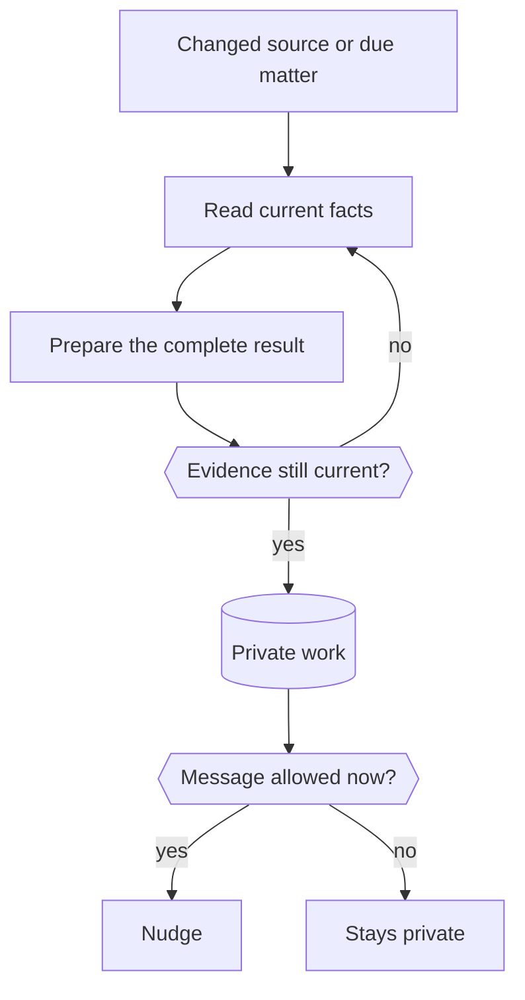

The proactivity engine reads your connected apps on its own, prepares useful work privately and messages you only when that work is worth an interruption. For you it's just [nudges](/use/nudges/): messages at the right time about things that matter.

## From a change to a nudge

A changed source, or a saved matter that is due for another look, starts one private run. When an app reports the change, such as a meeting's old and new time, the run gets that report as data, up to the last ten per source. A restricted worker reads current facts and relevant memory, prepares the complete result and saves it. Server code then decides whether a message can go out now.

If nothing useful remains, Nod stays quiet. It never reports routine checks or repeats a nudge because you didn't reply.

## What it reads

Every connected account is a source. No setup or opt-in is needed.

| Source                                                               | How Nod reads it                                                     | When it looks                                                       |
| -------------------------------------------------------------------- | -------------------------------------------------------------------- | ------------------------------------------------------------------- |
| Gmail                                                                | Conversations from the last 30 days, with exact versions per thread  | On new mail                                                         |
| Google Calendar                                                      | Events in the primary calendar from yesterday through the next month | When the calendar changes, checked every 30 minutes without a model |
| Work Nod saved for you                                               | Task state, results and waiting conditions                           | When a task changes                                                 |
| Every other app, including MCP and HTTP connections you added to Nod | The account's own read tools, the same ones Nod uses in chat         | Every 30 minutes, up to ten due accounts per run                    |

The saved-work change check covers a task's title, completion condition, state, result, waiting condition and next check, so step-by-step progress doesn't start a new assessment.

For an app without its own reader, the worker searches that account's tools, picks one and fills its arguments. The server checks the arguments against the tool's schema, then Trust's read-only check must classify the call as a read. Anything that would create, change, send or delete, a draft included, never runs.

An owner instruction that tells Nod to act on its own, such as "forward Ana's invoices to accounting", switches every source to ordinary background work while it's set, where Trust checks every action. Your selected model classifies the instruction once per version; a failed or unclear answer keeps ordinary work.

## Keep judgment and permission apart

The model judges usefulness. The server enforces permission, freshness and delivery.

| Question                           | What answers it                                                                 |
| ---------------------------------- | ------------------------------------------------------------------------------- |
| Does this help your current goals? | The model, from current facts, relevant memory and your preferences             |
| What does waiting cost?            | The model names a supported deadline or another concrete consequence            |
| Can Nod read this?                 | Trust, from your rules; private preparation skips a read instead of asking you  |
| Are the facts still current?       | The server re-reads cited records, or requires a read from the last two minutes |
| Can a nudge go out now?            | The server: repeats, snooze, quiet hours and the pause switch                   |

The worker has three tools: `read_source`, `proactive_issue` and read-only personal context. It has no sandbox, browser, web, code or connected-app write tools, and its final text stays private. App content, memory and saved drafts reach it as data, never instructions or permission. Secret fields are removed and email that gives account access is hidden before anything reaches the model.

Sending a draft is always a new request that goes through the [trust check](/trust/approvals/).

## Prepare the full result

A nudge doesn't replace the work. The worker saves a complete draft, plan, comparison or decision aid, with the references, amounts, dates and time zones the reader needs, and states what it couldn't confirm. It never invents eligibility, a cause, a deadline or an action that didn't happen.

The nudge itself states what changed and what's ready in one or two sentences, then asks one short question offering the next step. The first nudge about a kind of thing says once that Nod will keep flagging things like it.

## Deliver at the right time

There's no message count. The worker offers only work worth an interruption, weighed against the other open matters, and the server enforces what must always hold:

- **Once per matter.** A matter nudges you again only when its evidence changes and the change matters, such as an earlier deadline or a new option.
- **Quiet hours.** A nudge that comes up at night goes out when they end.
- **Snooze and pause.** A snoozed matter waits until its time. "Pause preparation" stops everything.

"Fewer of these" or "that wasn't useful" becomes feedback the worker uses next time.

## Keep one record of each matter

Prepared work is saved per matter, identified by a stable key and its main record, so a repeated signal never opens a second matter. A resolved matter stays closed until its condition really changes. A dismissed one comes back only for a changed condition or a new option, never just because a deadline moved. Closed drafts are deleted after 30 days; their closed state stays so dismissed work doesn't come back. Removing an account deletes everything prepared from it.

You answer in chat. `prepared_list` shows a draft, and reading it in a turn you started counts as review. `prepared_update` snoozes, closes, dismisses or rates a matter, and runs only in a turn started by your own message.

## Cost

Preparation has no budget of its own. Its model use counts toward your monthly spending limit in **Usage**, like everything else. Unchanged Gmail, Calendar and saved work start no model call. Apps without their own reader cost one private run every 30 minutes while any is connected. "Pause preparation" stops all of it.

## Research behind the behavior

The model judges usefulness. Code checks source versions, tool access, owner controls and delivery limits. These checks can't prove that a draft is useful.

| Research                                                                                                                                                          | Design choice                                                                                                      |
| ----------------------------------------------------------------------------------------------------------------------------------------------------------------- | ------------------------------------------------------------------------------------------------------------------ |
| [Mixed-initiative principles, 1999](https://erichorvitz.com/chi99horvitz.pdf)                                                                                     | Compare expected benefit, uncertainty, and interruption cost before offering help.                                 |
| [COM-B, 2011](https://implementationscience.biomedcentral.com/articles/10.1186/1748-5908-6-42)                                                                    | Remove work with a complete draft, plan, or choice aid. A reminder alone is insufficient.                          |
| [JITAI design principles, 2018](https://pmc.ncbi.nlm.nih.gov/articles/PMC5364076/)                                                                                | Separate need from readiness to engage. Keep useful work private when an interruption would add burden.            |
| [HeartSteps trial, 2019](https://pmc.ncbi.nlm.nih.gov/articles/PMC6401341/)                                                                                       | Measure repeated use and fatigue. Offer only what's worth it; silence does not mean approval or call for a repeat. |
| [Human-AI interaction guidelines, 2019](https://www.microsoft.com/en-us/research/wp-content/uploads/2019/01/Guidelines-for-Human-AI-Interaction-camera-ready.pdf) | Explain the prepared value and preserve feedback, dismissal, snooze, and stop controls.                            |
| [CaMeL, 2025](https://arxiv.org/abs/2503.18813)                                                                                                                   | Keep outside content separate from authority. The private worker has no connected-write tools.                     |
| [PRISM, 2026](https://arxiv.org/abs/2602.01532)                                                                                                                   | Test the decision to interrupt separately from the quality of the prepared response.                               |
| [PARE, 2026](https://arxiv.org/abs/2604.00842)                                                                                                                    | Test changing user state, failed tools, and repeated events. Re-read evidence before saving.                       |

These are design applications of research. Health intervention results don't establish the value of an assistant nudge, and Nod uses no fixed psychological score or sender-ranking rule. See [Proactivity evidence](/how-it-works/proactivity-evidence/) for what the evals measure.

## Add a source

Any app you connect already works through its own read tools. For exact record versions and cheap change checks, add a reader:

- An app reader goes in the integration provider's `activity` map, keyed by service, with `read`, an optional `changeToken` checked every 30 minutes outside model runs, and an optional `identity` that keeps the source through a login refresh.
- Any other source implements the [`ObservationProvider` port](https://github.com/n8n-io/nod/blob/main/src/ports/proactivity.ts) and is registered in `ApplicationAdapters.observations` in [`composition.ts`](https://github.com/n8n-io/nod/blob/main/src/server/composition.ts).

A reader returns only the owner's records, each with an ID, a version and data, and performs only reads. The engine has no provider names or source-specific rules.

:::caution[What the evals don't prove]
Synthetic evals don't measure long-term usefulness, missed opportunities or interruption cost for real owners. A measured state-of-the-art claim needs a field study and a relevant comparison. See [Capability evals](/contribute/evals/).
:::

## Related resources

- [Nudges](/use/nudges/)
- [Architecture](/how-it-works/architecture/)
- [Approvals and the trust check](/trust/approvals/)
- [Memory](/how-it-works/memory/)
