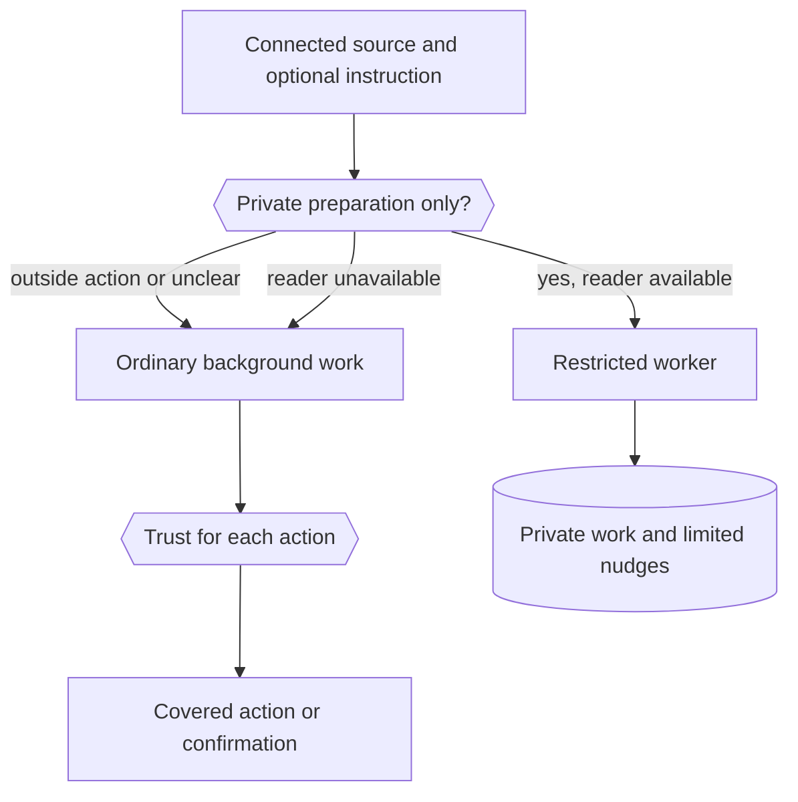
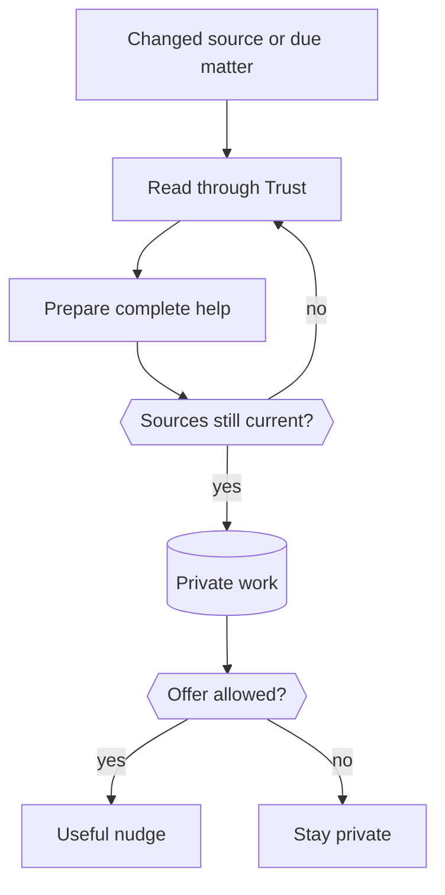
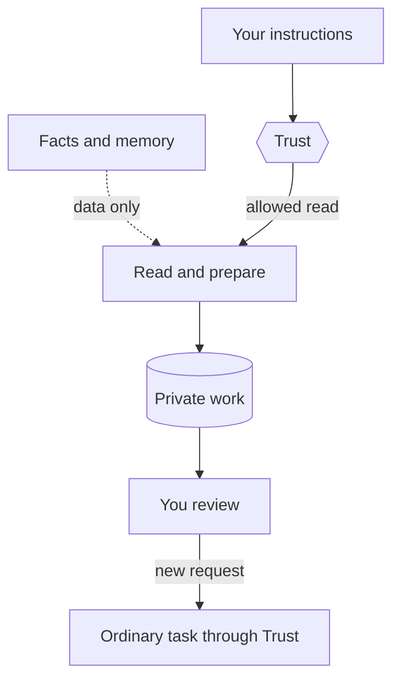
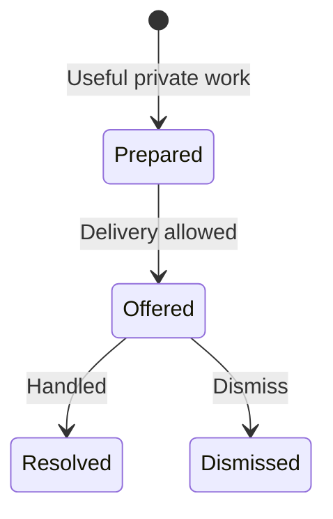

The proactivity engine prepares useful work from your connected sources automatically. It saves the full result privately, then decides whether a short message is worth your attention.

Connect a supported source and nod starts preparing useful work automatically. It uses current facts and relevant memory to decide what deserves your attention. You can adjust priorities or pause preparation at any time.

Existing watches keep working. An owner instruction that asks for an outside action uses the ordinary background runtime and Trust. Sources without a private reader also keep that runtime. New private preparation uses the restricted worker below.

## Keep existing watches and actions

Without a standing instruction, registered readers use private preparation. Optional instructions and your rules can guide this work. Explicit automations keep their existing path. Event text cannot select that path.

The selected model classifies owner instructions once per rule version. A failed or unclear classification keeps the ordinary path. This choice grants no permission. Trust still checks every connected action against your words and rules.

For example, “forward Ana's invoices to accounting” keeps its ordinary action checks. “Prepare replies to contract requests” uses private preparation where a reader is available. Slack, Outlook, GitHub, Linear, Notion, MCP, and n8n watches retain their existing path without a private adapter.

A source without events keeps the existing 30-minute activity check when your instruction covers it. A source with events uses those events.

## From a change to useful help

A changed source or a due unresolved matter starts an assessment. Unchanged source checks do not need model work. The model reads current facts and relevant memory, then prepares a complete result. The server checks the sources again before it saves the result or sends a nudge.

**Preparation and delivery are separate.** The worker can choose private preparation. Quiet hours or a message limit can also hold a requested nudge while the prepared work waits.

If nothing useful remains, nod stays quiet. It does not report routine checks or repeat an update because you did not reply.

## Separate judgment from permission

The model judges usefulness. The server enforces permission, source freshness, and delivery limits.

| Question                           | What answers it                                                                                                  |
| ---------------------------------- | ---------------------------------------------------------------------------------------------------------------- |
| Does this help your current goals? | The model uses current facts, relevant memory, and optional preferences.                                         |
| What does waiting cost?            | The model identifies a supported deadline or another concrete consequence. Age and urgency words are not enough. |
| Is the prepared work usable?       | The model checks its draft against the sources, keeps needed references, and states material unknowns.           |
| Can nod read this source?          | Trust checks the read arguments and any owner instructions or restrictions.                                      |
| Are the facts still current?       | The server reads the referenced records again and compares their versions.                                       |
| Can a nudge go out now?            | The server checks repeat delivery, snooze, quiet hours, message limits, and the pause switch.                    |

Memory can explain why an opportunity matters. It cannot prove that a source fact is current or grant permission.

Reads and private preparation need no standing instruction. Trust still checks each source read. Private preparation never asks you about a read. If Trust would ask, it skips that source: a rule that says to ask first blocks it until your rules change, and any other refusal retries later.

A later request, such as asking nod to send a reviewed reply, starts ordinary work. A standing instruction cannot give the restricted private worker a send or delete tool. Explicit standing automations use the separate ordinary path.

## Prepare the full result

A short nudge does not replace a complete draft, plan, comparison, or decision aid.

The model must retain the details needed to use the result. These include relevant reference numbers, amounts, units, dates, and time zones. The draft field must contain only the reusable result. Recipient-facing text includes only its subject and message. Owner review notes belong in the separate review fields. Relevant saved writing preferences help it write for the intended reader.

A draft must not invent eligibility, a cause, a deadline, a refund, a booking, or an action already performed. Unknown facts stay explicit. If a relevant record is shortened, the model reads that record by ID before it treats the result as strong evidence.

The nudge explains the concrete change and the prepared value in one or two short sentences, then asks one short question about the next step, such as seeing the draft. It does not claim an outside action. It does not use guilt, pressure, or silence as a reason to escalate.

Preparation and attention are separate choices. The worker can save well-supported, high-value work with `delivery: private`. That save sends no message. With `delivery: offer`, the server checks the same evidence and your delivery limits before it can send a nudge. The worker does not need to lower its impact or confidence rating to stay quiet.

A new checked match to an explicit current goal can justify one offer without a deadline. The worker considers delay cost when it chooses timing. Importance and urgency are separate.

Each source result reports the remaining read allowance. The last of the 12 reads is reserved for saving. Direct reads stop with one left. A save needs one fresh read per source, so work that cites several sources needs enough remaining reads for them. The worker saves useful private work before it uses the rest of its allowance on more pages. A later event continues the saved scan and sees prepared matters. Unsaved work from an earlier event session is not retained.

Source-read attempts count against the limit, including failed reads. The direct-read guard runs before the counter changes. A call rejected by that guard cannot use the final attempt reserved for saving.

The server holds a routine offer while a cited source has known remaining pages. The work stays private with its evidence and impact unchanged. After the relevant scan, the worker compares saved candidates. A time-sensitive offer can pass this coverage check; your quiet hours and message limits still apply. The hold does not schedule an immediate retry.

## Research behind the behavior

The model judges usefulness. Code checks source versions, tool access, owner controls, and delivery limits. These checks cannot prove that a draft is useful.

| Research                                                                                                                                                          | Design choice                                                                                                     |
| ----------------------------------------------------------------------------------------------------------------------------------------------------------------- | ----------------------------------------------------------------------------------------------------------------- |
| [Mixed-initiative principles, 1999](https://erichorvitz.com/chi99horvitz.pdf)                                                                                     | Compare expected benefit, uncertainty, and interruption cost before offering help.                                |
| [COM-B, 2011](https://implementationscience.biomedcentral.com/articles/10.1186/1748-5908-6-42)                                                                    | Remove work with a complete draft, plan, or choice aid. A reminder alone is insufficient.                         |
| [JITAI design principles, 2018](https://pmc.ncbi.nlm.nih.gov/articles/PMC5364076/)                                                                                | Separate need from readiness to engage. Keep useful work private when an interruption would add burden.           |
| [HeartSteps trial, 2019](https://pmc.ncbi.nlm.nih.gov/articles/PMC6401341/)                                                                                       | Measure repeated use and fatigue. Unreviewed offers reduce routine interruptions; silence does not mean approval. |
| [Human-AI interaction guidelines, 2019](https://www.microsoft.com/en-us/research/wp-content/uploads/2019/01/Guidelines-for-Human-AI-Interaction-camera-ready.pdf) | Explain the prepared value and preserve feedback, dismissal, snooze, and stop controls.                           |
| [CaMeL, 2025](https://arxiv.org/abs/2503.18813)                                                                                                                   | Keep outside content separate from authority. The private worker has no connected-write tools.                    |
| [PRISM, 2026](https://arxiv.org/abs/2602.01532)                                                                                                                   | Test the decision to interrupt separately from the quality of the prepared response.                              |
| [PARE, 2026](https://arxiv.org/abs/2604.00842)                                                                                                                    | Test changing user state, failed tools, and repeated events. Re-read evidence before saving.                      |

These are design applications of research. Health intervention results do not establish the value of an assistant nudge. nod uses no fixed psychological score or sender-ranking rule.

For example, a source reports a cancelled trip. nod checks current facts and your saved travel goal, then prepares a complete enquiry. It offers the result when the supported cost of waiting warrants attention. If you have handled the problem, it closes the matter instead.

The research does not establish a universal message limit. Your controls and measured results must guide that choice. See [Proactivity evidence](/how-it-works/proactivity-evidence/) for evaluation limits.

## Use one contract for every source

An observation is a current record from a registered read-only source. It has an opaque ID, a version, availability, and data.

A source revision identifies its account and access configuration. A record version identifies its current content. They protect different things: the read target and the facts used in the prepared work.

The [`ObservationProvider` port](https://github.com/n8n-io/nod/blob/main/src/ports/proactivity.ts) supplies the source inventory and reads. The core has no provider names, fixed issue categories, or source-specific completion rules.

The same flow can assess a repository check, a document change, saved work, a message, or a course programme. An email reply, a finished build, or an ended event does not automatically close every matter about that record. The model must assess what the change means.

The supplied production readers cover saved work, Gmail threads, and the primary Google Calendar. Other sources need an explicit reader for private preparation. Their existing watches keep ordinary background work. These adapters sit outside the engine.

### Add a reader safely

Register a provider in `ApplicationAdapters.observations` in [`composition.ts`](https://github.com/n8n-io/nod/blob/main/src/server/composition.ts). The provider instance must return only the current owner's sources and records.

Its inventory describes the read contract, an optional cheap change token, and an optional check interval. A stable unchanged token prevents an idle model turn. Use local metadata for the inventory. Put content reads in the bounded `read` call. Change the source revision when its principal or access configuration changes. A provider can keep a stable verified principal through a new login. Fence the physical account separately during every in-flight read. The registry passes that revision in `ObservationQuery.revision`. A reader must check it when it selects a mutable account or endpoint, before it reads content.

The reader must validate IDs for its own read target and perform only read operations. The registry never treats an ID as a URL. External content and tool metadata cannot register a provider or give it a write tool.

### Apply privacy before shortening

The shared registry removes secret fields and checks account-access email before it shortens data. Known secrets are removed from the privacy model's input. A failed or unavailable email check hides that content.

Each page has a shared data limit. An exact ID read can recover more of a shortened record. Source revisions are checked before and after the read. Stop ends the read even if a provider or privacy check ignores cancellation.

Source metadata uses an explicit field list. Known secrets are removed from labels, credential-bearing links are omitted, and private identifiers are refused.

The adapter checks the source revision again before it calls the provider. A new login for the same verified principal can keep that revision.

All returned content reaches the worker as data, never instructions or permission.

A read also supplies owner-local views for up to 64 distinct ISO timestamps in its source data. The server uses the existing time formatter and computes the weekday in your timezone. It keeps the source values and adds the matching local dates, times, offsets and weekdays. Source text cannot set your timezone. Without a configured timezone, nod keeps the original source time and offset. These views help the model avoid timezone arithmetic. They do not prove which timestamp is the deadline.

## Keep one record of each matter

A matter holds the prepared work, current source references, feedback, and its next check. It stays separate from personal memory.

The bounded list puts open work first. It removes work from old or disconnected source revisions before it limits the rows. A large closed history cannot hide open work from the compact index.

You can also handle or dismiss prepared work before a nudge. Snooze changes the next delivery time and keeps the current state.

The compact index includes the owner's snooze time. A save finds existing work from an explicit primary record and a stable matter key; it does not take an issue ID. Supporting references cannot replace another matter. Read and resolve use the issue ID.

A repeated event or a reworded title does not create another open instance of the same matter. Separate requests in one thread can have separate keys. A later nudge needs changed evidence and a stated material change.

Duplicate references are removed before the evidence check. Reference order does not change the notification version. It uses a stable ordering of complete source-version keys, including opaque IDs with punctuation.

A resolved matter stays closed. A genuinely new condition can start a new matter from changed source evidence. A dismissed matter stays closed for unchanged conditions. Changed checked evidence and a stated new condition can start a new instance. Gmail content versions exclude read and archive labels. New messages change the version. The model still supplies the matter key and decides whether a condition is new. Code cannot prove semantic identity across different keys. Dismissal closes a matter, not all future work from a record. A snooze holds delivery until the time you choose. Telling nod a nudge was useful or not useful helps later assessments. Silence does not count as feedback.

The new matter's key includes all cited source versions in a stable order. A change in a secondary source can start new work after resolution. It cannot reuse an earlier matter's key merely because the primary record did not change.

Each read also returns bounded `ownerDismissedMatters` hints. Each hint binds a hashed matter key, its primary record, and the checked source versions. It does not mute every cited record. The server checks the owner and source revision. Not useful feedback does not close or mute the matter.

Before save or resolve, the server reads the exact source IDs again. A changed version returns new observations for another assessment. Missing records cannot support a new result. Resolution must match the stored source revision. It saves the fresh versions for the records it checked and keeps the other source references. The same evidence cannot then count as a new condition. A record from a reconnected account cannot close work from the old account, even when the record ID is the same.

Evidence belongs to the current turn and source revision. It expires after two minutes on the wall clock. A lock wait does not extend that window. A cached result from before the current read cannot count as a fresh check.

### Store only the state the engine needs

[`proactivity.ts`](https://github.com/n8n-io/nod/blob/main/src/server/proactivity.ts) owns four tables:

| Record               | Stored state                                                                     |
| -------------------- | -------------------------------------------------------------------------------- |
| `proactive_issues`   | The matter, prepared work, source references, feedback, state, and next check    |
| `proactive_closures` | Closed state and source ID, revision, record ID, and version after draft cleanup |
| `proactive_sources`  | Source scan state, revision, page cursor, and last complete scan                 |
| `proactive_evidence` | Record ID, version, availability, and check time, bound to a turn                |

The evidence table does not store source bodies. Issue state and message insertion commit together under the turn lock and an owner lock. The existing delivery path sends the message.

Closed drafts expire after 30 days. Cleanup keeps their closed state and source keys in `proactive_closures` in the same transaction. This record has no draft, summary, source body, label, or URL. A later read still reports a dismissal. A later save still requires changed evidence to reopen resolved work. The owner and account revision must match. A missing source or expired login does not delete this state. Missing or different account scope stays hidden. A known inactive source can show older prepared work with a warning. It cannot support a new read. Reconnecting the same verified Google mailbox keeps its logical revision. Explicit removal is different from lost access. The connection removal transaction calls the shared `forgetSource` operation with the namespaced source ID. It deletes all private matters, closures, evidence, and scan state that cite that source for this owner. It runs before an outside disconnect, which can fail. Temporary absence never calls this operation. Past conversations and background transcripts follow normal retention. Source-state writes share the removal lock and check source registration again. A read or dispatcher that was already waiting cannot recreate removed state.

Message counts come from actual prepared-update messages. An update to the same matter still uses the daily allowance. `model_usage` remains the only cost ledger.

## Reuse the existing worker

Restricted private event turns have `turns.proactive=true`. Ordinary watches do not. A confirmation resume keeps this flag. One proactive turn runs per owner at a time. Ordinary sessions can run alongside it.

The restricted Pi session has only three tools:

- `read_source` reads a registered source.
- `proactive_issue` lists, reads, saves, or resolves private work.
- `manage_personal_context` reads memory, history, or notification preferences.

The session loads no sandbox tools, web extension, or code extension. A second runtime guard rejects native, nested, and deferred write routes. Final model text and progress stay private.

The heartbeat checks cheap source metadata before it starts model work. Calendar collection versions and saved-work change tokens suppress unchanged checks. Gmail starts work from new-mail events, not from every mailbox change. A failed native inbox feed uses bounded polling while direct reads remain available. A stopped app watch cannot start private reads. Sources without such signals use their declared interval. A provider can supply `activityChangeToken` and declare its supported services. The server polls this metadata method every 30 minutes, outside model turns. A failure marks the source unavailable and retries after five minutes. A 15-second deadline and an account-bound claim contain slow or stale results. The inventory reads only the saved token. The shared worker has no Calendar-specific rule.

The Calendar adapter reads only the event collection ETag with a fixed GET request. It adds the UTC date to the token so the moving read window gets a daily assessment. The first scan on a new UTC date includes unchanged events in the new window. Later same-day scans use the update-time filter. The bounds stay fixed from yesterday through the next 30 full UTC dates. All pages use the saved scan time. This uses the documented [event collection version](https://developers.google.com/workspace/calendar/api/v3/reference/events/list). Contract tests do not establish live connector reliability. Events mark durable pending source changes. A burst shares one active private job per owner. A signal that arrives during a scan remains pending. The scan keeps its starting token and signal count across pages. Completion acknowledges only those starting values. Its checkpoint also restores them after a failed turn.

Private preparation has no budget of its own. Its model use counts toward the owner's monthly spending limit, which stops every model session once reached. The owner can pause preparation in chat; a pause leaves source signals pending until it resumes. Ordinary watches retain their existing task limits.

Page progress survives a restart and uses a stable scan time. An ordinary failed page keeps its cursor and last complete watermark. Only an explicit expired-cursor result restarts that scan. Failed assessments restore their tentative scan checkpoint.

One failed record is unknown, not deleted or handled. The page keeps its good records and next cursor. Failed records get bounded retries with increasing delays. Gmail list reads use bounded recent metadata. Exact reads load up to eight full messages. Record reads and privacy checks have separate time bounds. One slow check cannot hold the whole page indefinitely. Claiming a due check moves it 30 minutes later, so a failed run gets another chance. Successful work sets the next check. Failed or interrupted turns do not retry automatically.

Engine tables start in one transaction under the existing setup lock. Concurrent workers cannot race to create the same tables. Source inventory calls have a 45-second bound. Setup and preparation also use the turn's cancellation signal. A late inventory result cannot continue a cancelled save. Stop also closes an active proactive database transaction. Pending work rolls back and releases its locks. The transaction enables PostgreSQL's 100 ms closed-connection check. A database or proxy must pass client disconnects through for this bound to apply.

## Deliver by priority and owner controls

The model supplies impact, evidence strength, urgency, and a supported deadline. Code checks these labels and source versions. It does not independently prove the benefit, urgency, or draft quality.

Routine delivery has a local daily limit and a minimum gap. A high-impact, time-sensitive item with a future deadline skips the daily limit and the gap, and does not use routine room. It never passes quiet hours: urgent work waits for them to end. Snooze and a zero message limit still hold. Urgent nudges have no count of their own; one nudge per matter and the strong-evidence requirement bound them.

Unread routine offers also use attention capacity across days. Each priority class can hold up to your ordinary daily limit of unreviewed offers in the current visible source scope. Hidden offers from an old account do not fill that capacity. A higher-priority item can pass a full routine class. Urgent items can pass this hold. A full draft read in owner-started chat or work shows review. Feedback or a direct reply shows engagement. The chat tool returns the draft and records review under the active turn and owner locks. Index reads and automatic background reads do not release attention capacity. Review schedules held matters for a later check. Silence does not create a negative preference. Held work stays private without an immediate model retry. Owner review allows a later check.

## Answer in chat

The owner answers a nudge in words, in any channel. The chat agent has two actions on prepared work:

- `prepared_list` lists prepared work, or reads one complete draft with its sources. A read in a turn started by an owner message counts as review.
- `prepared_update` snoozes, closes, dismisses, or records useful or not useful feedback. The server runs it only in a turn started by an owner message, so source content and background work can't hide a matter.

Sending a draft is a new request. It goes through the ordinary trust check, which sees the owner's reply and the nudge it answers.

## Check quality with examples

Synthetic evals test the same engine across different sources. They check the full prepared result, the owner message, silence when appropriate, and outside effects separately.

| Observation                                 | Useful prepared work                                                                         | Expected delivery                                             |
| ------------------------------------------- | -------------------------------------------------------------------------------------------- | ------------------------------------------------------------- |
| A flight is cancelled                       | An enquiry with flight and booking references, current facts, options, and explicit unknowns | One calm nudge that asks about the next step                  |
| A supplier statement lists an unused credit | An enquiry with customer, credit, and invoice references, plus the supported amount          | One nudge about the potential value, without a refund promise |
| A course programme changes                  | A comparison against a saved goal's language, level, timing, location, and budget            | One nudge only for a relevant option                          |
| A release check fails                       | An investigation plan based on the observed contract mismatch                                | One useful nudge; no deployment                               |
| The owner already handled a travel problem  | Resolve the stale matter from current facts                                                  | Silence                                                       |
| A second useful change arrives too soon     | Save the new work privately                                                                  | Hold delivery under the shared attention limit                |

Independent model judges check usefulness, factual support, and pressure. Code checks verify source use, required references, message counts, and outside effects. Failed attempts stay in the evaluation record and lead to a stated cause and another run.

See [Capability evals](/contribute/evals/) for the manual model test process.

:::caution[What these checks do not prove]
Synthetic evals do not measure long-term usefulness, missed opportunities, or interruption cost for real owners. A measured state-of-the-art claim needs a field study and a relevant comparison.
:::

## Evidence and research

[Proactivity evidence](/how-it-works/proactivity-evidence/) explains the controlled tests, stress cases, comparison prompt and remaining need for real owner outcomes. It keeps draft quality, timing, permitted effects and owner value as separate measures.

## Related resources

- [Architecture](/how-it-works/architecture/)
- [Nudges](/use/nudges/)
- [Approvals and the trust check](/trust/approvals/)
- [Memory](/how-it-works/memory/)
