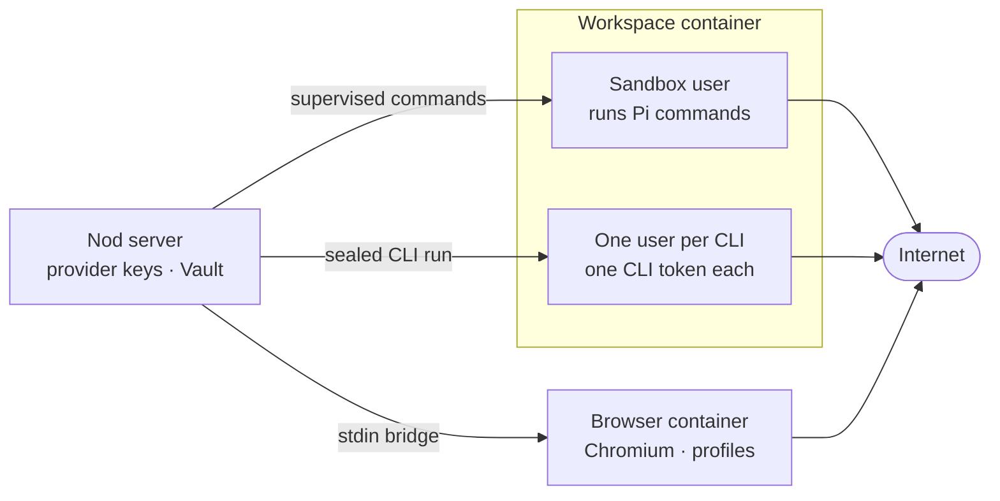
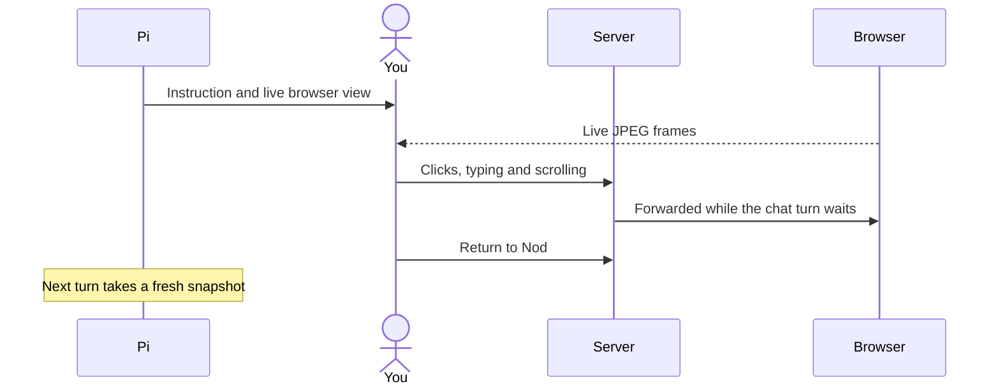

This page explains how Nod isolates the commands it runs and the websites it visits, and what each part of the system can and can't reach.

The short version: commands run as an unprivileged user in a workspace container. The browser runs in a separate container. Provider keys and the owner access key stay in the server process.

## Trust boundaries

## What each part can and can't reach

|                       | Server                           | Sandbox user              | Connected CLI user        | Browser container                               |
| --------------------- | -------------------------------- | ------------------------- | ------------------------- | ----------------------------------------------- |
| Provider keys         | Yes                              | No                        | No                        | No                                              |
| Owner access key      | Yes                              | No                        | No                        | No                                              |
| Vault values          | Yes                              | No                        | No                        | Only a value the server enters in a page        |
| A connected CLI token | Yes                              | No                        | Its own token only        | No                                              |
| Docker control        | Local socket or restricted proxy | No                        | No                        | No                                              |
| Workspace files       | Through a guarded reader         | Yes                       | Files passed as arguments | No shared mounts                                |
| Browser profiles      | Through the bridge               | No                        | No                        | Yes                                             |
| Internet              | Yes                              | Yes, see the limits below | Yes, with the same limits | Public addresses only, saved profiles included. |

## The workspace container

Pi's native tools (`read`, `bash`, `edit`, `write`, `find` and `ls`) run inside the workspace through `WorkspaceSession.exec`. Each thread works in `/workspace/<thread ID>`. A source install mounts `NOD_DATA_ROOT/workspaces`; self-hosted and desktop runtimes use a persistent workspace volume. `/home/node` is a separate volume, so tools Pi installs persist.

The tools use the thread's Linux workspace path on every host, including Windows. The runtime converts Windows file paths before it sends file operations to the container.

- Commands run as the unprivileged `node` user, without sudo.
- Bash gets no host environment. It sets the owner's `TZ` when known.
- No workspace file is loaded as instructions.

Both the workspace and browser containers drop all capabilities, set `no-new-privileges` and have these limits:

| Container | Source install (`compose.yaml`)                            | Local desktop runtime                              | Self-hosted server defaults                                |
| --------- | ---------------------------------------------------------- | -------------------------------------------------- | ---------------------------------------------------------- |
| Workspace | 8 GB memory, up to 4 CPUs, 4,096 processes                 | 2 GB memory, 2 CPUs, 1,024 processes               | 2 GB memory, no CPU limit, 512 processes                   |
| Browser   | 8 GB memory, up to 6 CPUs, 4,096 processes, read-only root | 2 GB memory, 2 CPUs, 768 processes, read-only root | 3 GB memory, no CPU limit, 1,024 processes, read-only root |

For source installs, `pnpm start` uses the Docker daemon's CPU count when it is lower than these caps. It also respects lower `NOD_WORKSPACE_CPUS` and `NOD_BROWSER_CPUS` values from the shell or `.env`. Direct Compose commands keep the listed defaults; set those variables when using a smaller Docker VM.

The self-hosted server reaches Docker through a restricted proxy for its workspace and browser containers. Its Compose configuration allows separate memory limits through `NOD_WORKSPACE_MEMORY` and `NOD_BROWSER_MEMORY`.

## The command supervisor

Every command goes through a small supervisor inside the container, in [`src/providers/docker/command.ts`](https://github.com/n8n-io/nod/blob/main/src/providers/docker/command.ts).

- It owns the command's session and signals every process in it, even ones that left the process group.
- A command also ends the processes it detached, when the command itself ends, so work it left behind never outlives it. Stop ends the whole tree the same way, and escalates to `SIGKILL` for a process that ignores the first signal.
- It enforces the timeout: 59 minutes for `bash` by default. The model can ask for longer.
- It acknowledges when the command ends. If that acknowledgement is lost, the server fences the workspace: no more commands run until Nod restarts.

## Command output

Up to 1 MiB of output reaches Pi. Pi shows the model the tail, and codemode scripts get the whole output and the exit code. Larger output keeps its first and last 512 KiB and names the complete log in the workspace.

Pi writes truncated output, codemode files and images, and extracted web PDFs to the server's temp folder. The runtime moves each file into the workspace's `.nod/outputs` folder and rewrites its path before the result is recorded. See [`src/providers/pi/sandbox.ts`](https://github.com/n8n-io/nod/blob/main/src/providers/pi/sandbox.ts).

## Connected CLIs

Each connected CLI runs as its own Linux user, derived from its path ID, in group `nod-connected`. Before each run, the supervisor installs the CLI's declared source into `/var/tmp/nod-cli-<path id>`, a folder only that user can open, if it's missing. It refuses an install folder or executable that another user can write, and refuses to run if another CLI's install belongs to the same user. So one CLI can't change another's install or read its token.

The CLI then runs with an environment built from scratch: a fixed `PATH`, a private temporary `HOME` and `XDG_CONFIG_HOME`, `LANG` and the connection's credential variables. Nothing comes from the sandbox user's files or environment, so a program the model plants never receives the token. See [MCP, APIs and CLIs](/connect/mcp-api-cli/).

## The browser container

The browser is a separate trusted container. It doesn't share mounts or a network namespace with the workspace. The server drives Vercel Labs [agent-browser](https://github.com/vercel-labs/agent-browser) over a fixed stdin bridge to a private Unix socket.

| Setting    | Value                                                                   |
| ---------- | ----------------------------------------------------------------------- |
| Display    | Headed Chromium on a private 1920x1080 virtual display per session      |
| Viewport   | 1440x900, with Noto fonts and software WebGL                            |
| Time zone  | The owner's saved IANA time zone, or UTC when unknown or invalid        |
| Language   | The owner's formatting locale, such as en-GB, sent as `Accept-Language` |
| HTTP cache | Under `/tmp`, per session, outside saved profiles                       |

Pi reads the page from agent-browser's accessibility snapshot, with `@eN` references, as plain text after the page URL. A snapshot returns up to 40,000 characters, and Pi reads the rest with an offset. Pi interprets the page and chooses controls. The server also reads the selected control's form method and destination for the trust check, and the page's visible text when it prepares a confirmation question.

Every browser command has a deadline: 60 seconds, or a wait's own timeout plus 30 seconds. That leaves room for agent-browser's own 30-second limit on each browser call, so only a browser that has stopped answering misses it. A browser that misses its deadline, is interrupted or doesn't close within 5 seconds is killed with all its Chromium processes. A cancelled action requires an explicit open or saved-session selection before that browser can continue. Once cancellation is acknowledged, other sessions keep their browsers and can continue. A lost bridge response still requires recovery of the application namespace because the worker may have closed it. Nod never repeats the interrupted action during recovery. While a dialog is open, the observation is the dialog, and every action except open is refused until Pi accepts or dismisses it.

Known secret values (passwords, codes, card numbers and security codes) are removed from tool output and masked in screenshots; usernames and the cardholder name aren't secrets and stay visible. URL parameters that carry credentials, such as tokens and signatures, are hidden; other query parameters stay. When an action fails, Pi sees the browser's own error with known secrets removed. Pi uses saved profiles through `browser_session` and never reads their files. The code is in [`src/providers/agent-browser/`](https://github.com/n8n-io/nod/tree/main/src/providers/agent-browser).

## Browser handoff

When Pi needs you in the browser, it calls `browser` with `action: handoff` and a clear instruction. Nod web shows the live tab in chat.

- Each handoff identifies its waiting turn and browser. Input reaches only that browser while its question stays pending. Other sessions keep their own browsers.
- **Return to Nod** continues the session that asked, including a background session, without posting a message for you. Pi looks at the page to see what you did.
- The panel scrolls into view once, when its first frame arrives. While it is open, the task ledger marks its task `browserHandoff`. With the full prompt, not the compact one for small context windows, the coordinator then points you to the panel instead of forwarding a message, because a task reply closes the handoff.
- One bridge call carries frames out, newest first, and your input in. Each input is acknowledged after the browser applies it. Failures reach the view without retrying the input. Losing the connection rejects pending input and disables it until the view reconnects.
- Frames pause during credential entry. Passwords you type in the handoff join the known secrets.
- An init script makes every passkey request fail at once and reports no passkey support, so a sign-in doesn't open a passkey prompt that the live view can't show.

## Watching a task's browser

A task's card can show its browser live while the task works. The server sends the same frames as a handoff, bound to the task instead of a waiting question.

- The view serves frames only while the task is open and its session has a running turn. The server checks this every second and ends the view when the turn finishes, waits or stops, the task closes or the thread is archived.
- The browser is the task's own session browser, looked up from the task on the server. Another session's browser, a helper's browser or another owner's task never reach the view.
- The view has no input path. Clicks, typing, **Back** and **Reload** still need a pending handoff, so watching can't race a step Nod is taking.
- Watching doesn't hold the browser open or count as use. When the browser closes, the view ends and says so instead of showing a saved screenshot.
- Live frames aren't masked like screenshots. A handoff pauses them during credential entry, then shows the page so you can finish a sign-in. A watch view also stays blank while any tab still shows a page Nod filled privately, until that page reloads or navigates.
- Desktop feedback screenshots skip a page that shows the view, as they do for a handoff.

Taking control while Nod browses isn't available yet. A takeover would have to stop the running step safely and treat an interrupted submission as uncertain, which needs its own design.

:::caution[Limits]
The workspace can reach public internet addresses. Source installs and self-hosted servers use a separate firewall container. It blocks private and reserved IPv4 addresses, including cloud metadata services, and all external IPv6 traffic. The workspace starts only after the firewall is ready and has no permission to change its rules. Local workspace services remain available through loopback. The desktop app's local runtime also blocks private and reserved addresses. The browser reaches only public addresses. Inside the browser container, Chromium runs with its own sandbox turned off; the container is the boundary.
:::

## Related resources

- [Architecture](/how-it-works/architecture/)
- [The agent runtime](/how-it-works/agent-runtime/)
- [Nod's workspace](/use/workspace/)
- [The browser](/use/browser/)
- [Security model and limits](/trust/security-model/)
