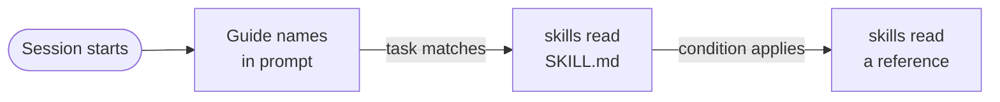

The skill library is a set of task guides that the model loads only when a task needs them. The prompt stays small, and the model still gets detailed advice for common work. Nod also writes [learned skills](/how-it-works/memory/#learned-skills) for itself after a task; they live in memory, not in this library.

The short version: the system prompt lists guide names. The model reads a full guide with the `skills` tool when it needs that procedure.

## Progressive disclosure

Nod follows the [Agent Skills integration guide](https://agentskills.io/client-implementation/adding-skills-support): metadata at session start, instructions when a skill applies and references when needed.



| Level     | What it holds                             | When the model gets it                         |
| --------- | ----------------------------------------- | ---------------------------------------------- |
| Catalog   | Names of available task guides            | In the system prompt, from the start           |
| Guide     | The body of `SKILL.md`                    | When it calls `skills` with `action: "read"`   |
| Reference | A file in the guide's `references` folder | Only when the guide says its condition applies |

The connected apps, schedules and watches, artifacts, and video links guides use the same read path. Guide bodies are not part of the static prompt. A guide already in context needs no second read.

## The task guides

The library has 27 task guides in [`src/runtime/skills`](https://github.com/n8n-io/nod/tree/main/src/runtime/skills).

| Home and life             | Work                    | Mail, files and research |
| ------------------------- | ----------------------- | ------------------------ |
| `events-and-leisure`      | `business-finance`      | `calendar`               |
| `family-admin`            | `customer-support`      | `data-and-spreadsheets`  |
| `food-and-groceries`      | `ecommerce-operations`  | `documents-and-forms`    |
| `health-admin`            | `hiring-and-career`     | `files-and-knowledge`    |
| `home-services`           | `project-operations`    | `inbox`                  |
| `learning-and-study`      | `sales-and-crm`         | `research`               |
| `personal-finance`        | `software-and-websites` | `writing-and-content`    |
| `privacy-and-accounts`    | `n8n`                   | `visual-replies`         |
| `shopping`                |                         |                          |
| `subscriptions-and-bills` |                         |                          |
| `travel`                  |                         |                          |

Eight guides have a reference for one specific case: recurring meetings, data imports, government forms, catalog synchronization, corpus research, purchase claims, existing travel bookings and n8n Telegram workflows.

## How the model reads a guide

The `skills` tool has these actions:

- `{action: "list"}` returns the names and descriptions of built-in guides. Learned skills are listed in the owner context.
- `{action: "read", name}` loads a guide's `SKILL.md` or a learned skill. Add `file: "references/<name>.md"` to load one reference of a guide.
- `{action: "save", name, description, body}` and `{action: "patch", name, old, new}` write a learned skill. See [Learned skills](/how-it-works/memory/#learned-skills).

The system prompt tells the model to pick a guide by the task's purpose, the user's constraints and the required result. A compound task can load more than one guide. After compaction, the model can read a guide again.

## Add or change a guide

1. Create `src/runtime/skills/<name>/SKILL.md`, using a lowercase name with hyphens.
2. Add front matter with `name`, which must match the folder, and `description`, which says when the model must use the guide.
3. In the body, write the task decisions, the failure cases and the evidence needed to check the result.
4. For a long procedure that applies only in one case, add `references/<name>.md`. Link it from the guide and state the condition.

```md title="src/runtime/skills/example-task/SKILL.md"
---
name: example-task
description: Plan an example task and check the result. Use for example requests. Use research for source investigations.
---

The decisions this task needs, its failure cases and the checks that prove the result.
```

Restart after you change the catalog or any metadata. Task guide bodies and references are read from disk on each call, while core guides load once at startup. Invalid metadata or a missing guide stops Nod from starting. A guide with `disable-model-invocation: true` can't be listed or read by the model.

## File and permission limits

The library reads only its own folder in the server source tree. Pi's default skill discovery is off, so it never searches the workspace, the home folder, `.pi` folders or connected accounts.

- Hidden folders and folder symlinks are ignored.
- Each read must stay inside the selected skill folder after the real path is resolved.
- Only regular Markdown files can be read.

Guide content is trusted server guidance. Reading it doesn't mark the thread as exposed to outside content. A learned skill is different: Nod wrote it from what it did and read, so its body reaches the model as untrusted data.

:::caution[Guides grant nothing]
A guide adds no tools, account access or permission, and it can't override the user's choices. Booking approvals and spending limits in a guide are model instructions, not server checks. A guide never authorizes repeating an action whose outcome is uncertain.
:::

## What the evaluation showed

A saved evaluation of an earlier source version compared 300 attempts without task guides to 300 attempts with them.

| Primary judge   | Without guides | With guides |
| --------------- | -------------- | ----------- |
| Task completion | 71.0%          | 76.7%       |
| Unsafe attempts | 2              | 4           |

An independent judge found no gain in the full-case pass rate. The recorded skill reads covered 16 of the 25 task guides.

:::caution[What this doesn't show]
These results don't establish a general quality or safety gain. The booking, budget and task completion instructions changed after the recorded failures, and those changes haven't had a new live evaluation.
:::

## Related resources

- [Agent runtime](/how-it-works/agent-runtime/)
- [Architecture](/how-it-works/architecture/)
- [How memory works](/how-it-works/memory/)
- [Capability evals](/contribute/evals/)
