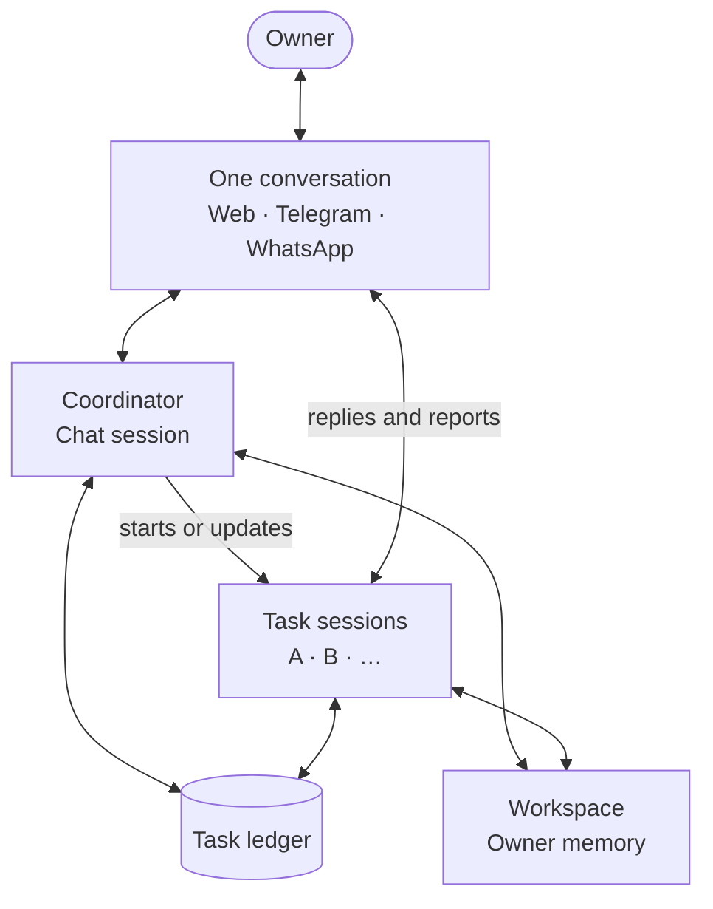

nod has one conversation per owner. The main chat session coordinates work. Each independent task gets a saved session that reports to the same conversation. Short requests stay in the main chat.

## The architecture



The conversation is the owner's view of the work. The coordinator assigns work and routes ordinary follow-ups. A task session does the work, asks its own questions and delivers its own results. The coordinator does not rewrite each result through another model call.

Explicit replies go to the selected task before the coordinator runs. The task's message identifies which work the owner is answering.

## Three separate concepts

| Concept | Purpose                                                   | Lifetime                                                |
| ------- | --------------------------------------------------------- | ------------------------------------------------------- |
| Task    | The goal, completion condition, progress and result.      | Until completed or stopped; its record stays available. |
| Session | The saved Pi history and execution context for that work. | Across turns, questions and owner updates.              |
| Turn    | One execution started by a message, dispatch or resume.   | Until it succeeds, waits, fails or is cancelled.        |

A task can need several turns in the same session. A successful turn does not mean the task is complete. The task calls `finish` after it checks its completion condition.

Each session runs one turn at a time. Different sessions run in parallel. There is no task limit of three. Browser capacity is a separate resource limit; a task that does not browse does not open a browser.

## One task ledger

The `tasks` table is the source of truth for task state. Task messages, web cards and Telegram status replies show that state; they are not separate task records. The model writes every task message from that state, in the owner's language.

| Record        | Owns                                                                                                                              |
| ------------- | --------------------------------------------------------------------------------------------------------------------------------- |
| `tasks`       | Goal, completion condition, brief, source owner message, session and message links, steps, progress, update revisions and result. |
| `turns`       | Execution state, session, task, reply channel and resume links.                                                                   |
| `messages`    | Owner input, questions, replies and delivered file links.                                                                         |
| `turn_events` | Tool and helper activity for the task's activity view.                                                                            |
| `model_usage` | Model requests and their cost.                                                                                                    |

Each turn sees up to 100 tasks of the active conversation, open ones first, then finished ones with their results, newest first. After a conversation reset in a development build, tasks from the archived conversation stay saved and on the Tasks page, which lists up to 100, open ones first, but leave the turn context.

A model-written task list in the workspace does not replace the ledger. The existing turn queue runs the sessions. The task system does not add another scheduler or cost ledger.

## Start, reply and finish

1. The owner gives the coordinator an independent goal. The coordinator uses `task start` with a title, completion condition, brief and planned steps.
2. One transaction saves the task, posts its first message and queues its first turn. A task started from chat uses its task ID as the session ID. The original owner message stays linked to the task.
3. The worker opens that saved session. The task updates its steps as it works. Text the model writes between tool calls becomes the task's live status: its card and the working bubble at the bottom of the chat show it, with the website while it browses. It isn't posted, because the task's first message already says what it is doing. Its questions, files, deliberate `send_message` updates and final reply reach the conversation; if it ends without a final reply, its last such text is posted instead. A reply from the owner while the task works gets its answer as a message. Event and schedule runs stay quiet.
4. If the task needs the owner, it asks a question and waits. Other sessions continue.
5. A reply to the task's first message, question, file or result continues that task. An ordinary message goes to the coordinator, which can forward the exact owner message to one or more selected open tasks. A finished or stopped task reopens only when the owner replies to one of its messages. If the target is unclear, it asks.
6. The task checks its completion condition, shares any result files and calls `task finish`. Its final reply goes directly to its message in the shared conversation.

Each owner update has a revision. The server records delivery at a model boundary. A task cannot finish while an owner update remains queued. A correction closes the old waiting turn, so an old pending approval cannot execute after that correction.

A schedule or event session can also create a task record for its work. It keeps its existing session instead of starting a second one.

## Shared information, separate histories

All sessions use the same workspace for the owner's conversation:

```text
/workspace/<thread ID>/
├── shared/
└── tasks/
    ├── <task A>/
    │   ├── drafts/
    │   └── outputs/
    └── <task B>/
        ├── drafts/
        └── outputs/
```

Task folders organize working files. They are not security boundaries. A task can read another task's output by its path. It must not overwrite another task's working files.

Each session has its own saved Pi transcript. Owner memory is shared and stays outside the sandbox. Sessions load current memory and task state when they start or continue. The main chat receives reports from other sessions in its conversation context.

Shared storage does not put every change into every active model context. The server delivers addressed owner updates. Tasks read current ledger state and shared files when they need them. Use saved reports and file paths to pass results between tasks; do not depend on another session's private history.

Coordination goes through the main session and ledger. Task sessions cannot forward owner updates to other tasks. They can read shared outputs. `delegate` is different: it runs temporary helpers inside a turn, returns their results to the parent and does not create saved task records.

Shared information does not grant permission. For a task started from chat, the trust check uses its original owner request and owner messages addressed to it. Other task reports, files, briefs and memory cannot authorize an outside action. See [Approvals](/trust/approvals/).

## One task across web and chat apps

Web chat and the Tasks page show the same compact preview. Expand it for steps, activity, the completion condition and task controls. Activity shows tool and helper events, not private model reasoning.

Telegram shows the task as messages nod writes and, while it works, its current step as a live draft. Its questions and result reply to its first message. `/tasks` sends a replyable status message for each open task. Reply with `/status` to inspect it or `/stop` to stop it. Native reply links for text parts and files select the same saved task in Telegram and WhatsApp.

These are views of one task record and session. A pending approval remains bound to its exact question and action. An old status message cannot approve a later action. Private sign-in and payment steps remain in nod's private forms.

See [Track tasks](/use/tasks/) for controls and screenshots.

## Stop, restart and reset

- **Stop one task** cancels that session's running, queued and waiting turns and its helpers. Other tasks continue. Only the owner or the main chat acting on an owner message can stop a task; scheduled and background runs can't. An outside action that already started can still finish.
- **Main Stop** stops active work and closes all open tasks. Schedules stay configured.
- **Restart** keeps task records, saved transcripts and waiting questions. A run interrupted during execution fails and is not retried. Its task can continue from a new owner message. The task's interruption notice replies to its own message when the model can prepare it.
- **Reset** archives the conversation, closes its open tasks and gives the next conversation a new workspace and chat session. Earlier records remain stored.

## Code and related guides

- [`src/server/tasks.ts`](https://github.com/n8n-io/nod/blob/main/src/server/tasks.ts): task ledger, dispatch, updates, reply targets and controls.
- [`src/server/thread.ts`](https://github.com/n8n-io/nod/blob/main/src/server/thread.ts): turn queue, session routing, input delivery and interruption handling.
- [Threads and turns](/how-it-works/threads-and-turns/): execution and session lifecycle.
- [Workspace and files](/use/workspace/): file access and delivery.
- [Memory](/how-it-works/memory/): shared owner context.
