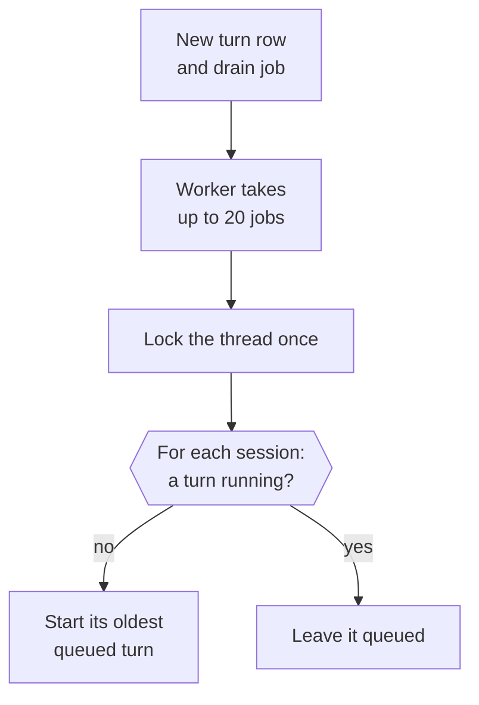
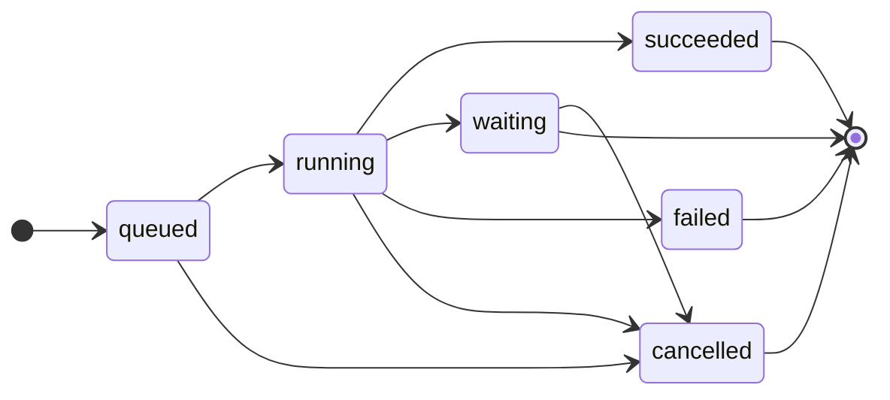
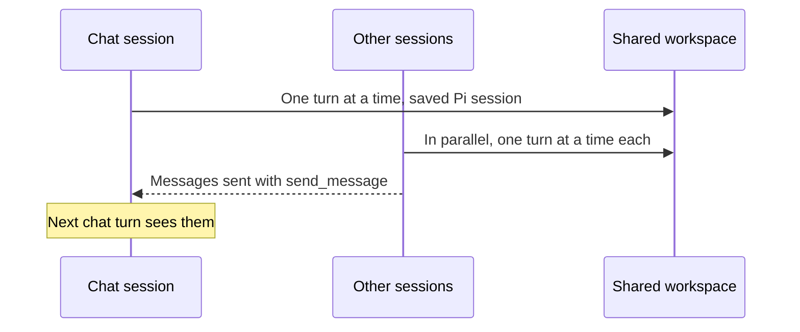

This page explains how Otto turns your messages, schedules and events into work, and how that work shares one conversation.

The short version: you have one thread. Every piece of work on it runs in a session: the chat is one, and every schedule fire and app event is another. A session runs one turn at a time, sessions run in parallel, and they all share one workspace. Turns and tool calls aren't retried automatically.

## One thread per owner

Each owner has one active row in the `threads` table, shared by web, Telegram and WhatsApp. The thread ID keys the sandbox workspace and the chat session: its persistent Pi session (the transcript) and its browser.

The code lives in [`src/server/thread.ts`](https://github.com/n8n-io/otto/blob/main/src/server/thread.ts).

## Every piece of work is a turn

A turn is one run of the agent. Each turn is a row in the `turns` table with a `source` and a `session_id`, and it records its reply channel, so a Telegram message gets its answer on Telegram.

| `source`   | Created by                                                                                 | Session                |
| ---------- | ------------------------------------------------------------------------------------------ | ---------------------- |
| `user`     | A message from you                                                                         | The chat               |
| `schedule` | A schedule firing                                                                          | A new session          |
| `event`    | A connected-app event, a reaction to an Otto message, or an internal check                 | A new session          |
| `resume`   | A completed secure form, payment approval, app connection or your answer to a confirmation | The session that asked |
| `task`     | The chat starting a task with `start_task`                                                 | The task's session     |

Creating a turn also queues a `thread-drain` job in the same transaction.

## How the worker starts turns

The worker fetches up to 20 drain jobs at once and drains each thread in the batch once, so extra drain jobs don't delay later turns. It starts turns without waiting for them. When a turn finishes, it queues the next drain.

## Turn status

`withTurnLock(turnId, op)` fences every database write a turn makes. The write runs only if the turn is still `running` on the active thread. A stopped, finished or reset turn can't write anything late, but an outside action that already started can still finish.

## Messages you send while Otto works

The composer never blocks. After each Pi step, a running chat turn takes the oldest queued plain messages from its own channel and session and steers them into Pi, all at once, before the next model request. Those messages move to the running turn, and their own turns close.

A message with attachments, a reply target or another channel stops the take. It and every message after it stay queued and run as their own turns. Background and read-only turns never take queued messages.

## Waiting and resuming

A question, an approval or a credential request ends the turn as `waiting`. Your next message is the next turn in the same Pi session.

A secure form or a verification code request stays open until a later turn starts in the same session. A payment request stays open until you send a newer message to the session that asked for it. So a chat message doesn't close a schedule or event session's sign-in or payment. A code you send as a reply goes to the request of the session that wrote the message you replied to.

Some steps finish outside the Pi session: a completed secure form, a payment approval, a new app connection or your yes or no to a confirmation. Each of these queues a `resume` turn in the session that asked, so a background task's confirmation continues that task. A confirmed action runs once, in that resume turn.

A resume turn acts with the authority of the work it continues. The trust check, approvals and the Vault follow its resumes back to the turn that started the work, so read-only work stays read-only. If that chain leads to another thread or loops, the action is refused.

## Tasks

A task is long work that runs in its own session while the chat stays free. It's in development behind `OTTO_TASKS`, which is off by default. When it's on, a chat turn can call `start_task {title, ack, instruction, steps?}`. Read-only and onboarding turns, background sessions and subagents don't get the tool.

The server starts the task in one transaction:

1. It locks the thread, then checks that the chat turn is still running and isn't read-only. Stop takes the same locks in the same order, so a stop and a start never deadlock.
2. It saves the task row in `tasks`. The row keeps a frozen copy of your message that started the task, including a message you sent while the turn was running, and the channel to reply on. After you answer a confirmation, that's the message that started the work, not your answer.
3. It posts `ack`, or "On it.", as a reply to your message.
4. It queues the task's first turn. The task ID is its session ID, so all of the task's turns run one at a time in that session, in parallel with the chat.

Until the task mode is built, a task turn runs with the rules of a background session.

## Sessions

|             | Chat                       | Schedule and event sessions                                                  |
| ----------- | -------------------------- | ---------------------------------------------------------------------------- |
| Key         | The thread ID              | The session's first turn                                                     |
| Concurrency | One turn at a time         | One turn at a time each, in parallel with everything else                    |
| Pi session  | The thread's saved session | A new in-memory session per turn                                             |
| Context     | The full conversation      | Chat turns that finished before the trigger, plus the session's own messages |
| Output      | Streams replies to chat    | Streams nothing. Delivers only explicit `send_message` calls.                |
| Browser     | The thread's browser       | Its own browser, deleted when the session ends                               |

When the next chat turn resumes its Pi session, it receives the messages other sessions sent since the previous chat turn started. A schedule or event session never sees another schedule or event session's messages. It still learns how many of Otto's messages from finished turns, in any session, you haven't answered since your last message, so it can stay quiet when you aren't replying. Messages from turns that are still running or waiting for you, such as an open question, don't count. All sessions share the workspace, so files one writes are there for the others.

## Subagents

`delegate {title, instruction}` runs one part of a turn as a subagent: another in-memory Pi session with Otto's tools, its own browser and the shared workspace. The model calls it several times in one step, Pi runs those calls in parallel, and each subagent's final answer comes back as an untrusted tool result. The model then puts the answers together, such as comparing three shops.

- **Inside the turn.** Subagents run in the turn that started them, with its authority, trace and spending. **Stop** stops them with it.
- **Needs you.** A subagent's question or confirmation pauses the whole turn, as the chat's would.
- **Limits.** Two run at once and further calls wait for a slot. A subagent can't delegate, sign in, pay or open saved browser sessions; the turn does those in its own browser. Read-only turns and activity checks can't delegate.
- **Browsers.** A subagent's browser is deleted when it finishes.

## Every session has its own browser

A session opens its browser on its first browser call, so a session that never browses never starts one. No session waits for another session's browser.

- The chat's browser is the one Otto hands to you, and the browser page shows it.
- A background session's browser is deleted when the session ends without waiting, or when **Stop** or reset cancels it.
- The browser container keeps at most four browsers live at once: enough for the chat and three other sessions. Subagent browsers count toward the four.
- To make room, the container closes the browser used least recently. It never closes the browser of a session whose turn is running, or a browser held for you. A subagent's idle browser can close.
- When no browser can close, a new one waits in line for a free slot. After two minutes the wait fails, so Otto can tell you or try again. **Stop** cancels the wait.
- The container never closes a running turn's browser to free a saved browser session for another session either. That session waits in the same line.
- A running turn pins its session's browser. When Otto starts, it clears the pins an earlier run left before it uses the browser, so a crash can't keep a browser pinned. After the browser container recovers, Otto pins the session again before it reopens the page.
- A closed browser keeps its profile until it's used again. Otto still hides the secret values it entered there when the session opens it again.
- A session that pauses on a question, approval or sign-in keeps its open page for 30 minutes, even when that turn didn't browse. Pausing never starts a browser for a session that has none.
- One setting sets the limit for every computer provider: `maxLiveSessions` in [`src/providers/container-browser/config.ts`](https://github.com/n8n-io/otto/blob/main/src/providers/container-browser/config.ts). Measure memory on an E2B sandbox with 2 CPUs and 3 GB before you raise it.

## How Otto web follows the work

Otto web reads the thread from `/api/state` and listens to `/api/events`. A `refresh` event says something changed, and a `delta` event streams a chat reply while Otto writes it.

- Otto web keeps one `/api/state` request open at a time. A refresh that arrives during a request marks the state stale, and Otto web fetches once more when the request ends.
- Otto web cancels a `/api/state` request after 30 seconds, so a request that never finishes can't stop later updates.
- Tool starts and finishes send at most one refresh per session each second, so parallel sessions don't flood the client. That refresh comes at the end of the second, so the latest step still shows.

The client side lives in [`src/web/hooks/use-app-state.ts`](https://github.com/n8n-io/otto/blob/main/src/web/hooks/use-app-state.ts).

## Stop and failures

**Stop** aborts running turns and cancels queued and waiting turns in every session. It can't undo an external action that already started. Ordinary turns have no time limit.

Turns and tool calls are never retried. Pi retries a model request that fails with a temporary provider error up to three times with backoff, and leaves the failed attempt out of the model context. Any other error, or a server restart, ends the turn `failed`. A conversation turn then posts one fixed message asking you to check outside effects or say continue.

When the monthly spending limit is reached, new turns end `failed` with a limit notice before they call the model.

## Reset

Reset is a development tool. In a local development build, **Clear messages** archives the thread and cancels its turns. The next turn starts a new Pi session, workspace and browser.

| Archived                               | Deleted                                                    | Kept                                                                                         |
| -------------------------------------- | ---------------------------------------------------------- | -------------------------------------------------------------------------------------------- |
| The thread with its messages and turns | The old browser's throwaway profile, downloads and screens | Accounts, Vault, tasks, schedules, saved browser sessions, saved browser routines and memory |

The web client sends its `threadId` with each message, so a late message from before the reset is refused.

## Related resources

- [Architecture](/how-it-works/architecture/)
- [The agent runtime](/how-it-works/agent-runtime/)
- [Sandbox and browser isolation](/how-it-works/sandbox-and-browser/)
- [One use, one result](/trust/outcomes/)
- [Chat with Otto](/use/chat/)
