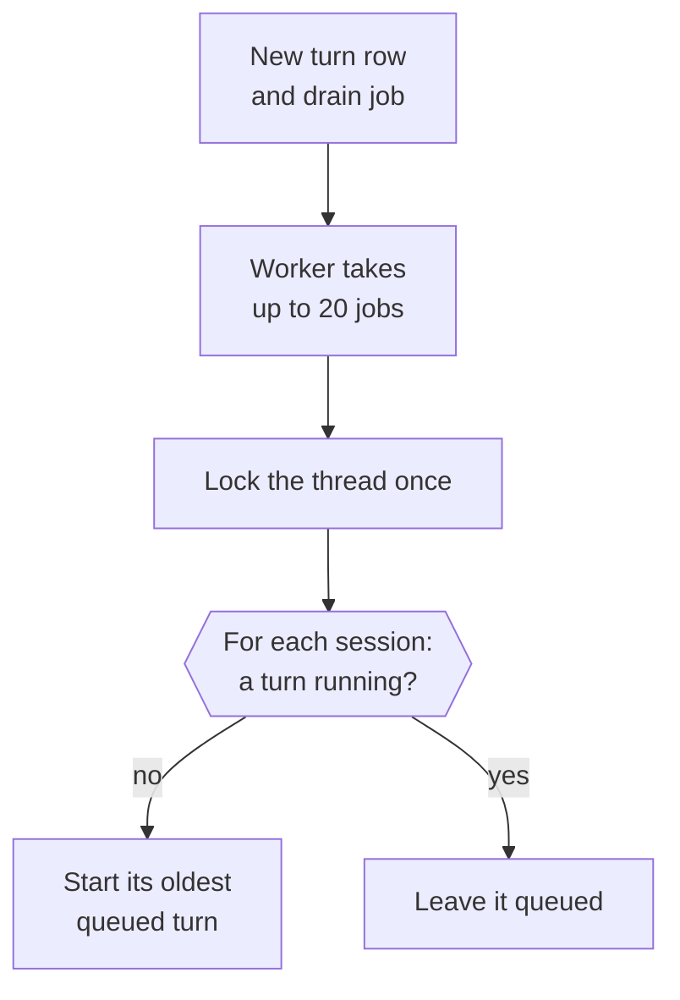
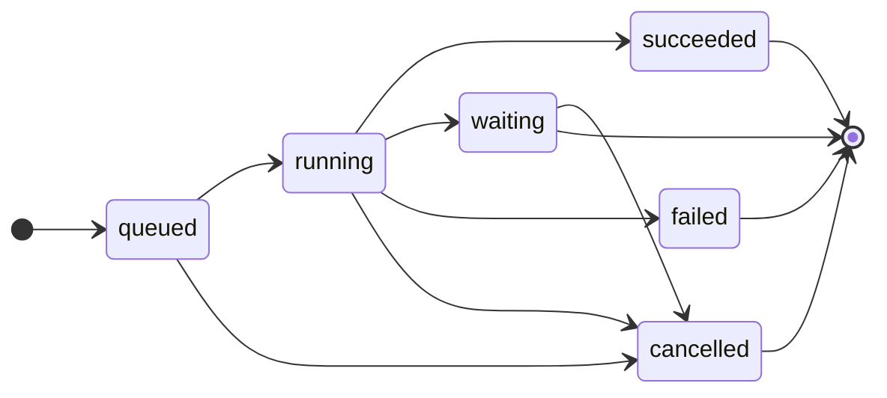

This page explains how nod turns your messages, schedules and events into work, and how that work shares one conversation.

The short version: you have one thread. Every piece of work on it runs in a session: the chat is one, each saved task has one, and every schedule fire and app event starts another. A session runs one turn at a time, sessions run in parallel, and they all share one workspace. Turns and tool calls aren't retried automatically.

## One thread per owner

Each owner has one active row in the `threads` table, shared by web, Telegram and WhatsApp. The thread ID keys the sandbox workspace and the chat session: its persistent Pi session (the transcript) and its browser.

The code lives in [`src/server/thread.ts`](https://github.com/n8n-io/nod/blob/main/src/server/thread.ts).

## Every piece of work is a turn

A turn is one run of the agent. Each turn is a row in the `turns` table with a `source` and a `session_id`, and it records its reply channel, so a Telegram message gets its answer on Telegram.

| `source`   | Created by                                                                                 | Session                                      |
| ---------- | ------------------------------------------------------------------------------------------ | -------------------------------------------- |
| `user`     | A message from you                                                                         | The chat, or the session selected by a reply |
| `task`     | Chat dispatch or an addressed owner update                                                 | The saved task session                       |
| `schedule` | A schedule firing                                                                          | A new session                                |
| `event`    | A connected-app event, a check of an app without events, or a reaction to a nod message    | A new session                                |
| `resume`   | A completed secure form, payment approval, app connection or your answer to a confirmation | The session that asked                       |

Creating a turn also queues a `thread-drain` job in the same transaction.

## How the worker starts turns

The worker fetches up to 20 drain jobs at once and drains each thread in the batch once, so extra drain jobs don't delay later turns. It starts turns from independent sessions without waiting for them. When a turn finishes, it queues the next drain.

## Turn status

`withTurnLock(turnId, op)` fences every database write a turn makes. The write runs only if the turn is still `running` on the active thread. A stopped, finished or reset turn can't write anything late, but an outside action that already started can still finish.

## Messages you send while nod works

The composer never blocks. After each Pi step, a running chat turn takes the oldest queued messages from its own channel and session and steers them into Pi, all at once, before the next model request. Their attachments are copied into the workspace. Images reach the model with the message when the model reads images and they fit the [image limits](/how-it-works/agent-runtime/); others stay workspace files marked as not shown. A reply carries the message it answers. Those messages move to the running turn, and their own turns close. The next line nod writes after taking them is posted as a message, so an answer to them never shows only as live status.

A message from another channel stops the take. It and every message after it stay queued and run as their own turns. Task turns also take addressed updates from their own channel and session. Event and schedule turns do not take queued messages. Each task update has a revision. The server records the revision when it delivers the input at a model boundary. A queued revision does not mean the model has applied it. Task completion refuses an unread update.

## Waiting and resuming

A question, an approval, or a credential request ends the turn as `waiting`. The message that asks, with any link to a secure form, payment, app connection or browser handoff, is saved in the same transaction that marks the turn `waiting`, so you never see a link before its step is open. A reply to any task message continues its saved session. This includes a question, a file or a completed result. A reply to another waiting question continues the session that asked. Unrelated messages continue the chat. A reply to a background question returns to that background session.

Some steps finish outside the Pi session: a completed secure form, a payment approval, a new app connection or your yes or no to a confirmation. Each of these queues a `resume` turn in the session that asked, so a background task's confirmation continues that task. A confirmed action runs once, in that resume turn. A resume turn records the turn it continues, so the trust check and approvals trace it back to the work that started it. A completed secure form or payment code queues its resume turn in the same transaction that records the entry.

A secure form closes when a newer turn starts in its session, and a payment request when you send a newer message there. A chat message is in the chat session, so it never closes a background task's form or payment.

## Sessions

| Session                | Key                                                             | Reports to the conversation                                                                                                                                                                                                                       |
| ---------------------- | --------------------------------------------------------------- | ------------------------------------------------------------------------------------------------------------------------------------------------------------------------------------------------------------------------------------------------- |
| Main chat              | The thread ID.                                                  | Streams its opening line, shows the text it writes between tool calls as live status, then posts its final reply. That text is posted only when a turn ends without a reply. See [Message cadence](/how-it-works/agent-runtime/#message-cadence). |
| Task started from chat | The task ID, stored in `tasks.session_id`.                      | Sends questions, files and its final reply to the task's message.                                                                                                                                                                                 |
| Schedule or event      | Its first turn. A task record created there keeps that session. | Uses explicit delivery tools; a linked task also delivers its final reply.                                                                                                                                                                        |

Every session saves its Pi history and opens its own browser on first use. Each runs one turn at a time; different sessions run in parallel.

When a background turn starts, it loads its own messages and recent conversation messages available before that turn, with other sessions' work included only after it finished. The saved Pi history remains separate. A new main chat turn receives reports sent by other sessions. All sessions share the workspace, so files one writes are available for the others to read.

## Saved tasks

The main chat uses `task start` for work with an independent goal. One transaction saves the task, posts its first message and queues its first turn. Short requests stay in the main chat. A successful turn alone does not close the task; the task checks its completion condition and calls `task finish`.

Explicit replies select a task before the coordinator runs. The coordinator uses `task reply` to forward the exact owner message when an ordinary follow-up selects an existing open task. Only a turn started by an owner message in the main chat can forward a message or stop a task. Owner updates keep their source message and revision. Questions, approvals and secure forms use the same wait and resume path as other sessions.

See [Task sessions](/how-it-works/task-sessions/) for the ledger, shared context, channel reply links and task controls.

## Subagents

`delegate {title, instruction}` runs one part of a turn as a subagent: another in-memory Pi session with nod's tools, its own browser and the shared workspace. The model calls it several times in one step, Pi runs those calls in parallel, and each subagent's final answer comes back as an untrusted tool result. The parent then uses the answers, such as to compare three shops. Helpers do not create saved tasks or control the task ledger.

- **Inside the turn.** Subagents run in the turn that started them, with its authority, trace and spending. **Stop** stops them with it.
- **Needs you.** A subagent returns questions and browser blockers to the parent. An app confirmation still pauses the whole turn.
- **Tools.** A subagent cannot delegate, ask or send chat messages to the owner, connect apps, sign in, pay, or open saved browser sessions. A paused turn cannot start another subagent.
- **Browsers.** A subagent's browser is deleted when it finishes.
- **Files.** Each subagent starts in `.nod/runs/<run ID>` inside the shared workspace. It returns complete file paths to its parent.
- **Outcomes.** Model failures and incomplete responses return as errors. They do not count as successful empty answers.

## Every session has its own browser

A session opens its browser on its first browser call, so a session that never browses never starts one. Sessions never share a browser.

- A chat or background session can hand its browser to you. The handoff identifies the exact turn and browser. It closes when that session continues. The developer browser page shows the chat browser.
- A background session's browser is deleted when the session ends without waiting, or when **Stop** or reset cancels it. If you later continue that task, it starts a fresh, signed-out browser. A reset conversation's browser never comes back.
- The browser container keeps four browsers live at once. At that limit, a new browser replaces the least recently used one that has been idle for five minutes. A browser waiting for you is never replaced during its 30-minute hold. The replaced browser closes and keeps its profile until it's used again.
- A browser used in the last five minutes is never closed for another. One idle for longer can be, even while its session or subagent is still running, for example during a long model step. Browsers don't close just because they're idle.
- When no browser can close yet, a new one waits for a free slot until its session stops. **Stop** cancels the wait at once.

## Stop and failures

The main **Stop** control aborts running turns, cancels queued and waiting turns in every session, and closes all open task records. A task's **Stop** control affects only that session and its helpers. Stop ends a turn at once, even when a tool call is stuck: nod stops waiting for it, and nothing it returns later reaches the turn. Stop can't undo an external action that already started. Ordinary turns have no time limit, but every browser command does (see [Sandbox and browser](/how-it-works/sandbox-and-browser/)).

Turns and tool calls are never retried. Pi retries a model request that fails with a temporary provider error up to three times with backoff, and leaves the failed attempt out of the model context. Any other error, or a restart during execution, ends the turn `failed`. The turn keeps the error as it was raised, such as the model provider's own reason for refusing a request, with known secrets removed. For work you started (a chat turn, a task, a reply to a task, or work that continues after you answer or approve), nod posts it in the main chat or as a reply to the task's message, written by the model, or as the plain error when the model can't write it, and a restart posts an interruption notice instead. A schedule run or event turn posts nothing; its error shows in **Usage** and in the schedule's run history. The session's next turn receives the error as `previousFailure`, so nod can work around it or tell you what to fix. A restart keeps saved task sessions and waiting questions.

When the monthly spending limit is reached, new turns end `failed` before they call the model, and work you started posts one limit notice.

Each session also checks in with you. When its model spend since your last message to it passes the task check-in ($5 by default, set in **Usage**), its tools refuse new work and the model asks you whether to keep going with `ask_user`. Reporting tools still work, and helpers stop at their next step. A model that keeps trying to work for two more steps ends the turn `failed` with a check-in notice. Your next message to that session starts a new count.

## Reset

Reset is a development tool. In a local development build, **Clear messages** archives the thread, cancels its turns and closes its open task records. The next turn starts a new Pi session, workspace and browser.

| Archived                                             | Deleted                                                    | Kept                                                          |
| ---------------------------------------------------- | ---------------------------------------------------------- | ------------------------------------------------------------- |
| The thread with its messages, turns and task history | The old browser's throwaway profile, downloads and screens | Accounts, Vault, schedules, saved browser sessions and memory |

The web client sends its `threadId` with each message, so a late message from before the reset is refused.

## Related resources

- [Architecture](/how-it-works/architecture/)
- [Task sessions](/how-it-works/task-sessions/)
- [The agent runtime](/how-it-works/agent-runtime/)
- [Sandbox and browser isolation](/how-it-works/sandbox-and-browser/)
- [One use, one result](/trust/outcomes/)
- [Chat with nod](/use/chat/)
