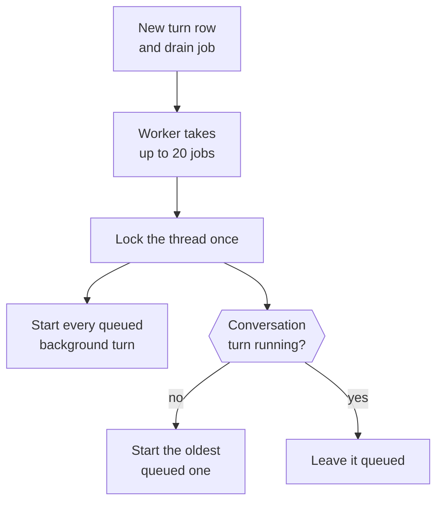
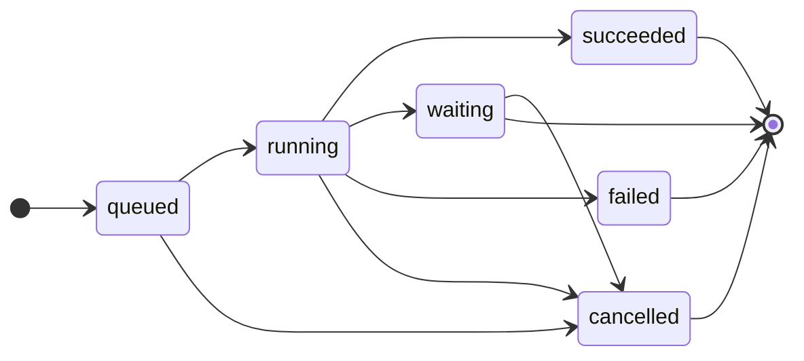
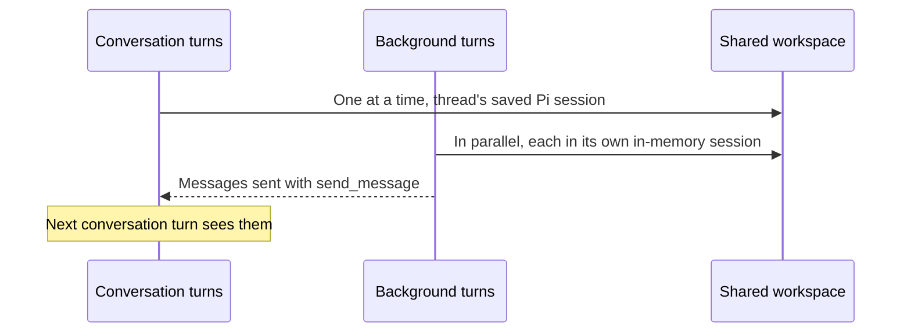

This page explains how Otto turns your messages, schedules and events into work, and how that work shares one conversation.

The short version: you have one thread. Everything that happens on it is a turn. Conversation turns run one at a time. Background turns run in parallel. Turns and tool calls aren't retried automatically.

## One thread per owner

Each owner has one active row in the `threads` table, shared by web, Telegram and WhatsApp. The thread ID keys three things:

- one persistent Pi session (the transcript)
- one sandbox workspace
- one browser computer

The code lives in [`src/server/thread.ts`](https://github.com/n8n-io/otto/blob/main/src/server/thread.ts).

## Every piece of work is a turn

A turn is one run of the agent. Each turn is a row in the `turns` table with a `source`, and it records its reply channel, so a Telegram message gets its answer on Telegram.

| `source`   | Created by                                                                                 | Kind                                                                               |
| ---------- | ------------------------------------------------------------------------------------------ | ---------------------------------------------------------------------------------- |
| `user`     | A message from you                                                                         | Conversation                                                                       |
| `schedule` | A schedule firing                                                                          | Background                                                                         |
| `event`    | A connected-app event, a reaction to an Otto message, or an internal check                 | Background                                                                         |
| `resume`   | A completed secure form, payment approval, app connection or your answer to a confirmation | Conversation, unless it resumes a background turn's sign-in, payment or connection |

Creating a turn also queues a `thread-drain` job in the same transaction.

## How the worker starts turns

The worker fetches up to 20 drain jobs at once and drains each thread in the batch once, so extra drain jobs don't delay later turns. It starts turns without waiting for them. When a conversation turn finishes, it queues the next drain.

## Turn status

`withTurnLock(turnId, op)` fences every database write a turn makes. The write runs only if the turn is still `running` on the active thread. A stopped, finished or reset turn can't write anything late, but an outside action that already started can still finish.

## Messages you send while Otto works

The composer never blocks. After each Pi step, a running conversation turn takes the oldest queued plain messages from its own channel and steers them into Pi, all at once, before the next model request. Those messages move to the running turn, and their own turns close.

A message with attachments, a reply target or another channel stops the take. It and every message after it stay queued and run as their own turns. Background and read-only turns never take queued messages.

## Waiting and resuming

A question, an approval or a credential request ends the turn as `waiting`. Your next message is the next turn in the same Pi session.

Some steps finish outside the Pi session: a completed secure form, a payment approval, a new app connection or your yes or no to a confirmation. Each of these queues a `resume` turn that continues the work. A confirmed action runs once, in that resume turn.

## Conversation and background turns

|             | Conversation turns         | Background turns                                                     |
| ----------- | -------------------------- | -------------------------------------------------------------------- |
| Sources     | `user` and their resumes   | `schedule`, `event` and their resumes                                |
| Concurrency | One at a time              | Start when they fire, in parallel                                    |
| Pi session  | The thread's saved session | A new in-memory session per turn                                     |
| Context     | The full conversation      | Only conversation turns that finished before the trigger was created |
| Output      | Streams replies to chat    | Streams nothing. Delivers only explicit `send_message` calls.        |

Active, queued, waiting and newer requests stay with the conversation. When the next conversation turn resumes the Pi session, it receives the messages background turns sent since the previous conversation turn started. All turns share the workspace.

## The browser has one holder

The browser belongs to one holder at a time: the conversation, a background turn or you. A turn takes it with its first browser call or browser handoff question. Others wait in order.

- A background turn gives it back when it ends.
- The conversation keeps it while it waits for you, so you can use it through the handoff.
- The conversation gives it back when a conversation turn ends without waiting, or after 30 minutes in which you haven't used the handoff.

## Stop and failures

**Stop** aborts running turns and cancels queued and waiting turns. It can't undo an external action that already started. Ordinary turns have no time limit.

Turns and tool calls are never retried. Pi retries a model request that fails with a temporary provider error up to three times with backoff, and leaves the failed attempt out of the model context. Any other error, or a server restart, ends the turn `failed`. A conversation turn then posts one fixed message asking you to check outside effects or say continue.

When the monthly spending limit is reached, new turns end `failed` with a limit notice before they call the model.

## Reset

Reset is a development tool. In a local development build, **Clear messages** archives the thread and cancels its turns. The next turn starts a new Pi session, workspace and browser.

| Archived                               | Deleted                                                    | Kept                                                                                         |
| -------------------------------------- | ---------------------------------------------------------- | -------------------------------------------------------------------------------------------- |
| The thread with its messages and turns | The old browser's throwaway profile, downloads and screens | Accounts, Vault, tasks, schedules, saved browser sessions, saved browser routines and memory |

The web client sends its `threadId` with each message, so a late message from before the reset is refused.

## Related resources

- [Architecture](/how-it-works/architecture/)
- [The agent runtime](/how-it-works/agent-runtime/)
- [Sandbox and browser isolation](/how-it-works/sandbox-and-browser/)
- [One use, one result](/trust/outcomes/)
- [Chat with Otto](/use/chat/)
