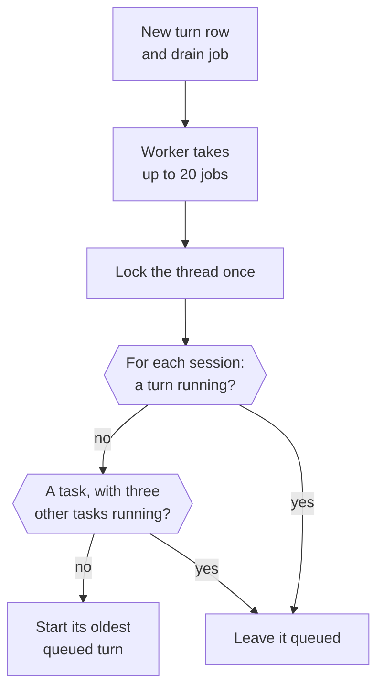
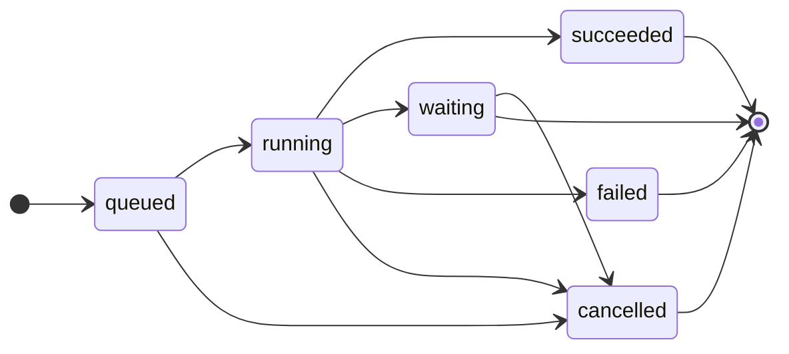
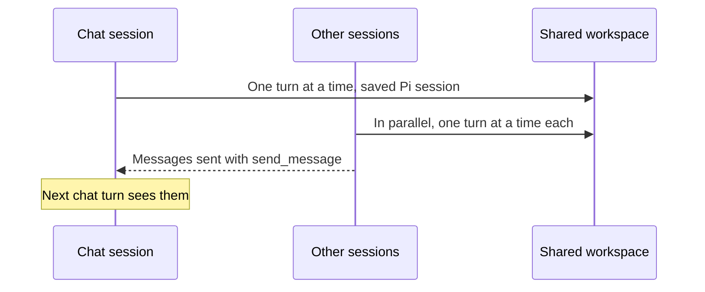

This page explains how Otto turns your messages, schedules and events into work, and how that work shares one conversation.

The short version: you have one thread. Every piece of work on it runs in a session: the chat is one, and every schedule fire and app event is another. A session runs one turn at a time, sessions run in parallel, and they all share one workspace. Turns and tool calls aren't retried automatically.

## One thread per owner

Each owner has one active row in the `threads` table, shared by web, Telegram and WhatsApp. The thread ID keys the sandbox workspace and the chat session: its persistent Pi session (the transcript) and its browser.

The code lives in [`src/server/thread.ts`](https://github.com/n8n-io/otto/blob/main/src/server/thread.ts).

## Every piece of work is a turn

A turn is one run of the agent. Each turn is a row in the `turns` table with a `source` and a `session_id`, and it records its reply channel, so a Telegram message gets its answer on Telegram.

| `source`   | Created by                                                                                 | Session                                                |
| ---------- | ------------------------------------------------------------------------------------------ | ------------------------------------------------------ |
| `user`     | A message from you                                                                         | The chat, or a task's session for a reply to that task |
| `schedule` | A schedule firing                                                                          | A new session                                          |
| `event`    | A connected-app event, a reaction to an Otto message, or an internal check                 | A new session                                          |
| `resume`   | A completed secure form, payment approval, app connection or your answer to a confirmation | The session that asked                                 |
| `task`     | The chat starting a task with `start_task`                                                 | The task's session                                     |

Creating a turn also queues a `thread-drain` job in the same transaction.

## How the worker starts turns

The worker fetches up to 20 drain jobs at once and drains each thread in the batch once, so extra drain jobs don't delay later turns. It starts turns without waiting for them. When a turn finishes, it queues the next drain.

At most three task sessions have a running turn at once. The worker counts them while it holds the thread lock, so two tasks started at the same moment can't both take the third place. A task that waits for you doesn't count, and neither do the chat, schedule fires or events, which the limit never holds back.

## Turn status

`withTurnLock(turnId, op)` fences every database write a turn makes. The write runs only if the turn is still `running` on the active thread. A stopped, finished or reset turn can't write anything late, but an outside action that already started can still finish.

## Messages you send while Otto works

The composer never blocks. After each Pi step, a running chat or task turn takes the oldest queued plain messages from its own channel and session and steers them into Pi, all at once, before the next model request. Those messages move to the running turn, and their own turns close. A turn takes messages only from its own session, so a chat message never steers a task and a reply to a task never steers the chat.

A message with attachments or from another channel stops the take. It and every message after it stay queued and run as their own turns. In the chat, a reply target stops the take too. In a task it doesn't, because your messages reach a task as replies to it or as messages the chat moved there. A task turn reads them as corrections or additions to the task. Schedule, event and read-only turns never take queued messages.

Steering reaches only the turn's own Pi session, never a running subagent. A subagent finishes its part without your message, and the turn reads the message at its next step, after the subagents of that step return.

## Waiting and resuming

A question, an approval or a credential request ends the turn as `waiting`. Your next message is the next turn in the same Pi session.

A secure form or a verification code request stays open until a later turn starts in the same session. A payment request stays open until you send a newer message to the session that asked for it. So a chat message doesn't close a schedule or event session's sign-in or payment. A code you send as a reply goes to the request of the session that wrote the message you replied to. A task's "On it" message belongs to the task, so a code that replies to it goes to the task's request.

Some steps finish outside the Pi session: a completed secure form, a payment approval, a new app connection or your yes or no to a confirmation. Each of these queues a `resume` turn in the session that asked, so a background task's confirmation continues that task. A confirmed action runs once, in that resume turn.

A resume turn acts with the authority of the work it continues. The trust check, approvals and the Vault follow its resumes back to the turn that started the work, so read-only work stays read-only. If that chain leads to another thread or loops, the action is refused.

## Tasks

A task is long work that runs in its own session while the chat stays free. It's in development behind `OTTO_TASKS`, which is off by default. When it's on, a chat turn can call `start_task {title, ack, brief, steps?}`. `brief` is Otto's working brief for the task, not your words. Read-only and onboarding turns, background sessions and subagents don't get the tool.

With the flag on, the chat's prompt tells Otto to start a task when the work takes more than about 30 seconds, uses the browser or waits for other people, and to answer anything quicker directly. After `start_task`, the chat turn writes nothing more about that task, because `ack` is its answer.

The server starts the task in one transaction:

1. It locks the thread, then checks that the chat turn is still running and isn't read-only. Stop takes the same locks in the same order, so a stop and a start never deadlock.
2. It saves the task row in `tasks`. The row keeps a frozen copy of your message that started the task, including a message you sent while the turn was running, the Otto message yours answered and the channel to reply on. After you answer a confirmation, that's the message that started the work, not your answer.
3. It posts `ack`, or "On it.", as a reply to your message.
4. It queues the task's first turn, with `brief` as its prompt. The task ID is its session ID, so all of the task's turns run one at a time in that session, in parallel with the chat.

Every turn of a task acts on your message that started it. A turn that holds a message of yours in the task's session, such as a reply routed to the task, acts on that message instead. The trust check never treats a task as background work, and a task started from read-only work stays read-only. The trust check, approvals and the Vault find the task from the turn's session:

- The trust check reads only the task's own words: your message that started it, the Otto message that one answered and your messages in its session. So a task you start with "yes, do that" keeps the proposal you agreed to. A chat message never counts for a task, and a task's messages never count for the chat. See [what the checker sees](/trust/approvals/#what-the-checker-sees).
- An approval's author is that message, so a schedule a task creates keeps your words as its instruction.
- The same action and arguments in two tasks get two separate approvals.
- A Vault yes in a task covers every later turn of that task, but not the chat or another task.
- A task can remember a profile detail only from that message, quoted in full, and can forget a note only when the trust check finds that your words ask for it.

The Tasks page reads each task's status from its row and the turns of its session. A closed task shows **Done**, **Stopped** or **Failed** from its row. An open task shows:

- **Working** while one of its turns runs.
- **Queued** while its latest turn waits for a free place, as a new task does while three other tasks run. A resume after your answer waits the same way.
- **Needs you** while its latest turn waits for you.

Stop and reset close the task's row as **Stopped**, and a failed turn closes it as **Failed**. See [Stop and failures](#stop-and-failures).

A failed or stopped task isn't on the chat's list of open tasks. A turn in another session, such as a chat message, never changes a task's status.

Tasks don't hold back other background work. Otto skips the read-only check of a connected app while a schedule or event session is queued or running, and tries again at the next review five minutes later. A queued or running task doesn't make it skip.

A task turn runs in task mode, which replaces the rules of a background session:

- **Prompt.** It names the task and carries your message that started it. The turn works only on that task, not on chat requests or other tasks.
- **Replies.** Every message the turn posts replies to the task's "On it" message: questions, the trust check's confirmations, secure-form and payment links, audio and files. A file shared with `share_file` goes out with the turn's next message, usually the result.
- **Result.** The turn's final text is the result, posted as a reply to "On it". The task row keeps the result's message ID, and the task closes as **Done** when the turn finishes. Closing declines the task's open confirmations, so none of them can run later.
- **Progress.** `task_progress {steps?, current?, now?, stop?}` changes the task's steps, current step and status line, and sends nothing. The server finds the task from the turn's session, so a task can only change its own row. `stop` closes the task as **Stopped**, declines its open confirmations and posts its note as a reply to "On it". The task's prompt allows it only when you ask that task to stop.
- **Tools.** A task turn has no `send_message` or `start_task`. Its subagents also lose `task_progress` and can't hand their browser to you.
- **Context.** The turn sees your message that started the task and the messages of the task's own session. It never sees the chat's later messages or another task's, and it doesn't get the count of messages you haven't answered.

A task keeps a saved Pi session under its task ID, and every turn of the task continues it. So a resume after a confirmation, a secure form or a new app connection doesn't repeat the request in its prompt. The task's transcript already has it.

The notes the server posts to a task aren't in its transcript: the stop note, the failure note and the reply to an expired question. So the task's next turn gets every note posted since its previous turn started, in its first instruction.

An hourly job deletes a closed task's saved Pi session and its browser profile 30 days after the task closes. A reset deletes them at once. A reply after that still opens the task, but in a new Pi session that starts from your message that started the task and the task's own messages. The server records the deletion only after both are gone, so the next hourly run tries again after a failure or a restart, also for a reset's tasks.

The chat sees each task only through its "On it" message and its latest result. The task's questions, links and other messages stay out of the chat's context. With `OTTO_TASKS` on, every chat turn also gets the list of open tasks, each with its ID, title, status and the ID of its "On it" message, so Otto knows what's running. The list is in the turn message, not the system prompt, so a status change doesn't change the chat's prompt.

### Replies to a task

Your reply to any message of a task goes to that task: its "On it" message, a question, a link or its result. The server finds the task from the message you replied to while it saves your message, and queues a `user` turn in the task's session. Every turn in a task's session is a background turn on the task's channel, so the task's answer goes where the task replies. A message without a reply target, or a reply to a chat message, stays in the chat.

- **While the task works.** The running turn takes your reply at its next step, as the chat takes a follow-up. See [Messages you send while Otto works](#messages-you-send-while-otto-works). A reply with attachments, or one that arrives after the turn's last step, waits behind the running turn and runs after it. The task stays open until your reply has run. If the running turn stops the task first, your reply opens it again when it starts.
- **While the task waits for you.** Your reply starts the task's next turn. A yes or no that replies to the confirmation, or to any other message of a task with one open confirmation, answers it and queues a `resume` turn in the task's session. Any other reply cancels the task's open confirmations. A confirmation the task asks while an earlier reply of yours waits is cancelled too, and your yes or no to it reaches the task as an ordinary reply. So an action you were asked about can't run twice.
- **After the task closed.** A reply to a done, stopped or failed task opens it again as **Queued**, in the same session. Within 30 days of closing, it also continues the same saved Pi session. It runs when fewer than three other tasks work.

### Answers to a task's confirmation

The server binds each answer to one approval, never to "the newest question" across tasks:

- **Reply target.** A reply to a task's message answers that task's one open confirmation, on the channel that asked. A reply to an Otto message in the chat never answers a task.
- **Approval ID.** `POST /api/approvals/<id>/answer {approved}` answers that approval only, whichever channel asked it. It needs the owner key like every local route, skips the reply reader and resumes the task on its own channel. A press on an approval that isn't pending, belongs to another owner or has expired creates no turn and returns `409`. A payment or **Do it for me** approval takes an answer only from the Otto app, so a chat-app button can't approve it.
- **No reply target.** A yes or no without a target answers the newest Otto message you'd seen on that channel only when it's a confirmation and no other task confirmation is open there. With two or more open, nothing is answered and the message goes to the chat, which asks which one you mean. A chat confirmation you'd seen closes, as it does for any other chat message, so it can't run twice. A message without a target never cancels a task's confirmation.

A task's confirmation expires 24 hours after Otto asks. A yes or no to it after that gets a short reply that the question expired, in the task's session and on its channel, and nothing runs. Chat, schedule and event confirmations stay open while their turn waits.

The chat can also hand your message to a task. When your message answers, corrects or adds to an open task, Otto calls `route_to_task {taskId}`. The server moves your message itself, with its text and ID, into the task's session as your reply, and the chat writes nothing more about it. Otto never writes your words for a task, so the trust check sees exactly what you sent. A message the chat moved answers no Otto message, so a moved "yes" can't approve what the task proposed. The server refuses to move a message into a task that waits for your yes or no to a confirmation, so Otto asks you to reply to that confirmation. When a bare yes or no could answer more than one task, Otto asks which one.

## Sessions

|             | Chat                                                                        | Schedule and event sessions                                                  | Task sessions                                                    |
| ----------- | --------------------------------------------------------------------------- | ---------------------------------------------------------------------------- | ---------------------------------------------------------------- |
| Key         | The thread ID                                                               | The session's first turn                                                     | The task ID                                                      |
| Concurrency | One turn at a time                                                          | One turn at a time each, in parallel with everything else                    | One turn at a time each, in parallel with everything else        |
| Pi session  | The thread's saved session                                                  | A new in-memory session per turn                                             | The task's saved session                                         |
| Context     | The conversation, with each task only as its "On it" message and its result | Chat turns that finished before the trigger, plus the session's own messages | Your message that started the task, plus the task's own messages |
| Output      | Streams replies to chat                                                     | Streams nothing. Delivers only explicit `send_message` calls.                | Streams nothing. Its messages and result reply to "On it"        |
| Browser     | The thread's browser                                                        | Its own browser, deleted when the session ends                               | Its own browser, deleted when the turn ends without waiting      |

When the next chat turn resumes its Pi session, it receives the messages other sessions sent since the previous chat turn started. From a task, that's only its result. A task's turn that resumes the task's Pi session gets no earlier messages again, because the task's transcript already has them. A schedule or event session never sees another schedule or event session's messages, or a task's. It still learns how many of Otto's messages from finished turns, in any session, you haven't answered since your last message, so it can stay quiet when you aren't replying. Messages from turns that are still running or waiting for you, such as an open question, don't count. All sessions share the workspace, so files one writes are there for the others.

## Subagents

`delegate {title, instruction}` runs one part of a turn as a subagent: another in-memory Pi session with Otto's tools, its own browser and the shared workspace. The model calls it several times in one step, Pi runs those calls in parallel, and each subagent's final answer comes back as an untrusted tool result. The model then puts the answers together, such as comparing three shops.

- **Inside the turn.** Subagents run in the turn that started them, with its authority, trace and spending. **Stop** stops them with it.
- **Needs you.** A subagent's question or confirmation pauses the whole turn, as the chat's would.
- **Your messages.** A message the turn takes while it works goes to the turn, not to a running subagent.
- **Limits.** Two run at once and further calls wait for a slot. A subagent can't delegate, sign in, pay or open saved browser sessions; the turn does those in its own browser. Read-only turns and activity checks can't delegate.
- **Browsers.** A subagent's browser is deleted when it finishes. Subagent browsers have their own two live slots, so a turn whose own browser holds a slot never waits on itself.

## Every session has its own browser

A session opens its browser on its first browser call, so a session that never browses never starts one. No session waits for another session's browser.

- The chat's browser is the one Otto hands to you, and the browser page shows it.
- A background session's browser is deleted when the session ends without waiting, or when **Stop** or reset cancels it.
- The browser container keeps at most four session browsers live at once: enough for the chat and three other sessions. Subagent browsers don't count toward the four. They have two slots of their own, so up to six browsers can be live.
- To make room, the container closes the browser used least recently in the same group: a session browser for a session, a subagent browser for a subagent. It never closes the browser of a session whose turn is running, or a browser held for you. A subagent's idle browser can close to make room for another subagent.
- When no browser can close, a new one waits in line for a free slot. Sessions and subagents wait in separate lines. After two minutes the wait fails, so Otto can tell you or try again. **Stop** cancels the wait.
- The container never closes a running turn's browser to free a saved browser session for another session either. That session waits in the same line.
- A running turn pins its session's browser. When Otto starts, it clears the pins an earlier run left before it uses the browser, so a crash can't keep a browser pinned. After the browser container recovers, Otto pins the session again before it reopens the page.
- A closed browser keeps its profile until it's used again. Otto still hides the secret values it entered there when the session opens it again.
- A session that pauses on a question, approval or sign-in keeps its open page for 30 minutes, even when that turn didn't browse. Pausing never starts a browser for a session that has none.
- Two settings set the limits for every computer provider: `maxLiveSessions` for sessions and `maxSubagentSessions` for subagents, in [`src/providers/container-browser/config.ts`](https://github.com/n8n-io/otto/blob/main/src/providers/container-browser/config.ts). Measure memory with six live browsers on an E2B sandbox with 2 CPUs and 3 GB before you raise either.

## How Otto web follows the work

Otto web reads the thread from `/api/state` and listens to `/api/events`. A `refresh` event says something changed, and a `delta` event streams a chat reply while Otto writes it.

- Otto web keeps one `/api/state` request open at a time. A refresh that arrives during a request marks the state stale, and Otto web fetches once more when the request ends.
- Otto web cancels a `/api/state` request after 30 seconds, so a request that never finishes can't stop later updates.
- Tool starts and finishes send at most one refresh per session each second, so parallel sessions don't flood the client. That refresh comes at the end of the second, so the latest step still shows.
- `/api/state` also lists the thread's tasks, open ones first, each with its status, the ID of its "On it" message and the model cost of all its turns, subagents included.

The client side lives in [`src/web/hooks/use-app-state.ts`](https://github.com/n8n-io/otto/blob/main/src/web/hooks/use-app-state.ts).

## Stop and failures

Stop works on one session or on all of them:

| Scope         | Route                                   |
| ------------- | --------------------------------------- |
| The chat      | `POST /api/thread/stop {scope: 'chat'}` |
| One task      | `POST /api/tasks/<id>/stop`             |
| Every session | `POST /api/thread/stop`                 |

**Stop** next to the send button stops only the chat, so tasks and other background sessions keep running. **Stop** on the **Browser** page stops every session.

Stop locks the thread, then cancels the queued, running and waiting turns in its scope and aborts the running ones. In the same transaction, for each session it cancelled, it declines the open confirmations, closes the secure forms, verification code and payment requests, and closes the task as **Stopped** with a short note that replies to its "On it" message. Then it deletes the browser of each background session it cancelled.

A task ID that belongs to another owner or an earlier thread returns `404`. A task with nothing queued, running or waiting has nothing to stop, so its row stays as it is. A reply to a stopped task opens it again. Stop can't undo an external action that already started. Ordinary turns have no time limit.

Turns and tool calls are never retried. Pi retries a model request that fails with a temporary provider error up to three times with backoff, and leaves the failed attempt out of the model context. Any other error, or a server restart, ends the turn `failed`. A conversation turn then posts one fixed message asking you to check outside effects or say continue.

A task turn that fails closes the task as **Failed** in the same transaction. It declines the task's open confirmations and posts a short note as a reply to the task's "On it" message, so you hear about it on Telegram and WhatsApp too. Nothing reruns. Your reply opens the task again. If a reply of yours already waits in the task's session, the task stays open and runs it next, with the note in its first instruction. Schedule and event sessions fail silently.

When the monthly spending limit is reached, new turns end `failed` with a limit notice before they call the model. A task's note is that notice.

## Reset

Reset is a development tool. In a local development build, **Clear messages** archives the thread and cancels its turns. The next turn starts a new Pi session, workspace and browser.

Reset closes the thread's open tasks as **Stopped**, without a note, because nobody reads the archived thread. When the turns it cancelled have finished, it deletes the saved Pi session and browser profile of every task on the thread.

| Archived                               | Deleted                                                                                                          | Kept                                                                                             |
| -------------------------------------- | ---------------------------------------------------------------------------------------------------------------- | ------------------------------------------------------------------------------------------------ |
| The thread with its messages and turns | The old browser's throwaway profile, downloads and screens, and each task's saved Pi session and browser profile | Accounts, Vault, task rows, schedules, saved browser sessions, saved browser routines and memory |

The web client sends its `threadId` with each message, so a late message from before the reset is refused.

## Related resources

- [Architecture](/how-it-works/architecture/)
- [The agent runtime](/how-it-works/agent-runtime/)
- [Sandbox and browser isolation](/how-it-works/sandbox-and-browser/)
- [One use, one result](/trust/outcomes/)
- [Chat with Otto](/use/chat/)
