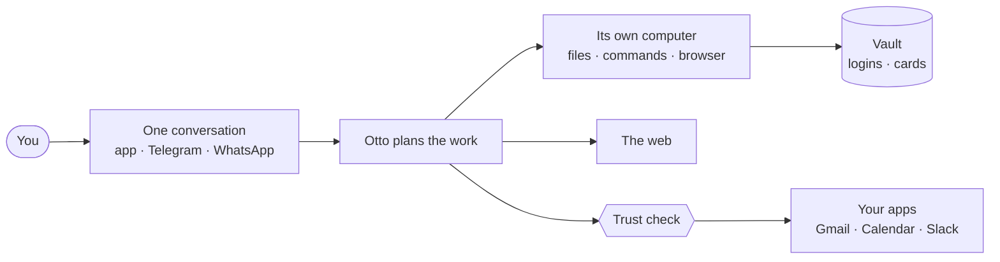

import { Card, CardGrid, LinkButton, LinkCard } from '@astrojs/starlight/components';
import { Image } from 'astro:assets';
import chatLight from '../../assets/screens/card-chat-light.png';
import chatDark from '../../assets/screens/card-chat-dark.png';
import tasksLight from '../../assets/screens/card-tasks-light.png';
import tasksDark from '../../assets/screens/card-tasks-dark.png';
import trustLight from '../../assets/screens/card-trust-light.png';
import trustDark from '../../assets/screens/card-trust-dark.png';

  <LinkButton href="/get-started/install-desktop/" icon="right-arrow">
    Install Otto
  </LinkButton>
  <LinkButton href="/get-started/what-is-otto/" variant="secondary">
    What is Otto?
  </LinkButton>

  <figure>
    <Image
      src={chatLight}
      alt="Otto comparing three venues in a table and drafting a booking request it hasn't sent."
      class="dark:sl-hidden"
    />
    <Image
      src={chatDark}
      alt="Otto comparing three venues in a table and drafting a booking request it hasn't sent."
      class="light:sl-hidden"
    />
    <figcaption>Give it the whole task</figcaption>
  </figure>
  <figure>
    <Image
      src={tasksLight}
      alt="The Tasks page with a weekday calendar check and a Friday recap scheduled."
      class="dark:sl-hidden"
    />
    <Image
      src={tasksDark}
      alt="The Tasks page with a weekday calendar check and a Friday recap scheduled."
      class="light:sl-hidden"
    />
    <figcaption>Keep watch on a schedule</figcaption>
  </figure>
  <figure>
    <Image
      src={trustLight}
      alt="Trust with this month's spending, the task check-in and every app action, sign-in and card use."
      class="dark:sl-hidden"
    />
    <Image
      src={trustDark}
      alt="Trust with this month's spending, the task check-in and every app action, sign-in and card use."
      class="light:sl-hidden"
    />
    <figcaption>See everything it did and spent</figcaption>
  </figure>

## Start here

<CardGrid>
  <Card title="Get set up" icon="laptop">

    - [Install the desktop app](/get-started/install-desktop/) on a Mac or Windows PC
    - [Install from source](/get-started/install-from-source/) on macOS or Linux
    - [Connect a model](/connect/models/) from OpenAI, Anthropic or OpenRouter

  </Card>
  <Card title="Try your first task" icon="rocket">

    - [Your first conversation](/get-started/first-conversation/)
    - [Chat with Otto](/use/chat/) from the app, Telegram or WhatsApp
    - [Run work on a schedule](/use/schedules/)

  </Card>
  <Card title="Stay in control" icon="padlock">

    - [Why you can trust Otto](/trust/principles/)
    - [When Otto asks before acting](/trust/approvals/)
    - [How Otto compares](/trust/compare/)

  </Card>
  <Card title="Understand Otto" icon="open-book">

    - [What is Otto](/get-started/what-is-otto/)
    - [Key concepts](/get-started/glossary/)
    - [How Otto works](/how-it-works/architecture/)

  </Card>
</CardGrid>

## Otto in one picture

You talk to one Otto. It plans the work, then uses its own computer, the web and the apps you connect. Trust checks what it does. Vault keeps your secrets out of the model.

## What Otto can do

<CardGrid>
  <Card title="Research" icon="magnifier">
    Search the web, read pages and PDFs, and compare sources.
  </Card>
  <Card title="Work on files" icon="document">
    Write documents, sheets and code in its own Linux workspace.
  </Card>
  <Card title="Use your apps" icon="puzzle">
    Read and draft in Gmail, Calendar, Slack, Notion, Linear and more.
  </Card>
  <Card title="Browse and sign in" icon="laptop">
    Fill forms, sign in with saved logins and download what you need.
  </Card>
  <Card title="Keep watch" icon="clock">
    Run on a schedule and, when you ask, notice new email that needs you.
  </Card>
  <Card title="Reply anywhere" icon="comment">
    Pick up the same conversation on Telegram or WhatsApp.
  </Card>
</CardGrid>

## Explore the docs

<CardGrid>
  <LinkCard
    title="Use Otto"
    href="/use/chat/"
    description="Chat, tasks, schedules, files, the browser and memory."
  />
  <LinkCard
    title="Trust and Vault"
    href="/trust/"
    description="Approvals, saved logins, payments and your data."
  />
  <LinkCard
    title="Connect"
    href="/connect/models/"
    description="Models, Composio apps, MCP servers, APIs and CLIs."
  />
  <LinkCard
    title="How Otto works"
    href="/how-it-works/architecture/"
    description="Threads, turns, the sandbox and hosted mode."
  />
  <LinkCard
    title="Deploy and operate"
    href="/deploy/configuration/"
    description="Settings, the desktop app, Cloudflare and analytics."
  />
  <LinkCard
    title="Contribute"
    href="/contribute/"
    description="Set up development, run checks and write docs."
  />
</CardGrid>
