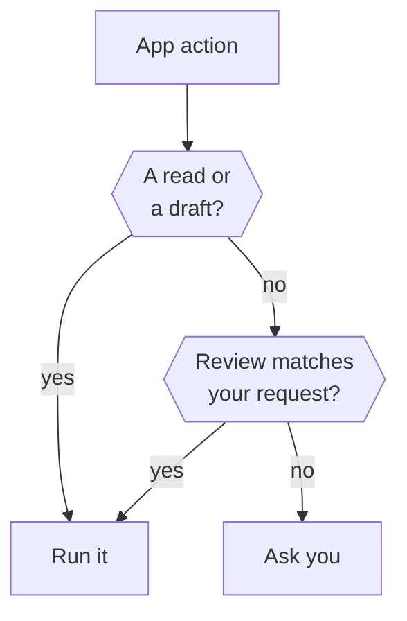

Before Otto runs an action in a connected app, the Otto server checks it against what you asked for. Reads and drafts run. Anything else runs only when your request covers it. Otherwise Otto asks you.

Background work, such as on a new email, has no request from you behind it. So it only reads and drafts, and asks for everything else. Otto doesn't keep a list of approved people: a send you confirmed earlier doesn't approve a later one by itself.

## How the server reads an action

The server classifies the request exactly as it will be sent, not the model's description of it. For an app action it reads the action name. For an API, MCP server or command-line tool you connected, it reads the HTTP method and path, the tool name or the command words.

| Type        | Examples                                                                              |
| ----------- | ------------------------------------------------------------------------------------- |
| Read        | List events, search email, a `GET` request, a GraphQL query                           |
| Change      | Your own data: create a draft, add an event without guests, update a document         |
| Outbound    | Send, reply, forward, post, share, invite or pay, or any change that names recipients |
| Destructive | Delete, trash, cancel, revoke or unsubscribe                                          |
| Unknown     | Anything without a recognizable verb                                                  |

## What runs directly

| Kind of work                                      | Reads and drafts              | Anything else                                        |
| ------------------------------------------------- | ----------------------------- | ---------------------------------------------------- |
| A conversation with you                           | Run                           | Run if the review matches your request               |
| A scheduled run                                   | Run                           | Run if it matches the schedule's instruction         |
| Background work Otto starts, such as on new email | Run                           | Ask                                                  |
| Read-only and onboarding work                     | Reads run, drafts are refused | Refused, unknown actions left to Otto's instructions |

When an action doesn't run directly, Otto asks you a yes/no question. Read-only work is the exception: classified writes are refused. Otto's instructions tell it to only read there, because the server can refuse only actions it can classify.



The diagram shows a conversation. A scheduled run is checked against its instruction, background work has nothing to check against so it asks, and read-only work refuses classified writes.

## The review model

The review model is a smaller model from your model provider. It answers one question: did you ask for this kind of action on this target?

It checks every action that isn't a read or a draft. It sees only your last five messages from the past day, the Otto message your latest one answered, and the action as sent, with long values shortened. It never sees tool results, web pages or emails. Task cards you tapped on your first chat are Otto's words, so they don't count as yours. A scheduled run is checked against the instruction that created its schedule.

If the review model isn't available, for example without a model provider key, every action that isn't matched another way asks you.

## The confirmation

The question shows the action, the account that will run it, the fields of the request and why Otto is asking. Long values are shortened, and a very long request ends with a count of the fields left out.

```text title="Example confirmation"
Gmail: send email?

Account: Gmail · ada@example.com

Recipient email: sam@example.net

Subject: Q3 figures

Why I'm asking: I could not confirm that you asked for exactly this.

Reply yes to go ahead, no to skip it, or tell me what to change.
```

- A bare **yes** or **no** answers the newest question you'd seen, not one that arrived after it.
- Any other reply closes the question, and Otto treats your message as a new request.
- A question expires after 30 minutes.
- A yes runs that exact saved action once, on the account shown. A different recipient or payload needs a new question.


:::note[Otto still uses judgement]
The trust check is a floor, not a replacement for Otto's own instructions. Otto also asks before a destructive action that your request doesn't clearly cover, even when the server would allow it.
:::

:::caution[What the trust check doesn't cover]
It checks connected-app actions only. Clicks and form submissions on websites in Otto's browser follow the model's instructions, with Vault checks for saved logins, sessions and cards. The review model is a best-effort judge and can be wrong.
:::

## Where this is enforced

| Part                    | Source                                                                                                            |
| ----------------------- | ----------------------------------------------------------------------------------------------------------------- |
| Classification          | [`src/shared/action-effect.ts`](https://github.com/n8n-io/otto/blob/main/src/shared/action-effect.ts)             |
| Trust check and review  | [`src/server/trust.ts`](https://github.com/n8n-io/otto/blob/main/src/server/trust.ts)                             |
| Confirmation text       | [`src/server/action-presentation.ts`](https://github.com/n8n-io/otto/blob/main/src/server/action-presentation.ts) |
| Confirmations, run once | [`src/server/approvals.ts`](https://github.com/n8n-io/otto/blob/main/src/server/approvals.ts)                     |

## Related resources

- [Trust and Vault](/trust/)
- [Our trust principles](/trust/principles/)
- [Untrusted content and prompt injection](/trust/untrusted-content/)
- [One use, one result](/trust/outcomes/)
- [Security model and limits](/trust/security-model/)
