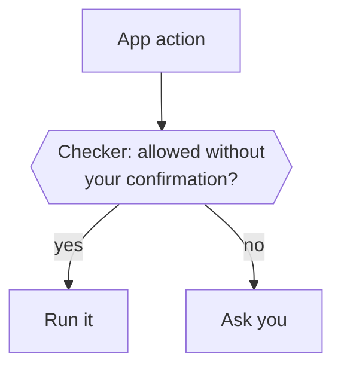

Before Otto runs an action in a connected app, the Otto server asks one checker whether you asked for it. For work you request, reads and drafts run by default unless your instructions forbid the action or require confirmation first. Anything else runs only when your words ask for it. Otherwise Otto asks you.

The same checker decides when Otto changes its own schedules or notification settings. A scheduled run is checked against the instruction that created it, and background work asks. Memory has its own rules: see [Memory](/how-it-works/memory/).

Background work, such as on a new email or a check of an app without events, has no words from you behind it. So the checker lets it read and draft, and Otto asks for everything else. Otto doesn't keep a list of approved people: a send you confirmed earlier doesn't approve a later one by itself.

## What the checker sees

The checker is your selected model at its fastest setting. It checks every app action, reads included, and answers one question: run it, or ask you? Looking up which app tools exist reads no account data, so it runs without a check.

| It sees                                                                         | It never sees                            |
| ------------------------------------------------------------------------------- | ---------------------------------------- |
| For main chat, your last five messages from the past day and the source request | Tool results, web pages, emails or files |
| The Otto message your latest one answered                                       | Anything Otto read while working         |
| A scheduled run's instruction, instead of your messages                         | Task cards you tapped on your first chat |
| The action and its arguments as Otto sends them                                 | Other people's words as yours            |

For a saved task, the checker sees its original owner request and recent owner messages addressed to that task. It does not use messages addressed only to another task. The main chat also excludes task-only messages and task action proposals from its recent authority. Shared memory, files, task briefs and other task reports do not grant permission. An approval remains bound to the exact action and turn. A reply continues the session that asked. A correction to a task closes its old waiting turn, so its old pending action cannot execute from a later approval reply.

Only your words carry authority. A web page or email can't argue for an action, because the checker never reads it.

## What runs directly

Limits in your task request or a schedule's instructions override these defaults, including for reads and drafts. Background work Otto starts uses the defaults below.

| Kind of work                                      | Reads and drafts | Anything else                                 |
| ------------------------------------------------- | ---------------- | --------------------------------------------- |
| A conversation with you                           | Run              | Run if your messages ask for it               |
| A scheduled run                                   | Run              | Run if the schedule's instruction asks for it |
| Background work Otto starts, such as on new email | Run              | Ask                                           |

If the checker can't answer, Otto requires confirmation. If the model also can't compose that confirmation, the action stays blocked. The checker always sees the whole request, however long.

## The confirmation

The same selected model writes the question from a frozen copy of the complete action, its arguments and account details. It explains what will happen and why Otto is asking, preserving the material facts in your conversation language. There are no language-specific confirmation templates or yes/no word lists.

Before showing it, a separate model call checks the question against those frozen facts without seeing the conversation. Both model calls receive a sanitized copy of the request, with secret-keyed values and private links redacted. A requested value cannot fill in a missing action argument, and current account or target details cannot replace a proposed change. An unsupported claim, an invalid response or an unavailable model leaves the action blocked. These model calls add time and cost; the factual check is also a best-effort judgment.

Your recent messages and explicitly stated remembered preferences guide presentation only. An explicit output-language request applies to that output, and a short reply keeps the established conversation language. Quoted material, account names, region and time zone don't select the language. After a reset, your new messages and any remembered preference guide it again.

Generating a question doesn't approve anything. The server checks the task again after generation, then saves the question and exact arguments together. Stop, cancellation, invalid model output or an unavailable model can't produce a late approval. The model never chooses the account or changes the saved arguments while writing the question.

- Your reply answers the newest question you'd seen, not one that arrived after it.
- A later status message in the same reply channel blocks a bare yes. A status in another channel does not block it. On web, a message that arrived after your displayed view does not replace the question you saw. Reply directly to the question to select it.
- The checker reads only your reply, never the question or the action, and decides whether it says yes, no or something else. Any wording or language works, such as "sure, go ahead" or "dale". If it can't read your reply, the question stays open.
- A yes with a change or condition, a question, an attachment or anything else closes the question without running the action. If you reply directly to a question from background work, that work continues with your message, so you can tell it what to change. Otherwise the task that asked ends and Otto treats your message as a new request. A reply to a question that was already answered or whose task has ended is an ordinary message.
- A yes runs that exact saved action once, on the account shown. A different recipient or payload needs a new question.
- Schedule edits and cancellations apply only to the reviewed version and need a fresh review if the schedule changes.
- Within one task, including any subagents it starts, Otto asks one question at a time. While it waits for your answer, app actions that task started after the question don't run, and Otto can try them again after you answer. Separate tasks, such as two scheduled runs, can each wait on their own question.

:::note[Asked once]
Otto doesn't add its own confirmation on top of the trust check or payment approval. The trust check asks you whenever your words don't cover an action; Otto itself asks only when the account, target or action is unclear.
:::

:::caution[What the trust check doesn't cover]
It checks connected-app actions, Otto's own changes and [sign-ins](/trust/vault/). Other clicks and form submissions on websites in Otto's browser follow the model's instructions; card entry always goes through [payment approval](/trust/payments/). The checker is a best-effort judge and can be wrong.
:::

## Where this is enforced

| Part                    | Source                                                                                                |
| ----------------------- | ----------------------------------------------------------------------------------------------------- |
| Trust check and checker | [`src/server/trust.ts`](https://github.com/n8n-io/otto/blob/main/src/server/trust.ts)                 |
| Confirmation text       | [`src/server/communication.ts`](https://github.com/n8n-io/otto/blob/main/src/server/communication.ts) |
| Confirmations, run once | [`src/server/approvals.ts`](https://github.com/n8n-io/otto/blob/main/src/server/approvals.ts)         |

## Related resources

- [Trust and Vault](/trust/)
- [Our trust principles](/trust/principles/)
- [Untrusted content and prompt injection](/trust/untrusted-content/)
- [One use, one result](/trust/outcomes/)
- [Security model and limits](/trust/security-model/)
