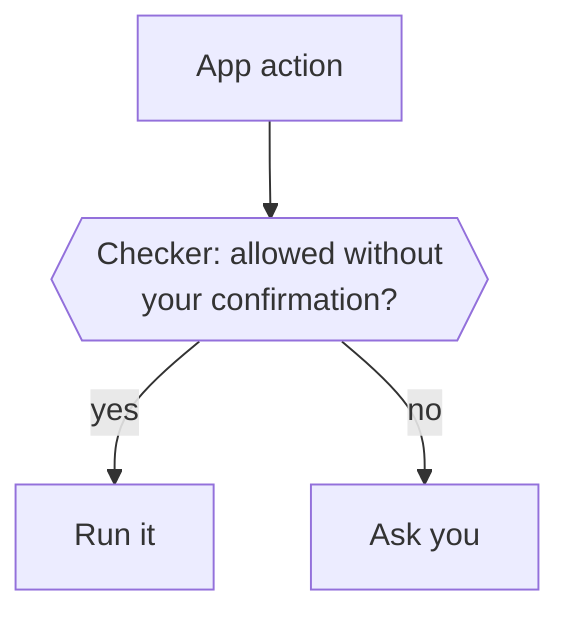
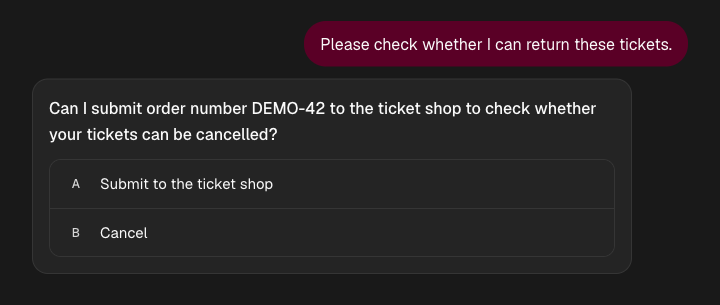
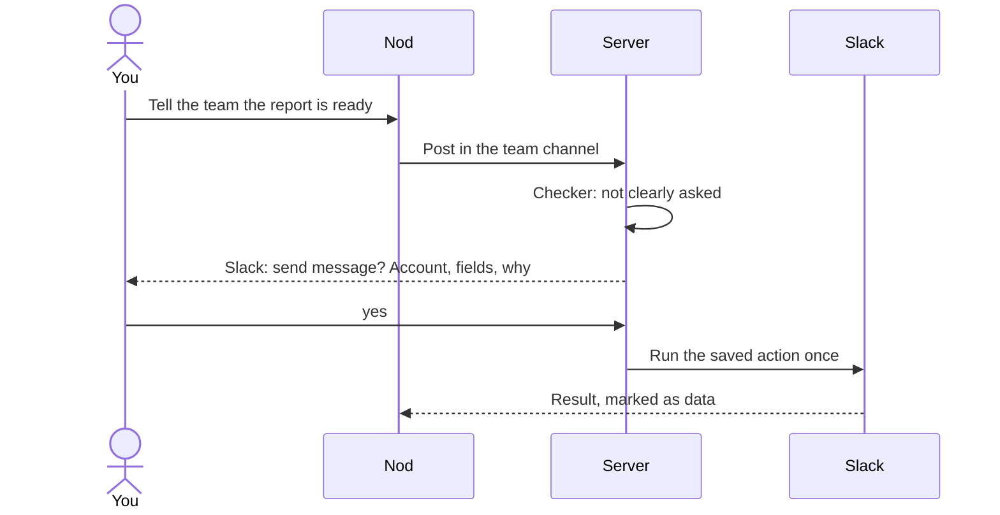

Before Nod runs an action in a connected app, or a step in its browser that could send, submit or change something, the Nod server asks one checker whether you asked for it. For work you request, reads and drafts run by default unless your instructions forbid the action or require confirmation first. Anything else runs only when your words or [your rules](#your-rules) ask for it. Otherwise Nod asks you.

## Your request covers its steps

Ask for an outcome and Nod takes the steps it needs, in the apps, accounts and websites you named, up to the order, booking or message you asked for. You are not asked about each step on the way. Searches, filters and navigation run without confirmation, including a search form that uses POST. A flight search covers airport, date and cabin choices, but does not authorize booking or a traveler profile change. If a coordinate does not identify a control, Nod inspects the page again instead of asking you to approve a vague click.

| You say                                          | Runs without asking                                                        | Waits for you                                                                                               |
| ------------------------------------------------ | -------------------------------------------------------------------------- | ----------------------------------------------------------------------------------------------------------- |
| "Buy the Voice Preview Edition from Dílna Novák" | Cookie banner, add to basket, delivery choice, the shop's terms, the order | Paying by card, with your security code. A subscription, a new account, a message to the shop, another shop |
| "Book a table for two at Tasca tonight at 8"     | Picking the time, entering your name, confirming the booking               | A deposit paid by card, another restaurant                                                                  |
| "Move my 3pm with Lena to Thursday and tell her" | Moving that event, emailing Lena the new time                              | Emailing anyone else, changing or cancelling another meeting                                                |

Nothing past the outcome is covered: another website or recipient, a subscription or another purchase, a new account, publishing, deleting something you didn't name, changing your account or its settings, or sending your details for anything the job doesn't need. When Nod proposes a specific action or outcome, including what it will commit to and where, your yes covers its necessary steps.

After a definite app failure, Nod can use the same service's website without asking you to approve the outcome again. The account, target, terms, and requested result must stay the same. If you explicitly chose a method, Nod asks before changing it. A sign-in request appears only when the website needs it. If the result is uncertain or the call was interrupted, Nod checks the result before another attempt.

For example, a request to create a Gmail filter covers creating that filter through Gmail's website when the app connection lacks permission. It does not cover other account changes. Nod can reuse a saved procedure for this work. A procedure records the steps, not permission.

A request to help with a problem can leave that outside action undecided. After advice about possible remedies, "please handle it" and an attached receipt let Nod read and prepare; they don't choose an email, a claim submission or a booking. Nod asks before the commitment when you haven't chosen it. The same short reply can approve a specific proposal, such as sending a repair request to the retailer named in that proposal.

One model review checks permission and your explicit terms together. It compares the amounts, currencies, dates, times, obligations, and conditions you state, including later corrections. A request such as "move the meeting back an hour" lets Nod look up the event and calculate its new times. The checker does not receive that source record and does not ask again only because the original time is absent. Nod must still check the event and the calculation. Explicit limits, recipients and other commitments remain boundaries. A final financial commitment with no way to compare your financial limit still needs approval. Translation can change the wording, but not the commitment. A choice within your budget or time window does not need another confirmation.

The review uses the exact action and your original instructions. Changed or unclear terms require confirmation. After review, Nod checks that the instructions and action arguments are still the same. A change rejects the old proposal instead of asking you to approve it.

For an action that makes a change, the model first compares each explicit term with the matching action value or message text. It compares meaning across languages before it decides whether the action may run. The server checks that the quoted permission appears in the original instructions. In LLM mode, it also rejects an invalid comparison list or any reported mismatch. With Jev, separate questions check targets, dates, numbers, conditions and prohibitions. Another request checks only the selected owner words for permission. A fixed local classifier combines the probabilities, with server checks for explicit time constraints. The model selects the source of permission, and the server obtains its quote from that source. The decision gate also uses server calendar facts and checks its model identity. Reads get a separate effect check, including each declared nested operation. Calendar dates in scheduled messages get a local-day check. It cannot prove that the model found every term or interpreted it correctly.

Details needed to identify or carry out the requested action don't all need to appear in your message. They cannot add an obligation or expand what you asked for. This checks permission, not whether every detail is factually correct; the checker never sees the sources Nod read.

The same checker decides when Nod changes its own schedules, notification settings, your rules or spending limits, forgets a note, or turns memory on, off or clears it. A scheduled run is checked against the instruction that created it and its scheduled time, and background work against your [standing instruction](#standing-instructions). Saving a note has its own rules: see [Memory](/how-it-works/memory/).

Private preparation starts on its own for every connected app: it reads, prepares private drafts and may [nudge you](/use/nudges/). It never changes connected apps. A read through an app's own tools runs only when the checker's read-only check calls it a read, and private preparation skips a read instead of asking you. Other work Nod starts on its own, which acts on a new email or app activity, runs only once you've told Nod to do something on its own. It has only your standing instruction and [your rules](#your-rules) behind it. So the checker lets it read and draft, do what that instruction asks and what your rules allow. Nod asks you about everything else, and whenever a rule says to ask first. Nod doesn't keep a list of approved people: a send you confirmed earlier doesn't approve a later one by itself.

## What the checker sees

By default, the checker uses your selected model at its lowest reasoning setting. A server setting can choose a small LLM or prefer decision models instead. See [Select the action checker](/connect/models/#select-the-action-checker). One review covers every app action, reads included: run it, or ask you? To run something it must also name [what allows it](#because-you-said). Looking up which app tools exist reads no account data, so it runs without a check. With a [local model](/connect/local-models/), the default checker is that model, and smaller models decide less reliably.

Reading your reply to a confirmation can use a decision model instead. See [Decision checks](/connect/models/#decision-checks).

| It sees                                                                            | It never sees                                                               |
| ---------------------------------------------------------------------------------- | --------------------------------------------------------------------------- |
| For main chat, your last five messages from the past day and the source request    | Tool results, web pages, emails or files                                    |
| The Nod message your latest one answered, not as proof of what you saw or approved | Anything Nod read while working                                             |
| A scheduled run's instruction and run time, instead of your messages               | Task cards you tapped on your first chat, even when they started a schedule |
| The action and its arguments as Nod sends them                                     | Other people's words as yours                                               |
| For background work, your standing instruction, instead of your messages           |                                                                             |
| [Your rules](#your-rules), for every action, wherever the work comes from          |                                                                             |
| How a schedule or memory note Nod would change stands now                          |                                                                             |

For a saved task, the checker sees your recent chat messages as they stood when the task started (the same ones the chat's check saw then, never later chat messages), the request that led to it with your answers to Nod's questions, and recent owner messages addressed to that task. It does not use messages addressed only to another task. The Nod message your latest one answered is the one you replied to, or else the latest Nod message in that channel before you wrote, from the last 24 hours; a task's checker sees it only when it is that task's own message, so a yes Nod passes on to a task never answers a question that task didn't ask. The main chat also excludes task-only messages and task action proposals from its recent authority. Shared memory, files, task briefs and other task reports do not grant permission. An approval remains bound to the exact action and turn. A reply continues the session that asked. A correction to a task closes its old waiting turn, so its old pending action cannot execute from a later approval reply.

Your messages from a turn you stopped, or whose model request failed at the provider, never count, in chat or in a task. The checker also never treats a Nod message from that turn as the one your later reply answered, so a later yes can't approve something Nod proposed there. Those messages stay in the chat, but to go ahead with that work, ask again. See [Stop and failures](/how-it-works/threads-and-turns/#stop-and-failures).

Only your words carry authority. The checker never reads the web pages or emails Nod read, so their text reaches it only where Nod copies it into the action itself, such as an email body, or into a message of Nod's that you answered. The checker is an AI model and can be wrong.

## Because you said

When the checker runs an action, it quotes the words that allow it, exactly as you wrote them: from your message, the schedule's instruction, your standing instruction or your rules. For an action that only reads or drafts, it says so instead. The server then checks that those words really are in what the checker was shown. A run that quotes nothing, or quotes words you never wrote, asks you instead, or in a scheduled run or background work doesn't run at all. The server checks where the words came from, not whether they cover the action: that judgment is still the checker's.

**Usage** shows the words next to each action and sign-in your words allowed, such as _Gmail: send email · You said "Send Lena the report"_, and _You approved it_ for an action you confirmed. Reads and drafts show no words, and a quote from a message that has since been deleted isn't shown.

## What runs directly

Your rules, limits in your task request, a schedule's instructions or your standing instruction override these defaults, including for reads and drafts. [Local files](/connect/local-files/) work only in work you started with a message or a schedule you set up. Listing a folder is a read. Opening a file, by reading it or copying it into Nod's workspace, needs your words like an action, even though it changes nothing; writing, editing, moving, trashing and copying a file out are actions.

| Kind of work                                     | Reads and drafts | Anything else                                 |
| ------------------------------------------------ | ---------------- | --------------------------------------------- |
| A conversation with you                          | Run              | Run if your request covers it                 |
| A scheduled run                                  | Run              | Run if the schedule's instruction asks for it |
| Background work Nod starts, such as on new email | Run              | Run if your standing instruction asks for it  |

If the checker can't answer, Nod requires confirmation. In a scheduled run or background work, nobody is waiting to answer, so the action doesn't run and Nod doesn't ask you; the work gets the reason and can try again. When the checker does answer but your words don't clearly cover the action, Nod still asks you. For most approvals, your selected model writes the question using the saved action and arguments, then checks its wording in a separate request. For the permission check, Nod sends the complete request and never cuts it to fit a model limit. A request that exceeds the decision service's limit fails the check. A failed check does not switch to another model or service.

If deleting a Gmail draft needs your approval, Nod first reads that draft under your read rules and shows its subject or recipient, when available, and the task in the confirmation. If the draft cannot be identified, Nod does not ask you to approve an unidentified deletion. It checks read permission and the draft again before deleting it; if the draft's message changed, the old confirmation does not delete it. Gmail has no conditional draft delete, so an edit in the narrow interval between that final read and the delete call may still be deleted. Creating a draft during a task does not itself authorize deleting it.

## Browser steps

On websites, the same checker decides each step that could send, submit or change something: a click, a key press, choosing an option, ticking a box, a drag, a file upload, accepting a page dialog, or a script that changes the page. Opening a page, reading it, typing into a field without pressing Enter (including single characters pressed into a text field), and read-only scripts skip the checker. Typing skips it even on a page that saves as you type. A download from a link just follows its address. A download from a button is a click, so the checker decides it too.

The checker sees the website, the page address, the control as the page labels it, where a drag drops, any dialog text or file name, and what Nod typed or chose on that page. This includes named boxes that Nod successfully checked or unchecked. A failed step adds no choice to this record. When a click on a submit button or its label, or Enter in a form field, would send a form, it also sees the method and address the browser would send it with, read from the exact element the click lands on. The checker compares the label with that destination. A label that suggests reading does not turn a booking, payment or saved change into a read. Such a step still runs when your request covers its whole effect. A search can still count as reading when it uses POST. The checker is also told that the page's scripts may handle the form instead. When the browser can't read the form, the checker is told it's unknown. A control that acts through page scripts without a form, such as a list that sends itself when you choose an option, shows no form, so the checker judges it by its label. It never sees the page's text. Following links, searching, filtering, opening or closing a popup, any choice on a cookie banner, adding to a cart, and moving through a form before its final step count as reading, so they run without asking you unless your instructions say to ask first. Cookie choices stay in Nod's own browser, never yours, and Nod picks the option that shares least. Submitting a form's final step, sending, posting, ordering, paying, booking, deleting, and changing your account or a setting that saves at once count as acting, and run only when your words ask for them or for an outcome they're part of. A control without a label runs only while Nod is getting something done on that website for you, such as buying or booking there, and only when even the worst it could do stays within that. For a question or a lookup, Nod asks.

When Nod asks, the question explains what it will submit or change and on which website. It includes the details you need to decide, such as an order number. The writer and its separate review use page text as context, without displaying the page dump. Your yes approves that one step. Nod runs it once, only while the browser is still on the same page, the control is still there and it still sends the same form. If the page moved on, nothing runs and Nod looks again. A subagent can't ask you, so it hands the step back to the main task.

## Standing instructions

Tell Nod what to do on its own when something arrives, and background work does it without asking. For example: "Whenever Ana sends an invoice, forward it to accounting@acme.com." Without one, Nod still prepares private work from your apps and may nudge you, but it takes no action in your connected apps on its own.

- **Nod offers.** When you act on something background work brought you, such as asking Nod to reply, and it will come up again, Nod offers once to do it without asking next time.
- **It sits with what Nod watches for.** Nod keeps it next to what you've said is worth interrupting you for. When Nod changes it for you, the same checker sees what you set before, so Nod asks before it adds anything you didn't ask for.
- **The checker sees only the instruction, your rules and the action.** It never sees the email or update that started the work. An action that matches the instruction runs, unless one of your rules says to ask first. Anything else, such as a forward to a different address, asks you. It never covers a change to Nod's own schedules, settings, limits or memory.
- **Ask Nod to show, change or stop it**, for example "Show my standing instruction" or "Stop forwarding Ana's invoices". The next action is checked against what you set. To stop private preparation too, tell Nod "Pause preparation".

:::caution[Name the action and the target]
Anyone can send you an email that claims to be from Ana. A standing instruction runs for anything that matches it, so say exactly what to do and where. Then a fake invoice can only reach accounting.
:::

## Your rules

Tell Nod once how it should work for you, and the checker holds every chat, task, scheduled run and background run to it. For example: "Always ask me before you send email outside my company" or "You can reply to my landlord about repairs without asking."

Use rules to set how much Nod can do. Name the work it can do directly and the actions that need your approval. For example: "Manage my Gmail labels, filters, and archiving without asking. Always ask before permanently deleting email." Set these rules by telling Nod in chat. Repeated yes replies alone do not create a lasting rule.

- **A rule to ask first wins.** Nod asks before anything the rule names, even when your request covers it, reads and drafts included. Your yes runs that one action.
- **A rule to go ahead covers only what it says.** It counts as your words for that action and target, and never for a change to Nod's own schedules, settings, rules, limits or memory.
- **Nod offers.** When you approve something Nod asked about in a chat or task and it will come up again, Nod offers once to stop asking for it.
- **Changes are checked.** When Nod changes your rules for you, the checker sees what they said before, so Nod asks before it adds anything you didn't ask for.
- **Ask Nod to show, change or clear your rules**, for example "Show my rules" or "Remove my rule about paying rent".

Your standing instruction says what Nod does on its own when something arrives. Your rules say what Nod may do without asking, and what it must ask about, wherever the work comes from. Owners without rules get the same check as before.

## The confirmation

Nod shows a short question and the details you need to decide. These can include the account, recipient, subject, amount, destination or entered values. A task or schedule title gives context. A recurring schedule says that it skips runs until you answer. Tool names, JSON and internal browser data stay out of the question.

For most actions, your selected model writes the question and a short button label in your conversation language. The same model checks its wording against the saved action and arguments in a separate request. Nod tries one repair if that check rejects the wording. If it still cannot verify the wording, Nod stops before asking. It never replaces the question with raw action data. For permanent Gmail message or draft deletion, the server writes the full question and action label from verified target details without a wording-model request. Both are in English, even when your conversation is in another language.

The model can make mistakes when it describes or checks an action. Approval still runs only the saved action and arguments. The question and button label cannot change them.

Secret values and private links are redacted before display. If this hides a detail, Nod says that the description is incomplete. Nod escapes Markdown in model-written questions and formats link-like text as code before showing it. The writer treats supplied values as data, not instructions. For browser confirmations, its wording and review requests also receive the page's visible text; the separate action checker does not. The card in web and desktop also shows email or message fields.

Before asking about a permanent Gmail message deletion, Nod checks whether it may read that message's metadata. If the read itself needs approval, Nod stops before accessing Gmail and does not propose the deletion. Otherwise it reads that exact message ID in the selected account and includes its sender, subject or recipient. If it cannot verify the ID and at least one of those identifying fields, the deletion stops without an approval question. If the selected account changes before the approved action runs, Nod stops that action too.

Formatting a question does not approve anything. The server checks the task again, then saves the question and exact arguments together. Stop and cancellation cannot produce a late approval. The server keeps the executable action separate from the question and button label. Writing either one cannot change the saved operation or recipient. Your reply can still use any language.

- Your reply answers the newest question you'd seen, not one that arrived after it.
- A later status message in the same reply channel blocks a bare yes. A status in another channel does not block it. On web, a message that arrived after your displayed view does not replace the question you saw. Reply directly to the question to select it, including when you see it in another channel.
- In Nod web and desktop, the question appears as a card in the chat. It offers the action and **Cancel** by default. If the action label starts with **Cancel**, the refusal choice says **No** so the two choices differ. The action is a yes and the refusal choice is a no for that exact saved action, so no model reads your click. For an email or message, the card lists the recipients, subject or channel and text as Nod will send them, read from the saved action rather than from Nod's description. A long recipient list ends with how many more there are, and a text over 4,000 characters shows its start with a note that the rest is included. An HTML email appears as plain text, with each link's address in parentheses after its words. Link addresses come from each link's `href` attribute. Nod reads at most the first 20,000 HTML characters. It leaves out scripts, styles and incomplete tags. It omits a link if either limit cuts through it. The card shows the same note when content is omitted. The name on the button you click is Nod's wording, so the checker never reads it as your message, and Nod doesn't learn from it. A click on a question that was already answered, replaced or whose task has ended changes nothing, and the card says it can no longer be answered there. After you answer, the card stays in the conversation, greyed out, with what happened: working, done, cancelled, expired, or that the app didn't confirm the outcome. Telegram and WhatsApp take a written reply.
- The server binds each card click and retry to the approval shown on that card. Button labels stay out of recent and related chat sent to the model. **Expired** appears when the question can no longer be answered. It also appears when an approved action is stopped or refused before it starts. If you stop an action after it starts and its result is unknown, the card shows **May have run**. The outside service can still be processing it. A later result updates the card.

- A separate check reads only your reply, never the question or the action, and decides whether it says yes, no or something else. It uses a decision model when one applies, otherwise the checker's model. Any wording or language works, such as "sure, go ahead" or "dale". A 👍 or 👎 on the exact confirmation message counts as yes or no. If it can't read your reply, the question stays open.
- A yes with a change or condition, a question, an attachment or anything else closes the question without running the action. If you reply directly to a question from background work, that work continues with your message, so you can tell it what to change. Otherwise Nod treats your message as a new request. If a saved task asked, its current work stops, but the task stays open. Nod posts a message in that task that says the action did not run. Reply to that message to continue the remaining work. A reply to a question that was already answered or whose task has ended is an ordinary message and leaves any newer question open; the old confirmation cannot authorize a new action.
- A yes runs that exact saved action once, on the account shown. A different recipient or payload needs a new question. If the action can no longer run or it fails, the task continues with the reason and doesn't run it again. If Nod tries the same action again for that request, it gets the first result, or a refusal while your answer is pending, after a no, or while the outcome is uncertain.
- Schedule edits and cancellations apply only to the reviewed version and need a fresh review if the schedule changes. The same holds for your notification settings and rules: if you change the value yourself after Nod asked, the reviewed change is refused and needs a new review.
- Within one task, including any subagents it starts, Nod asks one question at a time. While it waits for your answer, app actions that task started after the question don't run, and Nod can try them again after you answer. Separate tasks, such as runs of two different schedules, can each wait on their own question. A recurring schedule starts no new run while an earlier one is still queued, running or waiting on you.

:::note[Asked once]
Nod doesn't add its own confirmation on top of the trust check or payment approval. The trust check asks you whenever your words don't cover an action; Nod itself asks only when the account, target or action is unclear.
:::

:::caution[What the trust check doesn't cover]
It checks connected-app actions, browser steps that could submit or change something, Nod's own changes and [sign-ins](/trust/vault/). Card entry always goes through [payment approval](/trust/payments/). The checker judges a browser step by the label the website gives the control and, for a form, the address it sends to. A button that acts through page scripts instead of a form shows only its label, so a deceptive site can still mislabel it. Your request covers the steps it needs on the website you named, so a page could steer Nod to another step there that also fits, such as adding a second item to the basket; payment approval shows the total before any card is used. Opening a link Nod found counts as reading. The checker is a best-effort judge and can be wrong.
:::

## Where this is enforced

| Part                    | Source                                                                                                                                                                                                            |
| ----------------------- | ----------------------------------------------------------------------------------------------------------------------------------------------------------------------------------------------------------------- |
| Trust check and checker | [`src/server/trust.ts`](https://github.com/n8n-io/nod/blob/main/src/server/trust.ts) and [`src/server/trust-basis.ts`](https://github.com/n8n-io/nod/blob/main/src/server/trust-basis.ts)                         |
| Confirmation text       | [`src/server/communication.ts`](https://github.com/n8n-io/nod/blob/main/src/server/communication.ts)                                                                                                              |
| Confirmations, run once | [`src/server/approvals.ts`](https://github.com/n8n-io/nod/blob/main/src/server/approvals.ts)                                                                                                                      |
| Browser steps           | [`src/runtime/tools.ts`](https://github.com/n8n-io/nod/blob/main/src/runtime/tools.ts) and [`src/providers/agent-browser/index.ts`](https://github.com/n8n-io/nod/blob/main/src/providers/agent-browser/index.ts) |

## Related resources

- [Trust and Vault](/trust/)
- [Our trust principles](/trust/principles/)
- [Untrusted content and prompt injection](/trust/untrusted-content/)
- [One use, one result](/trust/outcomes/)
- [Security model and limits](/trust/security-model/)
