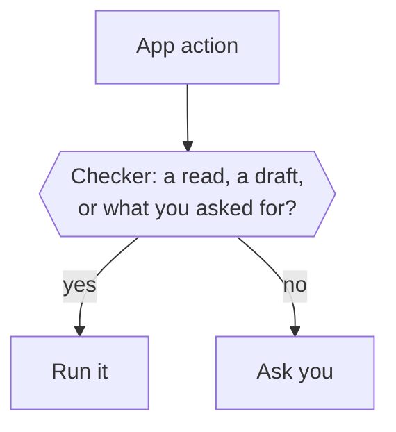

Before Otto runs an action in a connected app, the Otto server asks one checker whether you asked for it. The checker runs reads and drafts, and anything else only when your words ask for it. Otherwise Otto asks you.

The same checker decides when Otto changes its own schedules or notification settings. A scheduled run is checked against the instruction that created it, and background work asks. Memory has its own rules: see [Memory](/how-it-works/memory/).

Background work, such as on a new email or a check of an app without events, has no words from you behind it. So the checker lets it read and draft, and Otto asks for everything else. Otto doesn't keep a list of approved people: a send you confirmed earlier doesn't approve a later one by itself.

## What the checker sees

The checker is your selected model at its fastest setting. It checks every app action, reads included, and answers one question: run it, or ask you? Looking up which app tools exist reads no account data, so it runs without a check.

| It sees                                                 | It never sees                            |
| ------------------------------------------------------- | ---------------------------------------- |
| Your last five messages from the past day               | Tool results, web pages, emails or files |
| The Otto message your latest one answered               | Anything Otto read while working         |
| A scheduled run's instruction, instead of your messages | Task cards you tapped on your first chat |
| The action and its arguments as Otto sends them         | Other people's words as yours            |

Only your words carry authority. A web page or email can't argue for an action, because the checker never reads it.

## What runs directly

| Kind of work                                      | Reads and drafts | Anything else                                 |
| ------------------------------------------------- | ---------------- | --------------------------------------------- |
| A conversation with you                           | Run              | Run if your messages ask for it               |
| A scheduled run                                   | Run              | Run if the schedule's instruction asks for it |
| Background work Otto starts, such as on new email | Run              | Ask                                           |



If the checker can't answer, for example without a model provider key, Otto asks you. The checker always sees the whole request, however long.

## The confirmation

The question shows the action, the account that will run it, the fields of the request and why Otto is asking. Long values are shortened, and a very long request ends with a count of the fields left out.

```text title="Example confirmation"
Gmail: send email?

Account: Gmail · ada@example.com

Recipient email: sam@example.net

Subject: Q3 figures

Why I'm asking: I could not confirm that you asked for exactly this.

Reply yes to go ahead, no to skip it, or tell me what to change.
```

- Your reply answers the newest question you'd seen, not one that arrived after it.
- The checker reads only your reply, never the question or the action, and decides whether it says yes, no or something else. Any wording or language works, such as "sure, go ahead" or "dale".
- A yes with a change or condition, a question or anything else closes the question, and Otto treats your message as a new request. So does a reply to a question that was already answered or whose task has ended.
- A yes runs that exact saved action once, on the account shown. A different recipient or payload needs a new question.
- Within one task, including any subagents it starts, Otto asks one question at a time. While it waits for your answer, app actions that task started after the question don't run, and Otto can try them again after you answer. Separate tasks, such as two scheduled runs, can each wait on their own question.


:::note[Asked once]
Otto doesn't add its own confirmation on top of the trust check or payment approval. The trust check asks you whenever your words don't cover an action; Otto itself asks only when the account, target or action is unclear.
:::

:::caution[What the trust check doesn't cover]
It checks connected-app actions, Otto's own changes and [sign-ins](/trust/vault/). Other clicks and form submissions on websites in Otto's browser follow the model's instructions; card entry always goes through [payment approval](/trust/payments/). The checker is a best-effort judge and can be wrong.
:::

## Where this is enforced

| Part                    | Source                                                                                                            |
| ----------------------- | ----------------------------------------------------------------------------------------------------------------- |
| Trust check and checker | [`src/server/trust.ts`](https://github.com/n8n-io/otto/blob/main/src/server/trust.ts)                             |
| Confirmation text       | [`src/server/action-presentation.ts`](https://github.com/n8n-io/otto/blob/main/src/server/action-presentation.ts) |
| Confirmations, run once | [`src/server/approvals.ts`](https://github.com/n8n-io/otto/blob/main/src/server/approvals.ts)                     |

## Related resources

- [Trust and Vault](/trust/)
- [Our trust principles](/trust/principles/)
- [Untrusted content and prompt injection](/trust/untrusted-content/)
- [One use, one result](/trust/outcomes/)
- [Security model and limits](/trust/security-model/)
