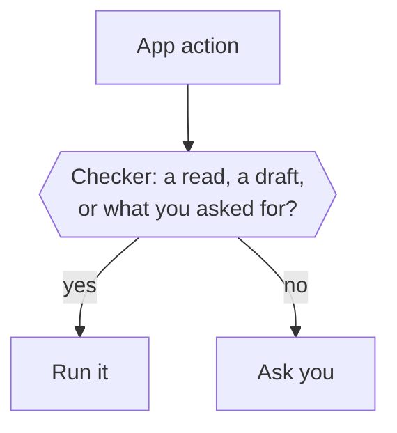

Before Otto runs an action in a connected app, the Otto server asks one checker whether you asked for it. The checker runs reads and drafts, and anything else only when your words ask for it. Otherwise Otto asks you.

Background work, such as on a new email, has no words from you behind it. So the checker lets it read and draft, and Otto asks for everything else. Otto doesn't keep a list of approved people: a send you confirmed earlier doesn't approve a later one by itself.

## What the checker sees

The checker is your selected model at its fastest setting. It checks every app action, reads included, and answers one question: run it, or ask you?

| It sees                                                 | It never sees                            |
| ------------------------------------------------------- | ---------------------------------------- |
| Your last five messages from the past day               | Tool results, web pages, emails or files |
| The Otto message your latest one answered               | Anything Otto read while working         |
| A scheduled run's instruction, instead of your messages | Task cards you tapped on your first chat |
| The action and its arguments as Otto sends them         | Other people's words as yours            |

Only your words carry authority. A web page or email can't argue for an action, because the checker never reads it.

## What runs directly

| Kind of work                                      | Reads and drafts | Anything else                                 |
| ------------------------------------------------- | ---------------- | --------------------------------------------- |
| A conversation with you                           | Run              | Run if your messages ask for it               |
| A scheduled run                                   | Run              | Run if the schedule's instruction asks for it |
| Background work Otto starts, such as on new email | Run              | Ask                                           |
| Read-only and onboarding work                     | Reads run        | Refused                                       |



If the checker can't answer, for example without a model provider key, Otto asks you. In read-only work, the action is refused instead. Otto refuses any app request over 32,768 characters, so the checker always sees the whole request.

## The confirmation

The question shows the action, the account that will run it, the fields of the request and why Otto is asking. Long values are shortened, and a very long request ends with a count of the fields left out.

```text title="Example confirmation"
Gmail: send email?

Account: Gmail · ada@example.com

Recipient email: sam@example.net

Subject: Q3 figures

Why I'm asking: I could not confirm that you asked for exactly this.

Reply yes to go ahead, no to skip it, or tell me what to change.
```

- A bare **yes** or **no** answers the newest question you'd seen, not one that arrived after it.
- Any other reply closes the question, and Otto treats your message as a new request.
- A question expires after 30 minutes.
- A yes runs that exact saved action once, on the account shown. A different recipient or payload needs a new question.


:::note[Otto still uses judgement]
The trust check is a floor, not a replacement for Otto's own instructions. Otto also asks before a destructive action that your request doesn't clearly cover, even when the server would allow it.
:::

:::caution[What the trust check doesn't cover]
It checks connected-app actions only. Clicks and form submissions on websites in Otto's browser follow the model's instructions, with Vault checks for saved logins, sessions and cards. The review model is a best-effort judge and can be wrong.
:::

## Where this is enforced

| Part                    | Source                                                                                                            |
| ----------------------- | ----------------------------------------------------------------------------------------------------------------- |
| Trust check and checker | [`src/server/trust.ts`](https://github.com/n8n-io/otto/blob/main/src/server/trust.ts)                             |
| Confirmation text       | [`src/server/action-presentation.ts`](https://github.com/n8n-io/otto/blob/main/src/server/action-presentation.ts) |
| Confirmations, run once | [`src/server/approvals.ts`](https://github.com/n8n-io/otto/blob/main/src/server/approvals.ts)                     |

## Related resources

- [Trust and Vault](/trust/)
- [Our trust principles](/trust/principles/)
- [Untrusted content and prompt injection](/trust/untrusted-content/)
- [One use, one result](/trust/outcomes/)
- [Security model and limits](/trust/security-model/)
