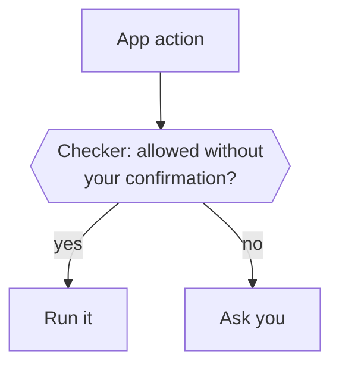

Before Otto runs an action in a connected app, or a step in its browser that could send, submit or change something, the Otto server asks one checker whether you asked for it. For work you request, reads and drafts run by default unless your instructions forbid the action or require confirmation first. Anything else runs only when your words ask for it. Otherwise Otto asks you.

The same checker decides when Otto changes its own schedules, notification settings or spending limits, forgets a note, or turns memory on, off or clears it. A scheduled run is checked against the instruction that created it and its scheduled time, and background work against your [standing instruction](#standing-instructions). Saving a note has its own rules: see [Memory](/how-it-works/memory/).

Work Otto starts on its own, such as on a new email or a check of an app without events, runs only once you've told Otto what to watch for. It has only your standing instruction behind it. So the checker lets it read and draft and do what that instruction asks. Otto asks you about everything else. Otto doesn't keep a list of approved people: a send you confirmed earlier doesn't approve a later one by itself.

## What the checker sees

The checker is your selected model at its fastest setting. It checks every app action, reads included, and answers one question: run it, or ask you? Looking up which app tools exist reads no account data, so it runs without a check.

Reading your reply to a confirmation can use a decision model instead. See [Decision checks](/connect/models/#decision-checks).

| It sees                                                                             | It never sees                                                               |
| ----------------------------------------------------------------------------------- | --------------------------------------------------------------------------- |
| For main chat, your last five messages from the past day and the source request     | Tool results, web pages, emails or files                                    |
| The Otto message your latest one answered, not as proof of what you saw or approved | Anything Otto read while working                                            |
| A scheduled run's instruction and run time, instead of your messages                | Task cards you tapped on your first chat, even when they started a schedule |
| The action and its arguments as Otto sends them                                     | Other people's words as yours                                               |
| For background work, your standing instruction, instead of your messages            |                                                                             |
| How a schedule or memory note Otto would change stands now                          |                                                                             |

For a saved task, the checker sees your recent chat messages as they stood when the task started (the same ones the chat's check saw then, never later chat messages), the request that led to it with your answers to Otto's questions, and recent owner messages addressed to that task. It does not use messages addressed only to another task. The Otto message your latest one answered is the one you replied to, or else the latest Otto message in that channel before you wrote, from the last 24 hours; a task's checker sees it only when it is that task's own message, so a yes Otto passes on to a task never answers a question that task didn't ask. The main chat also excludes task-only messages and task action proposals from its recent authority. Shared memory, files, task briefs and other task reports do not grant permission. An approval remains bound to the exact action and turn. A reply continues the session that asked. A correction to a task closes its old waiting turn, so its old pending action cannot execute from a later approval reply.

Only your words carry authority. A web page or email can't argue for an action, because the checker never reads it.

## What runs directly

Limits in your task request, a schedule's instructions or your standing instruction override these defaults, including for reads and drafts.

| Kind of work                                      | Reads and drafts | Anything else                                 |
| ------------------------------------------------- | ---------------- | --------------------------------------------- |
| A conversation with you                           | Run              | Run if your messages ask for it               |
| A scheduled run                                   | Run              | Run if the schedule's instruction asks for it |
| Background work Otto starts, such as on new email | Run              | Run if your standing instruction asks for it  |

If the checker can't answer, Otto requires confirmation. If the model can't write or check that confirmation, the action stays blocked. Otto sends the complete request and never cuts it to fit a model limit. A request that exceeds the decision service's limit fails the check. A failed check does not switch to another model or service.

## Browser steps

On websites, the same checker decides each step that could send, submit or change something: a click, a key press, choosing an option, ticking a box, a drag, a file upload, accepting a page dialog, or a script that changes the page. Opening a page, reading it, typing into a field without pressing Enter (including single characters pressed into a text field), and read-only scripts skip the checker. Typing skips it even on a page that saves as you type. A download from a link just follows its address. A download from a button is a click, so the checker decides it too.

The checker sees the website, the page address, the control as the page labels it, where a drag drops, any dialog text or file name, and what Otto typed or chose on that page. When a click on a submit button or its label, or Enter in a form field, would send a form, it also sees the method and address the browser would send it with, read from the exact element the click lands on. That shows where a vaguely labelled button really sends, as far as the address says what it does; the checker is also told that the page's scripts may handle the form instead. When the browser can't read the form, the checker is told it's unknown. A control that acts through page scripts without a form, such as a list that sends itself when you choose an option, shows no form, so the checker judges it by its label. It never sees the page's text. Following links, searching, filtering, closing a popup, declining optional cookies, adding to a cart, and moving through a form before its final step count as reading, so they run without asking you unless your instructions say to ask first. Submitting a form's final step, sending, posting, ordering, paying, booking, deleting, accepting cookies, and changing an account or a setting that saves at once count as acting, and run only when your words ask for them.

When the checker asks, the question names what the page shows, such as the amount and payee: the question writer and its fact check read the page's visible text, which the checker itself never sees. Your yes approves that one step. Otto runs it once, only while the browser is still on the same page, the control is still there and it still sends the same form. If the page moved on, nothing runs and Otto looks again. A subagent can't ask you, so it hands the step back to the main task.

## Standing instructions

Tell Otto what to do on its own when something arrives, and background work does it without asking. For example: "Whenever Ana sends an invoice, forward it to accounting@acme.com."

- **Otto offers.** When you act on something background work brought you, such as asking Otto to reply, and it will come up again, Otto offers once to do it without asking next time.
- **It sits with what Otto watches for.** Otto keeps it next to what you've said is worth interrupting you for. When Otto changes it for you, the same checker sees what you set before, so Otto asks before it adds anything you didn't ask for.
- **The checker sees only the instruction and the action.** It never sees the email or update that started the work. An action that matches the instruction runs. Anything else, such as a forward to a different address, asks you. It never covers a change to Otto's own schedules, settings, limits or memory.
- **See, change or stop it in Trust → Activity**, or tell Otto, for example "stop forwarding Ana's invoices". The next action is checked against what you set.

:::caution[Name the action and the target]
Anyone can send you an email that claims to be from Ana. A standing instruction runs for anything that matches it, so say exactly what to do and where. Then a fake invoice can only reach accounting.
:::

## The confirmation

The same selected model writes the question from a frozen copy of the complete action, its arguments and account details. It explains what will happen and why Otto is asking, preserving the material facts in your conversation language. It names the website, account and recipient as the action does, not by what you called them, and adds nothing from the conversation, such as that it repeats an earlier attempt. So a lookalike site can't hide behind the name you used. There are no language-specific confirmation templates or yes/no word lists.

Before showing it, a separate fact check by your selected model compares the question with those frozen facts without seeing the conversation. The writer and the fact check receive a sanitized copy of the request, with secret-keyed values and private links redacted. When sanitizing hides a value, both calls are told which fields are hidden, by name and never by value, and the question has to say that part of the action is not shown; a question that presents such an action as complete is rejected. A requested value cannot fill in a missing action argument, and current account or target details cannot replace a proposed change. An unsupported claim, an invalid response or an unavailable model leaves the action blocked. These model calls add time and cost; the factual check is also a best-effort judgment.

Your recent messages and explicitly stated remembered preferences guide presentation only. An explicit output-language request applies to that output, and a short reply keeps the established conversation language. Quoted material, account names, region and time zone don't select the language. After a reset, your new messages and any remembered preference guide it again.

Generating a question doesn't approve anything. The server checks the task again after generation, then saves the question and exact arguments together. Stop, cancellation, invalid model output or an unavailable model can't produce a late approval. The model never chooses the account or changes the saved arguments while writing the question.

- Your reply answers the newest question you'd seen, not one that arrived after it.
- A later status message in the same reply channel blocks a bare yes. A status in another channel does not block it. On web, a message that arrived after your displayed view does not replace the question you saw. Reply directly to the question to select it.
- A separate check reads only your reply, never the question or the action, and decides whether it says yes, no or something else. It uses a decision model when one applies, otherwise your selected model. Any wording or language works, such as "sure, go ahead" or "dale". If it can't read your reply, the question stays open.
- A yes with a change or condition, a question, an attachment or anything else closes the question without running the action. If you reply directly to a question from background work, that work continues with your message, so you can tell it what to change. Otherwise the task that asked ends and Otto treats your message as a new request. A reply to a question that was already answered or whose task has ended is an ordinary message.
- A yes runs that exact saved action once, on the account shown. A different recipient or payload needs a new question.
- Schedule edits and cancellations apply only to the reviewed version and need a fresh review if the schedule changes.
- Within one task, including any subagents it starts, Otto asks one question at a time. While it waits for your answer, app actions that task started after the question don't run, and Otto can try them again after you answer. Separate tasks, such as two scheduled runs, can each wait on their own question.

:::note[Asked once]
Otto doesn't add its own confirmation on top of the trust check or payment approval. The trust check asks you whenever your words don't cover an action; Otto itself asks only when the account, target or action is unclear.
:::

:::caution[What the trust check doesn't cover]
It checks connected-app actions, browser steps that could submit or change something, Otto's own changes and [sign-ins](/trust/vault/). Card entry always goes through [payment approval](/trust/payments/). The checker judges a browser step by the label the website gives the control and, for a form, the address it sends to. A button that acts through page scripts instead of a form shows only its label, so a deceptive site can still mislabel it. Opening a link Otto found counts as reading. The checker is a best-effort judge and can be wrong.
:::

## Where this is enforced

| Part                    | Source                                                                                                                                                                                                              |
| ----------------------- | ------------------------------------------------------------------------------------------------------------------------------------------------------------------------------------------------------------------- |
| Trust check and checker | [`src/server/trust.ts`](https://github.com/n8n-io/otto/blob/main/src/server/trust.ts)                                                                                                                               |
| Confirmation text       | [`src/server/communication.ts`](https://github.com/n8n-io/otto/blob/main/src/server/communication.ts)                                                                                                               |
| Confirmations, run once | [`src/server/approvals.ts`](https://github.com/n8n-io/otto/blob/main/src/server/approvals.ts)                                                                                                                       |
| Browser steps           | [`src/runtime/tools.ts`](https://github.com/n8n-io/otto/blob/main/src/runtime/tools.ts) and [`src/providers/agent-browser/index.ts`](https://github.com/n8n-io/otto/blob/main/src/providers/agent-browser/index.ts) |

## Related resources

- [Trust and Vault](/trust/)
- [Our trust principles](/trust/principles/)
- [Untrusted content and prompt injection](/trust/untrusted-content/)
- [One use, one result](/trust/outcomes/)
- [Security model and limits](/trust/security-model/)
