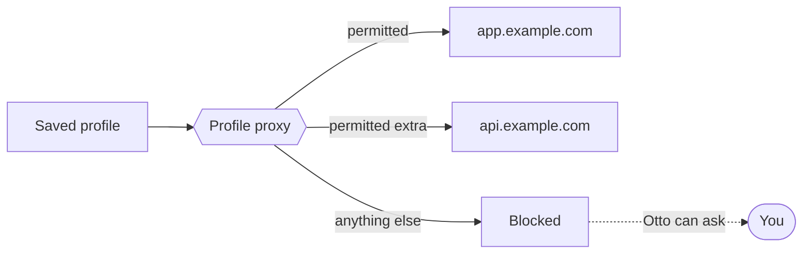

A saved browser session keeps a website signed in inside Otto's private browser, so later tasks can reuse it. Use one for sign-ins a saved login can't handle, such as a magic link or a code on your phone.

## Save a session

1. In **Vault**, select **New**, then **Website session**.
2. Enter the **Website address** and, if you like, an **Account name**. Select **Continue in chat**.
3. Otto opens the website in a new private browser profile. Sign in through the secure form, or take over the browser yourself.
4. Otto saves the session once it sees you're signed in.

You can also ask Otto in chat to connect to a website and save the session.

## Use a session

When a task needs the website, Otto opens the saved profile. It's the same permission check as a saved login: the server checks that your task needs this website and account, or Otto asks "Use your saved session on example.com?".

Opening a profile doesn't prove it's still signed in, so Otto checks the page. If opening it lands on another website, such as a sign-in service, Vault shows **Sign-in needed** and a **Sign in again** button.

## Only the websites you allow

All network traffic from a saved profile goes through a proxy. It allows only the exact origins permitted for the current task, and blocks everything else, including requests made by the page's own scripts. This covers page loads, HTTP and HTTPS requests and WebSocket connections.

Many sites also load assets, call APIs or redirect to a sign-in service on other origins. Blocked origins show up in what Otto sees, so it can request them as extra destinations, up to 20 at a time. One review covers the whole set, and each origin needs permission.

## When the browser stays signed in

| Situation                                     | What happens                                                                          |
| --------------------------------------------- | ------------------------------------------------------------------------------------- |
| The same task continues                       | The browser stays signed in                                                           |
| A new request from you within 30 minutes      | Every website and account in use is checked again. If one fails, it starts signed out |
| Any other new task, including a scheduled run | Starts signed out. Otto can reopen a saved session after the usual check              |
| Background work and read-only work            | Always starts signed out and can't open saved sessions                                |

## Sign out

Open the session in **Vault → Saved** and select **Sign out**. This deletes the saved profile. If a task is using it, stop the task first.

## Passkeys and manual sign-in

Passkeys are turned on in Otto's browser, but they need an authenticator that the browser can reach. Otto doesn't create one. For a passkey, a magic link or any step Otto can't finish, Otto asks you to take over its browser. See [Otto's browser](/use/browser/).

## Saved session or saved login?

|                  | Saved login                                            | Saved session                                 |
| ---------------- | ------------------------------------------------------ | --------------------------------------------- |
| What's stored    | Username and password, encrypted by Vault              | The browser profile: cookies and site storage |
| How you add it   | **New login**, an import or the private form           | Sign in once in Otto's browser                |
| How Otto uses it | The server types the values into the fields Otto picks | Otto opens the signed-in profile              |
| Where it works   | Fields on the login's exact origin                     | Origins the proxy permits for the task        |
| Best for         | Username and password sign-in                          | Sign-ins you do by hand, such as magic links  |

:::caution
Once signed in, Otto can act anywhere on that website. Vault doesn't review each click. A saved session is browser data kept with Otto's other data, and Vault doesn't encrypt it, so protect your computer and backups.
:::

## Where this is enforced

[`src/server/browser-connections.ts`](https://github.com/n8n-io/otto/blob/main/src/server/browser-connections.ts) (sessions) · [`src/server/vault-access.ts`](https://github.com/n8n-io/otto/blob/main/src/server/vault-access.ts) (permission and sign-out on a new task) · [`src/providers/agent-browser/network.ts`](https://github.com/n8n-io/otto/blob/main/src/providers/agent-browser/network.ts) (profile proxy)

## Related resources

- [Trust and Vault](/trust/)
- [Vault and saved logins](/trust/vault/)
- [Otto's browser](/use/browser/)
- [Security model and limits](/trust/security-model/)
