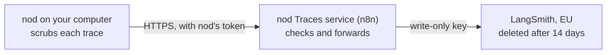

Conversation traces let the nod team at n8n see how nod handles real requests, so they can find and fix problems. They're off until you turn them on, and nod removes personal details on your computer before anything leaves.


## Turn traces on or off

1. Open **Settings → General**.
2. Turn on **Share conversation traces**.

Turn the switch off to stop sending at once. A trace that was already on its way can still arrive. Traces already sent are deleted when they expire, 14 days after they arrive.

The switch is separate from **Share usage data**, and you can turn either on without the other. It appears in the official desktop app. A source install shows it only when an operator sets `NOD_TRACES_URL` and `NOD_TRACES_TOKEN` (see [Configuration](/deploy/configuration/#analytics-and-feedback)).

## What a trace contains

While the switch is on, each request nod makes to your model becomes one trace, from chats, tasks, helpers and background checks.

| Sent, after scrubbing                                                     | Never sent                                                     |
| ------------------------------------------------------------------------- | -------------------------------------------------------------- |
| The messages and tool results the model saw for that request              | Your account, installation or device identifier                |
| nod's instructions, without your saved memory, learned skills and formats | Images, which become `[image]`                                 |
| The names of the tools the model could use                                | Saved passwords, codes and cards, which nod's model never sees |
| The model's reply                                                         | Checks of emails that may give access to an account            |
| The model name, token counts and cost                                     | Requests to decision services                                  |
| Whether it came from chat, a task, a helper or a background check         | Your usage analytics, which have their own switch              |

n8n's service sees your IP address when it receives a trace, as it does for update checks. It doesn't add the address to the trace.

## What nod removes first

Every trace passes through these layers on your computer before it's sent.

| Layer                       | What it removes                                                                                     | How it decides                                               |
| --------------------------- | --------------------------------------------------------------------------------------------------- | ------------------------------------------------------------ |
| Known secrets               | Keys you saved, model and app keys, nod's own tokens, and text shaped like a key, token or password | The exact values nod knows, plus known key formats           |
| Secret fields               | The value of fields such as `password`, `token` or `api_key` in tool arguments and app data         | The field name                                               |
| Your name                   | The name on each Gmail account you connected, in full or in part                                    | An exact match                                               |
| Email addresses             | Every address, and the name written beside one, as in `Jane Doe <jane@example.com>`                 | The address format                                           |
| Phone numbers               | Numbers that are valid in a country's numbering plan, using your region for local formats           | Google's libphonenumber rules                                |
| Payment cards               | Card numbers from Visa, Mastercard, American Express and other issuers                              | The issuer prefix and the Luhn checksum                      |
| Bank accounts               | IBANs                                                                                               | The country's length and the IBAN checksum                   |
| Crypto wallets              | Bitcoin and Ethereum addresses                                                                      | The Bitcoin address checksum, or the Ethereum address format |
| ID numbers                  | US Social Security, Spanish DNI and NIE, UK National Insurance, Brazilian CPF and Indian Aadhaar    | Each format's check digit or rules                           |
| Network addresses           | IPv4, IPv6 and MAC addresses                                                                        | Address validation                                           |
| Personal fields in app data | The value of fields such as `first_name`, `displayName`, `birthday`, `address` or `phone`           | The field name, whatever the value's type                    |

Here's a synthetic request before and after scrubbing, for an owner called Marta in Spain:

```text title="What the model saw"
Tell Jordi Serra <jordi.serra@example.com> I paid invoice 2026-114 with card 4111 1111 1111 1111.
He can call me on 612 345 678 or at the office, 203.0.113.42. Thanks, Marta
```

```text title="What the trace contains"
[name] <[email]> I paid invoice 2026-114 with card [card].
He can call me on [phone] or at the office, [ip]. Thanks, [owner]
```

The invoice number stays, because it isn't personal. Checks that need a valid number, such as the card checksum, keep ordinary numbers like order IDs and dates.

:::caution[Removal is automatic]
nod removes what it can recognize. A trace can still contain personal details written in other forms, such as another person's name in a sentence or a street address in plain text. Turn traces on only if you're comfortable with that.
:::

## How traces avoid identifying you

- **No account or device ID.** A trace carries no account, installation or device identifier, and no analytics ID.
- **IDs that expire.** The traces of one conversation are grouped under a random ID so the team can read them in order. The ID is a keyed hash that changes every day and whenever nod restarts. It can't be used to link traces to you, to other days or to other nod data such as feedback reports.
- **No owner context.** nod replaces your saved memory, learned skills and format preferences with `[owner context omitted]`.
- **No images.** Images are replaced with `[image]`.

These steps remove the direct links to you. What a conversation says can still identify you, for example a detail the scrubber doesn't recognize, so treat traces as private data rather than anonymous data.

## Where traces go



1. nod sends each scrubbed trace to n8n's **nod Traces** service. The service refuses requests without the token in official nod builds. It checks the trace's shape and size, files it in the `nod` project, and keeps no copy of the request. It forwards about 600 traces per clock minute from all senders combined, a best-effort cap that limits the cost of misuse.
2. The service writes the trace to n8n's LangSmith workspace in the EU with a tracing key that can write traces but can't read them. nod itself never holds a LangSmith key.
3. LangSmith deletes each trace 14 days after it arrives. People at n8n with access to that workspace can read traces until then.

n8n uses traces to find and fix problems in nod. It doesn't use them to train AI models.

:::note[The token isn't a secret from you]
Anyone who unpacks the desktop app can read the token it sends. The token keeps out scanners and stray requests. The real protection is the scrubbing on your computer, the checks in the service and the write-only key.
:::

## For operators

| Variable           | What it does                                                                                  |
| ------------------ | --------------------------------------------------------------------------------------------- |
| `NOD_TRACES_URL`   | The HTTPS address that receives traces. An empty value turns traces off for everyone.         |
| `NOD_TRACES_TOKEN` | The token sent as `x-nod-traces-token`. Without it, nod sends no traces and hides the switch. |

Official desktop builds take the token from the `NOD_TRACES_TOKEN` secret of the `release` environment, and only the packaging steps can read it. The service is defined in [`deployment/n8n/traces.mjs`](https://github.com/n8n-io/nod/blob/main/deployment/n8n/traces.mjs). It uses two n8n credentials: **nod traces webhook** holds the token and **nod LangSmith traces** holds the LangSmith tracing key. The tracing key expires after one year. Create a new **Tracing Only** key in LangSmith and update the credential before then. To change the token, update the n8n credential and the release secret together. Desktop builds made with the old token stop sending until people update.

## Where this is enforced

[`src/server/traces.ts`](https://github.com/n8n-io/nod/blob/main/src/server/traces.ts) (switch, layers and anonymous IDs) · [`src/server/personal-data.ts`](https://github.com/n8n-io/nod/blob/main/src/server/personal-data.ts) (personal data detectors) · [`src/providers/pi/traces.ts`](https://github.com/n8n-io/nod/blob/main/src/providers/pi/traces.ts) (images and owner context) · [`src/providers/n8n/traces.ts`](https://github.com/n8n-io/nod/blob/main/src/providers/n8n/traces.ts) (sending) · [`deployment/n8n/traces.mjs`](https://github.com/n8n-io/nod/blob/main/deployment/n8n/traces.mjs) (the service)

## Related resources

- [Your data and privacy](/trust/privacy/)
- [Security review guide](/trust/security-review/)
- [Security model and limits](/trust/security-model/)
- [Trust and Vault](/trust/)
