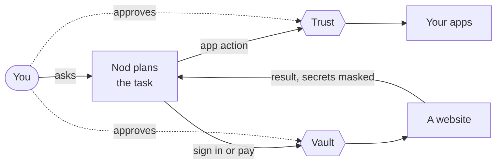

import { Card, CardGrid, LinkCard } from '@astrojs/starlight/components';
import trustVideo from '../../../assets/video/trust-layer.mp4?url';
import trustPoster from '../../../assets/video/trust-layer-poster.jpg?url';
import trustCaptions from '../../../assets/video/trust-layer.vtt?url&no-inline';

Trust decides what Nod can do in your apps and on websites. Vault decides how Nod uses your saved logins and cards, and it never shows them to the model.

Nod can sign in to a website, read a report, prepare a reply and complete a checkout. The model plans that work. A separate check decides which app actions, browser steps and sign-ins can run. It sees your words and the action, never the pages or emails Nod read: for a browser step, that's the website, the control's label and what Nod typed. It asks you when your words don't cover the action. Every payment waits for your approval.

<video
  controls
  preload="none"
  poster={trustPoster}
  width="1920"
  height="1080"
  aria-label="A narrated overview of Trust and Vault in Nod"
>
  <source src={trustVideo} type="video/mp4" />
  <track kind="captions" src={trustCaptions} srclang="en" label="English" />
</video>

Watch a narrated overview with synthetic data. The scenes show example states from the app. The model check can make mistakes.

<CardGrid>
  <LinkCard
    title="Our trust principles"
    href="/trust/principles/"
    description="Seven commitments, and how the server keeps them."
  />
  <LinkCard
    title="How Nod compares"
    href="/trust/compare/"
    description="Nod next to Instinct, Meta Muse and OpenAI dots."
  />
  <LinkCard
    title="Security review guide"
    href="/trust/security-review/"
    description="Data flows, threats and controls for security teams."
  />
</CardGrid>

## Two jobs, two paths

|                  | Trust                                                   | Vault                                                  |
| ---------------- | ------------------------------------------------------- | ------------------------------------------------------ |
| Protects         | Actions in your connected apps                          | Saved logins, verification codes and cards             |
| Checks           | The action and its arguments as Nod sends them          | The task, the saved account and the exact website      |
| Asks you when    | Your words don't cover an action beyond a read or draft | Nod wants an account you haven't allowed for this task |
| The model sees   | The action and its result                               | Account names and status, never the secret             |
| You review it in | The confirmation in chat and **Usage**                  | **Usage**                                              |

## Three rules behind everything

<CardGrid>
  <Card title="Authority comes from you" icon="approve-check-circle">
    Nod is designed so that only you give it permission, through your messages, approvals and the
    instructions you set, never a web page, email or file.
  </Card>
  <Card title="Secrets have their own path" icon="padlock">
    The server enters saved values into the website. The model never receives them.
  </Card>
  <Card title="One use, one result" icon="random">
    An approved action runs once. If the outcome is unclear, Nod says so. You check the result, or
    ask Nod to, before any new attempt.
  </Card>
</CardGrid>

## What Nod does in common cases

| You ask Nod to                                         | What happens                                                                                                                                                                                                                                                                        |
| ------------------------------------------------------ | ----------------------------------------------------------------------------------------------------------------------------------------------------------------------------------------------------------------------------------------------------------------------------------- |
| Read your calendar or inbox                            | It runs.                                                                                                                                                                                                                                                                            |
| Draft a reply                                          | It runs.                                                                                                                                                                                                                                                                            |
| Add an event, send an email or delete files            | A review checks it matches your request, then it runs. If it doesn't match, Nod asks.                                                                                                                                                                                               |
| Email a recipient you didn't ask it to contact         | The review finds no permission for that recipient, so Nod asks.                                                                                                                                                                                                                     |
| Sign in to a site with a saved login                   | Vault checks the account and website, then fills in the password privately.                                                                                                                                                                                                         |
| Pay at a checkout                                      | You approve that one payment with your card's security code, which Nod never saves.                                                                                                                                                                                                 |
| Do something while it reacts to a new email on its own | It does what you told it to do on its own, such as forwarding Ana's invoices to accounting@acme.com, unless a rule says to ask first. Anything else waits for you unless a rule allows it. Separately, it reads your apps and can nudge you about work it prepared, without acting. |

:::note[Asked once]
Nod doesn't add its own confirmation on top of these checks, which ask you whenever your words don't cover an action. Nod itself asks only when the account, target or action is unclear.
:::

## Where you see and change things

- **Usage** in the sidebar (⌘5 in the Mac app, Ctrl+5 in the Windows or Linux app) shows what Nod did and spent: app actions, sign-ins, card uses, questions and held attempts, with costs when pricing is available. For API models, the summary shows this month's spending and monthly limit; select a value to inspect or change it. With a subscription such as ChatGPT, it shows plan usage without costs or limit controls. Activities with an available chat message open that message; sign-ins and card uses open their saved Vault item when it is still available.
- **Chat** is where you ask Nod to show or change [standing instructions](/trust/approvals/#standing-instructions), [rules](/trust/approvals/#your-rules) and [task check-ins](/use/spending/#task-check-ins).
- **Vault** (⌘6 or Ctrl+6) lists your logins, cards and saved browser sessions. Edit or remove logins and cards, and sign out of sessions.
- **Settings → Memory** shows what Nod remembers about you and where it learned it.

## In this section

- [Our trust principles](/trust/principles/): the seven commitments behind Nod's design.
- [How Nod compares](/trust/compare/): Nod next to other assistants that act for you.
- [Security review guide](/trust/security-review/): what a security team needs to assess Nod.
- [Approvals and the trust check](/trust/approvals/): which app actions run directly and which wait for you.
- [Untrusted content](/trust/untrusted-content/): how Nod treats pages, emails and files that try to give it instructions.
- [Vault and saved logins](/trust/vault/): add logins, sign in privately and review activity.
- [Saved browser sessions](/trust/browser-sessions/): reuse a signed-in browser on the websites you allow.
- [Payments](/trust/payments/): approve one checkout with a saved card.
- [One use, one result](/trust/outcomes/): why approved work never runs twice.
- [Your data and privacy](/trust/privacy/): where your assistant stores data and what it sends to other services.
- [Conversation traces](/trust/conversation-traces/): what the optional traces contain, what Nod removes first and how they avoid identifying you.
- [Security model and limits](/trust/security-model/): the exact boundaries, and what they don't cover.
