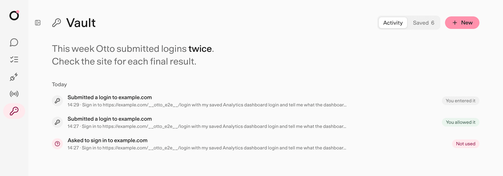

import { Card, CardGrid, LinkCard } from '@astrojs/starlight/components';

Trust decides what Otto can do in your apps. Vault decides how Otto uses your saved logins and cards, and it never shows them to the model.

Otto can sign in to a website, read a report, prepare a reply and complete a checkout. The model plans that work. The Otto server, not the model, decides which app actions, sign-ins and payments can run, and you can read every rule it applies.

<CardGrid>
  <LinkCard
    title="Our trust principles"
    href="/trust/principles/"
    description="Seven commitments, and how the server keeps them."
  />
  <LinkCard
    title="How Otto compares"
    href="/trust/compare/"
    description="Otto next to Instinct, Meta Muse and OpenAI dots."
  />
  <LinkCard
    title="Security review guide"
    href="/trust/security-review/"
    description="Data flows, threats and controls for security teams."
  />
</CardGrid>

## Two jobs, two paths

|                  | Trust                                                    | Vault                                                   |
| ---------------- | -------------------------------------------------------- | ------------------------------------------------------- |
| Protects         | Actions in your connected apps                           | Saved logins, verification codes and cards              |
| Checks           | The action and its arguments as Otto sends them          | The task, the saved account and the exact website       |
| Asks you when    | An action beyond a read or draft isn't in your request   | Otto wants an account you haven't allowed for this task |
| The model sees   | The action and its result                                | Account names and status, never the secret              |
| You review it in | The confirmation in chat and **Settings → Trust & cost** | **Vault → Activity**                                    |

## Three rules behind everything

<CardGrid>
  <Card title="Authority comes from you" icon="approve-check-circle">
    A web page, email or file can't give Otto permission. Only your messages and approvals can.
  </Card>
  <Card title="Secrets have their own path" icon="padlock">
    The server enters saved values into the website. The model never receives them.
  </Card>
  <Card title="One use, one result" icon="random">
    An approved action runs once. If the outcome is unclear, Otto says so. You check the result, or
    ask Otto to, before any new attempt.
  </Card>
</CardGrid>

## What Otto does in common cases

| You ask Otto to                                        | What happens                                                                                     |
| ------------------------------------------------------ | ------------------------------------------------------------------------------------------------ |
| Read your calendar or inbox                            | It runs.                                                                                         |
| Draft a reply                                          | It runs.                                                                                         |
| Add an event, send an email or delete files            | A review checks it matches your request, then it runs. If it doesn't match, Otto asks.           |
| Email an address it found on a web page                | The review doesn't find it in your request, so Otto asks.                                        |
| Sign in to a site with a saved login                   | Vault checks the account and website, then fills in the password privately.                      |
| Pay at a checkout                                      | You approve that one payment with your card's security code, or a yes if **Do it for me** is on. |
| Do something while it reacts to a new email on its own | It only reads and drafts. Anything else waits for you.                                           |

:::note[The model still uses judgement]
These checks are a floor under Otto's own instructions, not a replacement. Otto also asks before a destructive action that your request doesn't clearly cover.
:::

## Where you see and change things

- **Vault → Saved** lists your logins, cards and saved browser sessions. Edit them, remove them or turn **Sign in without asking** on or off.
- **Vault → Activity** shows every use, question, held attempt, reveal and permission change for 90 days.
- **Settings → Trust & cost** shows what Otto spent on models and what it did in your apps. You can set a monthly spending limit.
- **Settings → Memory** shows what Otto remembers about you and where it learned it.

## In this section

- [Our trust principles](/trust/principles/): the seven commitments behind Otto's design.
- [How Otto compares](/trust/compare/): Otto next to other assistants that act for you.
- [Security review guide](/trust/security-review/): what a security team needs to assess Otto.
- [Approvals and the trust check](/trust/approvals/): which app actions run directly and which wait for you.
- [Untrusted content](/trust/untrusted-content/): how Otto treats pages, emails and files that try to give it instructions.
- [Vault and saved logins](/trust/vault/): add logins, sign in privately and review activity.
- [Saved browser sessions](/trust/browser-sessions/): reuse a signed-in browser on the websites you allow.
- [Payments](/trust/payments/): approve one checkout with a saved card.
- [One use, one result](/trust/outcomes/): why approved work never runs twice.
- [Your data and privacy](/trust/privacy/): what stays on your computer and what leaves it.
- [Security model and limits](/trust/security-model/): the exact boundaries, and what they don't cover.
