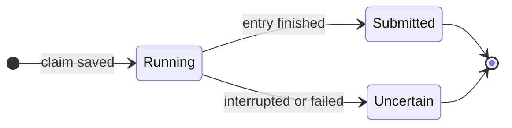

Nod never runs an approved action or a private entry twice. If it can't tell whether something happened, it says so, and you check before anyone tries again.

## A claim before every private step

Before the server enters a saved login, a code or a card, it saves a claim in its database. Each operation can be claimed once. Two open tabs, two replies or a lost response can't run it a second time.

| State     | What it means                                                         | What happens next                       |
| --------- | --------------------------------------------------------------------- | --------------------------------------- |
| Running   | The server is entering and submitting the values                      | Nod waits                               |
| Submitted | The values were entered, and any chosen submit button was pressed     | Nod reads the page to see if it worked  |
| Uncertain | The step may have reached the website, but the result wasn't recorded | Check the result before another attempt |

**Submitted** doesn't mean the sign-in or payment succeeded. Only the website knows that, so Nod checks the page.

**Uncertain** means the step may have reached the website. Nod keeps the claim and never replays it. Ask Nod to look at the page, the order or the account first. A new attempt is a new, explicit request.

## Confirmed app actions work the same way

When you say yes to an app action, the server runs that saved action once, and the task continues from the result. If the action can no longer run, for example because the account was disconnected after Nod asked, nothing is sent and the task continues knowing that. If it fails or is interrupted, it becomes uncertain, and Nod asks you to check the app before trying again. It never runs again on its own.

## Tasks and actions aren't retried

| What                                   | If it fails                                                                                                                                            |
| -------------------------------------- | ------------------------------------------------------------------------------------------------------------------------------------------------------ |
| A task                                 | It ends with a message asking you to check what happened, or say continue                                                                              |
| A tool call                            | It isn't repeated                                                                                                                                      |
| A confirmed app action                 | It becomes uncertain                                                                                                                                   |
| A private entry or payment             | It becomes uncertain                                                                                                                                   |
| A saved login that doesn't get through | Nod checks the page and doesn't enter that login again in the task. The next try opens the private form, where you pick a login or type a new password |
| A model request                        | A temporary provider error is retried up to three times                                                                                                |

## Stop and restarts

**Stop** cancels running, queued and waiting tasks. A form or code you submit late can't restart them. Stop can't undo anything that already reached a website or app. If you stop just after approving an app action, Nod still learns whether it ran, or that its result is uncertain, the next time you write in that conversation or task.

After Nod restarts, any claim or confirmed action that was still running becomes uncertain. Nothing that was in progress runs again.

:::tip
When Nod says a result is uncertain, ask it to check: "Did the order go through?" It reads the page or app without submitting again.
:::

## Where this is enforced

[`src/server/vault-use.ts`](https://github.com/n8n-io/nod/blob/main/src/server/vault-use.ts) (claims and states) · [`src/server/approvals.ts`](https://github.com/n8n-io/nod/blob/main/src/server/approvals.ts) (confirmed actions) · [`src/server/payments.ts`](https://github.com/n8n-io/nod/blob/main/src/server/payments.ts) (payment outcomes)

## Related resources

- [Trust and Vault](/trust/)
- [Approvals and the trust check](/trust/approvals/)
- [Vault and saved logins](/trust/vault/)
- [Payments](/trust/payments/)
