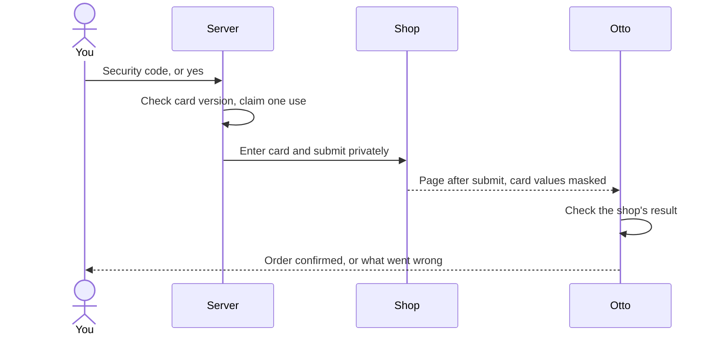

import { Badge, Steps } from '@astrojs/starlight/components';

Otto can complete a checkout with a card saved in Vault, but only after you approve that one payment. The model never sees the card number or security code.

<Badge text="Desktop and source installs" variant="note" />

## Save a card

<Steps>

1. Open **Vault**, select **New**, then **New payment card**.
2. Enter a **Name**, the **Cardholder name**, **Card number** and **Expiry date**.
3. Select **Save**. Saving a card doesn't approve any payment.

</Steps>

If Otto reaches a checkout and you have no card saved, it points you to this form. Save the card, then tell Otto to continue.

## Approve one payment

When Otto has filled in the rest of the checkout, it prepares one payment request. Before you see it, the browser reads the real origin of each card field. The request is bound to:

| Bound to                 | What it means                                                 |
| ------------------------ | ------------------------------------------------------------- |
| The card and its version | Editing the card or its permission cancels the request        |
| The shop                 | The origin of the checkout page                               |
| The checkout page        | The exact page Otto prepared                                  |
| Card-field destinations  | The real origin of every card field, including payment frames |
| The submit button        | The one control Otto chose                                    |
| Amount and currency      | As shown on the page                                          |

The request expires after ten minutes. A newer message from you, a changed card or **Stop** also makes it unusable.

In Otto web or desktop, Otto shows the checkout with the card fields hidden and asks, for example "Pay €7.99 at shop.example.com with Visa ••4242?". Reply with the card's security code. Otto web sends it privately, so it never reaches the model or the chat history.

### Approve with a yes

Turn on **Do it for me** for a card and a yes is enough. Otto keeps the card's security code, entered in the card form or at your next payment. Each payment still needs your yes.

- Turn it on in the card's form in Vault, or ask Otto. Otto then asks a yes/no question for that exact card and setting.
- It can be turned on only from a message in the Otto app, not from Telegram or WhatsApp.
- Turning it off deletes the saved code.
- If a page in the task contained [instructions aimed at AI assistants](/trust/untrusted-content/), a yes isn't enough and Otto asks for the code.

### From Telegram or WhatsApp

Chat apps can't approve payments or receive security codes. Otto asks you to open the same conversation in Otto on your desktop, where the **Approve payment** form waits. After you approve, Otto replies in the original chat.

## What happens after you approve

**Card submitted is not paid.** Vault records that the card was submitted, with the amount. Otto then reads the shop's page and tells you the result, because only the shop and your bank decide whether the payment went through. If the operation was interrupted, Vault shows **Result unknown**: check the order before you try again. See [One use, one result](/trust/outcomes/).

## When Otto never pays

- Background work Otto starts itself, and read-only work.
- Hosted Otto. It refuses to store new cards, change cards or pay.
- With an expired, replaced or already-used request.

:::caution[Limits]
A saved card can't make your card issuer enforce the amount or the shop. Otto binds its own operation, but a website can still change the cart. **Do it for me** stores a security code only with your consent, and this isn't a PCI DSS compliance claim: PCI SSC prohibits storing card verification codes after authorization for entities in scope. See [PCI SSC FAQ 1280](https://www.pcisecuritystandards.org/faqs/1280/).
:::

## Where this is enforced

[`src/server/payments.ts`](https://github.com/n8n-io/otto/blob/main/src/server/payments.ts) (request, approval and Do it for me) · [`src/server/vault-use.ts`](https://github.com/n8n-io/otto/blob/main/src/server/vault-use.ts) (one use) · [`src/server/trust.ts`](https://github.com/n8n-io/otto/blob/main/src/server/trust.ts) (when payment is allowed)

## Related resources

- [Trust and Vault](/trust/)
- [Vault and saved logins](/trust/vault/)
- [One use, one result](/trust/outcomes/)
- [Your data and privacy](/trust/privacy/)
