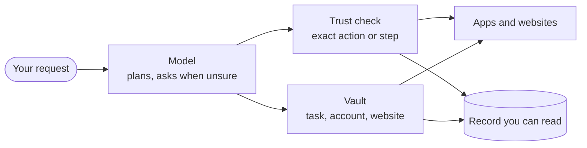

import { Card, CardGrid, LinkCard } from '@astrojs/starlight/components';

An assistant that acts for you is only worth having if you can trust it when you're not watching. These are the seven commitments Nod is built on.

Most assistants ask you to trust the company behind them. Nod's rules are enforced by a server, not by a model's good behaviour. They run where you choose, in code you can read, and they leave a record you can check.

<CardGrid>
  <Card title="1. Authority comes only from you" icon="approve-check-circle">
    Nothing Nod reads can give it permission.
  </Card>
  <Card title="2. The model never sees your secrets" icon="padlock">
    Passwords, codes and card numbers stay out of it.
  </Card>
  <Card title="3. Exact actions, run once" icon="random">
    You approve one specific action. It never repeats on its own.
  </Card>
  <Card title="4. You can see everything" icon="list-format">
    Every use, cost and app action is on record.
  </Card>
  <Card title="5. Your computer, your model" icon="laptop">
    Nod runs where you choose, with the provider you choose.
  </Card>
  <Card title="6. Open by default" icon="github">
    Open source code. Analytics you can turn off at any time.
  </Card>
  <Card title="7. Honest about limits" icon="warning">
    Every control says what it doesn't cover.
  </Card>
</CardGrid>

## Layers, not a single gate

No single check makes an AI assistant safe, so Nod stacks independent ones. The model's judgement is the first layer, never the last.

## 1. Authority comes only from you

Web pages, emails, files and app results are data. Only your messages, the instruction that created a schedule, your standing instructions, your rules and your explicit approvals can authorize an action, and Usage shows the words behind each action they allowed. A rule that says to ask first makes Nod ask even when your request covers the action.

- Reads and drafts run. Anything else needs authority from you: your request, or your yes.
- Your request covers the steps it takes and stops there. "Buy it from that shop" covers the cookie banner, the basket and the order there. "Move my 3pm and tell Lena" covers the event and the email to Lena. Neither covers anything else.
- Asking for help with a problem leaves Nod free to read and prepare. When you haven't chosen the outside commitment, Nod asks before sending, submitting or booking. A short yes can accept a concrete proposal; advice listing possible remedies isn't one.
- When intent must be judged, a separate review sees only your messages, your rules and the action, never the content that suggested it.
- Work Nod starts on its own can only read, draft and do what you told it to do on its own.

[How approvals work →](/trust/approvals/)

## 2. The model never sees your secrets

The model picks the account and the fields. The server fills in the value.

- Vault checks the task, the account and the website's exact origin before it uses a saved value.
- The value is typed into the verified field privately, and masked in everything the model sees afterwards.
- Model provider keys never enter the sandbox, the browser or a prompt.

[How Vault works →](/trust/vault/)

## 3. Exact actions, run once

An approval isn't a general "go ahead". It binds one action with its exact arguments.

- Changing a recipient, an amount or a payload needs new authority.
- A saved claim makes sure an approved action can't run twice, even after a double tap or a crash. If Nod tries the same action again for that request, it gets the first result.
- No action is retried automatically. If the outcome is unclear, Nod says so, and you check before anyone tries again.

[One use, one result →](/trust/outcomes/)

## 4. You can see everything

The full record is for every user, not an enterprise add-on.

- **Usage** shows what every request cost, every app change, send or deletion that ran, and every use of a saved item, question and held attempt.
- A monthly spending limit stops schedules, tasks and background work before their next model call. Nod sets it to $200 when you finish setup; earlier setups have none until you set one. Once it's reached, Nod still answers your messages, but only to raise or remove the limit, which you can also do in **Usage**. A task checks in with you once its spending since your last message passes the check-in amount you set.

[Spending and usage →](/use/spending/)

## 5. Your computer, your model

With a local desktop or source install, Nod's server, database, workspace and browser run on your computer. With a [self-hosted server](/deploy/self-host/), they run on that server, and your web or desktop clients reach the same assistant.

- You bring your own model provider and pay it directly.
- Commands run in a sandbox with no access to your files or keys.

[Your data and privacy →](/trust/privacy/)

## 6. Open by default

You shouldn't have to trust a security claim you can't check.

- Nod is open source under the Apache License 2.0, including the trust check, Vault and their tests.
- Usage analytics are on by default for new owners, existing saved choices stay as they are, and they stop when you turn off **Share usage data**. Usage analytics never capture screen recordings or session replays.
- Conversation traces stay off until you turn on **Share conversation traces**, and Nod removes personal details before any leave.
- Feedback reaches its configured recipient only when you send it. A diagnostic report is selected by default, with an exact preview and an option to leave it out. Redaction can miss personal details, so review it first.

[Analytics →](/deploy/analytics/)

## 7. Honest about limits

Security that overstates itself is worse than none, because people rely on it.

- The review is a best-effort judge and can be wrong.
- A website receives the values you let Nod submit, and can keep them.
- The Nod server can read saved values while it uses them.

[Security model and limits →](/trust/security-model/)

## Related resources

<CardGrid>
  <LinkCard
    title="How Nod compares"
    href="/trust/compare/"
    description="Nod next to other assistants that act for you."
  />
  <LinkCard
    title="Security review guide"
    href="/trust/security-review/"
    description="Data flows, controls and evidence for security teams."
  />
</CardGrid>
