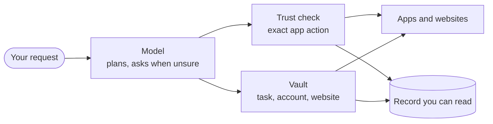

import { Card, CardGrid, LinkCard } from '@astrojs/starlight/components';

An assistant that acts for you is only worth having if you can trust it when you're not watching. These are the seven commitments Otto is built on.

Most assistants ask you to trust the company behind them. Otto's rules are enforced by a server, not by a model's good behaviour. They run where you choose, in code you can read, and they leave a record you can check.

<CardGrid>
  <Card title="1. Authority comes only from you" icon="approve-check-circle">
    Nothing Otto reads can give it permission.
  </Card>
  <Card title="2. The model never sees your secrets" icon="padlock">
    Passwords, codes and card numbers stay out of it.
  </Card>
  <Card title="3. Exact actions, run once" icon="random">
    You approve one specific action. It never repeats on its own.
  </Card>
  <Card title="4. You can see everything" icon="list-format">
    Every use, cost and app action is on record.
  </Card>
  <Card title="5. Your computer, your model" icon="laptop">
    Otto runs where you choose, with the provider you choose.
  </Card>
  <Card title="6. Open by default" icon="github">
    Open source code. Analytics off until you opt in.
  </Card>
  <Card title="7. Honest about limits" icon="warning">
    Every control says what it doesn't cover.
  </Card>
</CardGrid>

## Layers, not a single gate

No single check makes an AI assistant safe, so Otto stacks independent ones. The model's judgement is the first layer, never the last.

## 1. Authority comes only from you

Web pages, emails, files and app results are data. Only your messages, the instruction that created a schedule, and your explicit approvals can authorize an action.

- Reads and drafts run. Anything else needs authority from you: your request, or your yes.
- When intent must be judged, a separate review sees only your messages and the action, never the content that suggested it.
- Work Otto starts on its own can only read and draft.

[How approvals work →](/trust/approvals/)

## 2. The model never sees your secrets

The model picks the account and the fields. The server fills in the value.

- Vault checks the task, the account and the website's exact origin before it uses a saved value.
- The value is typed into the verified field privately, and masked in everything the model sees afterwards.
- Model provider keys never enter the sandbox, the browser or a prompt.

[How Vault works →](/trust/vault/)

## 3. Exact actions, run once

An approval isn't a general "go ahead". It binds one action with its exact arguments.

- Changing a recipient, an amount or a payload needs new authority.
- A saved claim makes sure an approved action can't run twice, even after a double tap or a crash.
- No action is retried automatically. If the outcome is unclear, Otto says so, and you check before anyone tries again.

[One use, one result →](/trust/outcomes/)

## 4. You can see everything

The full record is for every user, not an enterprise add-on.

- **Trust → Activity** shows what every request cost, every app change, send or deletion that ran, and every use of a saved item, question and held attempt.
- A monthly spending limit stops new work before the next model call. A task checks in with you once its spending since your last message passes the check-in amount you set.

[Spending and usage →](/use/spending/)

## 5. Your computer, your model

With the desktop app or a source install, Otto's server, database, workspace and browser run on your computer.

- You bring your own model provider and pay it directly.
- Commands run in a sandbox with no access to your files or keys.
- In hosted mode, every user gets a separate runtime, database role, key, browser and workspace.

[Your data and privacy →](/trust/privacy/)

## 6. Open by default

You shouldn't have to trust a security claim you can't check.

- Otto is open source under the Apache License 2.0, including the trust check, Vault and their tests.
- Usage analytics stay off until you turn on **Share usage data**, and recordings never show your content.
- Feedback reaches the Otto team only when you send it, and you can leave out the diagnostic report.

[Analytics and recordings →](/deploy/analytics/)

## 7. Honest about limits

Security that overstates itself is worse than none, because people rely on it.

- The review is a best-effort judge and can be wrong.
- A website receives the values you let Otto submit, and can keep them.
- The Otto server can read saved values while it uses them, and a hosting operator can decrypt hosted data.

[Security model and limits →](/trust/security-model/)

## Related resources

<CardGrid>
  <LinkCard
    title="How Otto compares"
    href="/trust/compare/"
    description="Otto next to other assistants that act for you."
  />
  <LinkCard
    title="Security review guide"
    href="/trust/security-review/"
    description="Data flows, controls and evidence for security teams."
  />
</CardGrid>
