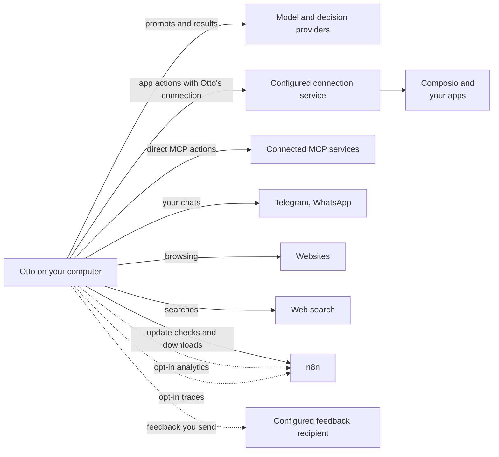

This page explains where Otto keeps your data, what leaves your computer and to whom, and how to delete it.

Desktop and source installs keep Otto's database, workspace and browser on your computer. Requests go to your model and decision providers, and the apps you choose. Composio app requests and results pass through the configured connection service and Composio. The default service is hosted by n8n; source installs can [select another trusted service](/deploy/configuration/#apps-and-composio).

The desktop app checks n8n's update service for new versions, which sees your IP address, app version and platform. Each check also sends a random ID that changes every week, so n8n can count installations each week. The update service sees that ID in the same request as your IP address, as it already sees your IP address on every check. It forwards the count to the Otto team's analytics with the platform and version, never your IP address, so weeks can't be linked there to each other or to you. See [Weekly installations](/deploy/analytics/#weekly-installations). Feedback, usage analytics and conversation traces are optional. An operator can configure a different feedback collector; the feedback dialog names its recipient before you send.

## Where your data lives

|                              | Desktop app                                                                                                                          | From source                                     |
| ---------------------------- | ------------------------------------------------------------------------------------------------------------------------------------ | ----------------------------------------------- |
| Otto server                  | Your computer                                                                                                                        | Your computer                                   |
| Database, workspace, browser | A private virtual machine on your computer                                                                                           | Docker containers on your computer              |
| Data folder                  | `~/Library/Application Support/Otto/` and `~/.otto-desktop/` on a Mac. `%APPDATA%\Otto\` and the `Otto-` WSL distribution on Windows | `.local/` (`OTTO_DATA_ROOT`) and Docker volumes |
| Who can read it              | You                                                                                                                                  | You                                             |

Unfinished setup interviews are encrypted in your installation’s private storage. Continuing saves your answers to memory and removes the draft text; **Change my answers** discards it without saving. An encrypted completion marker contains only a random interview identifier and expiry, so returning through setup does not save old answers again. Drafts and completion markers expire after 30 days and are discarded the next time Otto reads them. A completed interview can remain in the current tab while you go back through setup; that temporary copy is shown only while its completion marker is current and is cleared when onboarding finishes.

For what Otto stores and how long it keeps it, see the [Security review guide](/trust/security-review/#what-otto-stores).

## What leaves your computer

| Goes to                                   | What                                                                                                                                                                                                                                                                                                                                                                                                                                                                                                                                                                                                                                                                                                                                                                               |
| ----------------------------------------- | ---------------------------------------------------------------------------------------------------------------------------------------------------------------------------------------------------------------------------------------------------------------------------------------------------------------------------------------------------------------------------------------------------------------------------------------------------------------------------------------------------------------------------------------------------------------------------------------------------------------------------------------------------------------------------------------------------------------------------------------------------------------------------------- |
| The model provider you choose             | Your conversation, tool results and screenshots. With Gmail connected: your text from recent sent emails for writing style, plus inbox subjects and snippets for first tasks. Desktop and personal web installs can instead use the latest-message text from up to 40 recent inbox conversations for a setup summary. When an action needs your yes, the proposed action with its arguments and details is also sent to write and check the question, plus the page’s visible text for a browser step. Without a decision service, your replies to confirmations are read here too, and so are the sender, subject and text of each email Otto reads through your apps (up to 8,000 characters, the start and end of a longer one), to check whether it gives access to an account |
| Decision services                         | When one is set up (an OpenAI API or OpenRouter connection, or `TYPESAFE_API_KEY`), your replies to confirmations and the sender, subject and text of each email Otto reads through your apps, each checked on its own, instead of your model provider.                                                                                                                                                                                                                                                                                                                                                                                                                                                                                                                            |
| Apps and services you connect             | The actions Otto runs in them                                                                                                                                                                                                                                                                                                                                                                                                                                                                                                                                                                                                                                                                                                                                                      |
| Composio, if you connect apps through it  | Those app connections, the actions Otto sends and files attached to them, in the connection service operator's project. An attached file is uploaded only when its action runs, never for an action you decline                                                                                                                                                                                                                                                                                                                                                                                                                                                                                                                                                                    |
| Telegram and WhatsApp, if you set them up | The messages in those chats                                                                                                                                                                                                                                                                                                                                                                                                                                                                                                                                                                                                                                                                                                                                                        |
| Websites Otto visits                      | Whatever Otto browses, fills in or submits there                                                                                                                                                                                                                                                                                                                                                                                                                                                                                                                                                                                                                                                                                                                                   |
| Linked websites                           | Otto's server reads the start of each page linked in a reply and its preview image. Playing a video loads that site's player in your app, without the site's cookies                                                                                                                                                                                                                                                                                                                                                                                                                                                                                                                                                                                                               |
| Exa, for web search                       | Otto's search queries. With a ChatGPT plan, OpenAI runs the search instead                                                                                                                                                                                                                                                                                                                                                                                                                                                                                                                                                                                                                                                                                                         |
| n8n                                       | Composio app requests and results. Desktop update checks and downloads, which show your IP address, app version, platform and a random weekly ID. Masked usage analytics and scrubbed conversation traces if you opt in, and feedback when using the default collector                                                                                                                                                                                                                                                                                                                                                                                                                                                                                                             |
| Your configured feedback recipient        | Feedback and attachments you choose to send, including an optional diagnostic report                                                                                                                                                                                                                                                                                                                                                                                                                                                                                                                                                                                                                                                                                               |

Preview pages and images are fetched without your browser's cookies. After you select play, the embedded player receives Otto's origin as its referrer and runs without the site's cookies, in storage that is discarded when it closes. Otto checks that the player's address resolves to a public address when it prepares the preview, but those checks don't cover the player's later DNS answers, redirects or requests to other addresses.

OpenAI API connections use GPT Decisions at OpenAI. OpenRouter sends decision checks to TypeSafe. An optional `TYPESAFE_API_KEY` selects TypeSafe directly, regardless of your chat connection. See [Decision checks](/connect/models/#decision-checks) for routing and billing.

Otto creates a random cryptographic identity for each installation. The desktop app encrypts its private signing key with a key protected by the operating system. App updates preserve it. The connection service stores the public identity, admitted account references, usage counters and expiring connection state. It verifies signed requests and account ownership; knowing an identifier alone does not grant access.

You still authorize each app, such as Gmail, with its provider. No separate Google sign-in is needed to use the connection service. The Composio project key stays on that service. Your model keys stay encrypted on your installation. Provider keys never enter a prompt, Otto's workspace or its browser.

## What memory learns from

Memory notes come only from your own messages and the notes you add or import in **Settings → Memory**, never from Otto's replies, tool results or web pages. Otto also writes learned skills, the steps of a flow it did, from what it did and read; your model is told to replace names, contact details, account and order numbers, amounts and message content with placeholders, and Otto removes known secrets and refuses card numbers, keys and links with logins before it saves one. When you connect Gmail, your model also reads your recent sent email and writes one short note on your writing style. During setup, it can also summarise the latest-message text from up to 40 recent inbox conversations to suggest first tasks. That summary is never saved to memory and is deleted once the cards are posted. When no summary is available, task suggestions use recent subjects and snippets instead. The model is told to leave out facts, names and quotes, and Otto drops a note with an email address or link. See [Memory](/use/memory/).

## Delete your data

- **Memories.** Open **Settings → Memory**, select a note and choose **Forget**. This deletes the note and its earlier versions. You can also ask Otto to forget something.
- **Vault items.** Open the item in **Trust → Logins and cards** and delete it. For a saved browser session, select **Sign out**.
- **Apps.** Disconnect an app in **Apps**.
- **Everything.** In the desktop app, select **Remove all data** in **Settings → General**. Otto deletes your profile and private computer from the folders above, then quits. From source, stop Otto and delete its `OTTO_DATA_ROOT` folder (`.local/` by default) and its Docker volumes. Uninstalling the app alone keeps your data. A service you signed in to through Otto may still list Otto as a connected app until you remove it there.

:::caution
There's no button to clear only your chat history yet. **Remove all data** deletes it along with everything else.
:::

## Where this is enforced

[`src/server/memory-learning.ts`](https://github.com/n8n-io/otto/blob/main/src/server/memory-learning.ts) (memory sources) · [`src/server/analytics.ts`](https://github.com/n8n-io/otto/blob/main/src/server/analytics.ts) (analytics opt-in and events) · [`src/server/traces.ts`](https://github.com/n8n-io/otto/blob/main/src/server/traces.ts) and [`src/server/personal-data.ts`](https://github.com/n8n-io/otto/blob/main/src/server/personal-data.ts) (trace opt-in and scrubbing) · [`src/web/lib/analytics-privacy.ts`](https://github.com/n8n-io/otto/blob/main/src/web/lib/analytics-privacy.ts) (recording masks) · [`src/server/bug-report.ts`](https://github.com/n8n-io/otto/blob/main/src/server/bug-report.ts) (report redaction)

## Related resources

- [Trust and Vault](/trust/)
- [Security review guide](/trust/security-review/)
- [Security model and limits](/trust/security-model/)
- [Memory](/use/memory/)
