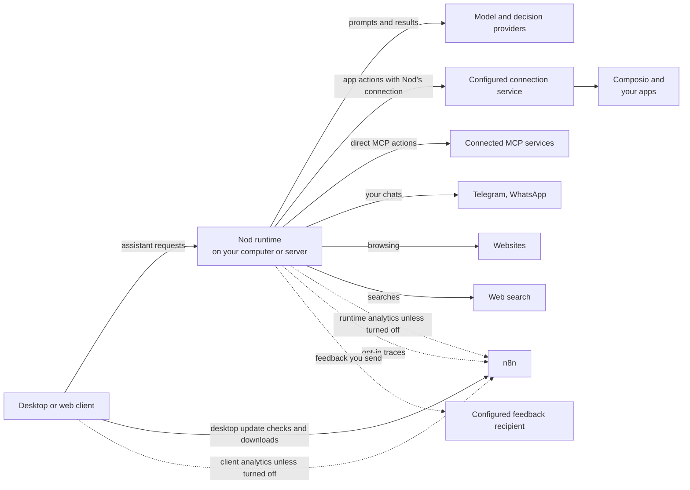

This page explains where Nod keeps your data, what it sends to other services, and how to delete it.

Local desktop and source installs keep Nod's database, workspace and browser on your computer. With a [self-hosted server](/deploy/self-host/), the server stores them along with your model credentials and Composio identity. Web and desktop clients reach that same assistant. Anyone administering the server or its storage may have access to its data.

Requests go to your model and decision providers, and the apps you choose. Composio app requests and results pass through the configured connection service and Composio. The default service is hosted by n8n; server and source installs can [select another trusted service](/deploy/configuration/#apps-and-composio).

The desktop app checks n8n's update service for new versions, which sees your IP address, app version and platform. Feedback, usage analytics and conversation traces are optional. An operator can configure a different feedback collector; the feedback dialog names its recipient before you send.

## Where your data lives

|                              | Local desktop assistant                                                                                                          | Local source install                           |
| ---------------------------- | -------------------------------------------------------------------------------------------------------------------------------- | ---------------------------------------------- |
| Nod server                   | Your computer                                                                                                                    | Your computer                                  |
| Database, workspace, browser | A private virtual machine on your computer                                                                                       | Docker containers on your computer             |
| Data folder                  | `~/Library/Application Support/nod/` and `~/.nod-desktop/` on a Mac. `%APPDATA%\nod\` and the `nod-` WSL distribution on Windows | `.local/` (`NOD_DATA_ROOT`) and Docker volumes |
| Who can read it              | You                                                                                                                              | You                                            |

A self-hosted server uses persistent Docker volumes and its private environment file; see [Storage and backups](/deploy/server-operations/). Connected desktop clients keep the server address and an OS-encrypted access token, plus preferences, drafts and temporary files. They do not create a separate assistant or Composio identity. Connecting does not move an existing local assistant to the server.

For what Nod stores and how long it keeps it, see the [Security review guide](/trust/security-review/#what-nod-stores).

Unsent chat drafts stay in app or browser storage on this device, for your account and conversation. They include text, reply targets, and uploaded file references. Private entry fields and recognized verification replies are excluded.

Unsent uploads become eligible for cleanup 24 hours after upload or their last renewal from an open draft. Existing eligible uploads get a fresh 24-hour grace period on the first upgrade that adds cleanup. Removing a file stops renewal. Nod reclaims eligible files in bounded batches on startup and every five minutes while running, so deletion can take longer when many files are due. Until cleanup claims a file for deletion, it can still be renewed or sent. After that, it is unavailable. Failed deletions are retried on later passes, including after restart. Sent attachments and published files are retained. New uploads use an owner-specific directory so interrupted writes can also be reclaimed. Older unreferenced files with no ownership record are preserved because Nod cannot safely attribute them.

Desktop file actions prepare private copies in the system temporary folder. The cache holds up to eight files. Saving creates a separate file in Downloads. Temporary copies remain until cache eviction or app shutdown. A forced stop can leave a temporary copy behind.

## What Nod sends to other services

For a remote assistant, model and app requests originate from the server. Desktop update checks, media playback and client analytics originate from the device you use.

| Goes to                                   | What                                                                                                                                                                                                                                                                                                                                                                                                                                                                                                                                                                                                                                                                                                                                                     |
| ----------------------------------------- | -------------------------------------------------------------------------------------------------------------------------------------------------------------------------------------------------------------------------------------------------------------------------------------------------------------------------------------------------------------------------------------------------------------------------------------------------------------------------------------------------------------------------------------------------------------------------------------------------------------------------------------------------------------------------------------------------------------------------------------------------------- |
| The model provider you choose             | Your conversation, tool results and screenshots. With Gmail connected: your text from recent sent emails for writing style, plus inbox subjects and snippets for first tasks. Desktop and personal web installs can instead use the latest-message text from up to 40 recent inbox conversations for a setup summary. When an action needs your yes, the proposed action with its arguments and details is also sent to write and check the question, plus the page’s visible text for a browser step. Without an email decision service, this connection also checks the sender, subject and text of each email Nod reads through your apps (up to 8,000 characters, the start and end of a longer one), to check whether it gives access to an account |
| Decision services                         | In `decision` mode: the complete action, your owner messages, rules and time zone, and replies to confirmations. Account-access email checks also send each email's sender, subject and text through the configured decision connection.                                                                                                                                                                                                                                                                                                                                                                                                                                                                                                                 |
| Apps and services you connect             | The actions Nod runs in them                                                                                                                                                                                                                                                                                                                                                                                                                                                                                                                                                                                                                                                                                                                             |
| Composio, if you connect apps through it  | Those app connections, the actions Nod sends and files attached to them, in the connection service operator's project. An attached file is uploaded only when its action runs, never for an action you decline                                                                                                                                                                                                                                                                                                                                                                                                                                                                                                                                           |
| Telegram and WhatsApp, if you set them up | The messages in those chats                                                                                                                                                                                                                                                                                                                                                                                                                                                                                                                                                                                                                                                                                                                              |
| Websites Nod visits                       | Whatever Nod browses, fills in or submits there                                                                                                                                                                                                                                                                                                                                                                                                                                                                                                                                                                                                                                                                                                          |
| Websites of your logins and apps          | Nod's server fetches each site's icon, without your browser's cookies                                                                                                                                                                                                                                                                                                                                                                                                                                                                                                                                                                                                                                                                                    |
| Exa, for web search                       | Nod's search queries. With a ChatGPT plan, OpenAI runs the search instead                                                                                                                                                                                                                                                                                                                                                                                                                                                                                                                                                                                                                                                                                |
| n8n                                       | Composio app requests and results when you use the default connection service. Desktop update checks and downloads, which show your IP address, app version and platform. Bounded usage analytics while sharing is on, scrubbed conversation traces if you opt in, and feedback when using the default collector                                                                                                                                                                                                                                                                                                                                                                                                                                         |
| Your configured feedback recipient        | Feedback and attachments you choose to send, including an optional diagnostic report                                                                                                                                                                                                                                                                                                                                                                                                                                                                                                                                                                                                                                                                     |

Trust checks use a known small LLM in `llm` mode. It can come from another connected service, so your owner messages, rules, time zone and action arguments can reach that service. `decision` selects direct TypeSafe Jev 1.14, then OpenRouter Jev, then Perplexity Decider through OpenRouter, then OpenAI Decisions. If none is available, it uses the small LLM. A failed or uncertain decision never selects another service. The chat model still writes and checks confirmation questions. Account-access email has separate connection rules. See [Decision checks](/connect/models/#decision-checks) for routing and billing.

Nod creates a random cryptographic identity for each assistant installation and encrypts its private signing key with the installation's Vault key. For a local desktop assistant, the operating system protects that Vault key. Server and source installs use a [configured or locally stored Vault key](/deploy/configuration/#vault). Remote clients use the server's identity, so connected accounts remain available across devices. The connection service stores the public identity, admitted account references, usage counters and expiring connection state. It verifies signed requests and account ownership; knowing an identifier alone does not grant access.

You authorize each app, such as Gmail, with its provider. The Composio project key stays on the connection service. Your model keys stay encrypted on your installation. Provider keys never enter a prompt, Nod's workspace or its browser.

When the selected chat model cannot read an attached image, Nod can send the image and your current request to an image model on another connected service. It first checks the selected connection, then the other connected connections. It keeps your chat selection. The selected chat model receives the image description as untrusted data. No image request is sent if no connected image model is available.

Telegram TGS stickers are decoded and played locally in a sandbox with no network access. Static and video stickers use local artifact files. Contact previews do not fetch websites. A shared map loads from OpenStreetMap only after you select **View map**.

Incoming voice messages go to OpenAI when its API key is available, or to OpenRouter and the provider it routes to when only an OpenRouter key is available. This can differ from your chat provider. Nod selects one service before sending the audio and does not switch services after a failed request. Text for a voice reply goes to OpenAI. Playback and waveform processing run in your browser without a model. The audio and transcript follow the same owned file and message rules as other channel content. See [Files and voice messages](/use/channels/#files-and-voice-messages).

The WhatsApp QR connection links Nod as a device on the account you select. Nod stores its device credentials and Signal keys encrypted on your installation. The QR code stays in the private setup panel. Disconnect removes the saved device keys. Group messages and other chats do not enter the Nod conversation.

## Your own telemetry

Set `OTEL_EXPORTER_OTLP_ENDPOINT` to send model request metadata to your own OpenTelemetry collector. Export is off when the variable is empty.

The export includes provider and model names, request timing, status, token counts, and available cost. It includes custom model names. Requests from one turn share an ID that changes when Nod restarts. Internal execution IDs, messages, tool content, keys, and raw errors are excluded.

This export is separate from the sharing switches in Settings. Your collector controls access, storage, and retention. See [OpenTelemetry configuration](/deploy/configuration/#opentelemetry) for setup and limits.

## Usage analytics

Usage analytics are on by default for new owners; owners who already saved a choice keep it. Turn off **Share usage data** in **Settings → Privacy & data** to stop them. They record which screens you open, how you move through them, and product events such as a task starting or a setting changing.

Usage data leaves your installation and goes to the Nod team at n8n through its EU-hosted PostHog project. This also applies to source installations. Operators can disable collection for everyone with `NOD_ANALYTICS_ENABLED=false`.

Analytics have no fields for raw messages, replies, tool arguments or results, Vault values, card details, full page addresses, names or email addresses. Analytics never capture screen recordings or session replays.

Survey answers are the content exception. Choosing a 0–10 recommendation score sends it to the same PostHog project immediately, even if you close the survey afterward. Typed text is sent only when you select **Next** or **Send**. Closing doesn't send unsubmitted text or withdraw answers already sent. Text is sent as entered, so leave out private conversations, credentials, and account details. See [Surveys](/deploy/analytics/#surveys).

Setting-change events identify a fixed control and bounded state, such as on, off, or configured. They exclude rule text, voice names, exact quiet-hour times, location and timezone or locale values, and spending-limit amounts. Navigation uses fixed page names without query strings or private IDs.

Events include tool use, approvals, model tokens and cost, run timing and failures, connection outcomes, and the kinds of replies and files shown, opened, or copied. Run-scoped events record whether work was owner-requested and whether it ran as immediate, scheduled, or background work. Model usage without a known work context is unclassified; UI output events have no work classification. They exclude website domains, purchase amounts and currencies, Vault inventory, file names, task answer-choice labels, and generated reply content.

While usage sharing is on, Nod uses an approved small model on your selected connection to infer a broad task purpose, such as research, scheduling, or content creation. After the execution ends, it sends that model up to 6,000 characters from the original request, saved task brief, or schedule instruction, with known secrets redacted. Nod doesn't add assistant replies, tool history, or attachments. This request still reaches your model provider. PostHog receives only a fixed category, classification status, taxonomy version, and existing execution context, never the request or a generated description.

Classification doesn't delay your reply. It has a 10-second model deadline, a 512-token output limit, and no retries. Both models must have known positive catalog prices, with the classifier's input and output rates no higher than your selected model's. A free, unknown-price, or variable-price selection, or no eligible small model on the connection, makes classification unavailable; Nod doesn't fall back to a larger model or another connection. Classification cost is included in model usage, and these requests are never included in conversation traces. Results are reused for resumed work and later segments in the same task session during the same sharing period. New chat requests are classified separately. Observer/event work, onboarding work, and cancelled, interrupted, or skipped segments are excluded. Categories describe inferred intent; Nod doesn't infer frustration or verified success for analytics. See the [categories and limits](/deploy/analytics/#task-categories).

Analytics stop when you turn sharing off, including in-flight classification and unsent results. Turning sharing back on doesn't reuse results from the earlier sharing period. Measurements use a pseudonymous installation ID, which does not identify the same person across installations. Ask to delete past data through **Send feedback**. See [Analytics](/deploy/analytics/#stop-sharing-or-delete-past-data) for the full list and limits.

## Conversation traces

Conversation traces are off until you turn on **Share conversation traces** in **Settings → Privacy & data**. While it's on, Nod sends scrubbed model requests and replies to its configured trace receiver. The default is n8n's Nod Traces service, which forwards them to n8n's LangSmith project in the EU. There, traces are deleted after 14 days, and n8n doesn't use them to train AI models. A different receiver has its own access and retention policies.

Before a trace leaves the machine running your assistant, Nod removes known secrets, your name, email addresses, phone numbers, card numbers, IBANs, crypto wallets, common ID numbers, IP addresses, personal fields in app data and images. A trace carries no account or device identifier, its conversation ID and Nod's IDs inside it change every day and whenever Nod restarts, your home folder path becomes `~`, and your saved memory is left out. Removal is automatic and can miss details written in other forms, such as another person's name in a sentence, so traces are pseudonymised, not anonymous. See [Conversation traces](/trust/conversation-traces/) for every layer, an example and where traces go.

## Feedback

The feedback dialog shows who receives your submission: the Nod team at n8n by default, or your operator's configured collector.

**Include diagnostic report** starts selected for every category until you change it. The report helps with support, debugging, and product improvement. Select **Review** to inspect the exact attachment, or untick the checkbox to leave it out. Your choice is remembered for your account on this device, including after sending or discarding a draft.

The report can include recent chat messages, tool arguments and results, runtime and app errors, and technical activity. Tool results can include text read from files, websites, or connected apps. Nod masks known secrets and recognized personal details before presenting the report. This is best-effort redaction: names and other personal information can remain. Review the report before sending it.

Credential fields, screenshots, binary data, system prompts, and model thinking are omitted. Execution IDs become labels that link entries within the report. Technical model and integration fields use known categories, and activity times use relative ages and durations.

Nod keeps a local journal of recent tool activity and failures, with redaction before writing and again when preparing a report. The journal holds at most three files of 1 MiB each. Reports read only the latest 24 hours. Expired records are removed on startup, report preparation, journal writes, and a one-minute cleanup timer. If Nod is stopped, expired files remain until it runs again. See [Report contents and limits](/deploy/troubleshooting/#report-contents-and-limits).

Preparing a report sends recent app activity and errors from the app window to your Nod runtime for redaction and assembly. The configured feedback recipient receives your submission only after you select **Send feedback**. On desktop, a new draft includes a screenshot of the Nod window when capture is available. Capture skips private screens, embedded browsers, open dialogs, and unsent text or files. The screenshot can include visible conversation text and is separate from the diagnostic report. Review, annotate, or remove it before sending. Feedback text and attachments are sent as provided and can contain personal information.

The report marks unavailable database or journal sources and omitted entries. The app activity and error buffers have fixed limits and no marker for dropped or expired entries. After an account change, app error capture pauses until the window reloads, and that source is marked unavailable. If redaction can't be prepared, the report omits message content and logs. If the report itself can't be prepared, select **Continue without report**. Your text and selected files stay in the draft.

Feedback does not change your usage analytics or conversation trace settings. Operators can disable submission and status checks with `NOD_FEEDBACK_ENABLED=false`. See the [configuration reference](/deploy/configuration/#analytics-and-feedback) for custom collectors and operation without either upstream collector.

## What memory learns from

Memory notes come only from your own messages and the notes you add or import in **Settings → Memory**, never from Nod's replies, tool results or web pages. Nod also writes learned skills, the steps of a flow it did, from what it did and read; your model is told to replace names, contact details, account and order numbers, amounts and message content with placeholders, and Nod removes known secrets and refuses card numbers, keys and links with logins before it saves one. When you connect Gmail, your model also reads your recent sent email and writes one short note on your writing style. The model is told to leave out facts, names, and quotes. Nod drops a style note with an email address or link. This waits for a connected model and respects your memory setting. See [Memory](/use/memory/).

During setup, Nod can read small samples from your connected tools to suggest first tasks. These reads respect your rules and cannot send messages, create drafts, change settings, or start monitoring. Nod excludes email that gives account access and removes secret fields before the card generator reads the small samples. There is no separate summary model call for each account. These samples are never saved to memory. Nod also checks the sender addresses of sampled email for notifications from apps it can connect, such as Slack or GitHub, skips senders from your own email domain, and keeps only those app names to mention under the first ideas, never the email itself. Before saving and posting the cards, Nod checks each app hint against its source account. It removes hints from accounts that change or are removed during discovery. The app names stay with the posted cards in your conversation.

## Delete your data

- **Memories.** Open **Settings → Memory**, select a note and choose **Forget**. This deletes the note and its earlier versions. You can also ask Nod to forget something.
- **Vault items.** Open the item in **Vault** and delete it. For a saved browser session, select **Sign out**.
- **Apps.** Disconnect an app in **Apps**.
- **A local desktop assistant.** Select **Remove all data** in **Settings → Privacy & data**. Nod deletes your local profile, private computer, and app browser storage, including unsent drafts. It then restarts and opens setup. The app stays installed. If connected to a server, first open **Replay onboarding… → Change server → Use this computer**. This deletes no server data.
- **A source install or self-hosted server.** Stop it, then remove its data directory and Docker volumes. For a server, follow [Server operations](/deploy/server-operations/). Disconnecting or uninstalling a client keeps the server's data.

Uninstalling the desktop app alone keeps its data. A service you signed in to through Nod may still list Nod as a connected app until you remove it there.

Disconnecting an app does not erase the connection service's installation or revocation records. **Remove all data** deletes local data, not those records. To request their removal from n8n's service, use **Send feedback**; for a custom service, contact its operator.

:::caution
There's no button to clear only your chat history yet. **Remove all data** deletes it along with everything else.
:::

## Where this is enforced

[`src/server/memory-learning.ts`](https://github.com/n8n-io/nod/blob/main/src/server/memory-learning.ts) (memory sources) · [`src/server/analytics.ts`](https://github.com/n8n-io/nod/blob/main/src/server/analytics.ts) (analytics consent and events) · [`src/server/traces.ts`](https://github.com/n8n-io/nod/blob/main/src/server/traces.ts) and [`src/server/personal-data.ts`](https://github.com/n8n-io/nod/blob/main/src/server/personal-data.ts) (trace opt-in and scrubbing) · [`src/web/lib/analytics-privacy.ts`](https://github.com/n8n-io/nod/blob/main/src/web/lib/analytics-privacy.ts) (route privacy) · [`src/server/bug-report.ts`](https://github.com/n8n-io/nod/blob/main/src/server/bug-report.ts) (report assembly) · [`src/server/feedback-redaction.ts`](https://github.com/n8n-io/nod/blob/main/src/server/feedback-redaction.ts) (report and journal redaction) · [`src/server/feedback-log.ts`](https://github.com/n8n-io/nod/blob/main/src/server/feedback-log.ts) (local journal limits)

## Related resources

- [Trust and Vault](/trust/)
- [Security review guide](/trust/security-review/)
- [Security model and limits](/trust/security-model/)
- [Memory](/use/memory/)
