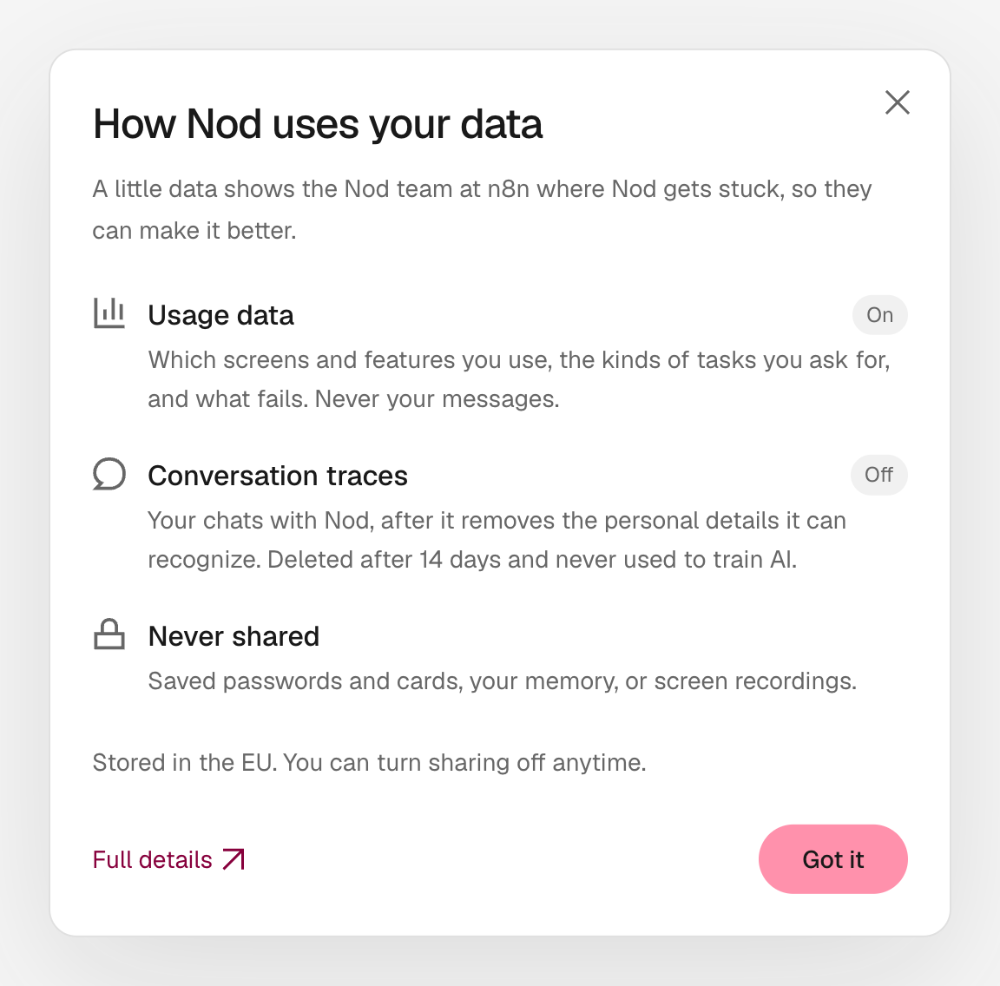

Nod keeps your data on your computer, or on your server if you self-host. This page shows what Nod sends to n8n and other services, and how to delete your data.

## What Nod shares with n8n

Nod can share two kinds of data with the Nod team at n8n. Both help the team find where Nod gets stuck.

- **Usage data** is on by default. It records the screens and features you use, and your onboarding and survey answers. Onboarding answers are your fixed About you choices, never what you type under **Something else**. They also appear on an installation profile so the team can filter events by those answers. It excludes your messages to Nod and Nod's replies. If you give your email in onboarding and tick its consent box, it is linked to the same profile.
- **Conversation traces** are off by default. They include the conversation, with personal details removed on your computer first.

### Example: one request

Say your name is Marta Puig, and you send Nod this message:

> Reply to Jordi's email about invoice 2026-114. Say I paid it today and he can call me on 612 345 678.

Nod reads Jordi's email in Gmail and sends your reply. Here's what n8n receives.

**Usage data** is a list of events with counts, timings, and costs. No event contains your message, Jordi's email, or the reply:

```text title="Usage data (shortened)"
turn_started      channel: web, work_type: immediate, owner_requested: true
tool_used         tool: apps, outcome: succeeded, duration_ms: 1840
service_used      app: gmail, connection_method: managed_app, outcome: succeeded
model_used        provider: anthropic, model: claude-sonnet-5-5,
                  input_tokens: 5210, output_tokens: 180, cost_usd: 0.02
turn_completed    outcome: succeeded, duration_ms: 9800
task_classified   task_type: communication
```

Each event also carries a random installation ID and the app version. The task label comes from a small model on your own model connection. Only the label, here `communication`, reaches n8n. When you submit About you while sharing usage, Nod stores its fixed choices on a PostHog person profile under the installation ID. The team can filter later events by those choices and use PostHog's current person properties to filter earlier events. If you give your email in onboarding and tick its consent box, the address joins that profile.

**A conversation trace** includes the conversation. Nod replaces the personal details it recognizes before the trace leaves your computer. This is the scrubber's real output for this request:

```text title="Conversation trace"
You:    Reply to Jordi's email about invoice 2026-114. Say I paid it today
        and he can call me on [phone].

Gmail:  From: [name] <[email]>
        Hi [owner], invoice 2026-114 is still open. Please pay to [iban].

Nod:    Sends to [email]:
        Hi Jordi, I paid invoice 2026-114 today. Call me on [phone] if
        anything is missing. [owner]
```

The trace also includes Nod's instructions, the model name, token counts, and cost. Its ID changes every day and whenever Nod restarts.

"Jordi" is still there. Nod spots details by their shape, such as email addresses, phone numbers, and bank accounts. It also knows your name from your connected accounts. It can't spot every name in a sentence, so traces are pseudonymised, not anonymous.

### What each switch shares

|            | Usage data                                                                                                                                                                                                              |
| ---------- | ----------------------------------------------------------------------------------------------------------------------------------------------------------------------------------------------------------------------- |
| Default    | On                                                                                                                                                                                                                      |
| Includes   | Screens and features you use, kinds of tasks, timings, costs, failures, basic device details such as browser, OS, screen and viewport size, pseudonymous session and window IDs, and your onboarding and survey answers |
| Excludes   | Your messages to Nod, Nod's replies, what Nod reads, saved passwords and cards, and screen recordings or session replays. Survey answers may contain personal details because Nod sends them as typed                   |
| Your email | If you give it in onboarding, it is linked to your usage data so that n8n can email you about Nod and other n8n products. Withdraw via the unsubscribe link in every email or at privacy@n8n.io.                        |
| Stored in  | n8n's PostHog project in the EU                                                                                                                                                                                         |
| Switch     | **Share usage data**                                                                                                                                                                                                    |
| Details    | [Analytics](/deploy/analytics/)                                                                                                                                                                                         |

|                | Conversation traces                                                                                     |
| -------------- | ------------------------------------------------------------------------------------------------------- |
| Default        | Off                                                                                                     |
| Includes       | Your conversations with Nod, including what it reads and does, minus the personal details it recognizes |
| Never includes | Passwords, cards, your saved memory, images, or account and device IDs                                  |
| Stored in      | n8n's LangSmith project in the EU for 14 days. Never used to train AI models.                           |
| Switch         | **Share conversation traces**                                                                           |
| Details        | [Conversation traces](/trust/conversation-traces/)                                                      |

Both switches are in **Settings → Privacy & data**. Turning one off stops new sends at once. It does not delete data already sent, including About you answers and a consented email. To request deletion, use **Send feedback**. A server operator can turn either switch off for everyone.

Select **How Nod uses your data** next to the **Privacy & data** heading to see this summary in Nod.



## Where your data lives

|                 | Desktop app                                                                                                                | Source install                     | Self-hosted server                 |
| --------------- | -------------------------------------------------------------------------------------------------------------------------- | ---------------------------------- | ---------------------------------- |
| Runs on         | A private virtual machine on your computer                                                                                 | Docker containers on your computer | Your server                        |
| Data folder     | Mac: `~/Library/Application Support/nod/` and `~/.nod-desktop/`. Windows: `%APPDATA%\nod\` and the `nod-` WSL distribution | `.local/` and Docker volumes       | Docker volumes and its `.env` file |
| Who can read it | You                                                                                                                        | You                                | Anyone who administers the server  |

For what Nod stores and for how long, see the [Security review guide](/trust/security-review/#what-nod-stores).

## What Nod sends to other services

| Service                             | What it receives                                                                                                                                                                                                                                                                |
| ----------------------------------- | ------------------------------------------------------------------------------------------------------------------------------------------------------------------------------------------------------------------------------------------------------------------------------- |
| Your model services                 | Your conversation, what Nod reads for you, and screenshots. Image reading and [trust checks](/connect/models/#decision-checks) can use another service you connected.                                                                                                           |
| Decision services, if you add them  | Each action Nod checks, with your messages and rules                                                                                                                                                                                                                            |
| The apps you connect                | The actions Nod runs in them                                                                                                                                                                                                                                                    |
| Composio and the connection service | Your app connections and the actions Nod sends. n8n hosts the [default service](/deploy/configuration/#apps-and-composio).                                                                                                                                                      |
| Telegram and WhatsApp               | The messages in those chats                                                                                                                                                                                                                                                     |
| Websites                            | What Nod browses, fills in, or submits. Nod also fetches the icons of your apps and logins.                                                                                                                                                                                     |
| Exa                                 | Web searches. With a ChatGPT plan, OpenAI searches instead.                                                                                                                                                                                                                     |
| Your voice service                  | [Voice messages](/use/channels/#files-and-voice-messages) you send, and the text of voice replies                                                                                                                                                                               |
| n8n                                 | Desktop update checks, which show your IP address, app version, and platform. Usage data, traces, and feedback, if you allow them. An email you give in onboarding with its consent box ticked is linked to your usage data in n8n's PostHog project while usage sharing is on. |

Your model keys stay encrypted on your installation. They never enter a prompt, Nod's workspace, or its browser.

## Feedback

**Send feedback** goes to the recipient the dialog names, which is the Nod team at n8n by default. It includes a diagnostic report unless you untick it. The report can include recent messages and tool results, with known secrets and recognized personal details masked. Select **Review** to check it before you send. On desktop, the draft also includes a screenshot of the Nod window, which you can remove.

See [Report contents and limits](/deploy/troubleshooting/#report-contents-and-limits).

## Email updates

The last onboarding step lets you leave your email address for updates about Nod and other n8n products. Its consent checkbox starts unchecked. Ticking it means you agree that n8n GmbH links your email to your Nod usage data and emails you about Nod and other n8n products, including invitations to research. A line under the box says how to withdraw. Nod sends the address only when you enter it, tick that box, and select **Start chatting**, or **Continue** in the desktop app, while **Share usage data** is on. It stores the address as the `email` property on this installation's PostHog person profile, with a consent flag, time and version, and the exact checkbox wording and privacy policy link you agreed to. This checkbox controls the email, not the fixed About you answers. Ordinary events do not carry the address. If you leave the address blank or sharing is off, Nod does not send it.

Submitting the form sends no email immediately. You can withdraw your consent at any time, with effect for the future, through the unsubscribe link in every email or at privacy@n8n.io. Turning off **Share usage data** stops new analytics and profile updates; it does not delete data already in PostHog. To remove stored answers or contact data, request deletion through **Send feedback** or at privacy@n8n.io. See n8n's [privacy policy](https://n8n.io/legal/privacy/).

## What memory learns from

Memory notes come only from your own messages, your answers in setup's About you step, and the notes you add. Nod never learns them from its replies, websites, or app data. When you connect Gmail, Nod also reads your recent sent email to learn your writing style, without facts or names. See [Memory](/use/memory/).

## Delete your data

- **A memory:** open **Settings → Memory**, select the note, and choose **Forget**. You can also ask Nod to forget something.
- **A Vault item:** open it in **Vault** and delete it. For a saved browser session, select **Sign out**.
- **An app:** disconnect it in **Apps**.
- **Everything in the desktop app:** select **Remove all data** in **Settings → Privacy & data**. Nod deletes your profile, its private computer, and unsent drafts, then opens setup again. The app stays installed, and no server data is deleted.
- **A source install or server:** stop it, then remove its data folder and Docker volumes. See [Server operations](/deploy/server-operations/).

Uninstalling the desktop app keeps its data. A connected service may still list Nod until you remove it there. To remove n8n's connection service records, use **Send feedback**.

:::caution
You can't clear only your chat history yet. **Remove all data** deletes it along with everything else.
:::

## Where this is enforced

[`src/server/traces.ts`](https://github.com/n8n-io/nod/blob/main/src/server/traces.ts) and [`src/server/personal-data.ts`](https://github.com/n8n-io/nod/blob/main/src/server/personal-data.ts) (traces) · [`src/server/analytics.ts`](https://github.com/n8n-io/nod/blob/main/src/server/analytics.ts) (usage data) · [`src/server/memory-learning.ts`](https://github.com/n8n-io/nod/blob/main/src/server/memory-learning.ts) (memory) · [`src/server/feedback-redaction.ts`](https://github.com/n8n-io/nod/blob/main/src/server/feedback-redaction.ts) (feedback reports)

## Related resources

- [Trust and Vault](/trust/)
- [Conversation traces](/trust/conversation-traces/)
- [Security review guide](/trust/security-review/)
- [Security model and limits](/trust/security-model/)
- [n8n privacy policy](https://n8n.io/legal/privacy/)
- [Nod Terms of Use](https://n8n.io/legal/nod-terms-of-use/)
