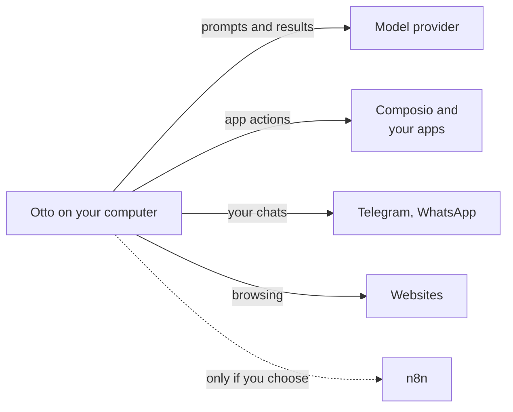

This page explains where Otto keeps your data, what leaves your computer and to whom, and how to delete it.

The short version: in the desktop app and a source install, everything Otto stores stays on your computer. Requests go to the model provider and apps you choose. The Otto team at n8n receives none of your data unless you send feedback or opt in to usage analytics.

## Where your data lives

|                              | Desktop app                                                                                                                          | From source                                     | Hosted                                    |
| ---------------------------- | ------------------------------------------------------------------------------------------------------------------------------------ | ----------------------------------------------- | ----------------------------------------- |
| Otto server                  | Your computer                                                                                                                        | Your computer                                   | The operator's infrastructure             |
| Database, workspace, browser | A private virtual machine on your computer                                                                                           | Docker containers on your computer              | A separate runtime and storage per user   |
| Data folder                  | `~/Library/Application Support/Otto/` and `~/.otto-desktop/` on a Mac. `%APPDATA%\Otto\` and the `Otto-` WSL distribution on Windows | `.local/` (`OTTO_DATA_ROOT`) and Docker volumes | The operator's database and storage       |
| Who can read it              | You                                                                                                                                  | You                                             | You, and the operator, who holds the keys |

For what Otto stores and how long it keeps it, see the [Security review guide](/trust/security-review/#what-otto-stores).

## What leaves your computer

| Goes to                                   | What                                                        |
| ----------------------------------------- | ----------------------------------------------------------- |
| The model provider you choose             | Your conversation, tool results and screenshots Otto takes  |
| Apps and services you connect             | The actions Otto runs in them                               |
| Composio, if you connect apps through it  | Those app connections and the actions Otto sends            |
| Telegram and WhatsApp, if you set them up | The messages in those chats                                 |
| Websites Otto visits                      | Whatever Otto browses, fills in or submits there            |
| n8n                                       | Feedback you send, and masked usage analytics if you opt in |

Provider keys, such as your model and Composio keys, stay in the Otto server. They never enter a prompt, Otto's workspace or its browser.

## Usage analytics

Usage analytics are off until you turn on **Share usage data** in onboarding or in **Settings**. They record which screens you open, how you move through them, and product events such as a task starting or a setting changing.

Analytics never include your messages, anything you type, Vault values, sign-in or model-key forms, the remote browser view, images, real page addresses, names or email addresses. See [Analytics](/deploy/analytics/) for the full list and the switch that turns them off for a whole installation.

## Feedback

Feedback you send goes to the Otto team at n8n. By default it includes a diagnostic report of your recent chat, actions and their results. Select **Review** to read the report first, or untick **Include diagnostic report** to leave it out. Otto removes known secret values from the report before you see it.

## What memory learns from

Otto learns only from your own short messages, never from its replies, tool results or web pages. When you connect Gmail, it also learns your writing style from your own sent email, with no facts, names or quotes. See [Memory](/use/memory/).

## Delete your data

- **Memories.** Open **Settings → Memory**, select a note and choose **Forget**. This deletes the note and its earlier versions. You can also ask Otto to forget something.
- **Vault items.** Open the item in **Vault → Saved** and delete it. For a saved browser session, select **Sign out**.
- **Apps.** Disconnect an app in **Apps**.
- **Everything.** Quit Otto and delete its data folders from the table above. Uninstalling the app alone keeps your data. In hosted mode, ask your operator.

:::caution
Released builds don't have a button to clear your chat history yet. To remove it, delete Otto's data folders.
:::

## Where this is enforced

[`src/server/memory-learning.ts`](https://github.com/n8n-io/otto/blob/main/src/server/memory-learning.ts) (memory sources) · [`src/shared/analytics.ts`](https://github.com/n8n-io/otto/blob/main/src/shared/analytics.ts) (analytics) · [`src/server/bug-report.ts`](https://github.com/n8n-io/otto/blob/main/src/server/bug-report.ts) (report redaction)

## Related resources

- [Trust and Vault](/trust/)
- [Security review guide](/trust/security-review/)
- [Security model and limits](/trust/security-model/)
- [Memory](/use/memory/)
